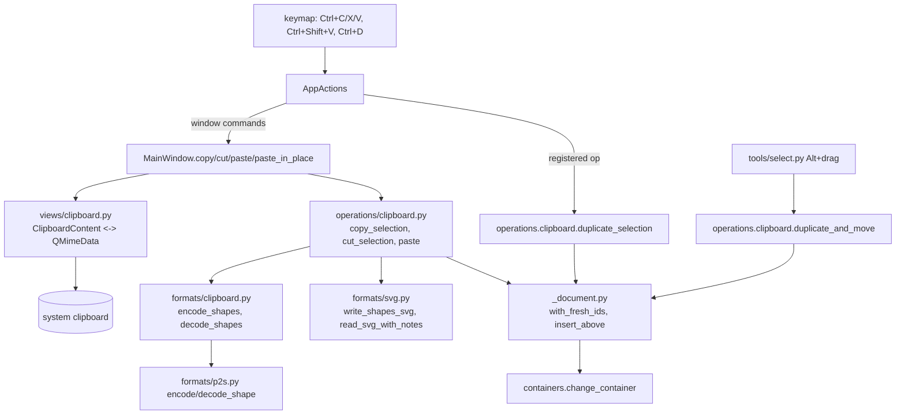

# Design Document

## Overview

Clipboard and duplicate are built from three pieces:

1. **A shape codec for the clipboard** in `formats/`: a small JSON envelope around the existing `.p2s` shape encoders and decoders, plus an SVG writer for a list of shapes. Formats stay Qt-free and unaware of the session.
2. **Operations** in `editing/operations/clipboard.py`: copy and cut return plain clipboard content, paste takes it, and duplicate is a registered operation. One helper hands out fresh ids to copied shapes, including Composite parts. Everything goes through `editing/containers.py`, so it works the same on layers and inside an entered Composite.
3. **Qt glue** in `views/`: a thin `views/clipboard.py` turns content into `QMimeData` and back, and `MainWindow` runs Cut/Copy/Paste/Paste in Place as window commands, because they need the system clipboard (and Paste the view center).

Alt+drag to duplicate is a variant of the Select tool's move gesture. The preview draws the moved copies on top through the gesture matrix and leaves the originals and the recorded document picture untouched; release commits through one operation.

## Steering Document Alignment

### Technical Standards (tech.md)
- **State:** operations change `AppState` inside `session.edit(label)`; views never touch state. The clipboard is not app state: it lives in the system clipboard and only views talk to it.
- **No Qt below `views/`:** the codec and operations work with `bytes` / `str`, so everything except the `QMimeData` mapping is unit-tested headless.
- **Layer rules:** `formats/clipboard.py` uses models and geometry only, as `p2s.py` does. Bounds that need text outlines are computed in `editing` (which may use `render`) and passed into the SVG writer.
- **Frozen shapes:** copies are made with `dataclasses.replace`; ids are the only thing that changes when a shape is copied.
- **Security:** clipboard input is treated like an opened file: size limits, validated decoders, the same SVG reader.

### Project Structure (structure.md)
- New: `formats/clipboard.py`, `editing/operations/clipboard.py`, `views/clipboard.py`.
- Changed: `formats/svg.py` (shape-list writer), `editing/operations/_document.py` (fresh ids, insertion helper), `tools/select.py` (Alt+drag), `tools/base.py` (`CursorType.DUPLICATE`), `render/overlay.py` + `render/picture.py` (copy preview), `views/keymap.py`, `views/main_window.py`, `views/actions.py`, `views/cursors.py`.
- Tests mirror the layout: `tests/formats/test_clipboard.py`, `tests/editing/test_clipboard.py`, `tests/tools/test_select.py` (Alt+drag), `tests/render/test_picture.py` (copy preview).

## Code Reuse Analysis

### Existing Components to Leverage
- **`formats.p2s.encode_shape` / `decode_shape`:** the clipboard's native payload is a list of encoded shapes, so every shape type the native format knows is copyable, with the same validation and limits.
- **`formats.p2s_migrations.CURRENT_VERSION`:** stamped into the clipboard envelope. A different version (another PressToShape build) falls back to the SVG flavor, which is always present.
- **`formats.svg._shape_element`, `read_svg_with_notes`:** SVG out and in. Composites already carry their parts in SVG metadata, so even the SVG flavor round-trips Composites between PressToShape instances.
- **`editing.containers.change_container`, `edited_composite`, `with_parts`:** inserting pasted and duplicated shapes into a layer or an entered Composite, with part modes.
- **`editing.operations._document.new_id`, `remove_shapes`, `prune_selection`:** ids, Cut's removal, selection cleanup.
- **`editing.operations.selection.delete_selection`:** Cut reuses its body (including closing an emptied Composite), factored into a helper that takes the undo label.
- **`editing.operations.paths._to_path`:** text pasted into an entered Composite becomes a path, since text can't be a part.
- **`geometry.transforms.translate`:** placing pasted shapes and committing Alt+drag.
- **`render.paths.PathCache.geometry_bounds`:** bounds of pasted shapes (text included) for centering and for the SVG `viewBox`.
- **`tools.select.SelectTool` MOVE mode, `render.overlay.Overlay.matrix`:** Alt+drag reuses the move gesture and matrix preview.
- **`views.keymap` / `views.actions`:** bindings, menus and actions as for every other command.

### Integration Points
- **System clipboard (`QGuiApplication.clipboard()`):** written on Copy/Cut, read on Paste, watched through `dataChanged` to enable Paste.
- **`CanvasView.view_center()`:** where Paste centers the shapes.
- **Undo history:** Cut, Paste, Paste in Place and Duplicate are each one `session.edit` step.

## Architecture



## Components and Interfaces

### `formats/clipboard.py` (new)
- **Purpose:** the native clipboard payload: a versioned JSON list of shapes.
- **Interfaces:**
  ```python
  MIME_TYPE = "application/x-presstoshape-shapes"

  def encode_shapes(shapes: Sequence[Shape]) -> bytes
      # {"format": "presstoshape-shapes", "version": CURRENT_VERSION, "shapes": [encode_shape(...), ...]}, UTF-8

  def decode_shapes(data: bytes) -> list[Shape]
      # Raises ClipboardError (a P2sError) on: over the size limit, bad JSON, wrong format marker,
      # other version, empty list, any shape decode error. Ids are kept as stored; callers renumber.
  ```
- **Dependencies:** `formats.p2s` (codecs, readers, limits), `formats.p2s_migrations.CURRENT_VERSION`.
- **Reuses:** the `.p2s` JSON reading rules (no NaN/Infinity constants, size limit equal to the document limit).
- Not migrated: the clipboard is short-lived, so a version mismatch is not an error for the user; paste just uses the SVG flavor.

### `formats/svg.py` (extended)
- **New interface:**
  ```python
  def write_shapes_svg(shapes: Sequence[Shape], bounds: Rect) -> str
      # A standalone SVG whose viewBox is `bounds` (doc coordinates), width/height = bounds size,
      # shapes written exactly as write_svg writes them (no layer group).
  ```
- `write_svg` and the new function share `_shape_element`. Keeping doc coordinates in the `viewBox` (instead of moving the shapes to 0,0) means Paste in Place of that SVG lands where the shapes were copied from (Req 4.2), and other apps still see a tight drawing.
- Reading clipboard SVG uses the existing `read_svg_with_notes`: shapes of all layers are flattened in document order by the paste operation.

### `editing/operations/_document.py` (extended)
- **New interfaces:**
  ```python
  def with_fresh_ids(state: AppState, shapes: Sequence[Shape]) -> list[Shape]
      # Same shapes, each (and every Composite part, recursively) with a new id from new_id().

  def insert_above(state: AppState, new_shapes: Sequence[Shape], anchor_ids: set[int] | None,
                   modes: Mapping[int, PartMode] | None = None) -> None
      # Inserts into the active container: directly above the topmost shape in `anchor_ids`, or on top when
      # None. Outside edit mode with anchor None the target is the active layer, hidden or not.
  ```
- One place renumbers ids, so groups and symbols can reuse it later.

### `editing/operations/clipboard.py` (new)
- **Purpose:** the clipboard and duplicate operations.
- **Interfaces:**
  ```python
  @dataclass(frozen=True)
  class ClipboardContent:
      native: bytes        # formats.clipboard payload
      svg: str             # write_shapes_svg

  def copy_selection(session) -> ClipboardContent | None
      # None when nothing is selected. Status "Copied N object(s)"; notify; no edit, not dirty.
  def cut_selection(session) -> ClipboardContent | None
      # copy_selection + delete in one edit "Cut".

  def paste(session, native: bytes | None, svg: str | None, center: Point | None) -> bool
      # center=None: Paste in Place (label "Paste in Place"); else move the shapes' bounds center to `center`
      # (label "Paste"). Tries native first, then svg; False + status "Nothing to paste" if neither decodes.

  @operation("edit.duplicate", "D&uplicate", can_run=has selection)
  def duplicate_selection(session) -> None
      # edit "Duplicate": copies of the selection above the topmost selected shape, selected. Clipboard untouched.

  def duplicate_and_move(session, dx: float, dy: float) -> None
      # Alt+drag commit: duplicate + translate copies in one edit "Duplicate".
  ```
- **Selected shapes:** `queries.selected_shapes` in paint order (bottom to top) — under the Node tool too, so Copy takes whole shapes (Req 1.6).
- **Paste flow:**
  1. Decode: `decode_shapes(native)`; on `P2sError` or no native, `read_svg_with_notes(svg)` with all layers' shapes in order. Parse failures are caught here (external boundary) and end in "Nothing to paste".
  2. If an entered Composite is the target: text shapes become paths (`_to_path`), noted in the status.
  3. Place: with a center, translate all shapes by `center - bounds_center`, where bounds come from a throwaway `PathCache` (`geometry_bounds`, union over the shapes).
  4. `with session.edit(label)`: `with_fresh_ids`, `insert_above(..., anchor_ids=None)`, selection = new top-level ids, node selection cleared, status "Pasted N object(s)" plus "(layer 'X' is hidden)" / SVG notes.
- **Duplicate flow:** in one edit, for the selection in paint order, `with_fresh_ids`, `insert_above(copies, anchor_ids=selection, modes=same modes as originals)`; selection = copies. Inside a Composite the copies keep their originals' part modes (Req 5.6).
- **Copy SVG bounds:** union of `geometry_bounds` of the copied shapes; a zero-size union (e.g. a single horizontal line) is padded to 1 unit so the `viewBox` stays valid.

### `editing/operations/selection.py` (refactor)
- `delete_selection`'s shape-removal body moves to `_delete_selected(state, label)` so Cut uses the same rules (including removing a Composite whose last part was cut and closing its edit mode).

### `tools/select.py` (extended)
- **Alt+drag:** in `press`, when the press starts a MOVE and `mods.alt` is held, the tool sets `self._duplicating = True`. Selection rules on press stay as without Alt (Req 6.1). Alt on handles is checked first, so it keeps meaning "scale from center" (Req 6.5).
- `move` is unchanged (same translation matrix). Shift behaves as for a plain move: today a move has no Shift constraint, so neither does Alt+drag; an axis constraint for both would be a separate change.
- `release`: if duplicating and the translation is non-zero, call `clipboard.duplicate_and_move(session, dx, dy)`; a zero translation (press and release on the same point) does nothing (Req 6.4).
- Cursor: `CursorType.DUPLICATE` while duplicating.
- `overlay`: while duplicating, `Overlay(selection, copies=tuple(moving shapes), matrix=..., frame=frame.transformed(matrix))` with `moving` empty, so the document picture stays as recorded and the originals stay visible.

### `render/overlay.py` + `render/picture.py` (extended)
- `Overlay.copies: tuple[Shape, ...] = ()` — shapes to draw again through `matrix` on top of the document.
- `DocumentPicture.draw_copies(canvas, copies, matrix)` records the copies into one `skia.Picture` keyed by the `copies` tuple (recorded once per gesture) and draws it under `matrix`. `CanvasView._paint` calls it after the document picture. Cost per frame stays one `drawPicture`, as for a normal move.

### `tools/base.py`, `views/cursors.py`
- `CursorType.DUPLICATE`, mapped to `Qt.CursorShape.DragCopyCursor`.

### `views/clipboard.py` (new)
- **Purpose:** the only code that touches `QClipboard` / `QMimeData`.
- **Interfaces:**
  ```python
  SVG_TYPES = ("image/svg+xml", "image/x-inkscape-svg")

  def put(content: ClipboardContent) -> None
      # native under formats.clipboard.MIME_TYPE, SVG under both SVG_TYPES, and the SVG as text/plain
      # (text editors; Inkscape does the same).
  def read() -> tuple[bytes | None, str | None]
      # (native, svg). svg comes from an SVG type, else from text/plain if it looks like an SVG document
      # (starts with "<svg" or "<?xml" and contains "<svg"). Oversized data is ignored.
  def can_paste() -> bool
      # Checks offered formats only (native, SVG types, or text), never parses (Req NFR performance).
  ```

### `views/keymap.py`, `views/actions.py`, `views/main_window.py`
- `WINDOW_COMMANDS` gains `edit.cut` ("Cu&t"), `edit.copy` ("&Copy"), `edit.paste` ("&Paste"), `edit.paste_in_place` ("Paste in Pl&ace").
- `KEYMAP`: `edit.cut` → `Keys.Cut`, `edit.copy` → `Keys.Copy`, `edit.paste` → `Keys.Paste` (standard keys expand to Ctrl+X/Shift+Del, Ctrl+C/Ctrl+Ins, Ctrl+V/Shift+Ins per platform), `edit.paste_in_place` → `"Ctrl+Shift+V"`, `edit.duplicate` → `"Ctrl+D"`.
- Edit menu: `edit.undo, edit.redo, None, edit.cut, edit.copy, edit.paste, edit.paste_in_place, edit.duplicate, edit.delete, None, edit.select_all`. No toolbar icons (Req 7.4: the main toolbar has no room that fits).
- `AppActions` gains `set_enabled(command_id, enabled)` for window commands. `MainWindow.refresh` enables Cut/Copy from `state.selection`, Paste/Paste in Place from `clipboard.can_paste()`; `QClipboard.dataChanged` re-runs that check (disconnected in `closeEvent`, per the lifetime rule).
- `MainWindow.copy/cut` call the operation and `clipboard.put` the result; `paste` / `paste_in_place` call `clipboard.read()` and `clipboard_ops.paste(session, native, svg, center)` with `center = self.canvas.view_center()` for Paste and `None` for Paste in Place.
- **Text fields keep their shortcuts (Req 7.3):** `QLineEdit` / spin boxes accept `ShortcutOverride` for the standard copy/cut/paste keys, so window-level actions don't fire while they have focus. Ctrl+D and Ctrl+Shift+V are not overridden by line edits; Ctrl+D is harmless there (selection-based), and Ctrl+Shift+V pasting shapes while a field has focus is accepted. Checked in the interaction test.

## Data Models

### Clipboard payload (`application/x-presstoshape-shapes`)
```json
{
  "format": "presstoshape-shapes",
  "version": 1,
  "shapes": [ { "type": "rect", "id": 7, "x": 10, "...": "same objects as in .p2s document layers" } ]
}
```
- `version` is `p2s_migrations.CURRENT_VERSION`; only an exact match is decoded.
- Shapes are listed bottom to top. Ids are the source ids and are replaced on paste.
- Not a file format: it is not documented in `docs/file-format.md` and needs no migrations or samples.

### `Overlay` addition
```python
copies: tuple[Shape, ...] = ()   # drawn again through `matrix`, on top; originals stay in place
```

## Error Handling

### Error Scenarios
1. **Clipboard has no pasteable data** (empty, image only, plain text that isn't SVG).
   - **Handling:** `read()` returns `(None, None)`; `paste` returns False.
   - **User Impact:** status "Nothing to paste"; document unchanged, no undo step.
2. **Broken or hostile native payload** (bad JSON, unknown type, huge numbers, oversized).
   - **Handling:** `decode_shapes` raises `ClipboardError`; paste falls back to the SVG flavor, then to scenario 1.
   - **User Impact:** paste still works from SVG when possible; otherwise "Nothing to paste".
3. **Broken SVG** (malformed XML, not an `<svg>` root).
   - **Handling:** `ET.ParseError` / `ValueError` caught in `paste`.
   - **User Impact:** "Nothing to paste: the clipboard's SVG couldn't be read".
4. **SVG with unsupported elements** (images, gradients-only, `<use>`).
   - **Handling:** reader notes as on open; supported shapes paste.
   - **User Impact:** status lists the notes; if nothing is left, scenario 1.
5. **Active layer is hidden.**
   - **Handling:** paste goes there anyway (Req 3.10).
   - **User Impact:** "Pasted 2 object(s) into hidden layer 'Sketch'".
6. **Text pasted into an entered Composite.**
   - **Handling:** converted to a path as Object to Path would.
   - **User Impact:** "Pasted 1 object(s); text became a path inside the Composite".
7. **Clipboard owned by another app that died / slow clipboard manager.**
   - **Handling:** Qt returns empty mime data; scenario 1. No timeouts of our own.

## Testing Strategy

### Unit Testing
- `tests/formats/test_clipboard.py`: encode/decode round trip of every shape type, nested Composites, rotated text, no-fill/no-stroke styles; rejects wrong marker, other version, empty list, oversized and malformed data with `ClipboardError`.
- `tests/formats/test_svg.py`: `write_shapes_svg` sets the `viewBox` to the bounds; reading it back gives the same shapes in the same coordinates (as the save/open round trip).
- `tests/editing/test_clipboard.py`:
  - copy doesn't change document, selection, undo or dirty; returns content for the selection in paint order;
  - cut removes, is one undo step, undo restores; cutting the last part of an entered Composite closes it;
  - paste centers on the given point, paste in place keeps coordinates; new unique ids also inside Composites; twice pasted → no duplicate ids; on top of the active layer; selection = pasted; one undo step; dirty;
  - native preferred over SVG; SVG fallback when native is broken or another version; foreign SVG with layers and groups flattened in order; nothing pasteable → status, no undo step;
  - paste into hidden layer; paste into entered Composite with new-part mode, text becomes path;
  - duplicate: same place, directly above the topmost selected, order kept, part modes kept, clipboard untouched;
  - `duplicate_and_move`: one undo step, copies moved, originals unchanged.
- `tests/tools/test_select.py` (`ToolDriver`): Alt+drag duplicates and moves; Alt click without movement does nothing; Alt on a handle still scales from center; overlay has `copies` and no `moving` while duplicating; cursor `DUPLICATE`.
- `tests/render/test_picture.py`: copies are drawn through the matrix on top while the originals stay (CPU surface pixel check).

### Integration Testing
- `tests/views/test_clipboard.py` (offscreen `QApplication`): `put` then `read` returns the same content; plain-text SVG is accepted, plain non-SVG text is not; `can_paste` follows the offered formats.
- Architecture test stays green (no Qt below `views/`, `formats` imports only models + geometry).

### End-to-End Testing
- Scratch interaction script with `QTest` on the real window, offscreen and on the desktop (GL): Ctrl+C / Ctrl+V / Ctrl+Shift+V / Ctrl+D / Ctrl+X on the canvas; Ctrl+C inside the layer-rename editor copies text, not shapes; Alt+drag on a shape.
- Manual interop check: copy in PressToShape → paste in Inkscape, and back; paste into a text editor shows SVG. Note for the check: some Linux desktops bind Alt+drag to window moving (Xfce, older setups), which eats the gesture before the app sees it; KDE Plasma 6 and GNOME use Meta/Super by default.
