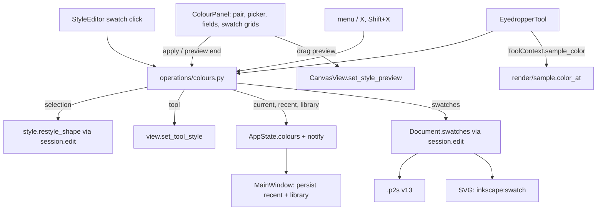

# Design Document

## Overview

A new right-hand dock, **Colour**, holds a fill/stroke pair, an HSV picker, number/hex/alpha fields, recent colours and two swatch groups (Document, Library). All of it reads from `AppState` and changes it through a new operations module, `editing/operations/colours.py`; the panel itself only keeps widget state (the HSV triple being dragged). The panel's **target** (selection, tool default style, or a loose current colour) is one query, so every colour source (picker, swatch, recent, eyedropper, menu command) goes through the same "apply to the active paint of the target" operation.

Document swatches are a tuple on `Document` (undoable, `.p2s` version 13, Inkscape swatches in SVG). Recent colours and the personal library are app-level `AppState` fields that `MainWindow` loads at start and writes back when they change, the way rulers and snapping are remembered today. The Eyedropper is a normal `BaseTool`; pixel sampling is a Qt-free render function the canvas hands to tools through `ToolContext`.

Dragging in the picker can't be a document edit per mouse move: restyling 100 shapes takes ~1 ms, but the canvas then re-records its picture of the 10k-shape benchmark document, measured at ~57 ms (CPU raster). So drags are **previewed** the way node drags are: the canvas draws the selected shapes as `Overlay.moving` + `live` replacements, and release commits one undo step.

## Steering Document Alignment

### Technical Standards (tech.md)
- Frozen data, `dataclasses.replace`; operations as plain functions, document edits inside one `session.edit`, view-state changes mutate + `notify()`.
- No Qt below `views/`: colour math, `.gpl` and library files, sampling and the eyedropper are Qt-free and unit-tested.
- `.p2s` change follows the format rule (version bump, migration, sample, docs row); explicit encoders/decoders.
- Translations: every text through `_()` / `N_()`, British English source ("Colour").

### Project Structure (structure.md)
- `models/colours.py` (new): `Swatch`, `ColourState`, `PaintSlot`.
- `models/app_state.py`: `Document.swatches`, `AppState.colours`, `Tool.EYEDROPPER`.
- `geometry/colours.py` (new): hex/RGB/HSV conversions, hex input parsing, hue-keeping.
- `formats/gpl.py` (new): GIMP palette read/write. `formats/swatch_library.py` (new): library JSON read/write.
- `formats/svg_swatches.py` (new): Inkscape swatch elements (write and read), used by `svg.py` / `svg_reader.py`.
- `formats/p2s.py`, `formats/p2s_migrations.py`: swatches, version 13.
- `render/sample.py` (new): colour of the rendered document at a point. `render/hit_test.py`: `leaf_at`.
- `editing/queries.py`: target and paint queries, document colours. `editing/operations/colours.py` (new).
- `tools/eyedropper.py` (new); `tools/base.py`: `ToolContext.sample_color`, `CursorType.EYEDROPPER`; `tools/registry.py`.
- `views/colour_panel.py`, `views/colour_picker.py`, `views/swatch_grid.py`, `views/paint_pair.py` (new); `views/widgets.py`, `views/style_editor.py`, `views/main_window.py`, `views/canvas_view.py`, `views/keymap.py`, `views/cursors.py`, `views/app_settings.py`, `views/tool_options_view.py`.

## Code Reuse Analysis

### Existing Components to Leverage
- **`style.restyle_shape` / `display_style` / `map_selected`**: how a style change reaches groups (opacity on the group, the rest to children, mask objects untouched) and images (opacity only). Every colour operation on the selection goes through them.
- **`view.set_tool_style`**: the tool-default target.
- **`Overlay.moving` + `Overlay.live`** and `ShapesPicture`: the moving set is recorded once as its own run, live replacements are drawn per frame. That is how scale and node drags stay fluid, and how picker drags will (including inside entered groups, through `live_container`).
- **`Session.edit(label, merge_key)` + `end_merge()`**: number-field steps merge, and a drag or field edit ends the merge so the next one is a new undo step.
- **`MainWindow._remember_view` pattern**: compare a state slice with the last written one, write settings when it changed.
- **`app_settings._data_folder`** (portable aware) and **`documents.write_atomically`** for the library file.
- **`svg_values.parse_color`** (svgelements): SVG colour keywords and `#rgb` in the hex field and in `.gpl` names.
- **`svg_gradients.resolve_gradient`**: reads swatch stops including `href` chains; one-stop gradients already become flat colours on shapes (Req 4.6 needs no change).
- **`PaintDefs`**: id allocation (`new_id`) and the `<defs>` element that swatches join.
- **`_OpacityRow`, `_percent_box`** (style editor): alpha row.
- **Cursor badge pattern** from `views/cursors.py` (pointer arrow + action badge): eyedropper cursor.

### Integration Points
- **Style editor**: `ColorButton` stops opening `QColorDialog`; a click calls back `on_activate("fill" | "stroke")`, and the Select page and drawing-tool pages connect that to `colours.set_active_paint`. Checkbox and opacity box unchanged.
- **Canvas**: gets `set_style_preview(changes | None)` and merges the preview into the tool's overlay while no tool gesture runs.
- **Undo**: `Document.swatches` is a tuple, so `_copy_document` (which copies layer lists) already isolates snapshots.

## Architecture



### Target and active paint (Req 1)

`queries.colour_target(state) -> Literal["selection", "tool", "current", "disabled"]`:
- selection non-empty: `"disabled"` if every selected shape is an `ImageShape`, else `"selection"`;
- else `"tool"` when `state.active_tool in state.tool_styles`;
- else `"current"`.

`queries.target_style(state) -> Style` is what the panel shows: `display_style` of the first selected non-image shape, the tool style, or `state.colours.current`. `queries.target_paint(state, slot) -> Paint | Mixed` additionally reports `MIXED` when selected shapes (via `display_style`) disagree on that slot's paint; opacities show the first shape's value as the style editor does.

`state.colours.active: PaintSlot` (`"fill"` / `"stroke"`) is view state, not saved.

All writes go through one private helper `_restyle(session, label, merge_key, **changes)` that dispatches on the target: `session.edit(label, merge_key)` + `map_selected(restyle_shape)` for the selection, `view.set_tool_style` for the tool, `replace(colours.current, ...)` + `notify()` for current. On top of it:
- `apply_colour(session, color, opacity=None, merge_key=None)`: sets `{slot: color}` and `{slot}_opacity` when given; remembers the colour (Req 3) unless `merge_key` is set (field steps), in which case the panel calls `remember_colour` when the field edit finishes.
- `set_paint_none(session)`, `swap_paints(session)` (both paints and both opacities, label "Swap fill and stroke"), `default_paints(session)` (`Style()` fill, stroke and their opacities, label "Default fill and stroke").
- Registered commands for the menu and keymap: `colour.toggle_active` (X), `colour.swap` (Shift+X), `colour.none`, `colour.default`; `can_run` false for `"disabled"` (and for swap/none/default with nothing to change). Menu: Object → Colour submenu.

### Colour picker and numbers (Req 2)

`geometry/colours.py` (pure):
- `hex_to_rgb`, `rgb_to_hex`, `rgb_to_hsv`, `hsv_to_rgb` (H 0–360, S/V 0–1, floats).
- `parse_hex_input(text) -> str | None`: `#rgb`, `#rrggbb`, with or without `#`, else an SVG keyword through a callback (views pass `svg_values.parse_color`; geometry can't import formats) → `#rrggbb` lower case, or None.
- `hsv_for(color, previous) -> HSV`: the HSV of `color`, keeping `previous` hue when the colour is grey (S = 0) and hue + saturation when it is black (V = 0) (Req 2.5).

`views/colour_picker.py` `ColourPicker(QWidget)`: SV square and hue strip painted with `QLinearGradient`s (square: white→hue horizontally, transparent→black vertically, so no per-pixel loop). It holds the HSV triple as floats; signals `dragged(hsv)` on every move and `released(hsv)` at the end. `set_hsv` doesn't emit.

`ColourPanel` keeps `self._hsv` and only overwrites it when the target's colour is no longer `rgb_to_hex(hsv_to_rgb(self._hsv))` (someone else changed it): then `hsv_for(new, self._hsv)`. So refreshes never move the user's handles, and a colour the user didn't touch is never rewritten (Req 2.6): the panel emits only on user input, and alpha changes send only `{slot}_opacity`.

Number fields: three `QSpinBox`es relabelled H/S/V or R/G/B, with a small toggle button; the mode is `state.colours.numbers` (`"hsv"` / `"rgb"`), persisted by `MainWindow`. Field edits call `apply_colour(..., merge_key="colour.<slot>")`; `editingFinished` calls `session.end_merge()` and `remember_colour`. Hex `QLineEdit` applies on `editingFinished`; invalid input re-shows the current hex.

### Drag preview (Req 1.4, performance)

While the picker or alpha slider is dragged and the target is `"selection"`, the panel emits `preview_changed(changes)` (e.g. `{"fill": "#…", "fill_opacity": 0.8}`); `MainWindow` forwards it to `CanvasView.set_style_preview(changes)`. The canvas computes, per frame:

```python
live = tuple(style.restyle_shape(shape, **changes) for shape in containers.selected_shapes(state))
overlay = replace(tool_overlay, moving=frozenset(ids), live=live)  # only while the tool has no gesture
```

On release the panel calls `set_style_preview(None)` and `apply_colour` once (one undo step, colour remembered). For `"tool"` and `"current"` targets there is no document to redraw, so drags apply directly (cheap; `set_tool_style` notifies). The selection frame and other panels show the committed value; only the canvas previews.

### Recent colours (Req 3)

`state.colours.recent: tuple[str, ...]`; `remember_colour(session, *colors)` puts them first, drops duplicates, keeps 16, notifies. Called by `apply_colour` (non-merging), swatch and recent clicks (both via `apply_colour`), picker release, field `editingFinished`, eyedropper (picked fill and stroke flat colours). Clearing: `clear_recent_colours`. Persisted by `MainWindow` as `colours/recent` (a string list) through `app_settings.recent_colours` / `set_recent_colours`.

### Swatches (Req 4, 5)

Model: `Swatch(id: int, name: str, color: str, opacity: float = 1.0)`, frozen, in `models/colours.py`.

- **Document**: `Document.swatches: tuple[Swatch, ...] = ()`; ids come from `Document.next_id`, the counter shapes and guides use, so a later "global colours" spec can reference them from paints without a new id space (Req 4.8).
- **Library**: `state.colours.library: tuple[Swatch, ...]`, ids local to the library (assigned on load). Library edits mutate + `notify()`, no undo.

One set of operations with a `palette: Literal["document", "library"]` argument, so the panel's two grids share code: `add_swatch(session, palette, color, opacity, name="")`, `rename_swatch`, `replace_swatch`, `delete_swatch`, `move_swatch(session, palette, swatch_id, step)`, `delete_all_swatches`, `copy_swatch(session, from_palette, swatch_id)` (to the other palette, new id, skipped if the same colour + opacity is already there), `import_swatches(session, palette, swatches)` (`.gpl` import, duplicates skipped). Document variants are undo steps ("Add swatch", "Rename swatch", …). `add_document_colours(session)` adds `queries.document_colours(doc)`: distinct flat fill/stroke colours and gradient stop colours of visible shapes in paint order, recursing into groups and Composite parts, minus colours already in the document palette.

Applying a swatch is `apply_colour(session, swatch.color, swatch.opacity)`.

**Library file**: `formats/swatch_library.py` reads/writes `{"version": 1, "swatches": [{"name", "color", "opacity"}]}` (JSON, keeps opacity, which `.gpl` can't). Path: `app_settings.swatch_library_path()` → `_data_folder("swatches.json")`. `MainWindow` loads it at start (unreadable → empty library, file left as is, a status message), and writes it with `write_atomically` when `state.colours.library` changed identity since the last write; only when the app has settings (tests and screenshots don't touch it).

**`.gpl`** (`formats/gpl.py`): `read_gpl(text) -> list[tuple[str, str]]` (name, `#rrggbb`), tolerant of `Name:`/`Columns:` headers, comments, tabs/spaces and missing names; raises `ValueError` without the `GIMP Palette` header. `write_gpl(name, swatches) -> str`. Opacity is dropped on export (GIMP palettes have none) and becomes 1 on import. File dialogs are in `ColourPanel`'s menu.

### Eyedropper (Req 6)

`tools/eyedropper.py` `EyedropperTool(BaseTool)`, cursor `CursorType.EYEDROPPER`, hint text. On `press(point, mods)`:

1. `leaf = hit_test.leaf_at(visible_shapes(doc), cache, point, tolerance)`: the deepest shape under the point, descending into groups (content children, mask objects skipped) but not into Composites (their parts don't draw with their own style); hidden shapes skipped, locked shapes included.
2. If `mods.shift`, or `leaf` is an `ImageShape`: `color = context.sample_color(point)`; if not None → `colours.apply_sampled_colour(session, color)` (= `apply_colour` without opacity).
3. Else if `leaf` is not None: `colours.pick_up_style(session, display_style(leaf))`. With a selection that is `_restyle(**every Style field)` labelled "Pick up style"; text, rectangles and ellipses keep their geometry because only `style` changes. Without a selection (target `"current"`) it puts the style's fill/stroke paints and opacities into `colours.current` and remembers the flat colours.

`render/sample.py` `color_at(doc, cache, point, zoom, references, page_color) -> str | None`: a 1×1 `skia.Surface`, cleared transparent, canvas scaled by `zoom` and translated so `point` lands on the pixel centre; draws the page rectangle in `page_color` and `draw_document` (no overlays, grid or guides), reads the pixel, returns `#rrggbb` (unpremultiplied) or None when fully transparent (empty pasteboard). Same code on GL and raster canvases (Req 6.7). The canvas provides `ToolContext.sample_color = lambda p: sample.color_at(state.document, cache, p, zoom, show_references, _COLORS.artboard)`. One click costs one `draw_document` pass (tens of ms on 10k shapes), acceptable for a click.

Registry: `Tool.EYEDROPPER`, `ToolEntry(Tool.EYEDROPPER, "tool.eyedropper", N_("E&yedropper"), EyedropperTool)` after Text; keymap `Binding("I", icons.TOOL_EYEDROPPER)` (Tabler `color-picker`). Tool options page: the hint text only.

### Files

- **`.p2s` v13**: document field `"swatches": [{"id", "name", "color", "opacity"}]`, omitted when empty; decoder validates `#rrggbb`, opacity via `sanitized` range, ids unique together with shapes and guides and below `next_id`. Migration 12 → 13 is `_unchanged`. Sample `tests/formats/samples/v13.p2s`, row in `docs/file-format.md`.
- **SVG write** (`formats/svg_swatches.py`, called from `write_svg` only, not `write_shapes_svg`, so the clipboard carries no swatches, Req 4.7): per swatch `<linearGradient id="swatchN" inkscape:swatch="solid" inkscape:label="name"><stop offset="0" style="stop-color:#…;stop-opacity:…"/></linearGradient>` in `<defs>`, ids from `PaintDefs.new_id("swatch")`. Unreferenced gradients render nothing, so resvg output is unchanged.
- **SVG read**: `read_swatches(root, ids)` finds `linearGradient` elements with `inkscape:swatch="solid"` or `osb:paint="solid"` (`http://www.openswatchbook.org/uri/2009/osb`), resolves their first stop through `resolve_gradient`'s stop reading, name = `inkscape:label`, else the id. Gradient swatches (`inkscape:swatch="gradient"`) are skipped with an import note. New swatches get document ids.
- **Inkscape check**: during implementation, a saved file is opened in Inkscape (if installed) to confirm the swatches show in its Swatches panel with names; if Inkscape names come from `id` rather than `inkscape:label`, the writer derives the id from the name as well.

### Panel layout (`views/colour_panel.py`)

The pair stays above a `QTabWidget` with three tabs (changed after review: a long palette shouldn't make the dock grow or push the picker away):
1. `PaintPair` (`views/paint_pair.py`, custom-painted): fill square behind/in front of a stroke ring, crossed out for None, gradient strip, "?" for mixed; buttons Swap, None, Default. Always visible.
2. **Colour** tab (scrolls when the dock is short): `ColourPicker`; number row (H/S/V or R/G/B + mode toggle), hex field, alpha row; **Recent** colours (`SwatchGrid`, context menu: Clear Recent Colours).
3. **Document** and **Library** tabs: a `SwatchGrid` (`views/swatch_grid.py`, flow of 18 px squares; click, tooltip "name – #hex", context menu, "+" cell that adds the current colour) scrolling inside the tab, with a `…` menu above it: Add Current Colour, Add Colours Used in Document (document only), Import Palette…, Export Palette…, Delete All Swatches.

`refresh(state)` updates only what changed (compares target style, active slot, recent tuple, swatch tuples by identity) and blocks signals while writing values back. The dock is added on the right above Layers; `resizeDocks` gives it twice the height of Layers by default (4:2:1 with Align).

## Components and Interfaces

### `geometry/colours.py` (new)
- **Purpose:** colour conversions and parsing. **Interfaces:** `hex_to_rgb`, `rgb_to_hex`, `rgb_to_hsv`, `hsv_to_rgb`, `hsv_for`, `parse_hex_input`. **Dependencies:** none. **Reuses:** nothing.

### `editing/operations/colours.py` (new)
- **Purpose:** every colour change. **Interfaces:** `set_active_paint`, `toggle_active_paint`, `apply_colour`, `apply_sampled_colour`, `set_paint_none`, `swap_paints`, `default_paints`, `pick_up_style`, `remember_colour`, `clear_recent_colours`, `set_number_mode`, swatch operations above, `set_library`. **Dependencies:** `style`, `view`, `queries`, `_document.map_selected`.

### `render/sample.py` (new), `render/hit_test.leaf_at`
- **Purpose:** what the eyedropper reads. **Reuses:** `draw_document`, `PathCache`, `_contains`.

### `tools/eyedropper.py` (new)
- **Purpose:** turns clicks into `pick_up_style` / `apply_sampled_colour`. **Dependencies:** `ToolContext.sample_color`, `hit_test.leaf_at`.

### `formats/gpl.py`, `formats/swatch_library.py`, `formats/svg_swatches.py` (new)
- **Purpose:** palette files, library file, SVG swatches. **Reuses:** `svg_values.parse_color`, `svg_gradients`, `PaintDefs`.

### Views (new): `ColourPanel`, `ColourPicker`, `PaintPair`, `SwatchGrid`
- **Purpose:** the dock. **Dependencies:** operations above; `MainWindow` wires `preview_changed` → `CanvasView.set_style_preview` and file dialogs.

## Data Models

```python
# models/colours.py
PaintSlot = Literal["fill", "stroke"]
NumberMode = Literal["hsv", "rgb"]

@dataclass(frozen=True)
class Swatch:
    id: int
    name: str
    color: str          # "#rrggbb"
    opacity: float = 1.0

@dataclass
class ColourState:
    active: PaintSlot = "fill"
    # What the panel edits when nothing is selected and no drawing tool is active; filled by the eyedropper.
    current: Style = field(default_factory=Style)
    recent: tuple[str, ...] = ()
    library: tuple[Swatch, ...] = ()
    numbers: NumberMode = "hsv"

# models/app_state.py
class Document: ...; swatches: tuple[Swatch, ...] = ()
class AppState: ...; colours: ColourState = field(default_factory=ColourState)
class Tool(Enum): ...; EYEDROPPER = auto()
```

## Error Handling

1. **Invalid hex or number input**: re-shows the current value; nothing applied.
2. **Library file unreadable or malformed**: empty library, the file is not overwritten until the user changes the library (then the old file is kept as `swatches.backup.json` via `write_atomically(keep_backup=True)`), status message "Swatch library could not be read".
3. **`.gpl` import fails** (no header, decode error, I/O): message box with the reason; library unchanged. Lines that aren't colours are skipped.
4. **`.p2s` with bad swatch data**: the existing decode error path (file refused with a message), as for other fields.
5. **SVG swatch without a readable stop**: skipped silently, like an empty gradient.
6. **Eyedropper on empty pasteboard** (sample is transparent): nothing happens.

## Testing Strategy

### Unit Testing
- `geometry/colours`: round trips hex↔rgb↔hsv for all 8-bit greys and a grid of colours (no drift: `rgb_to_hex(hsv_to_rgb(rgb_to_hsv(c))) == c`), `hsv_for` keeps hue on grey/black, `parse_hex_input` cases.
- `operations/colours`: each target (selection incl. groups, masked groups, images-only disabled; tool; current), apply with/without merge (undo count), swap/none/default, recent ordering/dedupe/limit, swatch operations on both palettes (undo only for document), `add_document_colours` with gradients and groups, `pick_up_style` keeps geometry and selection.
- `queries`: `colour_target`, `target_paint` mixed detection.
- `formats`: `.gpl` read (GIMP, Inkscape and Krita samples, odd whitespace, no names) and write; library JSON round trip and malformed input; SVG swatches written and read (incl. `osb:paint`, href chains, gradient swatches noted); `.p2s` v13 round trip and v12 → v13 migration via samples.
- `render/sample`: pixel colour over a filled rect, over a semi-transparent shape on the page, empty pasteboard → None; `hit_test.leaf_at` inside groups, locked included, hidden excluded.
- `tools/eyedropper` with `ToolDriver`: click, Shift+click (stub `sample_color`), image click, empty click, nothing-selected path.

### Integration Testing
- Generator check: a document with swatches saves to SVG that resvg renders like the canvas (swatches invisible).
- Style editor: clicking the Fill swatch sets `colours.active` and opens no dialog.
- Translation template updated; `de.po` complete; mnemonics don't clash.

### End-to-End Testing
- Scratch QTest script, offscreen and on the desktop (GL): drag in the picker with 100 of 10k shapes selected (frame times printed, target under 16 ms per preview frame after the first), release gives one undo step; eyedropper click and Shift+click on both renderers.
- Screenshot of the window with the panel at the minimum dock width; read the PNG to check layout in English and German.
