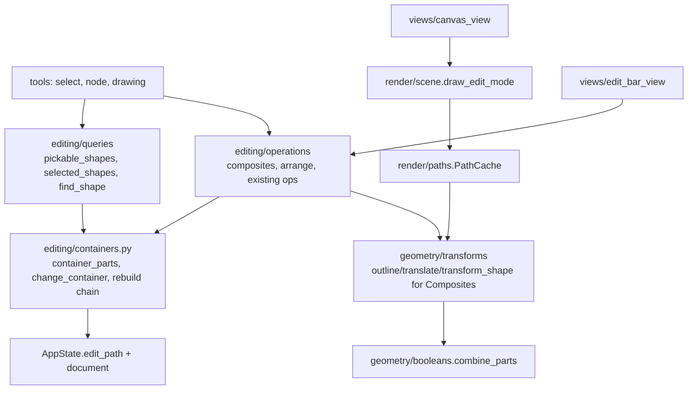

# Design Document

## Overview

A Composite is a new frozen shape type, `CompositeShape`, holding its parts and one mode per part. Its outline is `combine_parts` over the parts' outlines, so everything that already works with outlines works with Composites without changes: rendering, PNG export, hit-testing, bounds, destructive booleans, and use as a part of another Composite.

The real design work is **edit mode**: operations and tools must be able to work on the parts of a Composite exactly as they work on shapes in layers. That rests on two ideas:

1. **The active container.** `AppState.edit_path` lists the ids of the entered Composites, outer to inner, and is empty when no Composite is entered. Every operation and tool sees shapes through a small set of container-aware helpers. With an empty edit path they mean "the visible shapes in the layers", exactly as today. Inside edit mode they mean "the parts of the innermost Composite". Existing commands (move, transform, style, delete, node editing, drawing, booleans, Make Composite) then work on parts without being rewritten.
2. **Rebuilding the chain.** Shapes are frozen, so changing a part creates a new innermost Composite. Each enclosing Composite gets rebuilt with it, up to the top-level one in its layer. One helper does this. Snapshot undo keeps working unchanged, because it already copies layer lists and shares frozen shapes.

Rendering in edit mode is an extra pass on top of the normal frame: dim everything, then draw the edited Composite's live result and its part outlines styled by mode. Tools stay unaware of this.

## Steering Document Alignment

### Technical Standards (tech.md)
- **State:** the edit path and the new-part mode are plain fields in `AppState`, changed only by operations, and they are not part of undo history.
- **Layers:**
  - Geometry (`combine_parts`, outlines, transforms of Composites) stays in `geometry/`.
  - Drawing and picking stay in `render/`, which gets the pickable shapes passed in because it can't import `editing`.
  - Commands live in `editing/operations/composites.py` and `arrange.py`.
  - The edit bar lives in `views/`.
- **Architecture test:** stays green; the layer rules don't change.
- **SVG:** stays the exchange format. A Composite is written as its visible result plus PressToShape data that other tools keep and ignore (principle 4).

### Project Structure (structure.md)
- **New modules:** `editing/containers.py` (active container: read, change, rebuild the chain), `editing/operations/composites.py`, `editing/operations/arrange.py` and `views/edit_bar_view.py`.
- **Tests:** `tests/editing/test_containers.py`, `test_composites.py`, `test_arrange.py`, plus extensions to geometry, render, tools and SVG tests.

## Code Reuse Analysis

### Existing Components to Leverage
- **`geometry.booleans.combine_parts`:** the outline of a Composite.
- **`geometry.transforms.outline / translate / transform_shape`:** extended for Composites, which apply the operation to every part, recursively.
- **`render.paths.PathCache`:** caches the result path per frozen Composite. It already rebuilds only when the shape changes, and equality on frozen nested tuples covers part changes.
- **`render.scene.draw_shape`:** draws a Composite through its default path branch (cached result path, Composite style).
- **`editing.operations._document` helpers** (`map_selected`, `replace_shape`, `remove_shapes`, `new_id`, `prune_selection`) and `booleans._replace_with`: rewritten on top of `containers`, keeping their signatures.
- **Tools:** `SelectTool`, `NodeTool`, the drawing tools and handles work unchanged once `queries` and hit-testing are container-aware. `SelectTool` gains double-click / Enter to enter Composites.
- **Session after-restore hook:** it already prunes selection and node selection; it now also validates the edit path.
- **Keymap and registry:** new commands are registered operations with keymap bindings. Menus get submenu support for Make Composite ▸ mode.

### Integration Points
- **`MainWindow`:** the central widget becomes a small container with `EditBar` above `CanvasView`.
- **`SelectionOptions`:** a part-mode row in edit mode.
- **`ToolOptionsPanel`:** a new-part-mode row for drawing tools in edit mode.
- **`formats/svg.py`:** writes and reads Composites.

## Architecture



## Components and Interfaces

### Model (`models/shapes.py`, `models/app_state.py`)

```python
PartMode = Literal["add", "subtract", "intersect", "exclude"]      # moved here; geometry.booleans.Mode aliases it

@dataclass(frozen=True)
class CompositeShape:
    id: int
    parts: tuple["Shape", ...]
    modes: tuple[PartMode, ...]          # one per part; the first part's mode is ignored (it's the base)
    style: Style
    transform: Transform = IDENTITY_TRANSFORM   # stays identity: transforms are applied to the parts

Shape = RectShape | EllipseShape | PathShape | TextShape | CompositeShape

@dataclass
class AppState:
    ...
    edit_path: tuple[int, ...] = ()                  # entered Composites, outer to inner
    new_part_mode: PartMode = "add"                  # mode of parts drawn in edit mode
```

- Part ids are unique across the whole document, like all shape ids, so selection keeps being a set of ids.
- A part's mode stays with the part when the order changes (it's looked up by id when parts are rebuilt), so a former base gets its old mode back when it moves up.

### `editing/containers.py`

```python
def editing(state) -> bool
def edit_chain(state) -> list[CompositeShape]            # entered Composites, outer to inner (validated)
def edited_composite(state) -> CompositeShape | None     # innermost

def container_lists(state) -> list[list[Shape]]
    """What operations change: every layer's shape list outside edit mode, the innermost Composite's parts inside."""

def change_container(state, change: Callable[[list[Shape]], list[Shape]]) -> None
    """Applies `change` to each container list and writes the results back. In edit mode, the innermost
    Composite gets the new parts (modes kept by id, new parts in `state.new_part_mode`) and every enclosing
    Composite plus the top-level one in its layer are rebuilt."""

def valid_edit_path(state) -> tuple[int, ...]           # longest prefix that still exists (after undo)
```

`_document.map_selected / replace_shape / remove_shapes` and `booleans._replace_with` become one-liners over `change_container`. `shapes._add` appends through `change_container` (in edit mode there's no hidden-layer check). Ops that already go through these helpers become container-aware without changes of their own: selection moves, transforms, styles, deletes, node edits, booleans, Object to Path, set_shape_field and set_rotation.

### `editing/queries.py` (changed)

- `pickable_shapes(state)`: `container_lists` flattened, bottom to top. It replaces `visible_shapes` wherever "what the user can select" is meant (selection, select all, prune, `selected_shapes`, `can_combine`, `can_object_to_path`).
- `find_shape(state, id)`: searches recursively into Composites.
- `visible_shapes` stays for document-level use, i.e. rendering.

### `editing/session.py` (changed)

The after-restore step validates `edit_path` (`containers.valid_edit_path`) and then prunes the selection against `pickable_shapes`, both through `queries`. So undoing past a Composite's creation leaves edit mode (Req 3.8), and selection pruning doesn't drop part ids while editing.

### `editing/operations/composites.py` (new)

| Function | Registered as | Notes |
|---|---|---|
| `make_composite(session, mode="add")` | `path.make_composite` (Ctrl+Alt+C) and `path.make_composite_add/subtract/intersect/exclude` | Uses the selected outlines in the active container (text left out). Creates `CompositeShape(new_id, parts, ("add", mode, mode, …), bottom.style)` and inserts it via `_replace_with`, so a nested Composite takes the bottom part's mode in its parent (mode bookkeeping by id). Undo label "Make Composite". |
| `release_composite(session)` | `path.release_composite` | Each selected Composite is replaced in place by its parts (in order, with their own styles), all of them selected. |
| `flatten_composite(session)` | `path.flatten_composite` | Each selected Composite becomes a `PathShape` (same id, result outline, Composite style). Object to Path does the same for Composites. |
| `enter(session, composite_id)` | (Select tool double-click, Enter key) | Appends to `edit_path` and clears the selection. Not undoable. |
| `leave(session, levels=1)` | (Esc with empty selection, double-click outside, edit bar) | Pops levels and selects the Composite that was left. |
| `set_part_mode(session, mode)` | (selection panel) | Changes the selected parts' modes in the innermost Composite; the base is skipped. One undo step, "Change mode". |
| `set_new_part_mode(session, mode)` | (tool options) | Not undoable. |

Layer operations (select, show/hide, remove a layer) and new/open first leave edit mode completely, so "outside is dimmed and not selectable" always holds.

### `editing/operations/arrange.py` (new)

`raise_selection`, `lower_selection`, `raise_to_top`, `lower_to_bottom` change the order within each container list. A selected shape moves past the nearest unselected neighbour, and the relative order among selected shapes is kept. They're registered as `object.raise` (Page Up), `object.lower` (Page Down), `object.raise_to_top` (Home) and `object.lower_to_bottom` (End), and appear in a new **Object** menu. In edit mode they reorder parts, which changes the result (Req 4.3).

### `geometry/transforms.py` and `geometry/booleans.py` (extended)

- `outline(composite)` = `combine_parts([(outline(part), mode) for parts with an outline])`, recursive. Text parts can't be added (Req 1.4), so they never occur.
- `translate` and `transform_shape` on a Composite map over the parts, recursively. The Composite's own transform stays identity.
- `rotation_of(composite)` is 0, and Composites have no rotation field, like paths.
- `booleans.Mode` becomes an alias of `models.shapes.PartMode`.

### `render/` (changed)

- **`paths.PathCache`:** builds Composite paths from `outline`. When the result is empty, `bounds` falls back to the union of the part bounds. That's what makes an empty Composite selectable and gives it a dashed placeholder box (Req 2.2).
- **`hit_test.shape_at / shapes_in_rect`:** take the pickable shapes (bottom to top) instead of the document. A Composite with an empty result is hit inside its fallback bounds.
- **`handles.selection_frame`:** treats Composites like paths (axis-aligned geometry bounds).
- **`scene.draw_overlays`:** gets the pickable shapes for its per-shape selection boxes, so parts get boxes in edit mode.
- **`scene.draw_edit_mode(canvas, composite, overlay, cache, zoom, colors)`:** new, called by `CanvasView` after the document when `edit_path` isn't empty. It:
  1. fills the visible area with the pasteboard colour at about 60 % opacity, which dims everything;
  2. builds the live Composite: parts in `overlay.moving` are replaced by `overlay.live` shapes or by `transform_shape(part, overlay.matrix)`;
  3. draws its result in the Composite style;
  4. draws every part's outline as a hairline in the selection colour, with a pattern per mode: Add solid, Subtract dashed, Intersect dotted, Exclude dash-dot. The base part is drawn thicker.

  Selection boxes and handles are drawn afterwards, as today.

### `tools/` (changed)

- **`ToolContext.shape_at`:** passes `queries.pickable_shapes(state)` to hit-testing.
- **`SelectTool`:**
  - The band select uses the pickable shapes.
  - `double_click`: on a Composite, enter it; outside the edited Composite while in edit mode, leave; otherwise behave like a press.
  - `key("enter")`: enters a single selected Composite.
- **`BaseTool.escape`:** cancel if a gesture is active; else clear the selection if there is one; else, in edit mode, leave one level.
- **Drawing tools:** no changes. `shapes.add_*` already goes through `change_container`.

### `views/` (changed / new)

- **`EditBar` (`edit_bar_view.py`):** a slim bar above the canvas, visible only in edit mode. It shows "Layer 1 › Composite › Composite" as flat buttons (clicking one leaves to that level) and a "Done" button that leaves one level.
- **`MainWindow`:** the central widget is a `QWidget` with a vertical layout: the `EditBar`, then `CanvasView`.
- **`CanvasView._paint`:** after `draw_overlays`, calls `draw_edit_mode` when editing. It passes `queries.pickable_shapes` to `draw_overlays`.
- **`SelectionOptions`:** in edit mode, a "Mode" combobox for selected parts. It shows "Base" (disabled) when only the base is selected, and "Mixed" when the selected parts differ. `_KIND_NAMES` gets "Composite".
- **`ToolOptionsPanel`:** drawing-tool pages show a "New part" combobox in edit mode.
- **Keymap:**
  - `MENUS` entries may be `(title, [ids])` tuples, which become submenus.
  - The Path menu gains: Make Composite, a Make Composite ▸ Add / Subtract / Intersect / Exclude submenu, Release Composite and Flatten Composite.
  - A new Object menu holds the arrange commands.
  - Bindings: Ctrl+Alt+C for Make Composite, Page Up/Down and Home/End for arrange.

### `formats/svg.py` (changed)

**Writing.** A Composite becomes a normal `<path>` with its result `d` and the Composite style. Its definition goes inside the path's `<metadata>`, which SVG viewers don't render and Inkscape keeps:

```xml
<path d="…result…" fill="…" stroke="…">
  <metadata>
    <pts:composite xmlns:pts="https://github.com/blindpenguin/presstoshape/ns/svg/1">
      <rect … pts:mode="add"/>
      <ellipse … pts:mode="subtract"/>
      <path d="…" pts:mode="intersect"><metadata><pts:composite>…nested…</pts:composite></metadata></path>
    </pts:composite>
  </metadata>
</path>
```

**Reading.** A `<path>` with such metadata is parsed into a `CompositeShape`. Its parts are read with the same accumulated matrix as the path itself, so a `transform` added by another tool applies to both. The parts' result is then compared with the path's `d` **geometrically**: the area of their XOR has to stay under 0.1 % of the result area, with a small absolute floor. That way Inkscape rewriting `d` in its own number format doesn't count as an edit. On a mismatch the element loads as a plain path and the status bar reports "Composite edited elsewhere — opened as a path" (Req 7.4).

## Data Models

```
CompositeShape
- id: int
- parts: tuple[Shape, ...]          # bottom to top; may contain CompositeShapes
- modes: tuple[PartMode, ...]       # parallel to parts; modes[0] ignored (base)
- style: Style                      # paint of the result
- transform: Transform = identity   # always identity

AppState (additions)
- edit_path: tuple[int, ...] = ()
- new_part_mode: PartMode = "add"
```

## Error Handling

### Error Scenarios
1. **The edited Composite disappears** (undo past its creation, a layer removed, or a new document).
   - **Handling:** `valid_edit_path` trims the path after every restore; layer operations and new/open leave edit mode first.
   - **User Impact:** edit mode closes, and nothing breaks.
2. **The last part is deleted in edit mode.**
   - **Handling:** `delete_selection` notices the empty container. It deletes the Composite in the same undo step and leaves one level.
   - **User Impact:** the Composite is gone; undo brings it back.
3. **pathops fails while computing a result** (degenerate parts).
   - **Handling:** `outline` catches `PathOpsError` and returns an empty result, so the Composite shows its placeholder box instead of crashing the frame.
   - **User Impact:** the Composite looks empty until the part is fixed.
4. **An SVG definition is broken or doesn't match the result.**
   - **Handling:** any parse error in the metadata, or a geometric mismatch, falls back to the plain path, with a status message.
   - **User Impact:** the visible result is always kept.

## Testing Strategy

### Unit Testing
- **geometry:** Composite outline for each mode, nested, empty result, a text-free guarantee; `translate` and `transform_shape` of a Composite move and scale all parts, recursively.
- **containers:**
  - `container_lists` and `change_container` outside and inside edit mode at depth 1 and 2;
  - the chain gets rebuilt and the layer holds the new top-level Composite;
  - modes are kept by id and new parts get `new_part_mode`;
  - `valid_edit_path` after undo.
- **composites ops:**
  - make (each mode, inside edit mode becomes nested and takes the bottom part's mode), release, flatten / Object to Path;
  - enter / leave (selection, not undoable), set_part_mode skipping the base;
  - deleting the last part; layer ops leave edit mode;
  - undo labels.
- **arrange:** raise, lower, top and bottom with multiple selected shapes, in a layer and in a Composite (the result changes).
- **render:**
  - a Composite renders its result;
  - edit mode dims the outside and draws the live result with a moved part (pixel probes);
  - an empty Composite gets fallback bounds and a hit.
- **tools:**
  - double-click enters, and Esc first clears the selection, then leaves;
  - drag a part and the overlay result changes live;
  - a rectangle drawn in edit mode becomes a part in the new-part mode;
  - the node tool edits a path part.
- **svg:**
  - a round trip with nesting and all modes;
  - Inkscape-style rewritten `d` (relative commands, different precision) is still recognized;
  - an edited `d` loads as a path with a message;
  - broken metadata falls back to the path.
- **views:** keymap test for the new ids and the submenu.

### Integration Testing
A QTest scratch flow, run offscreen and on desktop GL:
1. make a Composite (Subtract) from two shapes;
2. double-click to enter;
3. drag a part and watch the result update;
4. draw a new part;
5. change a mode in the panel;
6. raise and lower parts;
7. enter a nested Composite through the edit bar;
8. press Esc to leave;
9. release and flatten;
10. save, reopen and compare.

### End-to-End Testing
- A screenshot of edit mode (dimmed surroundings, mode-styled outlines, edit bar).
- The canvas benchmark is unchanged for documents without Composites; a bench case dragging a part of a 20-part Composite in edit mode.
