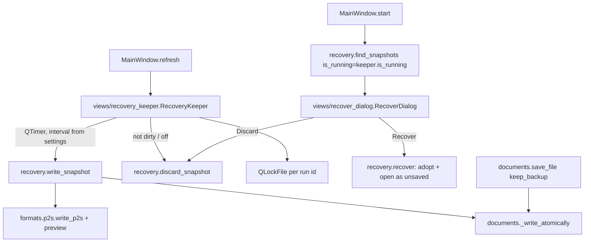

# Design Document

## Overview

Crash recovery is built from four small parts:

1. **A run lock** (views): each running PressToShape gets a random *run id* and holds a `QLockFile` named after it in the recovery folder. Qt's lock files know when their owner process is gone (stale lock), which is exactly "this run crashed".
2. **Snapshot files** (editing, Qt-free): one snapshot per run, `<run id>.p2s` (written like Save writes `.p2s`, with a small preview) plus `<run id>.json` (original path, original type, time, name). Written atomically through the existing `_write_atomically`.
3. **A snapshot keeper** (views) driven by the window's `refresh`, using one rule: *while the document has unsaved changes it has a snapshot at most one interval old; when it has none, there is no snapshot*. That one rule covers writing at intervals and removing after Save, New, Open, Discard and turning recovery off. A clean quit removes the snapshot and the lock.
4. **Recovery at startup** (views + one operation): snapshots of runs whose lock is stale are offered in a Recover Documents dialog. Recovering **adopts** the snapshot into the current run (renames it to the current run id), so the normal rule then keeps it until the document is saved or discarded. The recovered document opens unsaved and marked "(recovered)"; its first save is Save As.

Backups on save are a small extension of the existing atomic save. The new file is fully written to a temp file first. Then the old file is copied to `<name>.backup.<ext>`, and then the temp file replaces the old one. A failed save never touches either file.

## Steering Document Alignment

### Technical Standards (tech.md)
- **No Qt below views:**
  - snapshot writing, reading, listing and deleting live in `editing/operations/recovery.py`;
  - "is this run still alive" is passed in as a predicate;
  - `QLockFile`, `QTimer` and the dialog are in `views/`.
- **Native format unchanged:** snapshots are ordinary `.p2s` files; metadata goes into a JSON sidecar, so no format version bump is needed.
- **Atomic writes:** snapshots and backups reuse `documents._write_atomically`.
- **Settings:** new typed accessors in `views/app_settings.py`, shown on the General settings page.
- **Shortcut rule:** no new shortcuts.

### Project Structure (structure.md)
- **New:**
  - `editing/operations/recovery.py`;
  - `views/recovery_keeper.py` (run lock, timer, snapshot rule);
  - `views/recover_dialog.py`;
  - tests `tests/editing/test_recovery.py`, `tests/views/test_recovery_keeper.py`, `tests/views/test_recover_dialog.py`, `tests/views/test_crash_recovery.py` (subprocess crash test).
- **Changed:**
  - `editing/session.py` (`revision`);
  - `models/app_state.py` (`recovered`);
  - `editing/operations/documents.py` (backups, recovered save behaviour);
  - `views/app_settings.py`, `views/settings/general_page.py`, `views/main_window.py`;
  - docs.

## Code Reuse Analysis

### Existing Components to Leverage
- **`documents._saved_state`, `_preview`, `_write_atomically`, `_apply_saved_state`, `_reset`:** a snapshot is a save without changing `file_path`/`dirty`; recovering is an open plus "unsaved, recovered".
- **`formats.p2s.write_p2s` / `read_p2s` / `read_preview`:** the snapshot content and the dialog's thumbnails.
- **`views/app_settings` folder logic:** the portable build already keeps its data next to the executable (`translations/`); `recovery/` follows the same pattern.
- **`MainWindow.start()`:** already the place where startup decisions happen (New Document dialog); recovery comes first there.
- **`MainWindow.refresh()`:** already runs after every state change; it feeds the keeper.
- **Settings pages:** the General page gains two controls.

### Integration Points
- **Session:** a `revision` counter tells the keeper whether anything changed since the last snapshot.
- **Save flow:** `save_document_as` suggests the recovered document's original path; `save_file` gets `keep_backup`.
- **Close:** a clean `closeEvent` calls `keeper.finish()`.

## Architecture



## Components and Interfaces

### `editing/session.py`
- `revision: int`, increased by every `edit()` that commits, every undo/redo and every `_reset` (new document state). The keeper writes a snapshot only when `revision` differs from the one it last wrote.

### `models/app_state.py`
```python
@dataclass(frozen=True)
class RecoveredFrom:
    original_path: str | None    # None for never-saved documents
    saved_at: float              # snapshot time (epoch seconds)

AppState.recovered: RecoveredFrom | None = None
```

### `editing/operations/recovery.py` (Qt-free)
```python
@dataclass(frozen=True)
class Snapshot:
    run_id: str
    document: Path                # <run id>.p2s
    original_path: str | None
    saved_at: float
    name: str                     # file name, or "" for Untitled
    damaged: bool                 # metadata or document unreadable

def write_snapshot(session, folder: Path, run_id: str, view_center) -> None
    # .p2s with preview (≤128 px) + .json metadata, both atomic; original path = state.file_path or the
    # recovered document's original path. Raises OSError for the caller to report once.
def discard_snapshot(folder: Path, run_id: str) -> None          # missing files are fine
def find_snapshots(folder: Path, is_running: Callable[[str], bool]) -> list[Snapshot]
    # snapshots whose run isn't running, newest first; unreadable metadata -> damaged
def adopt(folder: Path, snapshot: Snapshot, run_id: str) -> Snapshot   # rename both files to run_id
def recover(session, snapshot: Snapshot) -> bool
    # read_p2s; _reset(document, path=None); apply saved state; dirty = True;
    # state.recovered = RecoveredFrom(...); status "Recovered {name} (from {time})". False + status on failure.
```
- **Metadata JSON:**
  ```json
  {"original_path": str | null, "saved_at": float, "app_version": str}
  ```
  - Read with the same care as `.p2s`: a size limit, types checked, damaged on any problem.
- **Time:** times are stored as epoch seconds; the dialog formats them in the interface language.

### `editing/operations/documents.py`
- `backup_path(target: Path) -> Path` → `poster.backup.p2s`.
- `_write_atomically(target, data, keep_backup=False) -> bool`: writes and fsyncs the temp file; then, if `keep_backup` and the target exists, copies the target to the backup (`shutil.copy2`); then `os.replace`. It returns whether a backup was wanted but couldn't be made, so the caller can note it.
- `save_file(..., keep_backup: bool = False)`:
  - adds "(no backup could be made)" to the status message when needed;
  - on success clears `state.recovered`.
- `_reset` (New, Open) clears `state.recovered`.

### `views/recovery_keeper.py`
```python
class RecoveryKeeper(QObject):
    def __init__(self, session, folder: Path, view_center: Callable[[], Point], settings: QSettings)
    run_id: str
    def is_running(self, run_id: str) -> bool     # own id, or another run's lock still held
    def refresh(self) -> None                      # called from MainWindow.refresh
    def finish(self) -> None                       # clean quit: discard snapshot, unlock
```
- **`__init__`:** creates the folder, picks `run_id = uuid4().hex`, and takes `QLockFile(folder / f"{run_id}.lock")` with a stale-lock time of 0 (Qt's process check decides).
- **`refresh()`:**
  - `interval = app_settings.recovery_interval(settings)` (minutes, 0 = off).
  - If off or the document isn't dirty: stop the timer and `discard_snapshot`.
  - Else, if `revision` != the last written revision and the timer isn't running: start a single-shot `QTimer(interval)`.
  - On timeout, if still dirty and changed: `write_snapshot` and remember the revision. An `OSError` shows one status message per failure streak (through a small operation that only sets the status), and the next change re-arms the timer.
- **`is_running(other)`:** `QLockFile(folder / f"{other}.lock").tryLock(0)` succeeds only if the owner is gone (stale lock), so it unlocks again and returns False. Snapshots without a lock file count as not running.

### `views/recover_dialog.py`
- **`RecoverDialog(QDialog)`:** a list (`QListWidget`, icon mode off) with a thumbnail from `read_preview`, then name / "Untitled", location, and time.
- **Buttons:**
  - **Recover** (default): disabled for damaged entries.
  - **Discard:** asks for confirmation, then `discard_snapshot` and removes the row.
  - **Close.**
- **Result:** `chosen: Snapshot | None`.

### `views/main_window.py`
- **`start()`:**
  - Builds the keeper.
  - `found = find_snapshots(folder, keeper.is_running)`; if any, it runs `RecoverDialog`. If a snapshot was chosen: `adopt` → `recover` → fit the view and **skip** the New Document dialog. If recovery fails, the reason shows in the status bar and normal startup continues.
  - Then the existing New Document logic.
- **`refresh()`:** calls `keeper.refresh()`. The title shows `"{name} (recovered)[*]"` while `state.recovered` is set.
- **`save_document()`:** with `state.recovered` set and no file path, it goes to Save As, which suggests the original path (or `untitled` + original suffix) and selects the original type's filter.
- **`save_file` calls** pass `keep_backup=app_settings.keep_backups(settings)`.
- **`closeEvent`** (clean): `keeper.finish()`.
- **After the Settings dialog closes:** `keeper.refresh()`, so interval changes apply immediately.

### `views/app_settings.py` and General page
```python
RECOVERY_INTERVALS = (0, 1, 2, 5, 10)        # minutes, 0 = off
def recovery_interval(settings) -> int        # default 5
def set_recovery_interval(settings, minutes) -> None
def keep_backups(settings) -> bool            # default True
def set_keep_backups(settings, value) -> None
def recovery_folder(executable=..., frozen=...) -> Path   # portable: <exe>/recovery; else app data /recovery
```
- **General page:** "Save recovery data every" (combo: Off, 1/2/5/10 minutes, as translated plurals) and "Keep a backup of the previous version when saving".

## Data Models

### Recovery folder
```
<app data>/PressToShape/PressToShape/recovery/
  3f2a…e1.lock      # QLockFile of a running (or crashed) run
  3f2a…e1.p2s       # snapshot document
  3f2a…e1.json      # {"original_path": "/home/…/poster.svg", "saved_at": 1792430000.0, "app_version": "…"}
```

### Settings keys
```
recovery/interval_minutes   0 | 1 | 2 | 5 | 10   (default 5)
save/keep_backups           bool                 (default true)
```

## Error Handling

### Error Scenarios
1. **Snapshot write fails** (disk full, folder not writable).
   - **Handling:** `OSError` caught in the keeper; status message once per failure streak; retried at the next change.
   - **User Impact:** a quiet note; work continues.
2. **Damaged snapshot or metadata.**
   - **Handling:** listed as damaged; only Discard offered.
   - **User Impact:** clear entry; no crash.
3. **Recovery fails at open** (file vanished between listing and recovering).
   - **Handling:** `recover` returns False with the status message; startup continues normally.
   - **User Impact:** the status bar says why.
4. **Backup can't be written** (read-only folder, name clash with a folder).
   - **Handling:** the save still replaces the file; the status says "no backup could be made".
   - **User Impact:** the file is saved.
5. **Two instances.**
   - **Handling:** each holds its own lock; `find_snapshots` skips live locks.
   - **User Impact:** no cross-talk.
6. **Recovery folder not creatable.**
   - **Handling:** the keeper disables itself for this run, with one status message.
   - **User Impact:** the app works without recovery.

## Testing Strategy

### Unit Testing
- **`tests/editing/test_recovery.py`:**
  - write → find (with `is_running` False) → recover gives the same document, view and selection, dirty, `recovered` set;
  - running runs are skipped;
  - damaged JSON and damaged `.p2s` are marked damaged;
  - discard removes both files;
  - adopt renames;
  - newest first.
- **`tests/editing/test_documents.py`:**
  - the backup is created with the right name and replaced on the next save;
  - none for new files;
  - `keep_backup=False` → none;
  - a failing backup (target folder made read-only, or `shutil.copy2` monkeypatched) still saves, with a note;
  - a failed write leaves the file and backup untouched;
  - saving clears `recovered`;
  - New and Open clear `recovered`.
- **`tests/editing/test_session.py`:** `revision` increases on edits, undo, redo and reset; not on selection or zoom.
- **`tests/views/test_recovery_keeper.py`** (offscreen, short intervals via a monkeypatched minute length):
  - a dirty document gets a snapshot after the interval;
  - no change → no rewrite;
  - saved → snapshot removed;
  - off → removed;
  - `finish()` removes the snapshot and lock.
- **`tests/views/test_recover_dialog.py`:** rows, damaged entries, Discard confirmation, chosen result.

### Integration Testing
- **`tests/views/test_crash_recovery.py`:**
  1. A subprocess (`sys.executable -c …`, offscreen) creates a keeper, makes the document dirty, forces a snapshot and ends with `os._exit(1)` (no cleanup).
  2. The test then finds that run's snapshot as not running.
  3. It recovers it, gets the exact document, and checks that the title shows "(recovered)".
- **Settings General page:** the controls write the settings.

### End-to-End Testing
- QTest scratch run on the real window, offscreen and with GL:
  - edit, wait for a short interval → the snapshot exists;
  - kill the process (`os._exit`) → restart → the Recover dialog lists it with a preview;
  - Recover → title "(recovered)", Ctrl+S opens Save As with the original name;
  - save → snapshot gone, backup created on the second save;
  - quit → recovery folder empty.
- German screenshot of the Recover dialog and the General page.
