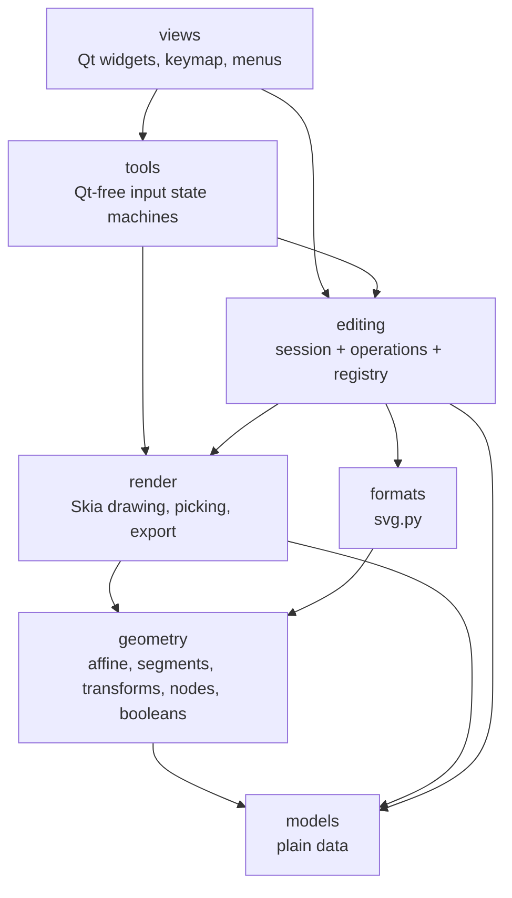

# Design Document

## Overview

veccy becomes four layers of its own on top of the existing data and renderer:

- **Session** (`editing/session.py`): the one `AppState`, the undo history with labelled steps, and change notification. Small and free of feature logic.
- **Operations** (`editing/operations/*.py`): plain functions `operation(session, ...)`, grouped by feature, and the only code that changes state. Operations that need no extra input are also registered (id, menu label, "can run?" check) so that menus, shortcuts and later a command search or scripting can be built from one list.
- **Tools** (`tools/*.py`): one Qt-free state machine per tool with a common interface. Tools turn pointer input into previews and finally into operation calls.
- **Views** (`views/`): Qt widgets only. Menus and toolbars are built from the operation and tool registries plus a keymap (id → shortcut, icon).

Below them, pure code moves out of `controllers/`: math into `geometry/`, SVG into `formats/`. `controllers/` and `AppController` disappear.

The move happens in steps that each keep the full test suite green (see Migration Plan). Behavior, SVG output and performance stay the same. The only visible change is that Undo/Redo name their step.

## Steering Document Alignment

### Technical Standards (tech.md)
- One `AppState`, edits through a single path, views re-render from state: unchanged principles, now named session / operations / views instead of model / controller / view.
- No Qt below `views/`. A new test enforces it, along with the import direction.
- Undo stays snapshot-based (copy layer lists, share frozen shapes). It now sits behind `Session.edit`, so command-based undo can replace it later without touching operations.
- tech.md, structure.md and CLAUDE.md are rewritten to describe this architecture (last task).

### Project Structure (structure.md)
- One package per layer and one module per concern, every app module under ~400 lines.
- New names follow the naming preferences: speaking names (`session`, `shape`, `segments`), "type" rather than "kind".

## Code Reuse Analysis

### Existing Components to Leverage
- **`AppController` methods**: their bodies move almost unchanged into operation functions. `self.state` becomes `session.state`, `self._checkpoint(); …; self._notify()` becomes `with session.edit(label): …`.
- **`controllers/geometry.py`, `affine.py`, `nodes.py`, `svg_io.py`**: moved, split where noted, otherwise unchanged.
- **`views/select_gesture.py`, `node_gesture.py`, `gesture_types.py`, the draw-tool parts of `canvas_gestures.py`**: become `tools/select.py`, `tools/node.py`, `tools/base.py`, `tools/pen.py`, `tools/shapes.py` and `tools/text.py`.
- **`views/actions.py`**: its QAction factory (`_make`, the tooltip with shortcut, the `lambda: slot()` wrapper) stays and is fed from the registries and the keymap.
- **Existing tests**: moved next to their new modules with the same assertions; only imports and call syntax change.

### Integration Points
- **`App`** creates the `Session` and passes it to `MainWindow`.
- **`MainWindow`** subscribes to the session, keeps its window commands (dialogs, viewport), and hands the session to its panels and `CanvasView`.
- **`CanvasView`** owns the tool instances (through the tool registry) and forwards Qt events to the active one.

## Architecture



Allowed imports (enforced by `tests/test_architecture.py`):

| Package | May import from veccy | Qt |
|---|---|---|
| `models` | – | no |
| `geometry` | models | no |
| `formats` | models, geometry | no |
| `render` | models, geometry | no |
| `editing` | models, geometry, formats, render | no |
| `tools` | models, geometry, render, editing | no |
| `views` | everything above, `icons` | yes |
| `app` | views, editing | yes |

Data flow (unchanged in spirit): input → tool → operation → `session.edit(...)` mutates state and records undo → `session.notify()` → `MainWindow.refresh()` → each view's `refresh(state)`.

### Modular Design Principles
- **Operations are functions, not classes.** A module of related functions reads like a chapter, and the registry decorator adds metadata without changing how the function is called.
- **The session knows nothing about features.** Selection pruning on undo is one hook (see below), not feature code inside history.
- **Presentation stays in views.** Shortcuts, icons and menu layout live in `views/`; the registry holds only id, label and check.

## Components and Interfaces

### Package layout

```
veccy/
├── app.py                        # App: creates Session + MainWindow, owns QApplication
├── icons.py                      # icon path constants (views only)
├── models/                       # unchanged: app_state.py, shapes.py
├── geometry/
│   ├── affine.py                 # 2D affine tuples (from controllers/affine.py)
│   ├── boxes.py                  # Point, Rect, box_from_drag, rect_from_points
│   ├── segments.py               # rect/ellipse/smooth segments, quad_to_cubic, transform_segments
│   ├── booleans.py               # union/difference via skia-pathops
│   ├── transforms.py             # outline, translate, transform_shape, rotation_of, with_rotation
│   └── nodes.py                  # path node editing (from controllers/nodes.py)
├── formats/
│   └── svg.py                    # from controllers/svg_io.py
├── render/                       # unchanged modules; imports switch to geometry
├── editing/
│   ├── session.py                # Session: state, history, notify, edit scope
│   ├── registry.py               # Operation, @operation, register(), operations()
│   ├── queries.py                # visible_shapes, selected_shapes, find_shape, active_layer
│   └── operations/
│       ├── __init__.py           # imports every module so the registry is complete
│       ├── history.py            # undo, redo
│       ├── view.py               # select_tool, set_zoom, zoom_in/out, set_tool_style, set_font_size
│       ├── selection.py          # set_selection, select_all, move_selection, delete_selection
│       ├── shapes.py             # add_rectangle/ellipse/path/text, set_shape_field
│       ├── transform.py          # transform_selection, set_rotation
│       ├── paths.py              # combine (union/difference), object_to_path
│       ├── node_editing.py       # set_node_selection, move_nodes, move_control, insert_node, delete_nodes
│       ├── style.py              # set_fill, set_stroke, set_stroke_width
│       ├── layers.py             # add/remove/select/rename layer, set_layer_visible
│       └── documents.py          # new_document, open_file, save_file, export_png
├── tools/
│   ├── base.py                   # Mods, CursorType, resize_cursor_type, ToolContext, BaseTool
│   ├── registry.py               # TOOLS: Tool enum -> (id, label, class); create_tools(context)
│   ├── select.py / node.py       # SelectTool, NodeTool
│   ├── pen.py / shapes.py / text.py   # PenTool, RectangleTool + EllipseTool, TextTool
└── views/
    ├── keymap.py                 # id -> Binding(shortcut, icon); menu and toolbar layouts
    ├── actions.py                # QActions built from registries + keymap + window commands
    ├── canvas_view.py            # dispatches events to the active tool; cursor and hint
    └── … (other panels unchanged apart from session instead of controller)
```

`geometry.py` (272 lines) is split by topic: segment construction, booleans (the only pathops user), and shape transforms. `Point` and `Rect` get one home in `geometry/boxes.py`, replacing today's three definitions (geometry, overlay, handles).

### `editing/session.py`

```python
class Session:
    """The one AppState, its undo history and change notification. Operations edit through `edit()`."""

    state: AppState

    def subscribe(self, listener: Callable[[], None]) -> None
    def notify(self) -> None

    @contextmanager
    def edit(self, label: str, merge_key: str | None = None) -> Iterator[AppState]:
        """One undoable step: snapshot before the body runs, mark dirty, notify once afterwards.
        Consecutive edits with the same merge_key extend the previous step."""

    def undo(self) -> None
    def redo(self) -> None
    @property undo_label / redo_label -> str | None
    def reset(self, document: Document, path: str | None) -> None   # new/open: clears history
    def end_merge(self) -> None                                        # selection change breaks merging
```

- A history step is `_Step(snapshot, label)`. The snapshot is the existing `_Snapshot(document copy, selected_layer_index)`. Redo stores the current snapshot with the same label.
- The undo limit stays 200.
- If the body raises, the step is dropped, no notification is sent and the exception propagates. Operations only enter `edit()` once they know they will change something, so no empty steps are recorded.
- After a restore, the session runs `_after_restore`: it prunes the selection to visible shapes, clears the node selection and sets the status to "Undo"/"Redo". That hook is the only selection knowledge in the session, matching today's `_restore`.
- Status messages stay exactly as today. Operations set `state.status_message` inside the edit, so the status bar text doesn't change; the `label` is used only for the history and the menu.

### `editing/registry.py`

```python
@dataclass(frozen=True)
class Operation:
    id: str                                  # stable, dotted: "edit.delete", "path.union"
    label: str                               # menu text incl. mnemonic: "&Delete"
    run: Callable[[Session], None]
    can_run: Callable[[Session], bool] = lambda session: True

    def invoke(self, session: Session) -> None:
        if self.can_run(session):
            self.run(session)

def operation(id: str, label: str, can_run=None):    # decorator for fn(session) -> None, returns fn unchanged
def register(id: str, label: str, run, can_run=None) # for variants: union/difference, zoom_actual, remove current layer
def operations() -> list[Operation]                  # registration order
def find(id: str) -> Operation
```

The registry is a module-level table of *definitions*, filled at import time; it holds no app state, so it doesn't conflict with "one AppState, no global state". Registering a duplicate id raises `ValueError`.

**Registered operations** (everything with a menu entry, toolbar button or shortcut today):
`edit.undo`, `edit.redo`, `edit.select_all`, `edit.delete`, `path.union`, `path.difference`, `path.object_to_path`, `view.zoom_in`, `view.zoom_out`, `view.zoom_actual`, `layer.add`, `layer.remove`.
Tools are registered separately in `tools/registry.py` (`tool.select`, `tool.node`, …).

### Operations, by example

```python
# editing/operations/selection.py
@operation("edit.delete", "&Delete", can_run=lambda session: bool(session.state.selection))
def delete_selection(session: Session) -> None:
    state = session.state
    if state.active_tool is Tool.NODE and state.node_selection:
        node_editing.delete_nodes(session)
        return
    count = len(state.selection)
    with session.edit(f"Delete {count} object(s)"):
        remove_shapes(state, state.selection)
        state.selection = set()
        state.status_message = f"Deleted {count} object(s)"


def move_selection(session: Session, dx: float, dy: float) -> None:   # not registered: needs values
    ...
```

- Small shared helpers for operations (`replace_shape`, `remove_shapes`, `map_selected`, `new_id`) live in `editing/queries.py` next to the read helpers, or in a private `editing/operations/_document.py` if they would push `queries.py` past one concern.
- Undo labels are short imperative phrases built from today's status wording: "Move 3 object(s)", "Rotate", "Scale", "Delete node(s)", "Rename layer", "Change fill", and so on. The full list is fixed in the task that ports each module.

### `editing/queries.py`

Read-only helpers on `AppState`, used by operations, tools and views: `visible_shapes(state)`, `selected_shapes(state)`, `find_shape(state, id)`, `active_layer(state)`, plus the predicates the registry checks use (`can_combine`, `can_object_to_path`).

### `tools/base.py`

```python
@dataclass(frozen=True)
class Mods: shift: bool = False; ctrl: bool = False; alt: bool = False

class CursorType(Enum): ...            # unchanged
def resize_cursor_type(angle_deg) -> CursorType

@dataclass
class ToolContext:
    session: Session
    cache: PathCache
    repaint: Callable[[], None]
    ask_text: Callable[[], str | None]   # dialog lives in the view
    pixel_size: float = 1.0
    @property zoom; def shape_at(point) -> int | None   # shared hit test with screen tolerance

class BaseTool:
    """Default behavior every tool inherits; tools override what they use."""
    def __init__(self, context: ToolContext)
    active: bool                         # False
    hint: str | None                     # None
    def press(self, point, mods): ...
    def move(self, point, mods): ...
    def release(self, point, mods): ...
    def double_click(self, point, mods): self.press(point, mods)   # Qt sends the second press only here
    def hover(self, point) -> CursorType: CROSS
    def escape(self) -> None:            # cancel when active, else clear the selection
    def cancel(self) -> None
    @property overlay -> Overlay         # selection only
```

`SelectTool`, `NodeTool`, `PenTool`, `RectangleTool`/`EllipseTool` (sharing a `_BoxTool` base) and `TextTool` each override the parts they need. They keep today's logic verbatim apart from calling operations instead of controller methods.

### `tools/registry.py`

```python
@dataclass(frozen=True)
class ToolEntry:
    tool: Tool            # the enum stored in AppState.active_tool
    id: str               # "tool.select"
    label: str            # "&Select"
    factory: type[BaseTool]

TOOLS: tuple[ToolEntry, ...]   # display order: select, node, pen, rectangle, ellipse, text
def create_tools(context: ToolContext) -> dict[Tool, BaseTool]
```

### `views/keymap.py`

```python
@dataclass(frozen=True)
class Binding:
    shortcut: str | QKeySequence.StandardKey | list[QKeySequence] | None = None
    icon: Path | None = None

KEYMAP: dict[str, Binding]           # operation, tool and window-command ids
MENUS: list[tuple[str, list[str | None]]]   # ("&File", ["file.new", "file.open", …, None, "file.quit"]); None = separator
MAIN_TOOLBAR, TOOL_STRIP: list[str | None]
```

Menu content, order, shortcuts and icons copy today's `menu_bar_view.py`, `toolbar_view.py`, `left_sidebar_view.py` and `actions.py` exactly. The zoom label widget in the main toolbar stays a special case in `toolbar_view.py`.

### `views/actions.py`

- Builds `actions: dict[str, QAction]` from three sources: registered operations (triggered → `op.invoke(session)`), tools (triggered → `view.select_tool(session, tool)`, checkable and in one `QActionGroup`), and window commands (a list of `(id, label, method)` provided by `MainWindow`: `file.new`, `file.open`, `file.save`, `file.save_as`, `file.export_png`, `file.quit`, `view.zoom_fit`, `help.about`).
- `refresh(state)` sets enabled from each operation's `can_run`, checks the active tool's action, and sets Undo/Redo text to `"&Undo " + label` (or `"&Undo"` disabled), the only visible change.
- `menu_bar_view.py`, `toolbar_view.py` and `left_sidebar_view.py` iterate the keymap layouts instead of naming actions.

### `views/canvas_view.py`

Gets the session instead of the controller and creates the tools with `create_tools(ToolContext(session, cache, self._repaint, self._ask_text))`. `self._tool = tools[state.active_tool]`; on a tool change the previous tool is cancelled. Event handlers call `self._tool.press/move/release/double_click/escape`. Cursor and hint come from `self._tool.hover` and `self._tool.hint`. The pen's Enter key calls `PenTool.finish`, the one tool-specific key, through an optional `key(key_name) -> bool` method on `BaseTool` (default False), so `CanvasView` doesn't check tool types.

## Data Models

No model changes. `AppState`, `Document`, `Layer`, `Tool`, shapes and `Overlay` stay as they are, so saved files, undo snapshots and render inputs are untouched.

New non-model types: `Session`, `_Step(snapshot, label)`, `Operation`, `ToolEntry`, `ToolContext`, `Binding`.

## Error Handling

### Error Scenarios
1. **An operation raises inside `session.edit`.**
   - **Handling:** the pending history step is discarded and no notification is sent; the exception propagates. Only file I/O can fail at runtime, and documents.py catches those I/O errors around the I/O call (as today), not around the edit.
   - **User Impact:** none for bugs beyond what happens today; file errors show in the status bar as now.
2. **Duplicate operation id or missing keymap entry.**
   - **Handling:** `register` raises on a duplicate id at import. A test asserts that every id in the menu and toolbar layouts exists in a registry or in the window commands.
   - **User Impact:** none; caught in development.
3. **Invoking a registered operation that can't run** (stale enabled state, shortcut while disabled).
   - **Handling:** `Operation.invoke` checks `can_run` first; the functions also guard themselves, as the controller methods do today.
   - **User Impact:** nothing happens, as now.
4. **An import breaks the layer rule.**
   - **Handling:** `tests/test_architecture.py` parses every module's imports with `ast` and fails, naming the module and the offending import.

## Testing Strategy

### Unit Testing
- Tests are mirrored into folders per package: `tests/geometry/`, `tests/formats/`, `tests/render/`, `tests/editing/`, `tests/tools/`. `pyproject.toml` sets `--import-mode=importlib` so test modules may share basenames across folders. Shared helpers (session factory, `all_shapes(session)`) go in `tests/conftest.py`.
- **`tests/editing/test_session.py`** (new): an edit records one labelled step; a merge key extends a step; an exception inside an edit leaves history and state untouched and doesn't notify; non-document notify doesn't record; undo/redo labels; undo prunes selection and clears the node selection.
- **`tests/editing/test_registry.py`** (new): registration order, duplicate id raises, `invoke` respects `can_run`, every registered id has a label.
- **Operation tests:** today's `test_app_controller.py` split by module (`test_selection.py`, `test_transform.py`, `test_node_editing.py`, `test_layers.py`, `test_documents.py`, …) with the same assertions.
- **Tool tests:** today's `test_canvas_gestures.py` split into `tests/tools/test_select.py`, `test_node.py` and `test_drawing.py`.
- **`tests/test_architecture.py`** (new): import direction and Qt-free packages, as in the table above.
- **`tests/views/`** stays Qt-free: a keymap test checks that every layout id resolves; it imports the keymap data only.

### Integration Testing
- Scratch QTest scripts (not committed, per CLAUDE.md) repeat the interaction checks from the shape-handles spec (handles, cursors, rotate hint, node edit, object to path, delete) plus layers, undo/redo labels, and open/save/export. They run offscreen and on desktop GL.
- A before/after SVG comparison: a document built by the same script and saved by the old and new code produces identical files.

### End-to-End Testing
- `scripts/screenshot_app.py` and `scripts/bench_canvas.py` are updated to the session/tools API. The screenshot is compared visually and the bench numbers against the previous run.

## Migration Plan

Each step ends with the full suite green and the app runnable:

1. **Pure code out**: `geometry/` (split as above) and `formats/svg.py`; switch all imports; delete the old modules. Add the architecture test with the rules that already hold.
2. **Session**: introduce `Session` with labelled history. `AppController` keeps its API but delegates state, history and notify to it. Session tests.
3. **Operations**: port controller methods module by module into `editing/operations/`, with `AppController` forwarding to them in the meantime. Move the matching tests.
4. **Callers switch**: views, gestures, scripts and tests call operations and queries directly; delete `AppController` and `controllers/`.
5. **Registry and keymap**: register operations, add `keymap.py`, build actions and menus from them, add Undo/Redo labels.
6. **Tools**: move gesture code into `tools/`, add `BaseTool` and the tool registry, make `CanvasView` dispatch; delete `canvas_gestures.py`, `select_gesture.py`, `node_gesture.py` and `gesture_types.py` from views.
7. **Tighten the architecture test** to the final rules; update the docs; run the bench, the screenshot, the SVG comparison and the interaction checks.
