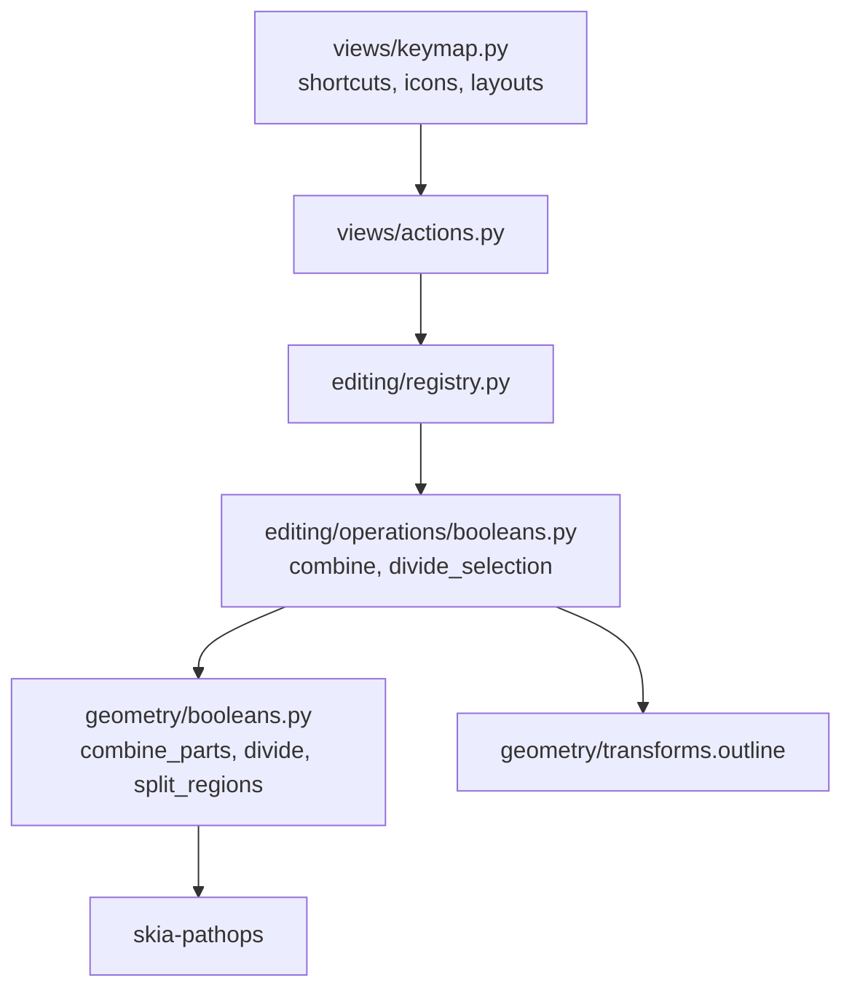

# Design Document

## Overview

Three parts:

1. **Geometry** (`geometry/booleans.py`): one function `combine_parts(parts)` that folds an ordered list of `(outline, mode)` parts with pathops, a `divide(outlines)` that returns pieces tagged with their top-most source, and `split_regions(segments)` that breaks a result into connected areas (each with its holes). skia-pathops already provides every operation needed (`UNION`, `DIFFERENCE`, `INTERSECTION`, `XOR`), per-contour orientation, `area` and `contains`.
2. **Operations** (`editing/operations/booleans.py`, new): `combine(session, op)` for union / difference / intersection / exclude, and `divide_selection(session)`. They move out of `paths.py`, which keeps Object to Path only. Five registered commands.
3. **Views** (`views/keymap.py`, icons): bindings, Path menu and tool strip entries, three new Tabler icons.

No model changes: every result is a plain `PathShape`.

## Steering Document Alignment

### Technical Standards (tech.md)
- Pure, Qt-free geometry in `geometry/`; state changes only in operations through `session.edit(label)`; presentation only in `views/keymap.py`. The architecture test keeps holding.
- skia-pathops stays the boolean engine (float32 inside; results rounded by the existing `_from_skia`).

### Project Structure (structure.md)
- New module `editing/operations/booleans.py`, one concern per module: `paths.py` shrinks to Object to Path.
- Tests: `tests/geometry/test_booleans.py` (extended) and `tests/editing/test_booleans.py` (combine and divide moved from `test_paths.py`, plus new cases).

## Code Reuse Analysis

### Existing Components to Leverage
- **`geometry.booleans._to_skia / _from_skia`**: segment ↔ pathops conversion, unchanged.
- **`geometry.transforms.outline`**: transformed outlines of rect/ellipse/path (text stays `None`, so it's excluded as today).
- **`editing.queries.can_combine`**: "two or more shapes with an outline" check for all five commands.
- **`operations._document.new_id`**: ids for results and pieces.
- **Existing `combine` z-order logic**: the result replaces the bottom-most selected shape in its layer; generalized to "insert a list of shapes there" so divide can reuse it.

### Integration Points
- **Registry**: `path.union`, `path.difference` keep their ids; new `path.intersection`, `path.exclude`, `path.divide`.
- **Keymap**: Path menu `[union, difference, intersection, exclude, divide, None, object_to_path]`; tool strip gets all five after the tools.
- **Icons**: `scripts/generate_icons.py` mapping + `icons.py` constants `INTERSECTION`, `EXCLUDE`, `DIVIDE`.

## Architecture



## Components and Interfaces

### `geometry/booleans.py`

```python
Mode = Literal["add", "subtract", "intersect", "exclude"]
_PATHOPS = {"add": UNION, "subtract": DIFFERENCE, "intersect": INTERSECTION, "exclude": XOR}

def combine_parts(parts: Sequence[tuple[Segments, Mode]]) -> Segments:
    """Starts from the first part's outline (whatever its mode) and applies each following part with its mode."""

def divide(outlines: Sequence[Segments]) -> list[tuple[Segments, int]]:
    """Every area covered by a different set of outlines, split into connected regions.
    Each piece is tagged with the index of the top-most outline covering it."""

def split_regions(segments: Segments) -> list[Segments]:
    """Connected areas of a simplified outline, each with the holes inside it."""
```

**`combine_parts`**: converts each outline once, folds with `pathops.op(result, part, _PATHOPS[mode])`, converts back once at the end. An empty list or an empty result returns `()`.

**`divide`** (incremental, roughly quadratic in the number of outlines instead of exponential over subsets):

```
pieces = []                                   # (pathops.Path, top_index)
for index, outline in enumerate(outlines):
    shape = to_skia(outline)
    covered = union of all earlier outlines (kept incrementally)
    next_pieces = []
    for piece, top in pieces:
        inside  = piece ∩ shape  -> (inside, index)    # now covered by this outline too
        outside = piece − shape  -> (outside, top)
        keep both if not empty
    remainder = shape − covered -> (remainder, index)
    pieces = next_pieces (+ remainder)
then each piece -> split_regions -> drop regions with area < MIN_PIECE_AREA
```

**`split_regions`**: simplifies, then for every contour counts how many other contours contain its first point (`contour.contains`). An even count means an outer boundary, an odd count means a hole. Each hole is attached to the smallest-area outer contour that contains it at depth − 1. Islands inside holes come out as their own regions. Pure pathops, no skia-python.

**`MIN_PIECE_AREA`** = 1e-3 square document units: float32 slivers along shared edges stay below it, while real shapes even at extreme zoom don't.

`boolean(outlines, op)` (today's API) is replaced. Its callers move to `combine_parts`, so destructive booleans and the future Composite share one code path (Requirement 5.3).

### `editing/operations/booleans.py`

```python
OPERATIONS = {"union": ("add", "Union"), "difference": ("subtract", "Difference"),
              "intersection": ("intersect", "Intersection"), "exclude": ("exclude", "Exclude")}

def combine(session, op: str) -> None
def divide_selection(session) -> None
```

- **`combine`** collects the selected shapes that have an outline (bottom to top). Inside `session.edit(name)` it computes `combine_parts([(outline, mode) for each])`. A non-empty result becomes a new `PathShape` with the bottom shape's style; an empty one leaves nothing and sets the status to "{name} is empty". The new shapes are inserted with `_replace_with(state, targets, new_shapes)`.
- **`divide_selection`** works the same way through `geometry.booleans.divide`. Each piece becomes a `PathShape` styled like `targets[top_index]`. Pieces are sorted by `top_index` (stable), so pieces from higher shapes stay above lower ones. All pieces end up selected, and the status reads "Divided into N pieces".
- **`_replace_with(state, targets, new_shapes)`**: removes the consumed shapes and inserts `new_shapes` in order at the bottom-most target's position in its layer. This generalizes today's combine loop.
- Registration: `path.union` "&Union", `path.difference` "D&ifference", `path.intersection` "&Intersection", `path.exclude` "E&xclude", `path.divide` "Di&vide". All use `can_combine` as their check.

### `views/keymap.py` and icons

| id | label | shortcut | icon (Tabler) |
|---|---|---|---|
| `path.union` | &Union | Ctrl++ | layers-union (existing) |
| `path.difference` | D&ifference | Ctrl+- | layers-subtract (existing) |
| `path.intersection` | &Intersection | Ctrl+* | `layers-intersect-2` (hatched overlap) |
| `path.exclude` | E&xclude | Ctrl+^ | `layers-difference` (overlap dashed out) |
| `path.divide` | Di&vide | Ctrl+/ | `layers-intersect` (all edges drawn) |

**Keyboard caveat:** on layouts where `^` is a dead key (German, French, …), Ctrl+^ may never reach Qt as a shortcut. I'll verify it on your keyboard during implementation. If it doesn't fire, Exclude gets a second binding (Ctrl+Alt+X), while Ctrl+^ stays for Inkscape familiarity on other layouts.

## Data Models

No changes. Results are `PathShape(id, segments, style)` with identity transform.

## Error Handling

### Error Scenarios
1. **Empty result** (intersection without overlap, exclude of identical shapes, difference that cuts everything).
   - **Handling:** the consumed shapes are removed and nothing is created. The status reads "{Operation} is empty". It's one undo step, so Ctrl+Z restores everything.
   - **User Impact:** the shapes disappear with a clear message and can be undone.
2. **pathops failure** (`PathOpsError` on degenerate input such as zero-area outlines).
   - **Handling:** caught in the operation *before* `session.edit` mutates anything (geometry runs first, then the edit applies the result). The status reads "{Operation} failed".
   - **User Impact:** nothing changes, and there's no crash.
3. **Slivers from float32 rounding in divide.**
   - **Handling:** pieces under `MIN_PIECE_AREA` are dropped.

## Testing Strategy

### Unit Testing
- **`tests/geometry/test_booleans.py`**:
  - `combine_parts`: each mode on overlapping squares (area and bbox); a first part with a non-add mode; non-overlapping intersect returns `()`; exclude of three overlapping squares (triple overlap filled again); results identical to the old union/difference tests.
  - `split_regions`: two disjoint squares give 2 regions; a square with a hole gives 1 region with 2 contours; an island inside a hole gives 2 regions.
  - `divide`: two overlapping squares give 3 pieces with the right top indices; a ring cut by a bar gives disconnected pieces split; identical squares give 1 piece; sliver filtering.
- **`tests/editing/test_booleans.py`**: the union/difference tests moved from `test_paths.py`, plus intersection (empty and non-empty, style and z-order from the bottom shape), exclude, divide (piece count, styles from the top-most source, selection, z-order, one undo step and undo restores ids/order), disabled with fewer than two outlines or text-only selections, and undo labels.
- **`tests/views/test_keymap.py`**: unchanged test, now also covering the new ids.

### Integration Testing
- A QTest scratch script: select overlapping shapes, trigger each command via its shortcut (including the dead-key check for Ctrl+^ on your layout) and via the tool strip. Run offscreen and on desktop GL.

### End-to-End Testing
- The screenshot shows the extended tool strip and Path menu. A visual check of a divided rect+ellipse.
