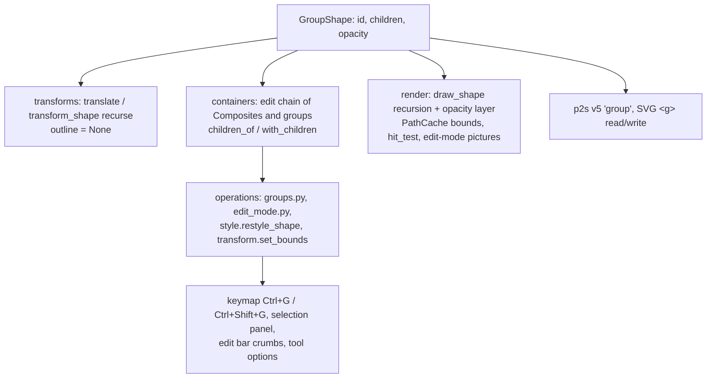

# Design Document

## Overview

A frozen `GroupShape` holds child shapes and its own opacity. It has no paint of its own and an identity transform (like a Composite, transforms are applied to the children). Everything that today recurses into Composites learns to recurse into groups as well; everything that treats "the entered Composite" as the active container is generalized to "the entered container", which is a Composite or a group. On top come group/ungroup operations, group-aware styling, drawing with true group opacity, SVG `<g>` in both directions and `.p2s` version 5.

The work lands in layers that each keep the suite green: model + geometry → containers and edit mode → rendering → operations → formats → views.

## Steering Document Alignment

### Technical Standards (tech.md)
- Frozen dataclasses, `dataclasses.replace`; Qt-free below `views/`.
- Operations through `session.edit(label)`; enter/leave are not undo steps.
- Per-frame cost stays in recorded pictures; no Python loop over thousands of shapes per frame.
- `.p2s` change follows the migration rule (version 5, sample, doc row).

### Project Structure (structure.md)
- `models/shapes.py`: `GroupShape`, `Shape` union, `children_of`.
- `editing/containers.py`: generalized edit chain; `editing/operations/edit_mode.py` (new): enter / leave / leave_all moved out of `composites.py`; `editing/operations/groups.py` (new): group / ungroup.
- `render/`: group drawing, bounds, hit-testing, edit-mode drawing.
- `formats/`: `p2s.py`, `p2s_migrations.py`, `svg.py`, `svg_reader.py`.
- `views/`: keymap entries, selection panel, edit bar, tool options.

## Code Reuse Analysis

### Existing Components to Leverage
- **`editing/containers.py`**: `edit_chain`, `pickable_shapes`, `container_lists`, `change_container` already implement "work inside an entered shape"; they gain a group branch.
- **Composite edit mode** (`composites.enter/leave`, `EditBar`, Select tool double-click / Enter / Esc, `Session` trimming a stale `edit_path`): reused unchanged in behaviour.
- **`geometry/transforms.translate` / `transform_shape`**: recurse into Composite parts; same for group children.
- **`_document.with_fresh_ids`, `queries.find_shape`**: recurse into parts; extended to children.
- **`render/picture.DocumentPicture`**: run recording of static and moving shapes; generalized to record any shape list, reused for the entered group's contents.
- **Opacity layer** from the import-fidelity spec (`saveLayerAlpha` only when needed): reused for group opacity.
- **`style.set_style` / `restyled`**: extended with a group-aware `restyle_shape`.

### Integration Points
- **Undo snapshots** copy layer lists and share frozen shapes; groups are frozen too, so nothing changes there.
- **Recovery, clipboard**: go through `p2s.encode_shape` / `decode_shape`, so they get groups with the codec.
- **SVG import notes**: the group-opacity note now only fires for opacity on layers and the root element.

## Architecture



## Components and Interfaces

### 1. Model (`models/shapes.py`)

```python
@dataclass(frozen=True)
class GroupShape:
    """Shapes kept together as one object; each child keeps its own style. Drawn as its children, composited
    with `opacity` when that is below 1."""
    id: int
    children: tuple["Shape", ...]
    opacity: float = 1.0
    # Stays identity: transforms are applied to the children.
    transform: Transform = IDENTITY_TRANSFORM

Shape = RectShape | EllipseShape | PathShape | TextShape | CompositeShape | GroupShape
ContainerShape = CompositeShape | GroupShape

def children_of(shape: Shape) -> tuple[Shape, ...]:   # parts, children, or ()
```

A group has **no `style` attribute**. Code that reads `shape.style` generically is reviewed below; groups are handled before it (drawing, hit-testing, bounds, styling, encoders). A type checker run over the touched modules catches missed spots.

### 2. Geometry (`geometry/transforms.py`)
- `outline(group)` → `None` (no single outline), so booleans, divide, Make Composite and `can_combine` leave groups out exactly like text, with no extra code.
- `translate` and `transform_shape` recurse into children (passing `min_extent`, `scale_radii`).
- `area_outline(group)` → `None`.

### 3. Containers and edit mode (`editing/containers.py`, `editing/operations/edit_mode.py`)

- `edit_chain(state) -> list[ContainerShape]`: follows `edit_path` through Composites **and** groups (candidates: `children_of(found)`).
- `edited_container(state)`: innermost entry; `edited_composite(state)`: innermost entry when it is a Composite, else `None` (part modes, new-part mode, text-in-Composite rules keep using this).
- `editing(state)`: any container entered (Esc / double-click-outside leave, adding to the container).
- `pickable_shapes` / `container_lists`: `children_of(innermost)`.
- `change_container`: rebuilds the innermost container with `with_children(container, shapes, …)` (Composites keep the mode bookkeeping of `with_parts`; groups just replace `children`), then every parent up the chain, then the layer.
- **Empty containers**: after a change, an entered group or Composite left with no children is removed from its parent and `edit_path` is trimmed to it (generalizes today's `delete_selected` special case, so cut, ungroup-inside and node deletion behave the same).
- `edit_mode.enter(session, shape_id)`, `leave(session, levels)`, `leave_all(state)`: moved from `composites.py` unchanged except that they accept groups and word the status by type ("Editing a group: Esc or Done to leave"). Callers (Select tool, edit bar, documents, layers) import from the new module.

### 4. Operations

**`editing/operations/groups.py`** (new)
- `@operation("object.group", N_("&Group"), can_run=_can_group)`: `can_group` = selection not empty and the innermost entered container is not a Composite. Collects selected pickable shapes bottom to top, removes them from every container list, inserts `GroupShape(new_id, shapes)` at the index where the top-most selected shape was (in its list), selects it. Label "Group".
- `@operation("object.ungroup", N_("&Ungroup"), can_run=_has_group)`: replaces each selected group by its children in place; when `group.opacity < 1`, every child gets `with_opacity(child, factor)` (leaf shapes: `style.opacity *= factor` via `sanitized`; nested groups: `opacity *= factor`; Composites: their own style). Selects the children. Label "Ungroup".

**Styling (`style.py`)**
- `restyle_shape(shape, **changes)`: for a group, `opacity` changes the group's own opacity and every other field is applied to each child recursively; for other shapes it is today's `restyled` on `shape.style`. `set_style` maps it over the selection.
- `display_style(shape) -> Style`: what the panel shows: for a group, the first leaf descendant's style with the group's opacity (a group without leaves shows `Style()` with its opacity).

**Geometry fields (`transform.py`)**
- `set_bounds(session, shape_id, x, y, width, height)`: scales and moves any shape (used for groups) so its geometry bounds become the given box, through `transform_shape` with a scale-about-corner matrix. Bounds come from `render.paths.PathCache().geometry_bounds` (editing may use render). Merge key per field, as `set_shape_field`.

**Clipboard and paste**
- `with_fresh_ids` and `find_shape` recurse into children.
- Pasting into an entered Composite flattens groups into their leaves before the existing text-to-path conversion.

### 5. Rendering (`render/`)

- `scene.draw_shape(group)`: when `opacity <= 0` skip; when `opacity < 1`, `saveLayerAlpha(bounds, alpha)`; draw each child with `draw_shape`; restore. No layer at full opacity (Req 4.3). Recorded pictures contain this, so the per-frame cost is unchanged.
- `PathCache`: `bounds(group)` / `geometry_bounds(group)` are the union of the children's (cached per group object like other entries); `get(group)` returns an empty path (never drawn).
- `hit_test._area` / `shape_at` / `shapes_in_rect`: a group is hit where any child is hit (recursion over children's regions, using the existing per-child bounds pre-check).
- `handles.selection_frame`: a group gets the axis-aligned box, like Composites and paths.
- **Edit mode** (`draw_edit_mode`): the chain may mix Composites and groups.
  - The outermost entered shape is drawn dimmed with `draw_shape` (its live state reconstructed as today).
  - Innermost **Composite**: unchanged (live result + part outlines by mode).
  - Innermost **group**: its children are drawn undimmed above the dim layer, with moving / live children from the overlay. To keep large imported groups fast, `DocumentPicture` is generalized into `ShapesPicture(shapes, moving, hidden)`, which records runs of static and moving shapes once per content change; the canvas keeps one for the document and one for the entered group's children, and the dimmed outer drawing is recorded too (keyed by the outermost shape object).
- `scripts/bench_canvas.py` gains a scenario with the 10k shapes inside one entered group.

### 6. Formats

**`.p2s` (`p2s.py`, `p2s_migrations.py`)**
- `{"type": "group", "id": n, "children": [shape, …], "opacity": 0.5?}`: no `style`, no `transform`; opacity written when below 1. The decoder reads `type` first and only requires `style` for non-group shapes. `_all_ids` recurses into children (duplicate id check).
- `CURRENT_VERSION = 5`, `MIGRATIONS[4] = _unchanged`, sample `tests/formats/samples/v5.p2s` (nested group with opacity, a Composite inside a group, an entered group in the state), doc rows for the shape type and the version.

**SVG writer (`svg.py`)**: a group becomes `<g>` (with `opacity` when below 1) containing its children's elements; layers stay `<g inkscape:groupmode="layer">`. The clipboard SVG uses the same element writer.

**SVG reader (`svg_reader.py`)**
- `visit_group` builds a child list; for `<g>` (not a layer) and `<a>` it wraps a non-empty list in `GroupShape(new_id, children, opacity=pending × own)`, and the children get a pending multiplier of 1. Layers and the root keep handing their opacity down per shape (no layer opacity in the model), and only there the group-opacity note remains. `<switch>` keeps flattening.
- A layer nested in a layer is read as a group.
- `<use>` of a `<g>` or `<symbol>` returns a group of the copies (with the use's opacity); `<use>` of a single shape stays that shape.
- Depth: nested groups share the existing depth limit with `<use>` chains (32), beyond which content is skipped with the "other elements" note.

### 7. Views
- **Keymap**: `object.group` → Ctrl+G, `object.ungroup` → Ctrl+Shift+G, both in the Object menu (and its toolbar group if one exists for arrange); icons from Tabler (`box-multiple` / `box-multiple-off`-style pair, chosen when generating).
- **Selection panel**: `_TYPE_NAMES[GroupShape] = N_("Group")`, heading `ngettext("Group of {count} object", …)` for a single group; X / Y / W / H rows for a single group calling `transform.set_bounds`; style editor refreshed with `display_style`; fill rule row visible when the group contains paths or Composites.
- **Edit bar**: crumb names per chain entry ("Group" / "Composite"); Done tooltip "Leave (Esc)".
- **Tool options**: the new-part row only while a Composite is the innermost entered container.

## Data Models

```
GroupShape
- id: int
- children: tuple[Shape, ...]   (bottom to top; any shape type, including groups and Composites)
- opacity: float = 1.0          (0..1, applied to the flattened children)
- transform: identity
```

`.p2s` example:

```json
{"type": "group", "id": 7, "opacity": 0.5,
 "children": [{"type": "rect", "id": 8, "x": 0.0, "y": 0.0, "width": 10.0, "height": 10.0,
               "style": {"fill": "#ff0000", "stroke": null, "stroke_width": 0.0}}]}
```

## Error Handling

### Error Scenarios
1. **Damaged `.p2s` group** (missing `children`, opacity out of range, duplicate ids inside):
   - **Handling:** `P2sError` with the JSON path, as for other shapes.
   - **User Impact:** the existing "Could not open" message.
2. **Empty or degenerate groups** (all children deleted, SVG `<g>` without shapes, group of zero-size shapes):
   - **Handling:** empty groups are removed / not created; zero-size bounds fall back to the children's union (possibly a point) and transform scaling refuses singular results as today.
   - **User Impact:** none; no invisible objects left behind.
3. **Very deep nesting in foreign SVG:**
   - **Handling:** depth limit 32 with a note.
   - **User Impact:** report dialog lists it.
4. **Group / Ungroup inside a Composite:**
   - **Handling:** Group is disabled there (parts must be outlines); Ungroup can't happen because groups never become parts (paste flattens them).

## Testing Strategy

### Unit Testing
- `tests/geometry/test_transforms.py`: translate / scale / rotate a nested group; `outline(group)` is None.
- `tests/editing/test_containers.py`: edit chain through group → Composite → group; `pickable_shapes`, `change_container` rebuilding mixed chains; empty containers removed and `edit_path` trimmed.
- `tests/editing/test_groups.py`: group order and z-position (also across layers), ungroup in place with opacity pushed down, can_run rules (nothing selected, inside a Composite), undo/redo, entering/leaving labels, drawing and pasting into an entered group, delete last child.
- `tests/editing/test_style.py`: group opacity vs. fill applied recursively; `display_style`.
- `tests/render/`: pixel test that group opacity flattens overlapping children (overlap not darker), group at full opacity identical to loose shapes, hit test inside a group, group bounds and selection frame.
- `tests/formats/test_p2s*.py`: round trip of nested groups, damaged-file cases, v4 sample opens, v5 sample opens to the expected document with the entered group restored.
- `tests/formats/test_svg*.py`: `<g>` / `<a>` become groups, empty groups dropped, group opacity exact (no note), nested layers, `<use>` of group and symbol, writer output `<g opacity>`, round trip; the four existing fixtures updated to their grouped structure.

### Integration Testing
- Clipboard round trip of groups (internal and SVG), paste into a Composite flattens.
- `bench_canvas.py` with and without an entered 10k-shape group, CPU and GL.

### End-to-End Testing
- QTest scratch run (offscreen and GL): Ctrl+G on two shapes, drag the group, double-click to enter, move a child, Esc, Ctrl+Shift+G; open the Figma fixture and enter its wrapper group. Screenshots of the panel for a selected group.
