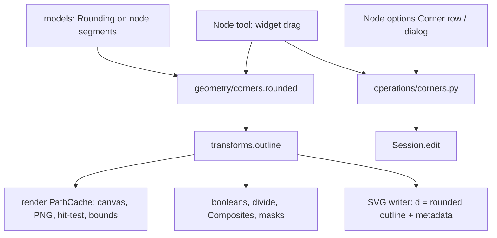

# Design Document

## Overview

A path node can carry a `Rounding` (radius + kind) on the segment that ends at it, like the corner flag from spec `path-structure`. The path's stored segments never change because of rounding; `transforms.outline` returns the **rounded outline** instead, and almost everything that draws or measures a path already goes through it (PathCache → canvas, PNG, hit-testing, bounds, snapping edges; booleans, divide, Composite parts, clip and mask objects via `outline` / `area_outline`). The rounding math is a pure module, `geometry/corners.py`. The Node tool gets corner widgets (a new drag mode), the Node options get a Corner row, and a small dialog sets exact values. Files: `.p2s` stores roundings per node (version 12); SVG writes the rounded outline as `d` and the live data as PressToShape metadata, the Composite pattern.

## Steering Document Alignment

### Technical Standards (tech.md)
- Frozen data, `dataclasses.replace`; pure geometry with unit tests; operations as plain functions with one `session.edit` each; no Qt below `views/`.
- `.p2s` change follows the format rule (version bump, migration, sample, docs row); explicit encoders.
- Paint defaults and "what you see is what you export" kept: the rounded outline is the one geometry used for canvas, PNG and SVG `d`.

### Project Structure (structure.md)
- `models/shapes.py`: `Rounding`, `CornerKind`, `rounding` field on node segments.
- `geometry/corners.py` (new): rounded outline, limits, widget placement and the radius ↔ widget distance mapping.
- `geometry/transforms.py`: `outline` rounds paths.
- `editing/operations/corners.py` (new): set / remove / apply corner rounding.
- `render/handles.py` + `render/scene.py` + `render/overlay.py`: widget hit-testing and drawing.
- `tools/node.py`: widget drag mode; `tools/base.py`: `ToolContext.edit_corners` callback, cursor type.
- `views/corner_dialog.py` (new), `views/tool_options_view.py` (Corner row), `views/keymap.py` (menus).
- `formats/p2s.py`, `formats/p2s_migrations.py`, `formats/svg.py`, `formats/svg_reader.py`, `formats/svg_names.py`.

## Code Reuse Analysis

### Existing Components to Leverage
- **`path_edit.to_subs` / anchor-edge form**: `corners.rounded` walks subpaths as anchors + edges, so open/closed handling and the closed-subpath alias are already solved.
- **`nodes.Topology`, `nodes._is_smooth`**: which nodes are corners (only those get rounded).
- **`transforms.outline` / `area_outline`**: the single entry point for geometry; rounding added there reaches PathCache, booleans, Composites and masks without touching them.
- **Composite SVG metadata pattern** (`svg.py` writes `<metadata><p2s:composite>`; `svg_reader._composite` checks the stored data still produces the visible `d`, else falls back to the plain path).
- **Corner flag plumbing from spec `path-structure`**: per-segment field kept by `replace`, carried through `Anchor`, `rebuild`, `transform_segments`, `.p2s` index lists.
- **`ToolContext.edit_guide`**: the existing pattern for a tool opening a dialog through the view (Node tool → `edit_corners`).
- **`LengthSpinBox`**, `merge_key` edits: Corner row in the options.
- **`Overlay.live`**: drag preview by replacing the path with one whose roundings changed; PathCache rebuilds only that path.

### Integration Points
- **PathCache**: unchanged; `_build` calls `transforms.outline`, which now rounds. Cache key is the frozen shape, so a changed rounding rebuilds.
- **Snapping**: node targets come from `nodes.nodes(path.segments)` (unchanged, Req 2.2); edge/centre/bounds targets from cache bounds, which are rounded.
- **Object to Path** (`paths.to_path`): for a `PathShape` with roundings, returns the baked outline (Req 5.4).

## Architecture



### Rounding geometry (`geometry/corners.py`)

Per subpath in anchor/edge form; anchor `k` is **roundable** when it has an edge on both sides, is not smooth (`_is_smooth` false, which includes the corner flag) and has `rounding.radius > 0`.

1. **Tangents at the node**: incoming direction `t_in` (end tangent of the edge arriving: `p - c2`, falling back to `p - c1`, then to the chord), outgoing `t_out` likewise. Interior angle `θ` between `-t_in` and `t_out`. `θ` near 0 or π (folded back or straight) → not roundable.
2. **Wanted cut length** on each side: `d = r / tan(θ/2)` (the tangent length of a circle of radius `r` touching both directions). Same `d` for all three kinds, so switching kind keeps the corner's extent (as in Illustrator).
3. **Limits** (Req 1.5): each edge has length `L` (line length, or cubic arc length from a 32-sample table). An edge whose both ends are roundable gives each end at most `L/2`; otherwise the rounded end may use up to `L`. `d_eff = min(d, limit_in, limit_out)`; `r_eff = d_eff · tan(θ/2)`. A corner with `d_eff < d` is reported as **limited**.
4. **Cut points**: `P_in` at arc length `d_eff` back from the node along the incoming edge, `P_out` forward along the outgoing one. Cubics are split with de Casteljau at the `t` found in the arc-length table; lines are interpolated. Tangents `T_in`, `T_out` at the cut points come from the split pieces.
5. **Corner piece** from `P_in` to `P_out`:
   - `round`: cubic with handle length `h = 4/3 · tan(φ/4) · r_eff` along `T_in` and back along `T_out`, `φ = π − θ` (the turn).
   - `inverted`: arc around the node with radius `d_eff`; cubic with handles perpendicular to `P_in − node` and `P_out − node`, turned towards each other, length `4/3 · tan(θ/4) · d_eff`.
   - `chamfer`: a line.
6. **Output**: each edge trimmed at its rounded ends (`t0`, `t1`), corner pieces between them, closed subpaths started at the first anchor's `P_out` when it is rounded. Result: plain MoveTo/LineTo/CubicTo/Close segments without flags.

Public functions:
- `has_rounding(segments) -> bool` (cheap check; `outline` skips everything when false).
- `rounded(segments) -> Segments`.
- `limited(segments) -> set[int]` (node indices drawn smaller than stored).
- `roundable(segments) -> set[int]` (corner nodes with a segment on both sides and a usable angle).
- `widget(segments, index, min_distance) -> Point | None`: on the bisector, inside the angle, at `max(min_distance, m(r_eff))` from the node, where `m(r) = r / sin(θ/2) − r` is the distance from the node to the middle of a round arc (the widget sits on the curve once the rounding is big enough).
- `radius_for(segments, index, distance) -> float`: inverse of `m` (`distance / (1/sin(θ/2) − 1)`), clamped ≥ 0.

### Corner widgets in the Node tool

- **Which**: for every edited path, `corners.roundable` ∩ (selected nodes of that path, or all of them when none is selected). Hidden while a node/handle drag runs, and when either adjacent edge is shorter than 4 screen px.
- **Placement**: `corners.widget(..., min_distance = 12 screen px · pixel_size)`.
- **Hit priority** (Req 3.7): controls, then nodes (existing `node_at`), then widgets (`render.handles.widget_at`, 5 screen px), then segments.
- **Drag** (new `_Mode.CORNER`): on press, the targets are the selected roundable corners of all edited paths plus the pressed one; the tool remembers `offset = widget_distance − m(r_start)` for the pressed corner. On move, the pointer is projected on the pressed corner's bisector; `r = radius_for(max(0, projection − offset))` (so the widget doesn't jump on press, and dragging back into the node gives 0). All targets get radius `r`, keeping their kind (new ones `round`). Preview through `Overlay.live` (rounded outline drawn by PathCache) plus `NodeOverlay.widgets` and `NodeOverlay.limited`. Release → `corners_ops.set_radius(session, refs, r)`, label "Round corners".
- **Double-click on a widget** → `ToolContext.edit_corners(refs)`; the view opens `CornerDialog` (kind combo, radius `LengthSpinBox` in the document unit, initial values from the pressed corner) and calls `corners_ops.set_corners(session, refs, kind, radius)` on OK.
- **Cursor**: `CursorType.CORNER` (Tabler `border-corner-rounded` style icon, mapped in `views/cursors.py`).
- **Drawing**: widgets as small rings (white fill, selection-colour ring); limited corners' widgets and their arcs in `CanvasColors.warning` (new colour, from `views/theme.py`).

### Operations (`editing/operations/corners.py`)

- `set_radius(session, refs, radius, merge_key=None)` and `set_corners(session, refs, kind, radius)`: refs are `(path id, node index)`; only roundable-capable nodes (corner nodes with two sides) of edited paths are changed. One undo step ("Round corners" / "Corner rounding"); spinbox edits pass a merge key.
- `@operation("path.remove_corners", "Remove Corner &Rounding")`: selected nodes (Node tool), else all nodes of selected paths.
- `@operation("path.apply_corners", "&Apply Corner Rounding")`: replaces each selected path's segments with `corners.rounded` (keeps id, style, place); can_run when a selected path has a rounding.
- `paths.to_path` bakes rounded paths; `queries.can_object_to_path` also accepts paths with roundings.

### Keeping roundings through edits (Req 5)

- `nodes.Anchor` gains `rounding`; `anchors_and_edges` reads it, `rebuild` writes it (on the MoveTo for a closed subpath's start, as the corner flag).
- `nodes.insert_node`: the second split piece keeps the original segment's fields via `replace` (flag and rounding), the new node gets none.
- `path_edit`: break copies (`_rotated_open`, `_pieces`) and merged join nodes get `rounding=None`; `set_node_type` smooth/symmetric clears it, corner keeps it.
- Transforms: `transform_segments` keeps fields (radii stay in document px; scaling doesn't scale them, Req 5.1).

### Files

- **`.p2s` version 12**: optional path field `"roundings": [[segment index, radius, kind], ...]`, validated (node segment, radius ≥ 0 finite, known kind); migration 11 → 12 no-op; sample `v12.p2s`; docs row.
- **SVG writer**: a path with roundings writes `d` = rounded outline and
  `<metadata><p2s:corners d="<original d>" nodetypes="…" roundings="i:kind:r …"/></metadata>`; `sodipodi:nodetypes` is left off such paths (it would describe the original nodes, not `d`).
- **SVG reader**: a `<path>` with that metadata parses the original `d`, applies `corners` / `roundings`, bakes the element transform like any path (radii scaled by `sqrt(|det m|)` so they match the drawn size), and checks that `corners.rounded(result)` matches the element's own `d` (same segment count and every point within 0.01 px). Match → live path; otherwise the plain path, silently (Req 6.3).
- **Clipboard**: uses the `.p2s` encoders; pasting into other apps uses the SVG writer, so they get the rounded outline.

## Components and Interfaces

### `geometry/corners.py` (new)
- **Purpose:** rounded outline and widget math. **Interfaces:** see above. **Dependencies:** `geometry.nodes`, `geometry.path_edit`, `models.shapes`. **Reuses:** anchor/edge form, `_is_smooth`, de Casteljau split from `nodes.insert_node` (moved to a shared helper).

### `editing/operations/corners.py` (new)
- **Purpose:** the only code that changes roundings. **Interfaces:** `set_radius`, `set_corners`, `remove_corners`, `apply_corners`, `selected_corner_values(state) -> (kind | None, radius | None)` for the options row.

### `tools/node.py`
- **Purpose:** `_Mode.CORNER` drag, widget hover cursor, double-click → `edit_corners`. Overlay gets widgets and limited sets.

### `views/corner_dialog.py` (new), `views/tool_options_view.py`
- **Purpose:** exact values. Dialog returns `(kind, radius)`; the Corner row (kind combo + `LengthSpinBox`) shows mixed values empty and writes through `set_corners` / `set_radius` with a merge key.

## Data Models

```python
CornerKind = Literal["round", "inverted", "chamfer"]

@dataclass(frozen=True)
class Rounding:
    radius: float          # document px, > 0
    kind: CornerKind = "round"

@dataclass(frozen=True)
class LineTo:              # likewise MoveTo, CubicTo
    x: float
    y: float
    corner: bool = False
    rounding: Rounding | None = None
```

`.p2s` (v12) path: `{"type": "path", ..., "corners": [3], "roundings": [[3, 12.0, "round"], [5, 4.0, "chamfer"]]}`.

SVG:
```xml
<path d="M 0,0 L 88,0 C … Z" style="…">
  <metadata><p2s:corners d="M 0,0 L 100,0 L 100,100 Z" roundings="1:round:12"/></metadata>
</path>
```

## Error Handling

1. **Degenerate corners** (zero-length edges, θ ≈ 0 or π, coincident handles): not roundable; drawn sharp; no widget. Never raises.
2. **Radius larger than fits**: drawn limited (Req 1.5), stored value kept; widget and arc in the warning colour while editing.
3. **Damaged `.p2s` roundings**: damaged-file error naming the field, like other fields.
4. **SVG metadata unreadable or not matching `d`**: the plain path from `d`; no note (Req 6.3).
5. **Rounding on a node that later becomes smooth or an end node** through an operation that doesn't clear it (e.g. the user lines up handles by hand): ignored when drawing (Req 1.2), kept in the data.

## Testing Strategy

### Unit Testing
- `tests/geometry/test_corners.py`: square with r on one/all corners (arc points on the circle within 1e-3, tangent continuity), limits (two rounded ends share an edge; stored radius kept, `limited` reports), inverted and chamfer shapes, curves next to the corner (cut point at the right arc length, outline continuous), closed subpath starting at a rounded node, open subpath ends ignored, smooth nodes ignored, degenerate angles, `widget` / `radius_for` inverse, `has_rounding` false path returns the same tuple object.
- `tests/geometry/test_nodes.py`, `test_path_edit.py`: roundings kept/cleared per Req 5.2–5.3.
- `tests/geometry/test_transforms.py`: `outline` rounds; transforms keep radii.

### Integration Testing
- `tests/editing/test_corners.py`: set/remove/apply, undo labels, merge of spinbox steps, only roundable nodes change, Object to Path bakes, booleans use the rounded outline.
- `tests/tools/test_node.py`: widget shown for selected/all corners, priority order, drag sets radius on all selected corners with one undo step, drag back to node gives 0, no jump on press, double-click calls `edit_corners`.
- `tests/render`: widgets and the rounded outline on a CPU surface (pixel checks).
- `tests/formats`: `.p2s` v12 round trip and damaged cases, v11 sample still opens; SVG round trip (live corners back), edited `d` → plain path, metadata with transform scaling radii, resvg generator check of rounded paths.

### End-to-End Testing
- Scratch QTest script on the real window, offscreen and on the desktop (GL): drag a widget on a square, double-click it and set chamfer in the dialog, type a radius in the options row, save and reopen SVG and `.p2s`; screenshots checked by eye.
