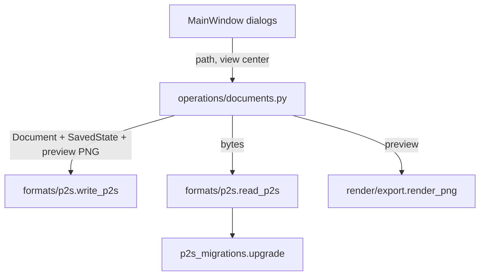

# Design Document

## Overview

A new `presstoshape/formats/p2s.py` writes and reads `.p2s` archives. `presstoshape/formats/p2s_migrations.py` upgrades older format versions. The document operations pick SVG or `.p2s` by file extension, and the main window offers both types in its dialogs.

Working state (view, tool settings, selection, edit path) travels as a small, explicit `SavedState` value. That keeps `formats/` free of `AppState`'s session-only fields.



## Steering Document Alignment

### Technical Standards (tech.md)
- **Stdlib only:** `zipfile`, `json`. No new dependency.
- **Layer rules:** `formats` uses only `models` and `geometry`. The preview is rendered in `editing` (allowed to use `render`) and passed in as bytes.
- **Explicit serialization:** one encoder/decoder pair per type, as a table keyed by `"type"`. No reflection over dataclass fields, so renaming a model field can't silently change the format.

### Project Structure (structure.md)
- `formats/p2s.py` and `formats/p2s_migrations.py`, next to `formats/svg.py`.
- Tests: `tests/formats/test_p2s.py` and `tests/formats/test_p2s_migrations.py`, plus sample files in `tests/formats/samples/` (`v1.p2s`).
- Format description: `docs/file-format.md`, the first file in a new `docs/` folder.

## Code Reuse Analysis

### Existing Components to Leverage
- **`documents.open_file` / `save_file` / `_reset`:** gain format dispatch by extension. Error handling and status messages work the same way.
- **`render/export.render_png(doc, scale)`:** renders the preview at a scale that makes the longer side at most 256 px.
- **`containers.valid_edit_path`, `queries.pickable_shapes`:** drop stale edit paths and selections after loading (Requirement 2.2).
- **`version.app_version()`:** the "written by" field. `formats` may not import it, so the operation passes the string in.
- **`CanvasView.center_artboard` / `fit_artboard`:** extended with `center_on(point)` and `view_center()`.

### Integration Points
- **Main window:**
  - Open dialog filter `"PressToShape and SVG (*.p2s *.svg);;PressToShape (*.p2s);;SVG (*.svg)"`.
  - Save As filter `"PressToShape (*.p2s);;SVG (*.svg)"`, with the extension taken from the selected filter if the user typed none.
  - Save passes `canvas.view_center()` to the operation.
- **View restore after open:** `open_file` sets `state.zoom_percent` and the new field `state.restore_view_center`. `MainWindow.open_document` then calls `canvas.center_on(...)` and clears it, or fits the artboard when it's empty (SVG files, `.p2s` without a view).

## Architecture

### Archive layout (format version 1)
```
mimetype            "application/x-presstoshape", stored uncompressed, first entry
document.json       format + document + state, deflate
preview.png         ≤ 256 px on the longer side
resources/          reserved, not written in v1, ignored when read
```

### `document.json` (v1)
```json
{
  "format": "presstoshape", "format_version": 1, "app_version": "0.1.0.dev…",
  "document": {
    "width": 600.0, "height": 400.0, "next_id": 42,
    "layers": [{"name": "Layer 1", "visible": true, "shapes": [ … ]}]
  },
  "state": {
    "view": {"zoom_percent": 100, "center": [300.0, 200.0]},
    "tools": {"styles": {"pen": {…}, "rectangle": {…}, "ellipse": {…}, "text": {…}},
              "font_size": 24.0, "new_part_mode": "add"},
    "selection": [12, 15], "selected_layer": 0, "edit_path": [7]
  }
}
```
- **Shapes:** `{"type": "rect" | "ellipse" | "path" | "text" | "composite", "id": …}` plus geometry, `"style": {"fill": "#rrggbb" | null, "stroke": … | null, "stroke_width": …}` and `"transform": [a, b, c, d, e, f]`. The transform is omitted when it's identity.
- **Path segments:** compact arrays (`["M", x, y]`, `["L", x, y]`, `["C", c1x, c1y, c2x, c2y, x, y]`, `["Z"]`).
- **Composites:** `"parts": [shape…]` and `"modes": [...]`.
- **Exact numbers:** floats are written with Python's shortest round-trip `repr` (what `json` already does), so save → open → save is byte-stable.

### Modular Design Principles
- `p2s.py`: `write_p2s(document, state, preview, app_version) -> bytes` and `read_p2s(data) -> tuple[Document, SavedState]`. Encoders and decoders are private.
- `p2s_migrations.py`: `upgrade(payload: dict) -> dict`, which applies `MIGRATIONS[v]` from the file's version up to `CURRENT_VERSION`. It's empty for v1 but tested.

## Components and Interfaces

### `formats/p2s.py`
- `SavedState` (frozen dataclass, in `formats` because only the format needs it):
  - `zoom_percent: int | None`
  - `view_center: Point | None`
  - `tool_styles: dict[str, Style]`
  - `font_size`, `new_part_mode`
  - `selection: frozenset[int]`
  - `selected_layer: int`
  - `edit_path: tuple[int, ...]`
- `P2sError(ValueError)`: every read failure. Messages are user-readable: "not a PressToShape file", "made with a newer PressToShape (format 3, this version reads up to 1)", "damaged: …".
- **Limits:** `document.json` ≤ 64 MiB decompressed, preview ≤ 8 MiB. Entries are read by exact name only, never extracted to disk.
- **Validation:** decoders check types and finite numbers, and reject unknown shape types or modes.

### `editing/operations/documents.py`
- `open_file(session, path)`:
  - `.p2s` → `read_p2s`, then `_reset`, then apply `SavedState`:
    - tool styles, font size and new-part mode are set
    - selection and edit path are filtered against the loaded document via `containers` / `queries`
    - zoom is set
    - `restore_view_center` is set
  - Anything else → SVG, as today.
- `save_file(session, path=None, view_center=None)`:
  - The format comes from the target's extension: `.p2s` → native, otherwise SVG.
  - Writes atomically:
    1. `tempfile.NamedTemporaryFile(dir=target.parent, delete=False)`
    2. write, flush, `os.fsync`
    3. `os.replace`
  - On error the temp file is removed and the status message is set.
  - First SVG save in a session → status hint (Requirement 3.3), tracked by `state.svg_hint_shown`.
- The preview is `render_png(document, scale)` with scale = min(1, 256 / longer side). It's skipped (no `preview.png`) if rendering returns None.

### Models
- `AppState.restore_view_center: Point | None = None`: a one-shot request consumed by the main window.
- `AppState.svg_hint_shown: bool = False`.

### Views
- `CanvasView.view_center() -> Point` (doc coordinates of the viewport center) and `center_on(point)`.
- `MainWindow`: the dialog filters above. `new_document` and `open_document` choose between restore and fit.

## Data Models
See `document.json` above. Tool keys use `Tool` enum names in lower case; unknown tool keys are ignored on read, so a future tool added in a newer minor change doesn't break older readers.

## Error Handling

### Error Scenarios
1. **Not a ZIP, or wrong/missing `mimetype`:** `P2sError("not a PressToShape file")`. The status bar says "Could not open name.p2s: …" and the current document stays.
2. **Newer format version:** refused with both versions named (Requirement 4.3).
3. **Malformed JSON, or invalid/unknown values:** `P2sError("damaged: …")` naming the failing path, e.g. `layers[0].shapes[3].width`.
4. **Write failure:** the temp file is removed, the target is untouched, and the status bar shows the OS error.
5. **Stale selection or edit path:** silently dropped.
6. **Huge entries:** refused before decompressing beyond the limit, reading in chunks.

## Testing Strategy

### Unit Testing
- **Round trip:** every shape type, nested Composites, rotated/skewed transforms, text, `None` fill/stroke, hidden and empty layers, `next_id`, and every `SavedState` field. Save → open → save gives identical bytes in `document.json`.
- **Failure cases:**
  - errors: not a ZIP, wrong mimetype, newer version, bad JSON, unknown type, NaN, negative sizes where invalid
  - size limits, using a crafted archive
  - unknown extra entries are ignored
- **Migrations:** `upgrade` on a v1 payload is the identity; `tests/formats/samples/v1.p2s` opens and matches the expected document (kept for all future versions).
- **Operations:**
  - dispatch by extension
  - the atomic save leaves the old file intact when the write fails (monkeypatched)
  - working state restored, stale ids dropped
  - SVG hint shown once
  - an opened SVG keeps saving SVG

### Integration Testing
- QTest scratch run, offscreen and on the desktop (GL):
  1. draw, zoom/scroll, select, enter a Composite
  2. Save As `.p2s`, New, Open
  3. check: same view area, selection and edit bar
  4. Save As `.svg`: status hint appears once
- Extend `--self-test` with a `.p2s` round trip, so frozen builds prove `zipfile`/`json` work in the bundle.

### End-to-End Testing
- Inspect a saved file with `unzip -l` and `python -m json.tool` (openness), and check that `docs/file-format.md` matches the real output.
- README/FAQ: "Will PressToShape have its own file format?" becomes yes (`.p2s`), and the docs mention the save flow.
