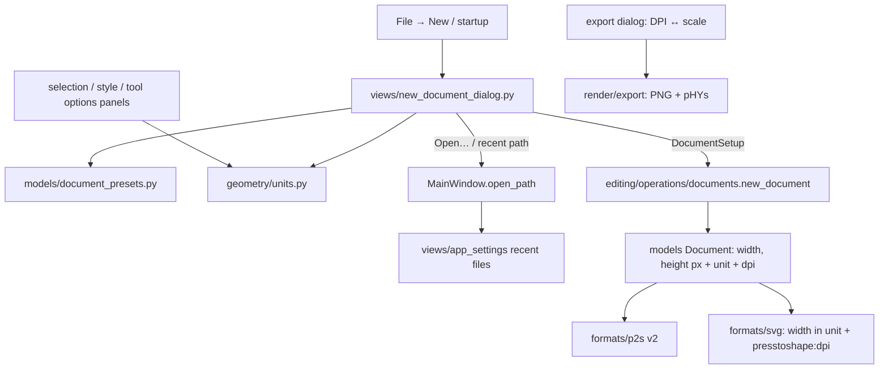

# Design Document

## Overview

Three pieces, built on one decision about coordinates:

1. **Units and DPI in the document.** Document coordinates stay what they are today: *document pixels*. A document now also has a `unit` (px, mm, cm, in, pt) and a `dpi`. One document pixel is 1/DPI inch. The unit only changes how lengths are **shown and entered**; geometry, rendering, hit-testing, booleans and undo don't change at all. An A4 document at 300 DPI is 2480.3 × 3507.9 document pixels and shows as 210 × 297 mm.
2. **The New Document dialog** collects size, unit, DPI and orientation (from presets or by hand) and hands plain values to one operation, `documents.new_document(session, setup)`. At startup it also offers Open… and recent files and the "Show at startup" choice.
3. **Recent files** are an app setting with a small, tested list logic, shown in the startup dialog and in File → Open Recent.

Files keep the physical size: `.p2s` format 2 stores unit and DPI; SVG writes `width="210mm"` with the `viewBox` in document pixels, plus our own `presstoshape:unit`/`presstoshape:dpi` attributes for an exact round trip. PNG export works in DPI and writes it into the file.

## Steering Document Alignment

### Technical Standards (tech.md)
- **State and operations:** unit and DPI are document fields, set only by operations (`new_document`, open). The dialog is a view and passes plain values.
- **No Qt below views:**
  - unit math in `geometry/units.py`;
  - presets as data in `models/document_presets.py`;
  - recent-list logic as plain functions.
- **Native format rules:** `CURRENT_VERSION` 1 → 2, migration, `tests/formats/samples/v2.p2s`, a row in `docs/file-format.md`.
- **Shortcut rule:** no new shortcuts. Ctrl+N stays New and opens the dialog; Open Recent has no shortcuts.
- **Translations:** all new texts go through `i18n`; preset names are `N_()`-marked data; German stays complete.

### Project Structure (structure.md)
- **New:**
  - `geometry/units.py`;
  - `models/document_presets.py`;
  - `views/new_document_dialog.py`;
  - `views/settings/general_page.py`;
  - tests `tests/geometry/test_units.py`, `tests/models/test_document_presets.py`, `tests/views/test_new_document_dialog.py`, `tests/views/test_recent_files.py`.
- **Changed:**
  - models: `models/app_state.py` (Document fields);
  - formats: `formats/p2s.py`, `p2s_migrations.py`, `formats/svg.py`;
  - render and editing: `render/export.py`, `editing/operations/documents.py`;
  - views: `views/app_settings.py`, `views/main_window.py`, `views/menu_bar_view.py`, `views/keymap.py`, `views/selection_view.py`, `views/style_editor.py`, `views/tool_options_view.py`, `views/export_dialog.py`, `views/settings/dialog.py`;
  - `app.py`;
  - docs.

## Code Reuse Analysis

### Existing Components to Leverage
- **`documents._reset`:** already replaces the document, clears history, selection and edit path. `new_document` keeps using it with a sized `Document`.
- **`CanvasView.fit_artboard`:** a new document opens fitted.
- **`MainWindow._confirm_discard`, `open_document`:** reused for "save changes?" and Open….
- **`views/app_settings` and `QSettings`:** recent files, last new-document setup and "show at startup" are new typed accessors next to language and renderer.
- **Settings window pages (`views/settings/`):** a General page is one more `SettingsPage` in `PAGES`.
- **SVG reader's base matrix:** already maps the viewBox into document coordinates, including stroke widths. Scaling foreign mm-based SVGs to a sensible DPI is one more factor in that matrix.
- **`PRESSTOSHAPE_NS`:** our SVG namespace (already used for Composites) carries unit and DPI.
- **`render/export.render_png`:** stays scale-based; the dialog converts DPI to scale.

### Integration Points
- **Startup (`App.run`):** after the window is shown and centred, `QTimer.singleShot(0, window.show_start_dialog)` when settings exist and "show at startup" is on.
- **File menu:** New opens the dialog; a dynamic Open Recent submenu, filled on `aboutToShow`.
- **Selection panel, style editor, tool options:** convert between document pixels and the document unit at the widget boundary.

## Architecture



## Components and Interfaces

### `models/app_state.py`
```python
Unit = Literal["px", "mm", "cm", "in", "pt"]

@dataclass
class Document:
    width: float = 600.0      # document pixels, as today
    height: float = 400.0
    layers: ...
    next_id: int = 1
    unit: Unit = "px"
    dpi: float = 96.0         # document pixels per inch
```
- Defaults keep every existing document and test unchanged (px, 96 DPI).

### `geometry/units.py` (pure)
```python
UNITS: tuple[Unit, ...] = ("px", "mm", "cm", "in", "pt")
PER_INCH = {"mm": 25.4, "cm": 2.54, "in": 1.0, "pt": 72.0}   # px: the DPI itself
DECIMALS = {"px": 2, "mm": 2, "cm": 3, "in": 3, "pt": 2}
MIN_DPI, MAX_DPI = 1.0, 9600.0

def to_px(value: float, unit: Unit, dpi: float) -> float
def from_px(px: float, unit: Unit, dpi: float) -> float
def convert(value: float, source: Unit, target: Unit, dpi: float) -> float
```

### `models/document_presets.py` (data)
```python
@dataclass(frozen=True)
class DocumentPreset:
    id: str            # stable, stored as "last used" ("print.a4")
    category: str      # N_()-marked: "Print", "Screen", "Web and social", "Icons"
    name: str          # N_()-marked: "A4", "Full HD", "Story", …
    width: float       # in `unit`, portrait for print formats
    height: float
    unit: Unit
    dpi: float

PRESETS: tuple[DocumentPreset, ...] = (...)   # Requirement 2.1
DEFAULT = DocumentPreset("default", "", N_("Default"), 600, 400, "px", 96)
```

### `editing/operations/documents.py`
```python
@dataclass(frozen=True)
class DocumentSetup:
    width: float          # in `unit`
    height: float
    unit: Unit
    dpi: float

def new_document(session, setup: DocumentSetup = DEFAULT_SETUP) -> None
    # validates (Requirement 3.5; raises ValueError for out-of-range values, the dialog prevents them),
    # converts to px, creates Document(width_px, height_px, unit=..., dpi=...) via _reset.
```

### `views/new_document_dialog.py`
- **`NewDocumentDialog(QDialog)`:**
  ```python
  NewDocumentDialog(last: StoredSetup | None, recent: list[str] | None, show_at_startup: bool | None, parent)
  # recent / show_at_startup None = opened from File → New (no startup parts)
  result_setup: DocumentSetup | None
  result_preset: str | None         # preset id or None for custom
  open_path: str | None             # a recent file or "open_requested" for Open…
  show_at_startup: bool
  ```
- **Layout:**
  - **Left:** a `QTreeWidget` of presets, top-level items are categories (expanded), children show "A4 · 210 × 297 mm".
  - **Right:** a form with Width, Height (`QDoubleSpinBox`), Unit (`QComboBox`), DPI (`QDoubleSpinBox`), Orientation (two checkable tool buttons with icons: portrait / landscape), a hint label ("2480 × 3508 px" or "210 × 297 mm at 300 DPI") and an error label.
  - **Startup only, below:** "Recent files" (`QListWidget`: name, folder, date), an "Open…" button, and a "Show this dialog at startup" checkbox.
  - **Buttons:** Create (default) and Cancel.
- **Behaviour:**
  - Selecting a preset fills the fields with signals blocked; any user edit selects the tree's "Custom" state (clears the selection) (Requirement 2.2).
  - **Unit change:** converts width and height through `units.convert` (Requirement 3.2).
  - **DPI change:**
    - physical unit: the values stay, and only the hint changes;
    - px: the values stay too, since px is the unit.

    (Requirement 3.3: physical size kept for physical units, pixel size kept for px.)
  - **Orientation:** swaps when it doesn't match the wanted one; it updates itself from width vs height.
  - **Validation:** each pixel size must be at least 1 and at most `MAX_DOCUMENT_PX` (the canvas limit, 100,000 px per side); otherwise Create is disabled and the error label says why.
  - Double-click a preset = Create; Enter = Create; Esc = Cancel.
  - Double-click/Enter on a recent file sets `open_path` and accepts.
  - Open… sets `open_path = OPEN` and accepts; `MainWindow` shows the file dialog and, if cancelled, reopens the start dialog (Requirement 4.2).

### `views/app_settings.py` (extended)
```python
def recent_files(settings) -> list[str]
def add_recent_file(settings, path: str) -> None      # move to top, dedupe by resolved path, limit 10
def remove_recent_file(settings, path: str) -> None
def clear_recent_files(settings) -> None
def updated_recent(paths: list[str], path: str, limit: int = 10) -> list[str]   # pure, tested
def show_start_dialog(settings) -> bool               # default True
def set_show_start_dialog(settings, value: bool) -> None
def last_new_document(settings) -> StoredSetup | None # preset id or custom width/height/unit/dpi
def set_last_new_document(settings, preset: str | None, setup: DocumentSetup) -> None
```

### `views/main_window.py`
- **`new_document()`:** opens the dialog without the startup parts. On Create: `_confirm_discard()` → `documents.new_document(session, setup)` → `canvas.fit_artboard()` → store the last setup.
- **`show_start_dialog()`:** the startup variant.
  - **Cancel:** applies the last setup if there is one (else keeps the built-in default) and fits.
  - **Open… / recent:** goes through `open_path`; on failure it reopens the dialog with the error shown (Requirement 4.3).
- **`open_path(path) -> bool`:** the shared open logic (view restore or fit, recent list update). `open_document()` and Open Recent use it. A failed open of a recent entry removes it (Requirement 5.3).
- **Saves:** successful saves call `add_recent_file`.
- **Open Recent:** a submenu marker `file.open_recent` in `keymap.MENUS`, built by `menu_bar_view` as an empty `QMenu` that `MainWindow` fills on `aboutToShow`: numbered entries "&1 name.p2s" (no shortcuts), a separator, "Clear Recent Files", or a disabled "No recent files".

### Unit display in panels
- **A small helper in views, `views/unit_fields.py`:** `configure(spin, unit, minimum_px, maximum_px, dpi)` sets decimals, suffix (" mm") and range; `shown(px)` / `stored(value)` convert.
- **SelectionOptions:** X, Y, W, H, centre and radius fields, plus stroke width in the style editor, convert at the widget boundary. On refresh, they reconfigure when the document's unit or DPI changed.
- **Tool options:** the tool styles' stroke width shows in the document's unit.
- **Font size:**
  - physical units: shown in pt (`from_px(size, "pt", dpi)`);
  - px documents: shown in px, as today.

  Requirement 6.4 says font size stays in pt. In a px document "pt" would turn today's 24 into 18, so px documents keep px. That deviation is visible in review.
- **Operations keep receiving document pixels;** no operation knows about units.

### Files
- **`.p2s` v2:** the document object gains `"unit"` and `"dpi"`. The migration from version 1 adds `"unit": "px", "dpi": 96.0`; the decoder validates the unit name and a DPI range of `MIN_DPI`–`MAX_DPI`. Plus a v2 sample and the file-format doc.
- **SVG write:**
  - **Physical units:** `width="{from_px(width)}{unit}"`, the same for height, and `viewBox="0 0 {width_px} {height_px}"`.
  - **px:** plain numbers, as today.
  - **Always:** `presstoshape:unit` and `presstoshape:dpi` on the root.
- **SVG read:**
  1. With `presstoshape:unit`/`dpi` present: take them as they are (exact round trip).
  2. Otherwise, with physical units (mm, cm, in, pt, pc → pt) on width: physical inches = width in inches; density = viewBox width ÷ inches.
     - If density ≥ 72: keep the coordinates, `dpi = density` (e.g. a 300 DPI file).
     - Otherwise (Inkscape mm documents have 25.4): scale the content by `96 / density` through the reader's base matrix and use `dpi = 96`, so the drawing gets usable pixel coordinates and stroke widths scale with it.

     `unit` = the file's unit.
  3. Otherwise: px, 96 DPI (as today).

### `render/export.py` and the export dialog
- **`render_png(doc, scale, dpi: float | None = None)`:** writes a `pHYs` chunk (pixels per metre = DPI / 0.0254) after `IHDR`, with its CRC from `zlib.crc32`.
- **Export dialog:** a DPI field (`doc.dpi × scale`) linked to Scale; the default DPI is `doc.dpi`. The last export DPI is kept in `ExportSettings` for the session, as scale is today.

### `views/settings/general_page.py`
- A "General" category (first in `PAGES`) with one checkbox: "Show the New Document dialog at startup".

## Data Models

### Settings keys
```
start/show_dialog      bool, default true
recent_files           list of absolute paths, newest first, max 10
new_document/preset    preset id or empty for custom
new_document/setup     [width, height, unit, dpi] of the last created document
```

### `.p2s` version 2 document object
```json
{ "width": 2480.31, "height": 3507.87, "unit": "mm", "dpi": 300.0, "next_id": 1, "layers": [ … ] }
```

## Error Handling

### Error Scenarios
1. **Recent file missing or unreadable.**
   - **Handling:** in the start dialog, the error is shown in place, with a "Remove from list" button. From Open Recent, a status message is shown and the entry removed.
   - **User Impact:** clear reason; the list cleans itself up.
2. **Invalid size or DPI typed in the dialog.**
   - **Handling:** Create is disabled, with a reason ("Width is at most 100,000 px at this DPI").
   - **User Impact:** no broken documents.
3. **Hostile `.p2s`** (unknown unit, DPI 0 or 1e9).
   - **Handling:** `P2sError` ("damaged file: document.unit should be one of …").
   - **User Impact:** as for other damaged files.
4. **SVG with odd units** (`em`, `%`, or a viewBox missing).
   - **Handling:** treated as px at 96 DPI, as today.
   - **User Impact:** opens; size may be in px.
5. **Settings value of the wrong type** (hand-edited ini).
   - **Handling:** the accessors fall back to defaults.
   - **User Impact:** none.

## Testing Strategy

### Unit Testing
- **`test_units.py`:** A4 at 72/96/300 DPI; in ↔ mm ↔ pt ↔ cm; px identity; round trips within float tolerance.
- **`test_document_presets.py`:** unique ids; every preset fits `MAX_DOCUMENT_PX` and DPI limits; print presets are portrait; names are marked for translation (present in the template).
- **`test_documents.py`:** `new_document` with setups; validation; not dirty, history cleared; default unchanged.
- **`test_p2s.py` / `test_p2s_migrations.py`:** v2 round trip with unit/DPI; the v1 sample migrates to px/96; the v2 sample opens; bad unit/DPI refused.
- **`test_svg.py`:**
  - mm/in/pt export writes physical width and the viewBox in px;
  - our own round trip is exact;
  - an Inkscape-style mm document (viewBox in mm) opens as mm, with content scaled to 96 DPI, and keeps its physical size on export;
  - a 300 DPI viewBox keeps its coordinates;
  - px files are unchanged.
- **`test_export.py`:** the pHYs chunk is present with the right value; sizes from DPI.
- **`test_recent_files.py`:** `updated_recent` moves to the top, dedupes, limits; the accessors survive bad stored values.

### Integration Testing
- **`test_new_document_dialog.py`** (offscreen):
  - preset fills the fields;
  - edit → custom;
  - unit switch converts;
  - DPI change keeps the physical size for mm and the pixel size for px;
  - orientation swap;
  - invalid size disables Create;
  - startup parts hidden for New;
  - recent list activation sets `open_path`;
  - the checkbox reflects and returns the setting.
- **`test_settings.py`:** the General page toggles `show_start_dialog`.
- **Selection panel in mm:** a rectangle shows 210 mm and editing 100 mm sets 1181.1 px at 300 DPI.

### End-to-End Testing
- QTest scratch run on the real window, offscreen and with GL:
  - start with settings → the dialog appears over the window;
  - A4 → Create → artboard fitted, panel in mm;
  - File → New → Cancel changes nothing;
  - New with unsaved changes asks first;
  - a recent file opens;
  - a missing recent file shows its error;
  - "Show at startup" off → no dialog on the next start.
- German screenshot of the dialog (texts fit).
- Manual check for the user: an A4 SVG saved here opens as A4 in Inkscape and back.
