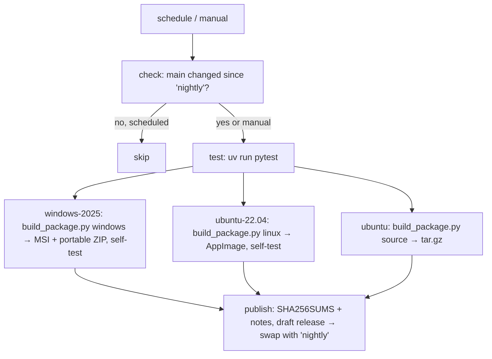

# Design Document

## Overview

One GitHub Actions workflow, `.github/workflows/nightly.yml`, builds and publishes the rolling `nightly` pre-release. All packaging logic lives in one Python driver, `scripts/build_package.py`, run with `uv run`. It works the same in CI and locally, so a package can be rebuilt on a developer machine with one command. The app itself changes very little. It gains:

- a version module
- a headless `--self-test` entry point for the smoke check
- an app icon
- frozen-safe resource paths (already `__file__`-relative, so these work unchanged)



## Steering Document Alignment

### Technical Standards (tech.md)
- **PyInstaller** (Decision 10) in `--onedir` mode: Qt stays as separate shared libraries (LGPL, Requirement 8.2), startup is faster than onefile, and the same folder feeds the ZIP, MSI and AppImage.
- **uv for everything**: build tools go into a new `build` dependency group (`pyinstaller==6.22.3`, `pillow` for the `.ico`), locked in `uv.lock`; CI runs `uv sync --frozen --group build`. No bare pip.
- **Pinning policy** (same reasons as for spec-workflow): actions pinned by commit SHA with the version in a comment; WiX pinned with `dotnet tool install --version`; appimagetool pinned to release `1.9.1` and verified by SHA-256.
- "No packaging or CI yet" disappears from tech.md's known limitations; Deployment and Build sections get updated.

### Project Structure (structure.md)
- New top-level `packaging/` holds static packaging inputs (PyInstaller spec, WiX source, desktop entry, release-notes template). `scripts/build_package.py` is the dev/CI script, like the existing `scripts/*.py`.
- New `presstoshape/version.py`, Qt-free, allowed from `app` and `views`. `tests/test_architecture.py` gets the entry.
- App icon at `presstoshape/assets/app/presstoshape.svg`, referenced from `presstoshape/icons.py` like the other icons.

## Code Reuse Analysis

### Existing Components to Leverage
- **`App.run(screenshot_path=…)`**: already renders the window once and exits. `--self-test` extends that path instead of adding a second startup path.
- **`formats.svg` read/write and `render.export`**: the self-test round-trips a small document through SVG and renders it, which exercises skia, skia-pathops and svgelements inside the bundle.
- **`presstoshape/icons.py` + `views/icon_engine.py`**: the window icon loads the same way as the other icons.
- **`scripts/screenshot_app.py` demo shapes**: the self-test seeds similar shapes (rect, ellipse, path, text, a Composite).

### Integration Points
- **`main.py`**: parses `--self-test` and `--version` before creating the window.
- **`MainWindow.show_about`**: shows `version.app_version()`.
- **Assets inside the bundle**: `icons.py` builds paths from `Path(__file__)`. PyInstaller places modules under `_internal/presstoshape/…` and keeps `__file__` there, so collecting `presstoshape/assets` as data at the same relative path is enough. The self-test checks it by loading every icon path.

## Architecture

Three layers, each usable on its own:

1. **App hooks** (Python, in the repo): `version.py`, `--self-test`, `--version`, icon.
2. **Packaging driver** (`scripts/build_package.py`): `version`, `windows`, `linux`, `source` and `notes` subcommands, which call PyInstaller, WiX, appimagetool and git. Pure helpers (version strings, MSI version, file names, notes text) are separate functions with unit tests.
3. **Workflow** (`nightly.yml`): orchestration only: checkout, setup, call the driver, upload and download artifacts, publish. No packaging logic inline.

### Modular Design Principles
- One subcommand per artifact type; shared steps (freeze, collect licenses) are helper functions.
- Static inputs (`.spec`, `.wxs`, `.desktop`, notes template) are files, not strings in Python or YAML.

## Components and Interfaces

### `presstoshape/version.py`
- **Purpose:** one place that knows the app version.
- **Interfaces:** `app_version() -> str`. Order of lookup:
  1. `presstoshape/_build_info.py`, generated by the build and gitignored; defines `VERSION`.
  2. Otherwise the `version` from `pyproject.toml` next to the package, plus `" (source)"`.
  3. Otherwise `"unknown"`.
- **Dependencies:** stdlib only (`tomllib`, `importlib`).

### `App` self-test (`presstoshape/app.py`) and `main.py`
- **Purpose:** headless smoke check of a frozen bundle (Requirement 2.2), plus `--version`.
- **Interfaces:**
  - `main.py --version` prints `app_version()` and exits 0.
  - `main.py --self-test` sets `QT_QPA_PLATFORM=offscreen` unless the variable is already set, then runs `App().run(self_test=True)`.
- **Self-test steps:**
  1. Create the window.
  2. Seed demo shapes, including a Composite.
  3. Load every icon path in `icons.py`.
  4. Round-trip the document through `write_svg` / `read_svg`.
  5. Render one PNG with `render.export` to a temp file.
  6. Grab the window and check that it isn't blank.
  7. Close, exit 0.
- **Failure:** any exception or failed check prints the reason to stderr and exits 1. Windowed builds have no console, so a timestamped result line also goes to `self-test.log` in the temp dir; CI checks the exit code and prints the log.
- **Linux display:** on Linux CI the AppImage self-test runs twice, once offscreen and once under `xvfb-run` with `QT_QPA_PLATFORM=xcb`. The xcb run catches missing X11 libraries such as `libxcb-cursor0`, which the offscreen run can't.
- **Reuses:** the `screenshot_path` branch of `App.run`.

### App icon
- `presstoshape/assets/app/presstoshape.svg`: a simple placeholder mark (a square and a circle combined, a nod to Composites) in the theme's accent blue. It can be replaced later without touching code.
- **Runtime:** `QApplication.setWindowIcon(icon_engine.icon(icons.APP))`.
- **Build time:** `build_package.py` renders it with QtSvg to PNGs (16 to 256 px). Pillow packs those into `presstoshape.ico` for the exe and MSI; the 256 px PNG goes into the AppImage.

### `packaging/presstoshape.spec` (PyInstaller)
- `onedir`, windowed (`console=False`), name `PressToShape`, icon from the generated `.ico`.
- `datas`: `presstoshape/assets` and the `licenses/` folder.
- `excludes`: unused Qt modules that PySide6 hooks might pull in (QtNetwork, QtQml, QtQuick, QtPdf, QtDBus where possible), and `tkinter`.
- `hiddenimports`: `presstoshape._build_info`.
- Generated inputs (`_build_info.py`, `.ico`, `licenses/`) come from the driver before PyInstaller runs.

### `scripts/build_package.py`
- **Subcommands:**
  - `version`: prints the nightly version and the MSI version. CI stores them as job outputs, so every platform uses the same values.
  - `windows`: does the shared steps, then:
    - zips the folder → `PressToShape-{v}-windows-x64-portable.zip`
    - runs `wix build -acceptEula wix7 -arch x64 -d Version=… -bindpath app=dist/PressToShape packaging/windows/PressToShape.wxs` → `PressToShape-{v}-windows-x64.msi`
  - `linux`: does the shared steps, then:
    - builds `AppDir/` (`usr/bin/` = the frozen folder, `AppRun` launcher, `presstoshape.desktop`, `presstoshape.png`, `.DirIcon`)
    - copies `libxcb-cursor.so.0` into the bundle when PyInstaller didn't, since it's missing on many distros
    - runs `ARCH=x86_64 appimagetool AppDir` → `PressToShape-{v}-linux-x86_64.AppImage`
  - `source`: `git archive --format=tar.gz --prefix=PressToShape-{v}/ HEAD` → `PressToShape-{v}-source.tar.gz`. Only tracked files go in (Requirement 5.2), and `uv.lock` is tracked.
  - `notes --previous SHA`: writes the release notes from `packaging/release-notes.md` plus `git log --oneline {previous}..HEAD`.
  - `self-test PATH`: runs the built app with `--self-test` and a timeout of 120 s, and prints the log if it fails.
- **Shared steps** (`windows`, `linux`):
  1. Write `_build_info.py`.
  2. Render the icons.
  3. Collect licenses.
  4. Run PyInstaller with `packaging/presstoshape.spec`.
  5. Self-test the frozen folder.
- **Pure helpers (unit-tested):**
  - `nightly_version(base, date, sha)` → `0.1.0.dev20261019+g6ba15e8`
  - `msi_version(base, date)` → `0.1.{days since 2026-01-01}`. Fits MSI's 0–65535 build field. Same-day reruns get the same number; the MSI allows same-version upgrades.
  - `asset_names(version)`
  - `release_notes(template, …)`
- **Licenses:**
  - PressToShape's `LICENSE`
  - Python's `LICENSE.txt` from `sys.base_prefix`
  - license files from the `*.dist-info` of `pyside6-essentials`, `shiboken6`, `skia-python`, `skia-pathops`, `svgelements`
  - the Tabler icons MIT license (`packaging/licenses/tabler-icons.txt`, committed, because pytablericons is dev-only)
  - The build fails if any expected file is missing, so a dependency bump can't silently drop a license.

### `packaging/windows/PressToShape.wxs` (WiX v7)
- `Package` with:
  - `Scope="perMachine"`
  - a fixed `UpgradeCode`
  - `Version="$(Version)"`
  - `Manufacturer="PressToShape project"`
- `MajorUpgrade` with `AllowSameVersionUpgrades="yes"`.
- `StandardDirectory ProgramFiles64Folder` → `PressToShape`. `<Files Include="!(bindpath.app)\**" />` harvests the whole PyInstaller folder (WiX v6+ feature, no heat).
- Start menu shortcut with the icon. `ARPPRODUCTICON` and help link (repo URL) for "Installed apps".
- No custom UI dialogs: the plain progress UI (`WixUI_Minimal` with a license page showing the GPL), to keep the MSI simple.

### `packaging/linux/`
- `presstoshape.desktop`: `Name=PressToShape`, `Exec=PressToShape`, `Icon=presstoshape`, `Categories=Graphics;VectorGraphics;`, `MimeType=image/svg+xml;`. The MIME type only matters to integration tools; this spec adds no file association logic.
- `AppRun`: a small shell launcher that runs `$APPDIR/usr/bin/PressToShape/PressToShape "$@"`.

### `.github/workflows/nightly.yml`
- **Triggers:** `schedule: cron "17 2 * * *"` (02:17 UTC, off the busy full hour) and `workflow_dispatch`.
- **Permissions:** `contents: read` at the top; `contents: write` only on `publish`.
- **Concurrency:** `group: nightly`, `cancel-in-progress: true`.
- **Jobs:**
  1. `check` (ubuntu): compares `main`'s HEAD with the commit the `nightly` tag points to (missing tag → build). It outputs `build=true/false`, the previous SHA, `version`, `msi_version` and `date`. Scheduled runs with no change stop here.
  2. `test` (ubuntu-22.04): `uv sync --frozen`, `uv run pytest`.
  3. `windows` (windows-2025, needs test): setup-python 3.13, setup-uv, .NET SDK (preinstalled) + `dotnet tool install --global wix --version 7.0.0`, then `uv run --group build python scripts/build_package.py windows --version … --msi-version …`. Uploads the MSI and ZIP as artifacts.
  4. `linux` (ubuntu-22.04, needs test): installs `libxcb-cursor0 xvfb`, downloads appimagetool 1.9.1 and checks its SHA-256, then `build_package.py linux`. The self-test uses `--appimage-extract-and-run` because the runners have no FUSE. Uploads the AppImage.
  5. `source` (ubuntu, needs test): `build_package.py source`. Uploads the tarball.
  6. `publish` (needs windows, linux, source):
     1. Download all artifacts.
     2. `sha256sum * > SHA256SUMS`.
     3. `build_package.py notes`.
     4. Create a **draft** release with all assets.
     5. Only once every upload has succeeded: delete the old `nightly` release, force-move the `nightly` tag to the built commit (`git push --force origin {sha}:refs/tags/nightly`), then publish the draft as `nightly`, `--prerelease`, `--latest=false`.

     A failure before the delete leaves the old nightly untouched (Requirement 2.3, Reliability). Uses the preinstalled `gh` CLI with `GITHUB_TOKEN`.
- **Python:** `actions/setup-python` 3.13 (official CPython builds) instead of uv-managed python-build-standalone, the combination PyInstaller documents and tests. uv is told to use it (`UV_PYTHON` set to that interpreter).

## Data Models

```
_build_info.py (generated, gitignored)
- VERSION: str        # "0.1.0.dev20261019+g6ba15e8"
- COMMIT: str         # full SHA
- BUILD_DATE: str     # "2026-10-19"

check job outputs
- build: "true" | "false"
- previous_sha: str | ""   # where 'nightly' pointed, for the notes' commit list
- version, msi_version, date: str
```

## Error Handling

### Error Scenarios
1. **Tests fail:** packaging jobs don't run; nothing is published; GitHub emails the failed run.
2. **One platform fails to build or self-test:** `publish` doesn't run (it needs all three jobs); the old nightly stays.
3. **Upload fails midway:** only the draft is affected; the old nightly stays. The next run starts with a fresh draft. Stale drafts named `nightly-draft-*` are deleted at the start of `publish`.
4. **Missing license file or icon render failure:** the driver exits non-zero with the missing path.
5. **appimagetool checksum mismatch:** the Linux job fails before anything is built.
6. **Packaged app can't find assets:** caught by the self-test's icon loading, not by users.
7. **WiX EULA:** the build passes `-acceptEula wix7`, which means the project accepts WiX v7's Open Source Maintenance Fee EULA. The fee applies only to organizations with more than US$10,000 annual revenue, which doesn't apply here. **Approving this design is your decision to accept that EULA.** The alternative is to pin WiX v6.0.2, which needs no acceptance flag but is no longer the maintained line.

## Testing Strategy

### Unit Testing
- `tests/test_version.py`: `app_version()` with and without a fake `_build_info` (monkeypatched module), and the source fallback reading `pyproject.toml`.
- `tests/scripts/test_build_package.py`: `nightly_version`, `msi_version` (day 0, a later date, upper bound check), `asset_names`, `release_notes` (contains SHA link, version, commit list, warnings), and the license list (each expected source exists in the current environment).
- Architecture test updated for `version`.

### Integration Testing
- The self-test runs on every frozen build in CI (offscreen; plus xcb under Xvfb on Linux).
- Locally on Linux during implementation: `uv run --group build python scripts/build_package.py linux`, then run the AppImage on the desktop (GL), open, draw, save and export.
- First workflow runs via `workflow_dispatch` on a branch with the publish step pointed at a test tag (`nightly-test`), so the real `nightly` release appears only once everything works. The test release and tag are removed afterwards, one command each.

### End-to-End Testing
- After the first real nightly:
  - Download each asset and verify `SHA256SUMS`.
  - Start the AppImage on the Linux desktop.
  - Check that the release notes render correctly.
- Windows MSI/portable can't be tried by hand (no Windows machine, per FAQ). CI's self-test on the windows-2025 runner is the check, plus an MSI install/uninstall step in the workflow: `msiexec /i … /qn`, run the installed exe's `--self-test`, then `msiexec /x … /qn`. This verifies installation, upgrade code and uninstall on a real Windows machine.
- README gets a "Nightly builds" section; FAQ's "What can it do / installers" answers get updated with hedged wording ("untested development builds").
