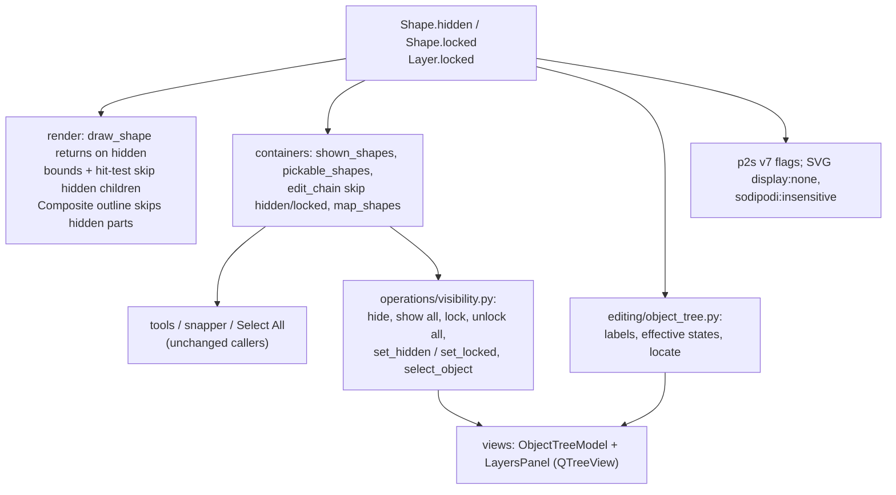

# Design Document

## Overview

Every shape type (groups included) gets two frozen flags, `hidden` and `locked`; `Layer` gets `locked` next to `visible`. Two rules then decide everything:

- **Drawn** = layer visible and no hidden flag on the shape or any container around it. `draw_shape` returns early on a hidden shape, so canvas, recorded pictures, edit-mode drawing and PNG export all follow without further code. Composites leave hidden parts out of their result.
- **Pickable** = drawn, layer unlocked, and no hidden or locked flag on the shape (containers around it are covered because a hidden or locked container can't be entered).

`editing/containers.py` owns both rules (`shown_shapes`, `pickable_shapes`, `edit_chain`), so tools, snapping, Select All and commands keep asking the same functions they ask today. New operations in `editing/operations/visibility.py` set the flags through a document-wide `map_shapes` helper. The Layers panel becomes a `QTreeView` over a lazy `QAbstractItemModel`, with Qt-free labels, locations and effective states in `editing/object_tree.py`. `.p2s` goes to version 7; SVG uses `style="display:none"` and `sodipodi:insensitive="true"`.

Work lands in layers that each keep the suite green: model + geometry + render → containers and operations → formats → views.

## Steering Document Alignment

### Technical Standards (tech.md)
- Frozen dataclasses changed with `dataclasses.replace`; no Qt below `views/`.
- Document edits in `session.edit(label)`; the flags are document state, so every toggle is an undo step.
- Per-frame cost stays in recorded pictures: the hidden check runs while recording, never per frame.
- `.p2s` change follows the migration rule (version 7, sample, doc row).
- SVG facts used for interop only: `display:none` (SVG) and `sodipodi:insensitive="true"` (the attribute Inkscape writes for locked objects and layers).

### Project Structure (structure.md)
- `models/shapes.py`, `models/app_state.py`: the flags.
- `geometry/transforms.py`: Composite outline skips hidden parts.
- `render/scene.py`, `render/paths.py`, `render/hit_test.py`: drawing, bounds and picking skip hidden shapes.
- `editing/containers.py`: `shown_shapes`, `pickable_shapes`, `edit_chain` rules and `map_shapes`; `editing/object_tree.py` (new): tree rows' Qt-free logic; `editing/operations/visibility.py` (new): commands and toggles; `layers.py`: layer lock.
- `formats/p2s.py`, `p2s_migrations.py`, `svg.py`, `svg_reader.py`.
- `views/layers_view.py` (panel), `views/object_tree_model.py` (new, Qt item model), `views/keymap.py`, `icons.py`, `scripts/generate_icons.py`.

## Code Reuse Analysis

### Existing Components to Leverage
- **`containers.pickable_shapes` / `edit_chain` / `valid_edit_path`**: already the single gate for "what can be selected" and "what is entered"; they gain the flag rules. `Session` already trims `edit_path` and selection with them after undo.
- **`_document.prune_selection`**: drops selected ids that stopped being pickable.
- **`containers.with_children`**: rebuilds Groups and Composites keeping part modes by id; used by `map_shapes`.
- **`edit_mode.enter`**: reused by the tree to enter the containers around a clicked object.
- **`set_layer_visible` / the hidden-layer checks in `shapes._add` and `clipboard.paste`**: the model for the layer lock (same refusal and note).
- **`SvgIconEngine`**: normal/disabled icon modes give the dimmed "inherited" toggles for free.
- **`ShapesPicture` content key**: compares layer shape tuples; changing a flag replaces the shape object, so pictures re-record on their own.

### Integration Points
- **Undo snapshots**: `_copy_document` copies `Layer`s with `dataclasses.replace(layer, shapes=list(...))` so `locked` is kept.
- **Clipboard, recovery**: go through `p2s.encode_shape` / `decode_shape`, so they get the flags with the codec.
- **Registry `can_run`** for Show All / Unlock All: needs "is anything hidden/locked", answered by a query memoized on the layer shape tuples (see Performance).

## Architecture



## Components and Interfaces

### 1. Model (`models/shapes.py`, `models/app_state.py`)

Every shape dataclass (`RectShape`, `EllipseShape`, `PathShape`, `TextShape`, `CompositeShape`, `GroupShape`) appends:

```python
    hidden: bool = False
    locked: bool = False
```

Appended after the existing defaulted fields, so every positional constructor call keeps working. `Layer` appends `locked: bool = False` after `shapes`.

```python
def is_shown(shape: Shape) -> bool        # not shape.hidden (named for readability at call sites)
```

Conversions that build a new shape from an existing one (`with_fresh_ids`, Object to Path, ungroup, transforms, styling) go through `replace` and keep the flags; anything else that builds new shapes from the selection works only on shapes that were pickable, so has no flags to lose.

### 2. Geometry (`geometry/transforms.py`)
- `_composite_outline` skips hidden parts: `if not part.hidden and (part_outline := area_outline(part)) is not None`. The Composite's part modes stay keyed by id, so the next visible part above the base becomes the base exactly as if the hidden one were deleted.

### 3. Rendering (`render/scene.py`, `render/paths.py`, `render/hit_test.py`)
- `draw_shape`: `if shape.hidden: return` first. Covers layers, group children, edit-mode pictures, PNG export and Alt+drag copies.
- `draw_composite_parts` (edit-mode part outlines) skips hidden parts.
- `PathCache` group bounds: union of the non-hidden children; all children if every one is hidden (a group can't collapse to an empty box).
- `hit_test._regions` / `_contains`: skip hidden children. Top-level hidden shapes never reach hit-testing because callers pass `pickable_shapes`.

### 4. Containers (`editing/containers.py`)

```python
def shown_shapes(state) -> list[Shape]
    """Drawn shapes of the active container, bottom to top: visible layers' or the entered container's
    shapes without hidden ones (locked included). Snap targets."""

def pickable_shapes(state) -> list[Shape]
    """shown_shapes minus locked shapes and shapes of locked layers."""

def edit_chain(state)            # candidates at every level are pickable shapes only (visible, unlocked
                                 # layer; not hidden, not locked), so valid_edit_path trims an entered
                                 # container that got hidden or locked, or whose layer did.

def map_shapes(state, change: Callable[[Shape], Shape]) -> list[Shape]:
    """Applies `change` to every shape in the document, containers' insides included (outer first), rebuilding
    only the containers whose contents changed, so unchanged shapes keep their identity. Returns the shapes
    `change` replaced (their new versions)."""
```

`edit_chain` also looks only in unlocked, visible layers (today: visible). `Snapper.build` switches from `pickable_shapes` to `shown_shapes` (locked objects stay snap targets). Every other caller of `pickable_shapes` keeps it.

### 5. Operations (`editing/operations/visibility.py`, `layers.py`)

```python
@operation("object.hide", N_("&Hide Selection"), can_run=has_selection)
def hide_selection(session)     # map_selected → hidden=True; clear selection; "Hide"; status ngettext count

@operation("object.show_all", N_("Sho&w All"), can_run=lambda s: queries.any_hidden(s.state))
def show_all(session)           # map_shapes → hidden=False; selection = replaced ∩ pickable; "Show all"

@operation("object.lock", N_("&Lock Selection"), can_run=has_selection)
def lock_selection(session)     # as hide_selection with locked; "Lock"

@operation("object.unlock_all", N_("&Unlock All"), can_run=lambda s: queries.any_locked(s.state))
def unlock_all(session)         # as show_all with locked; "Unlock all"

def set_hidden(session, shape_id: int, hidden: bool) -> None   # tree eye; "Hide" / "Show"
def set_locked(session, shape_id: int, locked: bool) -> None   # tree lock; "Lock" / "Unlock"

def select_object(session, shape_id: int, extend: bool = False) -> None
    """Tree click: activates the object's layer, enters the containers around it (edit_mode.enter, outer to
    inner, leaving first whatever doesn't lead there) and selects it; `extend` adds to the selection when it
    is in the active container. No-op for effectively hidden or locked objects. Not an undo step."""
```

`layers.py` gains `set_layer_locked(session, index, locked)` ("Lock layer" / "Unlock layer"). Every flag change ends with `state.edit_path = valid_edit_path(state)` and `prune_selection(state)` inside the edit, so hiding/locking the entered container (or its layer) leaves edit mode and nothing hidden or locked stays selected. `shapes._add` and `clipboard.paste` add the locked-layer case next to the hidden-layer one (refuse drawing with "Layer '{name}' is locked"; paste with a note). `paste` clears both flags on the top-level pasted shapes (a foreign SVG may carry `display:none`).

`queries.any_hidden(state)` / `any_locked(state)`: recursive scan, memoized on the tuple of layer shape lists' identities (one cached answer per document content), so menu `can_run` checks on every notify cost a tuple comparison.

### 6. Object tree logic (`editing/object_tree.py`, Qt-free)

```python
ObjectType = Literal["rect", "ellipse", "path", "text", "group", "composite"]

def object_type(shape) -> ObjectType
def object_label(shape) -> str              # _("Rectangle") … or the text, first line shortened to 30 chars + "…"

@dataclass(frozen=True)
class Location:
    layer_index: int
    containers: tuple[int, ...]             # ids of the containers around the shape, outer to inner

def locate(state, shape_id) -> Location | None
def inherited_flags(state, location) -> tuple[bool, bool]   # (hidden, locked) from layer and containers
```

### 7. Views (`views/object_tree_model.py`, `views/layers_view.py`)

**`ObjectTreeModel(QAbstractItemModel)`**: three columns (name, eye, lock). Internal nodes reference layers by index and shapes by id; a node's children are built only when Qt asks for them (`rowCount` on an expanded parent), so collapsed groups cost nothing. Rows are topmost first.
- `data`: `DisplayRole` = layer name / `object_label`; `DecorationRole` in column 0 = type icon; columns 1/2 = eye / eye-off and lock / lock-open icons, as `QIcon.Mode.Disabled` pixmaps when the state comes only from an ancestor (inherited) and the row's own flag is off.
- `flags`: layer names editable (rename on double-click as today).
- `set_content(state)`: when the layers' shape tuples (by identity), names, visible and locked flags are unchanged, nothing happens. Otherwise `beginResetModel` / `endResetModel`, and the panel restores expanded rows by key (layer index / shape id) and the scroll position. Uniform row heights keep a 10k-row layer cheap to show.

**`LayersPanel`** keeps the add/delete buttons and swaps `QListWidget` for a `QTreeView` (header hidden, uniform row heights, eye/lock columns sized to their icons, extended selection):
- Click on the eye / lock column → `set_layer_visible` / `set_layer_locked` or `set_hidden` / `set_locked`, deferred with `QTimer.singleShot(0, …)` because the notify resets the model (same rule as today's `_on_item_changed`).
- Click on a layer name → `select_layer`; on an object name → `select_object(extend=Ctrl/Shift)`.
- `refresh(state)`: `set_content`, then mirror `state.selection` into the tree's selection model with signals blocked; expand ancestors of and scroll to the first selected row when the selection changed. Cheap when nothing relevant changed.

### 8. Keymap and icons
- `views/keymap.py`: `object.hide` Ctrl+3, `object.show_all` Ctrl+Alt+3, `object.lock` Ctrl+2, `object.unlock_all` Ctrl+Alt+2; Object menu gains a section `object.hide, object.show_all, object.lock, object.unlock_all`. Mnemonics are checked by the existing clash test.
- Tabler icons added in `scripts/generate_icons.py`: `eye`, `eye-off`, `lock`, `lock-open`, plus type icons (`square`, `circle`, `vector-bezier`, `typography`, `box-multiple` for groups, and the existing Composite/union icon for Composites); constants in `icons.py`.
- Note: on Windows, Ctrl+Alt equals AltGr; on layouts where AltGr+2/3 type a character (German ² ³), Ctrl+Alt+2/3 may not reach Qt as a shortcut. The commands stay in the menu either way; checked on a Windows nightly.

### 9. Formats

**`.p2s` version 7**: `encode_shape` writes `"hidden": true` / `"locked": true` only when set; `decode_shape` reads them as optional booleans (wrong type → `P2sError` damaged-file message). Layers write `"locked": true` when set. `MIGRATIONS[6] = _unchanged`; sample `tests/formats/samples/v7.p2s` with a hidden shape, a locked group with a hidden child, a hidden Composite part and a locked layer; `docs/file-format.md` row.

**SVG writer** (`_shape_element`): hidden → `style="display:none"`; locked → `sodipodi:insensitive="true"`, for shapes, `<g>` groups and Composite parts in their metadata; layers get `sodipodi:insensitive="true"` when locked. The clipboard SVG uses the same function.

**SVG reader**: `visit` no longer drops `display:none` elements that would be imported: the shape(s) are read and marked hidden (multi-line text: every line). A `display:none` `<g>` becomes a hidden group with its children read normally. `sodipodi:insensitive="true"` marks the shape, group or layer locked; other values are ignored. Unchanged: elements under `<defs>`/`<symbol>`/other non-rendered containers, and a `<use>` whose referenced element has `display:none` (still skipped, as SVG doesn't render it). Composite metadata parts keep their flags, and the stored-parts check compares against the result computed without hidden parts, so a hidden part doesn't trigger the "changed by another program" fallback.

## Data Models

```python
@dataclass(frozen=True)
class RectShape:
    id: int
    x: float; y: float; width: float; height: float
    style: Style
    transform: Transform = IDENTITY_TRANSFORM
    rx: float = 0.0
    ry: float = 0.0
    hidden: bool = False
    locked: bool = False
# … same two fields on EllipseShape, PathShape, TextShape, CompositeShape, GroupShape

@dataclass
class Layer:
    name: str
    visible: bool = True
    shapes: list[Shape] = field(default_factory=list)
    locked: bool = False
```

`.p2s` shape: `{"type": "rect", "id": 3, …, "hidden": true, "locked": true}`; layer: `{"name": "Sketch", "visible": true, "locked": true, "shapes": […]}`.

## Error Handling

1. **Malformed flags in `.p2s`** (non-boolean `hidden`/`locked`): `P2sError` naming the JSON path, like other damaged fields.
2. **Odd `sodipodi:insensitive` values** in foreign SVG: anything but `"true"` is ignored.
3. **Tree click on an object that vanished** (deferred slot after undo): `select_object` / `set_hidden` look the id up and do nothing when it's gone.
4. **Everything hidden/locked**: Select All selects nothing, tools act on empty canvas; the status bar of Hide/Lock tells how to undo ("{count} objects hidden. Object → Show All brings them back").

## Testing Strategy

### Unit Testing
- `tests/models`: flags default False; positional constructors unchanged.
- `tests/geometry/test_transforms.py`: Composite outline without hidden parts; all parts hidden → empty.
- `tests/render`: hidden shape / hidden group child not drawn (CPU pixels), not hit, excluded from group bounds; group with all children hidden keeps its full bounds.
- `tests/editing/test_containers.py`: `shown_shapes` vs `pickable_shapes` for hidden, locked, locked layer, edit mode; `edit_chain` trims hidden/locked containers; `map_shapes` keeps identity of untouched shapes and part modes.
- `tests/editing/test_visibility.py`: each command (undo labels, selection after, can_run), toggles on nested shapes, hiding/locking the entered container leaves edit mode, locked layer refuses drawing and notes paste, paste clears top-level flags, `select_object` enters containers and refuses hidden/locked rows, `any_hidden` memo invalidates on edit.
- `tests/editing/test_object_tree.py`: labels, types, `locate`, inherited flags.
- `tests/tools`: click and rubber band skip locked and hidden; snapping still hits locked objects; Node tool can't pick locked paths.

### Integration Testing
- `tests/formats`: `.p2s` round trip of every flag position (shape, group child, Composite part, layer) and v6 → v7 upgrade; v7 sample; SVG write → read round trip; reading Inkscape-style `display:none` and `sodipodi:insensitive` snippets; clipboard SVG keeps nested flags.
- `--self-test` unchanged (no new data files beyond icons, which are covered by the existing icon check).

### End-to-End Testing
- Scratch QTest script (offscreen and desktop GL): hide with Ctrl+3, click where the shape was (selects what's below), Show All; lock a background, rubber-band over it; toggle eye/lock in the tree; click a group child row and see the group entered and the child selected; canvas selection highlights its row.
- Performance: `scripts/bench_canvas.py` unchanged numbers; scratch timing of `LayersPanel.refresh` with 10,000 shapes after a move (target well under one frame, ~5 ms) and of the first expand of that layer.
