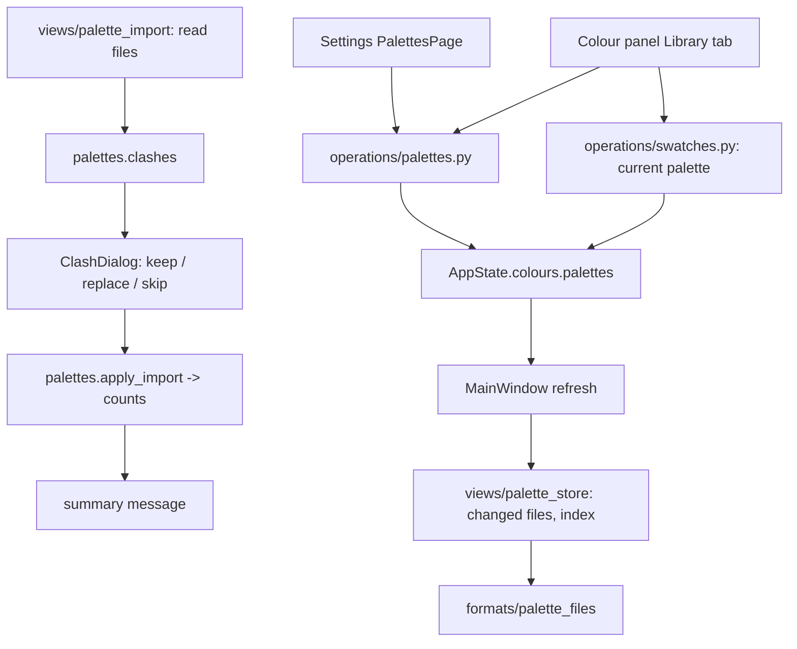

# Design Document

## Overview

`ColourState.library` (one tuple of swatches) becomes `ColourState.palettes`, a tuple of frozen `Palette`s, plus `current_palette` (an id). Palette ids, like library swatch ids today, are numbered per run; on disk palettes are identified by their file. Every change goes through a new Qt-free operations module, `editing/operations/palettes.py`; the existing swatch operations keep their `palette` argument, with `"library"` now meaning the current palette.

Batch import is split the same way: views read files into `(name, colours)` items, a pure function finds name clashes, the clash dialog collects a choice per clash, and one operation applies the import and returns counts. Storage moves from `views/main_window.py` into a small `views/palette_store.py` (one JSON file per palette plus an index), with the codec Qt-free in `formats/palette_files.py`. The Settings window gets a `PalettesPage`; the Colour panel's Library tab gets a dropdown and a richer `…` menu.

## Steering Document Alignment

### Technical Standards (tech.md)
- Frozen data changed with `replace`; operations as plain functions mutating app-level state and calling `notify()` (palettes are not undoable, as the library isn't today).
- No Qt below `views/`; file and folder I/O stays in views, codecs in `formats/`.
- Writes through `documents.write_atomically`; tests pass their own folders.

### Project Structure (structure.md)
- `models/colours.py`: `Palette`; `ColourState.palettes`, `current_palette` (replacing `library`).
- `formats/palettes.py`: `read_named_palette` (name stored in the file + colours).
- `formats/palette_files.py` (new): palette JSON and index codec, file names from palette names.
- `editing/operations/palettes.py` (new): collection operations, import planning and applying.
- `editing/operations/swatches.py`, `colours.py`: library = current palette.
- `views/palette_store.py` (new): load/save the folder, migration from `swatches.json`.
- `views/palette_import.py` (new): read the selected files, clash dialog, summary, progress. `views/palette_export.py` (new): one or several palettes.
- `views/settings/palettes_page.py` (new); `views/settings/pages.py` (`SettingsContext.session`, `palettes_folder`), `views/settings/dialog.py` (`PAGES`).
- `views/colour_panel.py` (Library tab), `views/main_window.py` (store, `open_settings(page)`), `views/app_settings.py` (folder path, current palette name).

## Code Reuse Analysis

### Existing Components to Leverage
- **`formats/palettes.py`** readers/writers (GIMP, hex, JASC, Paint.NET, `colors_from_pixels`) and the panel's `_read_palette_file` (moved to `views/palette_import.py`).
- **`formats/swatch_library.py`** validation of swatch items: reused by the palette file codec (same item shape), and still read once for the migration.
- **`swatches.py` operations** (`add`, `rename`, `replace`, `delete`, `move`, `copy`, `import`) for swatches inside the current palette.
- **`SwatchGrid` / `swatch_tooltip`** for the Settings preview; **`SettingsPage` / `PAGES`** for the new category.
- **`documents.write_atomically`**, **`app_settings._data_folder`** (portable aware).
- **Panel export code** (format filters, suffix by chosen filter): moved into `views/palette_export.py` and extended to several palettes.

### Integration Points
- **MainWindow**: owns a `PaletteStore` (only with settings, as the library file today); loads at start, saves in `refresh` when `colours.palettes` changed identity; remembers the current palette by name in settings.
- **Settings window**: `open_settings(page=None)`; the panel's "Manage Palettes…" opens it on the Palettes page. The dialog is modal, but operations still notify, so the Colour panel follows while it is open (Req 3.5).

## Architecture



### Model

```python
@dataclass(frozen=True)
class Palette:
    id: int                      # numbered per run; files identify palettes on disk
    name: str
    swatches: tuple[Swatch, ...] = ()

@dataclass
class ColourState:
    ...
    palettes: tuple[Palette, ...] = ()
    current_palette: int | None = None   # a palette id, None only when there are no palettes
```

Swatch ids stay local to their palette. `library` is removed; `swatches.palette_swatches(session, "library")` returns the current palette's swatches, and `_change(..., "library", ...)` replaces that palette (creating "My swatches" first when there is none, Req 1.3).

### Operations (`editing/operations/palettes.py`)

- `unique_name(palettes, name, ignore_id=None) -> str`: trimmed name (empty → "Palette"), numbered "Name (2)", "(3)" … if taken, case-insensitive.
- `new_palette(session, name) -> int` (becomes current), `rename_palette(session, id, name)` (refused names, i.e. empty or taken, keep the old one and notify), `duplicate_palette(session, id) -> int` ("Name copy"), `delete_palettes(session, ids)` (current moves to the neighbour), `set_palette_order(session, ids)` (from the Settings list after a drag), `set_current_palette(session, id)`.
- `set_palettes(session, palettes, current_name)`: what the store loaded at start.
- Import:
  ```python
  @dataclass(frozen=True)
  class ImportItem:
      name: str
      colors: tuple[PaletteColor, ...]   # (name, colour, opacity), already capped at 1024

  Choice = Literal["keep", "replace", "skip"]

  def clashes(palettes, items) -> list[int]          # indices of items whose name is taken, by an existing
                                                     # palette or an earlier item in the batch
  def apply_import(session, items, choices: dict[int, Choice]) -> ImportCounts  # imported, replaced, skipped
  ```
  Items are applied in order. "keep" numbers the name, "replace" replaces the swatches of the palette holding the name at that point (existing, or imported earlier in the batch) and keeps its position, "skip" leaves it out. New palettes go to the end; the first becomes current if there was none (Req 4.6). One `notify()` at the end.

### Reading names from files (`formats/palettes.py`)

`read_named_palette(suffix, text) -> tuple[str | None, list[PaletteColor]]`: the colours as `read_palette` gives them, plus the stored name: GIMP `Name:` (and Lospec's `#Palette Name:` comment), Paint.NET `;Palette Name:`. Hex and JASC have none. `read_palette` stays as a thin wrapper.

### Storage

`formats/palette_files.py` (Qt-free):
- `encode_palette(palette) -> str` / `decode_palette(text) -> (name, swatches)`: `{"version": 1, "name": …, "swatches": [{"name", "color", "opacity"?}]}`, validated like the library file (ValueError on anything else).
- `encode_index(files) -> str` / `decode_index(text) -> list[str]`: `{"version": 1, "order": ["pico-8.json", …]}`.
- `file_name(name, taken) -> str`: lower-case, characters outside `[a-z0-9._-]` become `-`, trimmed to 60, `.json`, numbered if taken (case-insensitive, for Windows).

`views/palette_store.py`, `PaletteStore(folder)`:
- `load() -> LoadResult(palettes, problems)`: reads the index (missing or damaged → no order), then every `*.json` except the index; ordered by index, unknown files at the end (Req 6.4); unreadable files listed in `problems` and left alone (Req 6.3). It keeps `id → file` and `id → last saved Palette`.
- Migration (Req 1.5): no folder and an old `swatches.json` beside it → its swatches become "My swatches" (saved right away), the old file is renamed `swatches.migrated.json`.
- `save(palettes)`: writes files only for palettes whose object changed since the last save (identity), new palettes get `file_name(...)`, removed palettes' files are deleted (deletion was confirmed in the UI), the index is rewritten when the order or set changed. All writes atomic; an `OSError` is reported once by MainWindow (as the library today).
- Load time: 500 small JSON files are well under the 200 ms target; measured in the end-to-end check.

`MainWindow`: `palettes_folder` parameter (replacing `library_path`), default `app_settings.palettes_folder()`; the current palette is remembered as `colours/current_palette` (its name) in settings. Load problems are shown once after start (status message with the count; the names in a message box when the window is shown).

### Import flow (`views/palette_import.py`)

1. The files chosen in the multi-select file dialog (no folder import, changed after review); more than 1000 → refused with a message before reading anything (Req 4.5).
2. `read_items(files, progress)`: each file through `read_named_palette` / the PNG path, name = stored name or file stem, colours capped at 1024 (more → that file fails with "too many colours"); failures collected as (file, reason). A `QProgressDialog` with `minimumDuration=1000` covers long batches (Req, Performance).
3. `clashes(...)`; if any, `ClashDialog(items, clash_indices, existing_names)`: a table (palette name, source file, choice combo), buttons **Keep All / Replace All / Skip All**, **Import** and **Cancel** (Req 4.3). Replace choices ask no second time: the dialog says that replacing overwrites the existing swatches.
4. `apply_import(...)`, then a summary box: imported / replaced / skipped counts and the failed files with reasons (Req 4.4). A single clean file shows no summary, only a status message.

### Export (`views/palette_export.py`)

- `export_one(parent, palette)`: save dialog with the four formats, file name proposed from the palette name; type from the suffix or the chosen filter (today's code).
- `export_many(parent, palettes)`: folder dialog, then the format from a small choice dialog; file names from `file_name`-like sanitizing with the format's suffix; if any exist, one question "Replace N files?" (Req 5.2). Names are written into GIMP and Paint.NET files (Req 5.3).

### Settings page (`views/settings/palettes_page.py`)

```
┌ Palettes ──────────────────────────────────────────────┐
│ ┌──────────────────────┐  [New] [Rename] [Duplicate]    │
│ │ My swatches      12  │  [Delete]                      │
│ │ PICO-8           16  │  [Import…]                     │
│ │ Endesga 32       32  │  [Export…]                     │
│ │ …                    │  [Open Palettes Folder]        │
│ └──────────────────────┘                                │
│ PICO-8 – 16 colours                                     │
│ ■■■■■■■■■■■■■■■■                                        │
└─────────────────────────────────────────────────────────┘
```

- `QListWidget` with extended selection and `InternalMove` drag; after a drop, the item order (palette ids in item data) goes to `set_palette_order`. Each row shows name and count.
- Buttons enabled by selection (Rename/Duplicate one, Delete/Export one or more). Delete confirms with the names (up to 10, then "and N more").
- Preview: `SwatchGrid` (no "+") of the single selected palette in a scroll area; its context menu offers Rename, Move Left/Right, Delete for the swatch, through `swatches.py` operations on that palette (they take the palette id: `palette_swatches`/`_change` get an optional `palette_id`, default the current one).
- The page rebuilds its list from `session.state.colours.palettes` after each of its own actions (the dialog is modal, so nothing else changes them meanwhile), keeping the selection by id.
- `SettingsContext` gains `session: Session | None` and `palettes_folder: Path | None`; the page shows a note and disables itself when they are None.

### Colour panel Library tab

- A `QComboBox` of palette names above the grid (ids as item data), rebuilt only when `palettes` changed by name/order; activating an item calls `set_current_palette`.
- `…` menu: New Palette…, Rename Palette…, Import Palettes… (the import flow above), Export Palette…, Manage Palettes… (signal `manage_palettes` → `MainWindow.open_settings(PALETTES_PAGE)`), Delete All Swatches.
- Empty collection: the grid is replaced by a note and New Palette… / Import Palettes… buttons (Req 2.5).
- The Document tab keeps importing colours into the document's swatches (the old behaviour, through `palette_import.read_items` with no clash step).

## Components and Interfaces

### `editing/operations/palettes.py` (new)
- **Purpose:** the collection. **Interfaces:** above. **Dependencies:** models, `formats.palettes.PaletteColor` type. **Reuses:** `Swatch`, id counters as in `swatches._change`.

### `formats/palette_files.py` (new), `formats/palettes.read_named_palette`
- **Purpose:** palette JSON, index, file names; names from palette files. **Reuses:** swatch item validation from `swatch_library`.

### `views/palette_store.py`, `views/palette_import.py`, `views/palette_export.py`, `views/settings/palettes_page.py` (new)
- **Purpose:** disk, dialogs, the Settings category. **Dependencies:** the operations above, `write_atomically`, `SwatchGrid`.

## Data Models

See Model. On disk:

```
<data folder>/palettes/
├── index.json            {"version": 1, "order": ["my-swatches.json", "pico-8.json"]}
├── my-swatches.json      {"version": 1, "name": "My swatches", "swatches": [{"name": "", "color": "#e11d48"}]}
└── pico-8.json
<data folder>/swatches.migrated.json   (the old single library, kept after migration)
```

## Error Handling

1. **Damaged palette file / index**: skipped / ignored, file untouched, listed once after start.
2. **Write fails** (disk full, permissions): one warning per refresh that hit it; the palettes stay in memory and are retried on the next change.
3. **Import: unreadable file, not a palette, > 1024 colours**: listed in the summary with the reason; the rest imports.
4. **More than 1000 files selected**: refused up front with the count.
5. **Rename to an empty or taken name**: refused, the old name shown again with a message.
6. **Export: unwritable target**: message naming the file; files already written stay.

## Testing Strategy

### Unit Testing
- `operations/palettes`: unique names (case, numbering, trimming), new/rename/duplicate/delete (current moves, last one deleted → None), order, swatch operations on the current palette and on a given palette, "My swatches" created on demand, `clashes` (against existing and within the batch), `apply_import` for keep/replace/skip including replace of an earlier batch item, counts, first import becomes current.
- `formats/palette_files`: round trip, damaged inputs, file names (umlauts, slashes, very long, case clashes); `read_named_palette` for each format incl. Lospec's.
- `views/palette_store` (with `tmp_path`): load order, unknown files appended, missing files dropped, damaged files reported and untouched, save writes only changed files, deletes removed ones, migration renames the old library.

### Integration Testing
- Settings page with a session: buttons, drag reorder through the list model, delete confirmation (patched `QMessageBox`), preview context actions.
- Colour panel: dropdown follows and sets the current palette, "+" with no palettes creates "My swatches", Manage Palettes opens Settings on the right page.
- Import flow with a temp folder of Lospec-style files: clash dialog choices applied, summary counts, > 1000 files refused.

### End-to-End Testing
- Scratch script: 500 generated palette files, measure load time; batch import 500 files with clashes through the real dialogs (offscreen), screenshots of the Settings page and the Library tab in English and German, read by eye.
