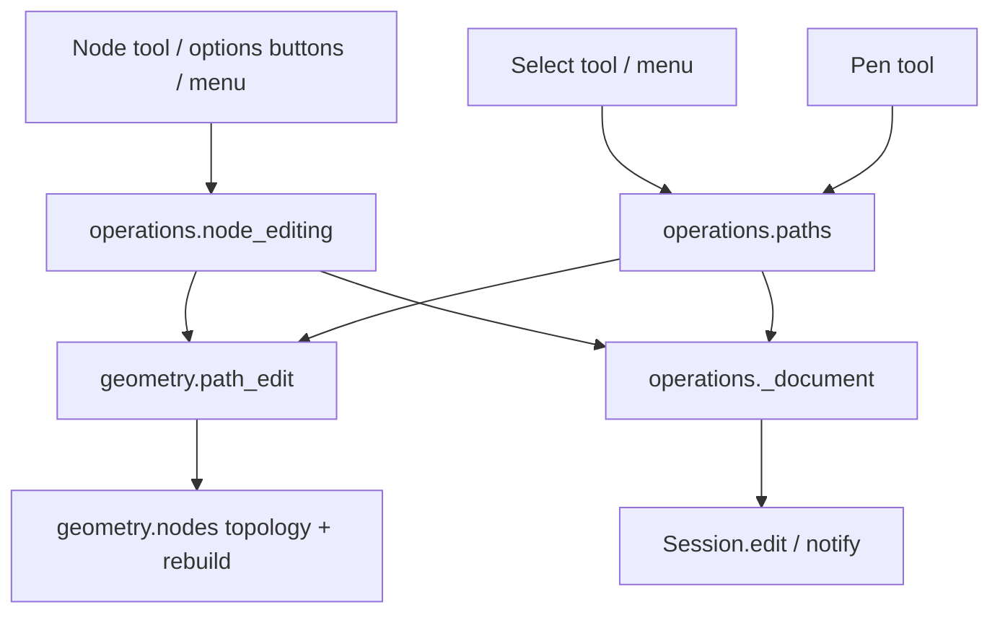

# Design Document

## Overview

All structural edits are pure functions on segment tuples in a new module `geometry/path_edit.py`, next to the existing node math in `geometry/nodes.py`. Thin operations in `editing/operations/` apply them to selected paths (Select tool) or selected nodes (Node tool), each as one undo step. The Node tool gets command buttons in its options page, sharing the menu's `QAction`s. The Pen learns to start from an existing open end and to finish on one.

The one model change is a per-node **corner flag** (Requirement 1.5), stored on the segment that ends at the node.

## Steering Document Alignment

### Technical Standards (tech.md)
- No Qt below `views/`; geometry is pure and unit-tested; operations are plain functions registered with `@operation`.
- Shapes stay frozen; edits use `dataclasses.replace`.
- File format change follows the `.p2s` rule: version bump, migration, sample, row in `docs/file-format.md`.

### Project Structure (structure.md)
- `geometry/path_edit.py` (new): node types, break, join, delete segment, open/close, reverse, combine/split.
- `editing/operations/node_editing.py`: node commands (Node tool selection).
- `editing/operations/paths.py`: path commands (Combine, Split, Close, Open, Reverse) and Pen continuation (`continue_path`).
- `tools/pen.py`, `tools/node.py`: gesture changes only.
- `views/tool_options_view.py`: Node page with buttons; `views/keymap.py`: menu layout and icons.

## Code Reuse Analysis

### Existing Components to Leverage
- **`geometry/nodes.py`**: `_Topology` (subpaths, node aliases on closed subpaths, control ownership), `_anchors_and_edges` / `_rebuild` (anchor + edge representation already used by `delete_nodes`), `_is_smooth`, `insert_node`. `path_edit.py` imports these; the private helpers get public names (`topology`, `anchors_and_edges`, `rebuild`).
- **`node_editing._edit_path` / `_edited_path`**: the pattern for "replace one path's segments in one undo step and set the node selection".
- **`operations/_document.py`**: `replace_shape`, `remove_shapes`, `replace_with` (stacking-preserving replacement for Combine/Split/Join across paths), `new_id`.
- **`paths.to_path`**: converts rects/ellipses during Combine.
- **`geometry/segments.transform_segments`**: bakes a path transform before combining (paths already have identity transforms; rects/ellipses become paths first).
- **`geometry/pen_paths`**: `PenNode`, `pen_segments` build the tail appended when the Pen continues a path.
- **`AlignPanel._buttons`** pattern: `QToolButton.setDefaultAction(actions[id])`, so buttons share enabled state, label, icon and tooltip with the menu.
- **`render/overlay.NodeOverlay` / `render/handles`**: node drawing; gets a start-node marker.

### Integration Points
- **Undo / Session**: `session.edit(label)`; node selection stored in `AppState.node_selection` (already multi-path: the Node tool edits every selected path, so Requirement 3.6 needs no new selection model, only commands that accept refs from two paths).
- **`.p2s`**: path encoder/decoder gain an optional `"corners"` list.
- **SVG**: writer emits `sodipodi:nodetypes`, reader parses it.

## Architecture



### Path representation used by path_edit

Every function converts each subpath to the existing anchor/edge form, edits that, and rebuilds:

```python
@dataclass(frozen=True)
class Sub:                      # one subpath
    anchors: tuple[Anchor, ...] # point + corner flag + source node index (for mapping the selection)
    edges: tuple[Edge, ...]     # None = line, else (c1, c2); len = len(anchors) - 1, or len(anchors) if closed
    closed: bool
```

`to_subs(segments) -> list[Sub]` and `from_subs(subs) -> Segments` are the only places that know about MoveTo/Close and the closed-subpath alias. Each command is then a small list manipulation: break = rotate/split anchors, join = concatenate (reversing one), reverse = reverse anchors and swap each edge's controls, delete segment = drop one edge, combine = concatenate sub lists, split = one path per sub. `from_subs` writes closing lines as `Close` (no duplicate end node), closing curves as `CubicTo` back to the start + `Close`, matching what the Pen produces today.

Commands return the new segments **and** a mapping from old node indices to new ones (`dict[int, int]`), so operations can keep or move the node selection (Requirement 1.9, 2.5).

## Components and Interfaces

### geometry/path_edit.py (new)
- **Purpose:** structural path edits, pure.
- **Interfaces:**
  - `to_subs(segments) -> list[Sub]`, `from_subs(subs) -> Segments`
  - `set_node_type(segments, indices, kind: "corner" | "smooth" | "symmetric") -> Segments`
  - `make_lines(segments, indices) -> Segments`, `make_curves(segments, indices) -> Segments`
  - `break_at(segments, indices) -> Edited` (Edited = segments + index map)
  - `join(segments_a, end_a, segments_b, end_b, with_segment: bool) -> Edited` (for one path, pass the same segments twice; returns one segment tuple)
  - `delete_segments(segments, indices) -> Edited | None`
  - `close_subpaths(segments, indices | None) -> Segments`, `open_subpaths(segments, indices | None) -> Segments`
  - `reverse(segments, indices | None) -> Segments` (`None` = all subpaths; else subpaths containing a selected node)
  - `split(segments) -> list[Segments]`, `combine(list[Segments]) -> Segments`
  - `end_nodes(segments) -> set[int]`, `adjacent(segments, a, b) -> bool` for `can_run` checks
- **Smooth/Symmetric math (Req 1.2–1.4):** direction = normalised (out − anchor) − (in − anchor), falling back to (next − prev) when a handle is missing or both collapse; line edges next to the node become cubics with the far control at one third of the line (shape kept), near control at the new handle (length one third of the neighbour distance).
- **Dependencies:** `geometry.nodes`, `models.shapes`.

### Corner flag on segments (data model)
- `MoveTo`, `LineTo`, `CubicTo` get `corner: bool = False` (last field, so existing positional constructors keep working). For the closed-subpath alias, the flag lives on the `MoveTo`.
- `nodes._is_smooth` returns `False` for a corner-flagged node, so `move_control` stops mirroring (Req 1.5). Smooth/Symmetric clear the flag; Corner sets it; Alt-dragging a handle in the Node tool sets it (a deliberately broken node stays broken even if the user later lines the handles up by eye).
- `nodes.insert_node`, `delete_nodes`/`_rebuild`, `move_nodes` keep flags (they use `replace` or the anchor form, which now carries the flag). `transform_segments` keeps them. Booleans, Pencil fitting and outlines create fresh segments without flags, which is correct (new geometry).
- Equality includes the flag, so `PathCache` and undo see the change.

### Persistence of the corner flag
- **`.p2s` version 11:** path objects get optional `"corners": [segment indices]`, omitted when empty; decoder validates indices (must be node segments, else damaged-file error like other fields). Migration 10 → 11 is a no-op (absent = none). Sample `tests/formats/samples/v11.p2s`, row in `docs/file-format.md`.
- **SVG:** write `sodipodi:nodetypes` on paths that have at least one flagged node *or* at least one smooth node (so Inkscape and our reader agree): one char per node in Inkscape's layout (`c` corner/cusp, `s` smooth, `z` symmetric when lengths match), closed subpaths as Inkscape writes them. Read: `c` on a node whose handles are collinear sets the flag; anything else is ignored; the attribute is ignored entirely when its length doesn't match the node count (paths edited by tools that don't update it). The exact layout is checked against a path saved by Inkscape (test fixture).
- **Clipboard** payload uses the `.p2s` encoders, so flags copy along.

### Node commands — editing/operations/node_editing.py
- `@operation("path.node_corner" | "path.node_smooth" | "path.node_symmetric" | "path.make_line" | "path.make_curve" | "path.break_nodes" | "path.join_nodes" | "path.join_segment" | "path.delete_segment", ...)`.
- `can_run`: tool is Node and the node selection satisfies the command (any node; ≥ 2 adjacent nodes; non-end node; exactly two end nodes; ≥ 2 adjacent nodes).
- Join across two paths: result replaces the higher path (`replace_with` keeps its stacking slot and style), the lower one is removed; selection becomes the joined path, node selection the merged node(s). Both paths must be children of the same container (`containers.pickable_shapes` contains both), else disabled.
- Labels: "Make nodes corner", "Make nodes smooth", "Make nodes symmetric", "Make segments lines", "Make segments curves", "Break path", "Join nodes", "Join with segment", "Delete segment".

### Path commands — editing/operations/paths.py
- `@operation("path.combine", "&Combine")`, `("path.split", "&Split Path")`, `("path.close", "C&lose Path")`, `("path.open", "O&pen Path")`, `("path.reverse", "&Reverse Direction")`.
- With the Node tool and a node selection, Close/Open/Reverse apply to the subpaths of the selected nodes (Open = Break at Nodes); otherwise to every subpath of every selected path.
- Combine: selected shapes in the active container that are paths, rects or ellipses (`to_path` first); refused (disabled) when any selected shape is a group, Composite, text or image, or when fewer than two remain. Result keeps the topmost shape's id, style and stacking slot (`replace_with`); others removed; result selected.
- Split: each selected path with ≥ 2 subpaths becomes one path per subpath (`new_id` for all but the first, which keeps the id), inserted at the original slot in subpath order, all selected. Inside a Composite the new parts take the original part's mode.

### Pen continuation — tools/pen.py + operations/paths.continue_path
- **Hover / press (Req 7.1–7.2):** with no path in progress, the Pen checks open end nodes of visible, unlocked paths in `containers.pickable_shapes` (within the existing close radius, topmost first). Hit → `CursorType.PEN_CONTINUE` (new) and a highlighted node in the overlay. Press on it starts a continuation: the tool keeps `_continuing = (path_id, at_start)` and seeds its node list with that end as a `PenNode` (its existing incoming handle, so the first new segment leaves smoothly if the user drags). Dragging on press shapes that end's outgoing handle (mirrored into the existing incoming one unless Alt), as for a first node today.
- **Preview:** the original path is drawn unchanged; the tail is drawn as today's in-progress path.
- **Finishing (Req 7.3):** while in progress (continuing or not), hovering an open end node of another eligible path, or the other end of the continued subpath, shows the join cursor; clicking commits with the target.
- **Commit:** one operation `paths.continue_path(session, path_id, at_start, tail_nodes, target: EndRef | None, closed_self: bool)`; a new path that ends on an existing end calls the same op with `path_id=None` (new path joined into the target). Internally: `pen_segments(tail)` → `path_edit.join(...)` with the original (and target), replacing the higher path, keeping its style and id (Req 7.4). One undo step, label "Continue path" (or "Join paths").
- **Esc (Req 7.5):** clears the tail; nothing was written to the document yet, so the original is untouched.
- Snapping excludes the continued path's moving end, as the Pen's own nodes are excluded today.

### Node tool view changes
- `NodeOverlay` gets `starts: frozenset[int]` (start node of each subpath); `render/handles` draws it slightly larger / as a square outline so direction is visible (Req 5.5).
- `ToolOptionsPanel` Node page: a grid of `QToolButton`s (`setDefaultAction`) for the nine node commands plus Close/Open/Reverse, above the existing hint. Needs `AppActions` passed into the panel (as `AlignPanel` does).
- Alt-drag on a handle in `NodeTool.release` calls `move_control(..., keep_smooth=False)` which now also sets the corner flag.
- Icons: Tabler outline icons added to `scripts/generate_icons.py` mapping (e.g. `point`, `vector-spline`, `vector-bezier`, `line`, `scissors`, `link`, `arrows-exchange`, `focus-2` — final picks during implementation), constants in `icons.py`, bindings in `keymap.py`.

### Menus and shortcuts
- `Path` menu: booleans, composites, then `path.combine`, `path.split`, separator, `path.close`, `path.open`, `path.reverse`, separator, submenu **Nodes** with the nine node commands, then Object to Path.
- **No shortcuts** in this spec (the requirements review left the question open, so the shortcut rule's default applies). Adding Inkscape's Ctrl+K / Ctrl+Shift+K and Shift+J / Shift+B later is a one-line keymap change each.

## Data Models

```python
@dataclass(frozen=True)
class MoveTo:
    x: float
    y: float
    corner: bool = False   # also LineTo, CubicTo (after their coordinates)

# geometry/path_edit.py (internal working form)
@dataclass(frozen=True)
class Anchor:
    point: Point
    corner: bool
    source: int | None      # node index in the input segments; None for created nodes

Edge = tuple[Point, Point] | None

@dataclass(frozen=True)
class Sub:
    anchors: tuple[Anchor, ...]
    edges: tuple[Edge, ...]
    closed: bool

@dataclass(frozen=True)
class Edited:
    segments: Segments
    index_map: dict[int, int]    # old node index -> new node index (nodes that survive)
```

`.p2s` path object (v11): `{"type": "path", "id": …, "segments": [...], "corners": [3, 7]}`.

## Error Handling

### Error Scenarios
1. **Invalid selection for a command** (e.g. join with three nodes, break on an end node only).
   - **Handling:** `can_run` disables it; the operation re-checks and returns without an edit.
   - **User Impact:** greyed button/menu item; nothing happens via stale shortcut.
2. **Join across containers or with a locked/hidden path.**
   - **Handling:** not offered (`can_run` false; Pen ignores such end nodes).
   - **User Impact:** no join cursor on those nodes.
3. **Delete Segment leaves a single node / empty path.**
   - **Handling:** subpaths with < 2 nodes dropped; empty path removed in the same undo step (as `delete_nodes`).
   - **User Impact:** path disappears; undo restores it.
4. **Malformed `corners` in `.p2s`** — damaged-file error naming the field, like other fields. **Mismatched `sodipodi:nodetypes` in SVG** — ignored silently (Inkscape does the same; not worth an import note).
5. **Degenerate geometry** (zero-length handles, coincident nodes) — Smooth falls back to the neighbour direction; if that is zero too, the node is left unchanged.

## Testing Strategy

### Unit Testing
- `tests/geometry/test_path_edit.py`: `to_subs`/`from_subs` round trip on open, closed (with and without explicit closing segment), compound and Pen-made paths; each command on lines, curves, closed and open subpaths, end nodes, compound paths; index maps; shape preservation (sampled points of the outline before/after for break, reverse, make-curve, combine, split); reverse twice = identity.
- `tests/geometry/test_nodes.py`: corner flag stops mirroring; insert/delete keep flags.
- `tests/formats`: `.p2s` v11 round trip with corners, v10 sample still opens, `sodipodi:nodetypes` written and read (Inkscape fixture), mismatched length ignored; resvg generator check covers new paths.

### Integration Testing
- `tests/editing/test_node_editing.py` / `test_paths.py`: each operation through the session — one undo step with the right label, undo restores segments and node selection, `can_run` per selection, join across two paths keeps style/stacking of the higher one, combine/split stacking and ids, behaviour inside an entered group and a Composite (part modes kept on split).
- `tests/tools/test_pen.py`: continue from end and from start, drag on the end node, join onto another path's end, close onto own other end, Esc keeps original, cursors, locked/hidden paths ignored.
- `tests/tools/test_node.py`: Alt-drag sets corner; start markers in overlay.

### End-to-End Testing
- Scratch QTest script (not in pytest): Node tool buttons enabled/disabled with selections, run each from the panel and the menu, offscreen and on the desktop (GL); Pen continuation by mouse. Screenshot of the Node options page to check layout and icons.
- `uv run python scripts/update_translations.py`, German entries, mnemonic-clash test.
