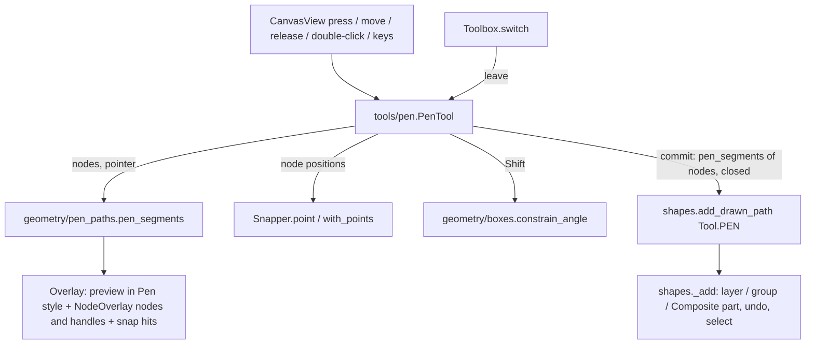
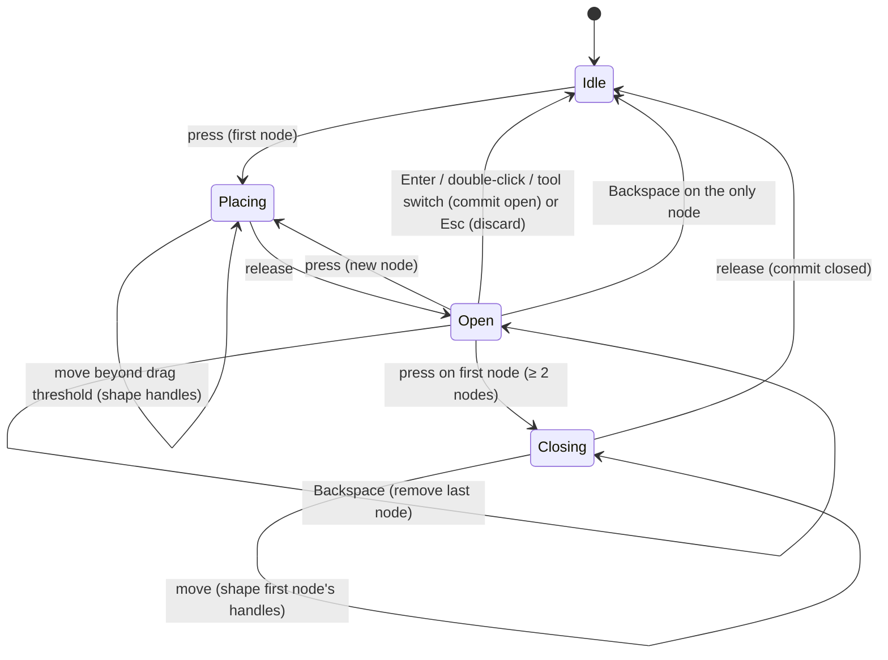

# Design Document

## Overview

The Pen tool keeps a list of **pen nodes** instead of a list of points. Each node has a position and optional incoming and outgoing handles. A new pure-geometry function `pen_segments(nodes, closed)` turns them into path segments: a segment is a `LineTo` when neither end has a handle on that side, otherwise a `CubicTo` whose missing control falls on its node. The same function builds the live preview and the committed path, so the preview always shows what gets created.

`PenTool` becomes a small state machine:

- **press** places a node, or starts closing when it lands on the first node;
- **drag** (beyond a few screen px) pulls out the handles of that node;
- **release** ends the placement, or commits the closed path;
- **move without the button** updates the rubber band and the close hover.

Committing goes through the existing `shapes.add_drawn_path(session, segments, Tool.PEN)`, so layers, groups, Composites, undo, selection and the hidden-layer message behave as for the Pencil.

No file format change: the pen only produces `MoveTo`, `LineTo`, `CubicTo` and `Close`.

## Steering Document Alignment

### Technical Standards (tech.md)
- **Tools are Qt-free input state machines** that commit through one operation call; the Pen keeps its gesture state until it commits.
- **Geometry stays pure and tested:** `geometry/pen_paths.py` has no state and no Qt.
- **Snapping:** one `Snapper` per path, built at the first press, as today. Nodes placed since then are added as extra point targets, without rebuilding from the document.
- **Cursors** are `CursorType` values; only `views/cursors.py` maps them to Qt.
- **Translations:** the new hint goes through `N_`/`_`, German complete; no new shortcut.

### Project Structure (structure.md)
- **New:**
  - `geometry/pen_paths.py`;
  - tests `tests/geometry/test_pen_paths.py` and `tests/tools/test_pen.py` (the Pen test now in `test_drawing.py` moves there);
  - cursor icons `cursor_pen_add` (Tabler `crosshair`) and `cursor_pen_close` (Tabler `circle-dot`) in `generate_icons.py` and `icons.py`.
- **Changed:**
  - `tools/pen.py` (rewritten), `tools/base.py` (`CursorType` values, `BaseTool.leave`), `tools/registry.py` (`Toolbox.switch` calls `leave`), `tools/snapper.py` (`with_points`);
  - `geometry/boxes.py` (`constrain_angle`);
  - `render/overlay.py` (`NodeOverlay.handles`), `render/scene.py` (draws them);
  - `views/canvas_view.py` (Backspace/Delete forwarded to the tool), `views/cursors.py`, `views/tool_options_view.py` (hint);
  - translations.

## Code Reuse Analysis

### Existing Components to Leverage
- **`shapes.add_drawn_path`:** adds a path in a tool's style to the active container, as one undo step "Add path"; already used by the Pencil.
- **`Overlay.preview` + `render/scene.draw_overlays`:** draws the preview in the Pen's style, with a hairline in the preview colour when the style has no stroke (Requirement 5.2 is already met by this).
- **`NodeOverlay` + `_draw_nodes`:** node squares and handle arms in the selection colour. The pen preview reuses it: the nodes of the path in progress, with `selected` used to highlight the first node while a click would close.
- **`Snapper` / `SnapTargets`:** node snapping with Ctrl to ignore it, and snap feedback through `Overlay.snap`.
- **`geometry.nodes`:** already treats a closed subpath whose last segment ends on its start as one node (alias). Pen paths are built to match, so the Node tool shows them correctly without changes.
- **`ToolDriver`, `drag`, `all_shapes`** in `tests/helpers.py`.

### Integration Points
- **`CanvasView`** forwards press/move/release/double-click and hover unchanged. One addition: Backspace and Delete reach the active tool while it has a gesture (see below).
- **`Toolbox.switch`:** tool changes now let the outgoing tool decide what happens to its gesture (`leave`); the default is still to cancel.
- **`shapes.add_path(session, points)`** (Catmull-Rom from points) stays for the demo shapes, `screenshot_app.py` and the tests that use it as a quick way to make a curved path. The Pen no longer calls it. `smooth_segments` stays with it.

## Architecture



### Gesture state machine



## Components and Interfaces

### `geometry/pen_paths.py`
```python
@dataclass(frozen=True)
class PenNode:
    point: Point
    handle_in: Point | None = None   # absolute doc coordinates
    handle_out: Point | None = None

def pen_segments(nodes: Sequence[PenNode], closed: bool = False) -> tuple[Segment, ...]
def mirrored(anchor: Point, handle: Point) -> Point          # 2·anchor − handle
def with_drag(node: PenNode, pointer: Point, mirror: bool) -> PenNode
    # handle_out = pointer; handle_in = mirrored(...) if mirror else unchanged
```
- **`pen_segments`:**
  - starts with `MoveTo(nodes[0])`;
  - each pair `a → b` becomes `LineTo(b)` if `a.handle_out is None and b.handle_in is None`, else `CubicTo(a.handle_out or a.point, b.handle_in or b.point, b.point)`;
  - **closed:** the pair `last → first` follows the same rule. A straight closing segment is just `Close()` (implicit line, like `rect_segments`). A curved one is `CubicTo(…, first.point)` followed by `Close()`, which `geometry.nodes` treats as an alias of the first node, so there is no duplicate node (Requirement 3.4).
- Handles that coincide with their node (a drag shorter than the threshold never sets them) are stored as `None`, so straight stays straight.

### `geometry/boxes.py`
```python
def constrain_angle(origin: Point, point: Point, step_deg: float = 45.0) -> Point
    # `point` projected onto the nearest ray from `origin` at a multiple of step_deg, keeping the projected length.
```
Used for Shift on node placement (relative to the previous node) and on handle drags (relative to the node).

### `tools/pen.py`
```python
class PenTool(BaseTool):
    hint (unchanged mechanism; text in tool_options_view)
    active -> bool                    # nodes placed
    overlay -> Overlay
    press(point, mods)
    move(point, mods)                 # with the button down: drag handles; without: rubber band + close hover
    release(point, mods)
    double_click(point, mods)         # commit open path; ignored when idle (no stray new path)
    hover(point) -> CursorType
    key(name) -> bool                 # "enter" commits, "backspace" removes the last node
    leave()                           # tool switch: commit open path (≥ 2 nodes), else cancel
    cancel()                          # Esc: discard
```
- **State:**
  - `_nodes: list[PenNode]`;
  - `_pressed: Point | None` (the press position while the button is down);
  - `_dragging: bool`;
  - `_closing: bool`;
  - `_pointer: Point | None` (hover position for the rubber band);
  - `_snapper`.
- **Constants (screen px, times `pixel_size`):** `_DRAG_PX = 3` (click vs drag), `_CLOSE_PX = 5` (first-node hover radius).
- **Press:**
  1. **Close:** with ≥ 2 nodes and the press within `_CLOSE_PX` of the first node, set `_closing`. The first node takes priority over snapping (Requirement 3.5).
  2. **Ignore a click on the last node** (within `_CLOSE_PX`): no zero-length segment.
  3. **Place a node:** otherwise the position is `constrain_angle(previous, point)` with Shift, or else `snapper.point(point, ignore=ctrl)`, and `PenNode(position)` is appended.
- **Move with the button down:**
  - once the pointer is `_DRAG_PX` from the press, `_dragging` turns on and stays on;
  - the handle target is the pointer, constrained around the node with Shift; handles never snap (Requirement 2.6);
  - **while placing:** the last node becomes `with_drag(node, target, mirror=not alt)`. Alt keeps the incoming handle where it was the moment Alt went down; releasing Alt mirrors again (Requirement 2.5);
  - **while closing:** the same is applied to the first node. Its outgoing handle follows the pointer (the first segment leaves along it) and its incoming handle, which shapes the closing segment, mirrors it. With Alt, the outgoing handle is kept and only the incoming one moves (to the mirrored position), so the first segment doesn't change.
- **Release:** while closing, commit the closed path. Otherwise end the placement.
- **Move without the button:** `_pointer` is snapped or Shift-constrained like a node position; inside `_CLOSE_PX` of the first node it is the first node itself.
- **Commit (`_commit(closed)`):**
  - if there are ≥ 2 nodes, `shapes.add_drawn_path(session, pen_segments(nodes, closed), Tool.PEN)`;
  - then reset.
- **Snapping:** the snapper is built at the first press. After each placed node, `self._snapper = self._snapper.with_points([node.point])`, so the path's own nodes snap (Requirement 1.6).
- **Overlay:**
  - `preview = (pen_segments(nodes + rubber band), pen style)`. The rubber band is `PenNode(_pointer)` when hovering and not dragging; when hovering the first node, the preview is `pen_segments(nodes, closed=True)`;
  - `nodes = (NodeOverlay(pen_segments(nodes), selected={0} if hovering or dragging the first node else ∅, handles=…),)`, where `handles` are the arms of the last node, and of the first node while closing;
  - `snap = snapper.hits`.
- **Cursors (`hover`):**
  - `CursorType.CROSS` when idle (start a new path, as the other drawing tools);
  - `CursorType.PEN_ADD` while a path is open;
  - `CursorType.PEN_CLOSE` over the first node with ≥ 2 nodes.

### `tools/base.py` and `tools/registry.py`
- `CursorType.PEN_ADD`, `CursorType.PEN_CLOSE`.
- `BaseTool.leave()` defaults to `self.cancel()`.
- `Toolbox.switch(tool)` sets the new active type **first**, then calls `old.leave()`. The Pen's commit notifies, which runs `CanvasView.refresh → Toolbox.switch` again inside the switch; with the type already updated, that inner call is a no-op. Views are idempotent, so the nested refresh is harmless.

### `tools/snapper.py`
```python
def with_points(self, points: Iterable[Point]) -> "Snapper"
    # Same lines and grid, extra point targets; Snapper.off() stays off.
```
`SnapTargets` gets a matching `with_points` that re-sorts only the point tuple. That costs O(n log n) per click, never per move.

### `render/overlay.py` and `render/scene.py`
- `NodeOverlay.handles: tuple[tuple[Point, Point], ...] = ()`: (anchor, handle) pairs drawn like control arms and circles. They are needed because a handle with no following segment yet (the outgoing handle of the node being dragged) has no `ControlRef`.

### `views/canvas_view.py`
- **Keys:**
  - `keyPressEvent` forwards `Key_Backspace` / `Key_Delete` as `key("backspace")`;
  - `event()` accepts `ShortcutOverride` for those two keys while `toolbox.active.active`, so Delete doesn't trigger `edit.delete` (deleting the selection) mid-path. Outside a gesture both keys behave as today.
- **Modifiers:** Alt changes only take effect on the next mouse move, which is fine while dragging. Desktops that grab Alt+drag for moving windows affect this as they already affect Alt+drag duplicate.

### `views/cursors.py`, icons
- `_CUSTOM[CursorType.PEN_ADD] = icons.CURSOR_PEN_ADD`, `_CUSTOM[CursorType.PEN_CLOSE] = icons.CURSOR_PEN_CLOSE`. Both icons are centred, so the existing centre hotspot fits.

### `views/tool_options_view.py`
`HINTS[Tool.PEN]`:
> Click: corner point. Drag: curve.
> Click the first point to close.
> Double-click / Enter: finish. Backspace: remove last point. Esc: cancel.
> Shift: 45° steps. Alt while dragging: break the handles.

## Data Models
```python
PenNode(point: Point, handle_in: Point | None = None, handle_out: Point | None = None)  # geometry/pen_paths.py
NodeOverlay.handles: tuple[tuple[Point, Point], ...] = ()                               # render/overlay.py
```
Documents and files: unchanged (ordinary `PathShape`).

## Error Handling

### Error Scenarios
1. **Fewer than two nodes when finishing** (single click then Enter, double-click on empty canvas).
   - **Handling:** `_commit` creates nothing and resets.
   - **User Impact:** none; the stray first node disappears.
2. **Double-click after closing by click.** The first click closed and committed; Qt delivers the second as a double-click.
   - **Handling:** `double_click` is ignored when idle instead of starting a new path.
   - **User Impact:** none.
3. **Hidden or locked layer.**
   - **Handling:** `_add` refuses with the existing message; the path in progress is discarded.
   - **User Impact:** as for other drawing tools.
4. **Document edits during drawing** (undo, a menu command).
   - **Handling:** pen nodes are plain coordinates, so they stay and commit into the current document. No special handling.
   - **User Impact:** none beyond the edit itself.
5. **Commit during a tool switch** (nested refresh).
   - **Handling:** ordering in `Toolbox.switch` as above; covered by a test on the real window.
   - **User Impact:** the path appears selected and the new tool is active.

## Testing Strategy

### Unit Testing
- **`tests/geometry/test_pen_paths.py`:**
  - only corners → `LineTo`s only;
  - a smooth node in the middle → cubics on both sides with mirrored controls, straight elsewhere;
  - a corner after a smooth node → cubic with `c2` on the end node;
  - closed and straight → ends with `Close()` without a duplicate point;
  - closed and curved → `CubicTo` to the start + `Close()`, with `geometry.nodes.nodes` listing each node once and the first one smooth when mirrored;
  - `mirrored`, `with_drag` (with and without mirror);
  - `constrain_angle` at 0/45/90/… and for negative angles.
- **`tests/tools/test_pen.py`** (`ToolDriver`):
  - **Clicks:** clicks → polygon of `LineTo`s, selected, one undo step "Add path"; a press and release under the drag threshold counts as a click;
  - **Drags:** drag → mirrored handles, Node tool reports the node smooth; Alt mid-drag → incoming kept, node not smooth; releasing Alt mirrors again; Shift click → 45° segment; Shift drag → 45° handle;
  - **Closing:** by click → closed path and no duplicate node; by drag → curved closing segment; the first node beats a nearby snap target; hover over the first node → `PEN_CLOSE` cursor and preview closed;
  - **Finishing:** Enter and double-click finish open, no extra node; Esc discards; Backspace removes the last node, and on the only node ends the path; a tool switch commits (≥ 2 nodes) and discards (1 node);
  - **Rest:** a click on the last node is ignored; snapping to the grid and to the path's own earlier nodes, Ctrl ignores it; in an entered group/Composite → added there; hidden layer → message, nothing added; overlay shows the rubber band and handles; a closed path round-trips through SVG and `.p2s` unchanged.
- **`tests/tools/test_base.py` / registry:** `Toolbox.switch` calls `leave` after updating the active tool.
- **Translations:** template updated; `de.po` complete.

### End-to-End Testing
- **QTest scratch script** on the real window, offscreen (raster) and on the desktop (GL), steps:
  1. `P`, click a triangle, close on the first node: a closed straight triangle;
  2. draw a wave with click-drags: the Node tool shows smooth nodes and handles where they were dragged;
  3. press Delete mid-path: removes a node, not the selection;
  4. switch to Select mid-path: the path is committed and selected.
- **Screenshot** of a drawing in progress (rubber band, handles, close highlight) checked by eye.
