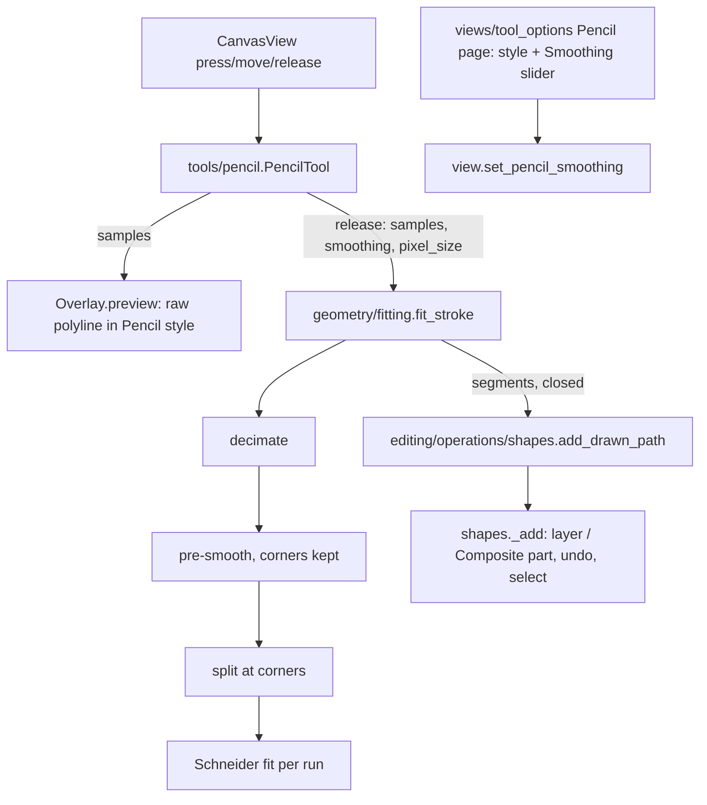

# Design Document

## Overview

The Pencil is a new tool, `PencilTool`, that records stroke samples while the button is down. It shows them as a live polyline and, on release, turns them into a path with a new pure-geometry function `fit_stroke()`. The path is added through the existing shape-adding operation, so layers, Composites, undo, selection and the "layer is hidden" message all work as for the Pen.

`fit_stroke()` has three stages, each pure and separately tested:
1. **Decimate** samples closer than a fraction of a screen pixel.
2. **Pre-smooth** the positions with a small moving average whose width grows with Smoothing; corners are protected from it.
3. **Fit cubic beziers** with Philip J. Schneider's algorithm ("An Algorithm for Automatically Fitting Digitized Curves", Graphics Gems, 1990): least-squares fit per run of points, Newton–Raphson reparameterization, and recursive splitting at the worst point until the error is within tolerance. Runs are split first at **corners**, places where the direction turns sharply, so corners stay corners and everything else joins smoothly (tangent continuity).

The tolerance and the pre-smoothing width come from the Smoothing value (0–100) and the zoom while drawing, so the line's character doesn't depend on zoom.

## Steering Document Alignment

### Technical Standards (tech.md)
- **Tools are Qt-free input state machines** that commit through one operation call; the Pencil follows the Pen's pattern.
- **Geometry** (`geometry/fitting.py`) is pure Python and unit-tested. No new dependency: numpy is only installed as a dependency of skia-python, not ours; plain Python with decimation is fast enough (see Performance).
- **Native format rules:** the Pencil's style is saved automatically, since tool styles are stored by tool name and unknown names are ignored by older versions. The new **smoothing** value is new stored data, so `CURRENT_VERSION` 2 → 3, with a no-op migration (absent = default 50), a `v3.p2s` sample and a row in `docs/file-format.md`.
- **Shortcut rule:** `F` for a drawing tool, a frequent action.
- **Translations:** new texts through `i18n`, German complete.

### Project Structure (structure.md)
- **New:**
  - `geometry/fitting.py`;
  - `tools/pencil.py`;
  - tests `tests/geometry/test_fitting.py`, `tests/tools/test_pencil.py`;
  - the icon `tool_pencil` (Tabler `pencil`) in `generate_icons.py` and `icons.py`.
- **Changed:**
  - models and editing: `models/app_state.py` (`Tool.PENCIL`, default style, `pencil_smoothing`); `editing/operations/shapes.py` (`add_drawn_path`); `editing/operations/view.py` (`set_pencil_smoothing`, tool name);
  - tools: `tools/registry.py`;
  - views: `views/keymap.py`; `views/tool_options_view.py` (Pencil page with the Smoothing slider);
  - formats: `formats/p2s.py`, `p2s_migrations.py`, the sample, `docs/file-format.md`;
  - translations, docs.

## Code Reuse Analysis

### Existing Components to Leverage
- **`shapes._add`:** adds to the active layer or the entered Composite, selects, names the undo step, handles hidden layers.
- **`Overlay.preview` and `render/scene.draw_overlays`:** draw a preview path in a style; the live stroke is a preview made of `LineTo` segments.
- **`PenTool`:** structure, cancel/Esc handling and the `pixel_size` from the tool context (screen px → document units).
- **Tool options (`ToolOptionsPanel`, `StyleEditor`, `LengthSpinBox`):** the Pencil page reuses the style editor and the unit-aware stroke width; it adds one slider.
- **`Session` / tool registry / keymap:** tools appear in the strip, menu and shortcuts from `TOOLS` + `KEYMAP`.

### Integration Points
- **`CanvasView`** forwards press/move/release unchanged; no tool-type checks. Tablet pens arrive as synthesized mouse events, since `CanvasView` doesn't accept tablet events.
- **`.p2s` working state:** `tools.pencil_smoothing`.

## Architecture



## Components and Interfaces

### `geometry/fitting.py`
```python
@dataclass(frozen=True)
class StrokeSample:
    x: float
    y: float
    # Room for the pressure/variable-width spec; unused by the fitting today.
    pressure: float = 1.0
    time: float = 0.0

def fit_stroke(samples: Sequence[StrokeSample], smoothing: int, pixel_size: float,
               close_distance_px: float = 6.0) -> tuple[tuple[Segment, ...], bool] | None
    # (segments starting with MoveTo, closed) or None if the stroke is too short to be a path.
```
- **Parameters from Smoothing `s` ∈ [0, 100]:**
  - tolerance = `pixel_size × (1 + 11 × (s/100)²)` (1 to 12 screen px, gentle at the low end);
  - pre-smoothing window = `round(4 × s/100)` samples on each side;
  - corner angle = 70° turn, measured over neighbours ~3 screen px away. It doesn't depend on smoothing: corners are about intent, not noise.
- **Stages:**
  1. `_decimate`: drop samples closer than 0.5 screen px to the last kept one.
  2. **Closing:**
     - if the stroke is shorter than 3 screen px in total, return None;
     - if the end is within `close_distance_px` of the start and the stroke is long enough to enclose something, mark it closed and snap the end to the start.
  3. `_corners`: indices where the direction turns more than the corner angle.
  4. `_presmooth`: a moving average that keeps corner points, the first point and the last point fixed.
  5. For each run between corners: `_fit_cubic(points, left_tangent, right_tangent, tolerance)` (Schneider). Tangents at internal joins are shared, which gives G1 continuity; corners get one-sided tangents.
  6. **Closed strokes:** a final `Close()`; if the start isn't a corner, the start and end tangents are shared so the seam is smooth.
- **Safeguards:**
  - Newton steps are clamped;
  - degenerate runs (all points equal) become a line;
  - a fitted control point that would overshoot by more than three times the run's chord length falls back to Wu–Barsky handle lengths (chord / 3);
  - the recursion is capped.

### `tools/pencil.py`
```python
class PencilTool(BaseTool):
    cursor = CursorType.CROSS
    press(point, mods)   # start: samples = [point]
    move(point, mods)    # append if moved ≥ 0.5 screen px; repaint
    release(point, mods) # append; fit; shapes.add_drawn_path(session, segments, closed, Tool.PENCIL); reset
    cancel()             # Esc
    overlay              # preview = (polyline segments of the samples, pencil style)
```
- **The preview polyline** is cached as a tuple of segments, extended on each move: no re-building the whole tuple per move beyond the Python tuple concatenation.

### `editing/operations/shapes.py`
```python
def add_drawn_path(session, segments: tuple[Segment, ...], tool: Tool) -> int | None
    # path with the tool's style; label "Add path"; reuses _add.
```
`add_path` (Pen) stays as it is.

### `models/app_state.py`
- `Tool.PENCIL` (after `PEN`).
- `_default_tool_styles`: `Tool.PENCIL: Style(fill=None, stroke="#18181b", stroke_width=2.0)`.
- `AppState.pencil_smoothing: int = 50`.

### `editing/operations/view.py`
- `set_pencil_smoothing(session, value)`: clamps to 0–100; not a document edit, so it only notifies.
- `tool_name(Tool.PENCIL)` returns `pgettext("tool", "Pencil")`.

### Tool registry, keymap and icon
- `ToolEntry(Tool.PENCIL, "tool.pencil", N_("Penc&il"), PencilTool)`, after the Pen. The mnemonic avoids clashes in the Tools menu (Select, Node, Pen, Rectangle, Ellipse, Text).
- `KEYMAP["tool.pencil"] = Binding("F", icons.TOOL_PENCIL)`.

### `views/tool_options_view.py`
- The Pencil page is a style editor `(STROKE, WIDTH, FILL)` like the Pen, plus a `QSlider` 0–100 labelled "Smoothing" with the current value shown next to it, wired to `view.set_pencil_smoothing`, and a hint.
- `TITLES[Tool.PENCIL] = N_("Pencil tool")`.

### `.p2s` version 3
- **State:** `tools.pencil_smoothing`, an integer 0–100, optional (default 50); invalid values are refused as damage.
- **Migration 2 → 3:** none needed (identity), registered so the version chain stays complete; plus a sample and a doc row.

## Data Models
```python
StrokeSample(x, y, pressure=1.0, time=0.0)   # geometry/fitting.py
AppState.pencil_smoothing: int               # 0..100, default 50
```

## Error Handling

### Error Scenarios
1. **Stroke too short** (a click or a tiny jiggle).
   - **Handling:** `fit_stroke` returns None; the tool creates nothing.
   - **User Impact:** none.
2. **Degenerate input** (all points identical, perfectly straight lines, zig-zags).
   - **Handling:** safeguards in the fitter; tested.
   - **User Impact:** a straight line or a corner path; no spikes.
3. **Hidden active layer.**
   - **Handling:** `_add` refuses with the existing message.
   - **User Impact:** as for the other drawing tools.
4. **Damaged smoothing value in a `.p2s`.**
   - **Handling:** `P2sError` naming `state.tools.pencil_smoothing`.
   - **User Impact:** as for other damaged files.

## Testing Strategy

### Unit Testing
- **`tests/geometry/test_fitting.py`:**
  - **Shapes:** a straight line → one segment; a sampled circle (noisy and clean) → a closed path within tolerance of the circle with few segments (≤ 8 at default); a drawn "L" keeps its corner (no smooth tangent at the corner); a sine wave → smooth joins (tangent directions match at every non-corner join).
  - **Accuracy and smoothing:** maximum deviation from the samples ≤ tolerance; higher smoothing → fewer segments.
  - **Edge cases:** a tiny stroke → None; identical points → None; zoom independence (the same stroke scaled by 4 with `pixel_size` × 4 gives the same segment count).
  - **Sanity:** no control point beyond the overshoot limit; performance: 5,000 noisy points fitted in < 100 ms.
- **`tests/tools/test_pencil.py`** (`ToolDriver`):
  - drag → path added, selected, one undo step;
  - preview while dragging uses the Pencil style;
  - Esc cancels;
  - a click creates nothing;
  - closing near the start;
  - inside a Composite → a part in the new-part mode;
  - hidden layer message;
  - the smoothing value affects the node count.
- **Formats:** v3 round trip of `pencil_smoothing`; v2 sample opens with the default; bad value refused.
- **Views:** tool options Pencil page slider ↔ state; keymap and mnemonic tests cover the new tool.

### End-to-End Testing
- QTest scratch run on the real window, offscreen and with GL: `F` selects the Pencil; drag a wavy stroke with many mouse moves → a smooth path with few nodes appears, editable with the Node tool; drag a closed loop → a closed path; screenshot with the Node tool to show the node count.
- `bench_canvas` unchanged.
