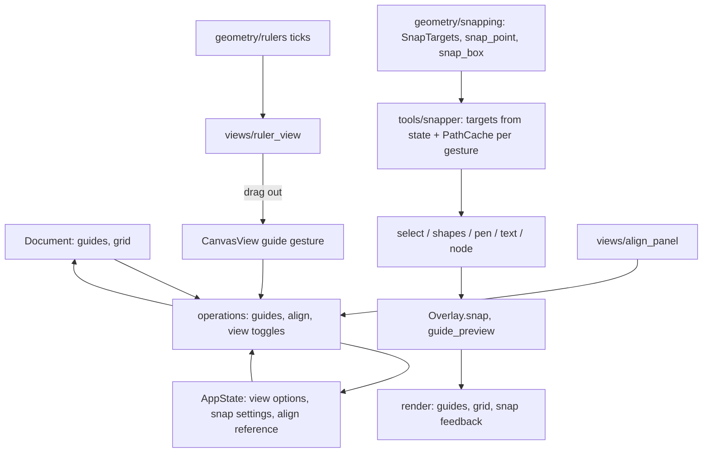

# Design Document

## Overview

Five parts, built bottom-up so each lands with tests:

1. **Model**: guides and grid settings on the `Document` (undoable, saved); show/lock/snap toggles as view state on `AppState` (not undoable).
2. **Pure geometry**: alignment and distribution offsets (`geometry/align.py`), snap target sets and snapping queries (`geometry/snapping.py`), ruler tick layout (`geometry/rulers.py`).
3. **Operations**: align/distribute, guides, grid, toggles (`editing/operations/align.py`, `guides.py`, `view.py`).
4. **Tools and rendering**: a per-gesture `Snapper` the tools ask (`tools/snapper.py`), snap feedback in the overlay, guides/grid drawing in `render/`, guide dragging in the Select tool.
5. **Views and formats**: rulers around the canvas, the Align panel in the right sidebar, View menu with checkable entries and a magnet toolbar toggle, Settings snap distance, `.p2s` version 6, SVG `sodipodi:namedview` guides/grid.

## Steering Document Alignment

### Technical Standards (tech.md)
- Qt-free logic below `views/`; geometry functions are pure and unit-tested.
- Frozen value types (`Guide`, `GridSettings`, `SnapSettings`) changed with `dataclasses.replace`.
- Per-frame work stays bounded: snap targets are prepared once per gesture; grid lines are generated only for the visible area as one path.
- `.p2s` change follows the migration rule.

### Independent implementation
- All code, algorithms' implementations, icons and test files are written for PressToShape. No code is copied or translated from Inkscape, inkex, Illustrator or other projects, and their sources are not used as a template.
- Interoperability relies only on facts about file formats (which element and attribute names exist, what a coordinate means, e.g. that a stored guide y is measured from the bottom of the viewBox) and on common UI conventions (Ctrl+R for rulers, % for snapping). Such facts and conventions aren't anyone's code; where the design names another program, it only states that behaviour so files and habits carry over.
- Test fixtures in other programs' formats are hand-written from that format knowledge, never copied from their files.
- Icons come from Tabler (MIT, already credited in the license list).

### Project Structure (structure.md)
- New modules: `models/layout.py`, `geometry/align.py`, `geometry/snapping.py`, `geometry/rulers.py`, `editing/operations/align.py`, `editing/operations/guides.py`, `tools/snapper.py`, `render/guides.py`, `views/ruler_view.py`, `views/align_panel.py`, `views/guide_dialog.py`, `views/grid_dialog.py`.
- Changed: `models/app_state.py`, `tools/base.py`, `tools/select.py`, `tools/shapes.py`, `tools/pen.py`, `tools/text.py`, `tools/node.py`, `render/overlay.py`, `render/scene.py`, `views/canvas_view.py`, `views/main_window.py`, `views/keymap.py`, `views/actions.py`, `views/toolbar_view.py`, `views/settings/canvas_page.py`, `views/app_settings.py`, `formats/p2s.py`, `formats/p2s_migrations.py`, `formats/svg.py`, `formats/svg_reader.py`, `formats/svg_page.py`.

## Code Reuse Analysis

### Existing Components to Leverage
- **`render/paths.PathCache.geometry_bounds`**: the box align, distribute and object snapping use (same as the selection frame).
- **`geometry.transforms.translate`** and `editing.operations._document.map_selected`: moving shapes for align/distribute.
- **`render/viewport.Viewport`**: doc ↔ screen mapping for rulers, guides and the visible area.
- **`registry.operation`, `keymap`, `actions.AppActions`**: commands, menus, shortcuts; extended with checkable entries.
- **`Session` snapshots**: copy the `Document` with `replace`, so guides and grid (immutable fields on it) become undoable without changes to the session.
- **`geometry.units`**: unit conversion for rulers, grid defaults, dialogs.
- **Tabler icons** via `generate_icons.py`: `layout-align-*`, `layout-distribute-*`, `spacing-horizontal/vertical`, `magnet`.

### Integration Points
- **Tools** already receive a `ToolContext`; it gains `snapper(...)` and a `pointer_off_canvas` flag set by the canvas.
- **Overlay** gains `snap: SnapFeedback | None` and `guide_preview`, drawn by `scene.draw_overlays`.
- **`SavedState`** (`.p2s` working state) gains show grid / show guides / lock guides.
- **App settings** (QSettings) keep rulers, snapping toggles and snap distance between sessions; `App` loads them into `AppState` at start, the views write them back on change.

## Architecture



## Components and Interfaces

### 1. Model

`models/layout.py`:

```python
GuideOrientation = Literal["horizontal", "vertical"]

@dataclass(frozen=True)
class Guide:
    id: int                      # from Document.next_id, shared with shapes
    orientation: GuideOrientation
    position: float              # doc px: y for horizontal, x for vertical

@dataclass(frozen=True)
class GridSettings:
    spacing: float               # doc px between minor lines
    major_every: int = 5         # every N-th line is drawn stronger

def default_grid(unit: Unit, dpi: float) -> GridSettings:
    # px: 10 px / 10, mm: 5 mm / 2, cm: 0.5 cm / 2, in: 0.25 in / 4, pt: 12 pt / 6

@dataclass(frozen=True)
class SnapSettings:
    enabled: bool = True
    grid: bool = False
    guides: bool = True
    artboard: bool = True
    objects: bool = True
    nodes: bool = True
    distance_px: float = 8.0     # screen px

@dataclass(frozen=True)
class ViewOptions:
    show_rulers: bool = True
    show_grid: bool = False
    show_guides: bool = True
    lock_guides: bool = False
```

`Document` gains `guides: tuple[Guide, ...] = ()` and `grid: GridSettings | None = None` (None = the unit's default, resolved by `layout.grid_of(document)`). `AppState` gains `view: ViewOptions`, `snapping: SnapSettings`, `align_reference: Literal["selection", "artboard"] = "selection"`.

### 2. Geometry

**`geometry/align.py`**
```python
AlignEdge = Literal["left", "hcenter", "right", "top", "vcenter", "bottom"]
def align_offsets(boxes: Sequence[Rect], edge: AlignEdge, reference: Rect) -> list[Point]
DistributeMode = Literal["gaps_x", "gaps_y", "centers_x", "centers_y"]
def distribute_offsets(boxes: Sequence[Rect], mode: DistributeMode) -> list[Point]
```
Boxes are `(x, y, w, h)`. Distribution sorts by the box start (centre for the centre modes), keeps the first and last, and spaces the inner ones; offsets are returned in the input order. Gap mode with total sizes larger than the span gives negative gaps (overlapping evenly), as Inkscape and Illustrator do.

**`geometry/snapping.py`**
```python
SnapTarget = Literal["grid", "guide", "artboard", "edge", "centre", "node"]

@dataclass(frozen=True)
class LineTarget:          # a vertical (x) or horizontal (y) line to snap a coordinate to
    value: float
    target: SnapTarget
    extent: tuple[float, float] | None   # the other axis' span of the source object, for feedback lines

@dataclass(frozen=True)
class SnapTargets:
    xs: tuple[LineTarget, ...]   # sorted by value
    ys: tuple[LineTarget, ...]
    points: tuple[tuple[float, float], ...]   # nodes, sorted by x
    grid: GridSpec | None        # origin + spacing; snapped by rounding, no arrays

@dataclass(frozen=True)
class SnapHit:
    axis: Literal["x", "y", "point"]
    value: float
    target: SnapTarget
    line: tuple[Point, Point] | None     # feedback segment in doc space

@dataclass(frozen=True)
class SnapResult:
    offset: Point                        # what to add to the dragged geometry
    hits: tuple[SnapHit, ...]

def snap_point(targets, point, tolerance) -> SnapResult
def snap_box(targets, box: Rect, tolerance, with_points: Sequence[Point] = ()) -> SnapResult
```
`snap_point` first tries node points (2D nearest within tolerance, by bisecting the x-sorted points), then x and y independently against lines and the grid. `snap_box` tests the box's left/centre/right against `xs` (top/middle/bottom against `ys`) and the optional moving nodes against points, choosing per axis the smallest correction. Lookups bisect the sorted tuples, so a query is O(log n). Feedback lines for "edge"/"centre" hits run from the dragged box to the target object's span (smart-guide look).

**`geometry/rulers.py`**
```python
@dataclass(frozen=True)
class Tick:
    screen: float        # px along the ruler
    major: bool
    label: str | None    # number in the unit, formatted without trailing zeros

def ruler_ticks(start_doc: float, end_doc: float, zoom: float, unit: Unit, dpi: float, length_px: float) -> list[Tick]
```
Chooses the smallest step from 1·10ⁿ, 2·10ⁿ, 5·10ⁿ (in the unit) whose labelled ticks are at least ~60 px apart, with 5 or 10 minor ticks between.

### 3. Operations

**`editing/operations/align.py`**: `align(session, edge)` and `distribute(session, mode)` registered as `object.align_left` … `object.distribute_centers_y`, with `can_run` (selection ≥ 1, distribute ≥ 3 pickable selected). Boxes from `PathCache().geometry_bounds`; reference = union of boxes, or the artboard `(0, 0, w, h)` when `align_reference == "artboard"` or only one object is selected. One `session.edit` per command with labels "Align left", "Distribute horizontally", …. `set_align_reference(session, value)` is view state.

**`editing/operations/guides.py`**: `add_guide(session, orientation, position) -> int`, `move_guide(session, guide_id, position)` (merge key per guide, so a drag is one step), `delete_guide`, `clear_guides` (registered `view.clear_guides`), `set_grid(session, spacing, major_every)` (one undo step). All guide/grid edits go through `session.edit` and replace `document.guides` / `document.grid`.

**`editing/operations/view.py`** additions (not undo steps): `toggle_rulers`, `toggle_grid`, `toggle_guides`, `toggle_lock_guides`, `toggle_snapping`, `set_snap_target(session, target, on)`, `set_snap_distance(session, px)`, registered as `view.show_rulers`, `view.show_grid`, `view.show_guides`, `view.lock_guides`, `view.snapping`, `view.snap_grid` … with a `checked` callback (see Views).

### 4. Tools and snapping

**`tools/snapper.py`**
```python
class Snapper:
    @classmethod
    def for_gesture(cls, state, cache, pixel_size, visible: Rect, exclude: set[int], include_nodes_of: ... ) -> "Snapper"
    def point(self, point: Point, mods: Mods) -> Point            # snaps unless disabled or mods.ctrl
    def box(self, box: Rect, mods: Mods, nodes: Sequence[Point] = ()) -> Point   # returns the corrected offset
    @property
    def feedback(self) -> SnapFeedback | None
```
Built once when a gesture starts. Targets come from the **visible area plus a margin** only (shapes off-screen can't be seen to snap to, and this keeps building cheap with 10,000 shapes): pickable shapes' geometry bounds (edges, centres) and, with Nodes on, path nodes and rect corners, excluding the moving shapes; guides when shown; artboard edges and centre; grid when shown and checked. Tolerance = `distance_px × pixel_size`. `ToolContext` gets `visible_rect` (set by the canvas) and `snapper(exclude)`.

Tool integration:
- **Select, move**: offset = pointer delta, then `snapper.box(moved start box, …)` corrects it; the matrix uses the corrected delta. Shift's existing behaviour is unchanged.
- **Select, scale**: the dragged handle point is snapped with `snapper.point` before computing the scale.
- **Rectangle / ellipse / pen / text**: press and move points pass through `snapper.point`.
- **Node tool**: a dragged node's target point is snapped, excluding that path's moving nodes.
- **Guide drag** (Select tool or from a ruler): `snapper.point` with guides excluded, only the relevant axis used.
- **Not snapped**: pencil, rotation, bezier handles, nudges.

`Overlay` gains `snap: SnapFeedback | None` (hits with feedback lines and a translated label) and `guide_preview: Guide | None`.

**Guides in the Select tool**: on press, after handles and shapes miss and guides are shown and unlocked, `render.guides.guide_at(guides, point, tolerance)` picks a guide → mode `GUIDE`; move updates a preview; release calls `guides.move_guide`, or `delete_guide` when `context.pointer_off_canvas` (released over a ruler). Double-click on a guide calls `context.edit_guide(guide_id)`, which the canvas wires to the guide dialog. Hover returns a new `CursorType.GUIDE_H/GUIDE_V` (resize-style cursors).

### 5. Rendering

- **`render/guides.py`**: `draw_guides(canvas, guides, viewport_rect, zoom, color)` one-pixel hairlines across the visible area; `guide_at(...)` for hit-testing in screen tolerance.
- **Grid** (`render/guides.py` too): `draw_grid(canvas, grid, visible, zoom, colors)` builds minor and major lines for the visible area only into two paths; minor lines skipped below 6 screen px spacing, majors below 6 px too. Drawn after the document picture with low alpha so it shows over fills.
- **Snap feedback** in `scene.draw_overlays`: thin dashed lines in the selection colour for hits with a `line`, a small cross at point snaps, and the label drawn with the UI font next to it.
- Order: background → document → grid → guides → edit mode → overlays (snap feedback, handles). Export draws only background-free document as today.

### 6. Views

- **`views/ruler_view.py`**: `Ruler(orientation)` QWidget painted with QPainter from `ruler_ticks`, theme colours, a pointer marker and the selection extent band. `CanvasView` calls `setViewportMargins(ruler_size, ruler_size, 0, 0)` when rulers are shown and positions the two rulers plus a corner square; it updates them on scroll/zoom/pointer move (cheap repaint of two thin widgets). Pressing on a ruler starts a guide gesture on the canvas (`CanvasView.begin_guide_drag(orientation)`), which grabs the mouse until release.
- **`views/align_panel.py`**: `AlignPanel` with the six align buttons, four distribute buttons (Tabler icons, tooltips), and a "Relative to" combo; buttons enabled from the commands' `can_run`. Added as a second right dock below Layers in `MainWindow`; the dock layout is saved with `QMainWindow.saveState` next to the window placement, so the split is remembered.
- **Checkable commands**: `registry.operation(..., checked=lambda session: bool)`; `AppActions` creates checkable QActions for them and syncs `setChecked` in `refresh` (signals blocked).
- **Keymap**: Ctrl+R rulers, `%` snapping, `#` grid, `|` guides; View menu: Show Rulers, Show Grid, Show Guides, Lock Guides, Clear Guides, Grid Settings…, separator, Snapping, Snap To ▸ (Grid, Guides, Artboard, Objects, Nodes). Object menu: Align ▸ and Distribute ▸. Toolbar: magnet toggle after zoom.
- **Dialogs**: `GuideDialog` (position in the unit, Delete button) and `GridDialog` (spacing in the unit, major every N) as window commands.
- **Settings → Canvas**: "Snap distance" spin (screen px, 2–30).
- **Persistence**: `app_settings` gets `view_options` / `snap_settings` getters/setters; `App` applies them to the new `AppState`; `MainWindow.refresh` writes them back when they changed.

### 7. Formats

**`.p2s`** version 6: `document.guides: [{"id", "orientation", "position"}]`, optional `document.grid: {"spacing", "major_every"}`; `state.view: {"show_grid", "show_guides", "lock_guides"}` (optional). Migration 5→6 is identity (absent = none / defaults). Sample `v6.p2s`, doc rows.

**SVG** (written in `svg_page.py` next to the page attributes, read in `read_page`):
```xml
<sodipodi:namedview pagecolor="#ffffff" showgrid="false" showguides="true" inkscape:lockguides="false"
                    inkscape:document-units="mm">
  <sodipodi:guide id="guide12" position="x,y" orientation="0,-1"/>   <!-- horizontal -->
  <sodipodi:guide id="guide13" position="x,y" orientation="1,0"/>    <!-- vertical -->
  <inkscape:grid id="grid1" type="xygrid" units="mm" originx="0" originy="0"
                 spacingx="…" spacingy="…" empspacing="2" visible="…" enabled="true"/>
</sodipodi:namedview>
```
- Guide positions are in user units with y measured from the bottom of the viewBox (Inkscape's stored convention: `y_top = viewBox height − y_stored`, as inkex's `Guide.position` does). Writing inverts it. Orientation is the guide's normal: |nx| > |ny| → vertical guide, else horizontal; angled guides are skipped with an import note.
- Grid spacing is read as user units, or as a length with a unit suffix (older Inkscape files), converted with the page scale; missing or broken values fall back to the unit's default grid with a note.
- Our own files carry the same namedview, so Inkscape shows the guides and grid.

## Data Models

See Component 1. `.p2s` excerpt:

```json
"document": {"…": "…",
  "guides": [{"id": 31, "orientation": "vertical", "position": 120.0}],
  "grid": {"spacing": 18.897637795275593, "major_every": 2}},
"state": {"view": {"show_grid": true, "show_guides": true, "lock_guides": false}}
```

## Error Handling

### Error Scenarios
1. **Snapping with huge documents**: target building is limited to the visible area; if it still exceeds a budget (e.g. 20,000 targets) node targets are dropped first. User impact: none noticeable.
2. **Degenerate selections** (zero-width boxes, a single object for distribute): commands disabled or offsets of zero; no undo step without a change.
3. **Damaged `.p2s` guide/grid data**: `P2sError` with the JSON path.
4. **Foreign SVG with odd guides/grids** (angled guides, unit-suffixed spacing, missing attributes): skipped or defaulted with an import note.
5. **Guide dragged off-screen without a ruler shown**: released outside the viewport deletes only when it was released over a ruler; otherwise it is placed at the clamped position.

## Testing Strategy

### Unit Testing
- `tests/geometry/test_align.py`: each edge, reference to selection and artboard, distribute gaps/centres with unsorted input, negative gaps, fewer than three boxes.
- `tests/geometry/test_snapping.py`: point and box snapping per target, tolerance edges, nearest wins, x and y independent, grid rounding with origin, feedback lines, 10k targets × 1000 queries under budget.
- `tests/geometry/test_rulers.py`: tick steps across zooms and units, labels, readable spacing.
- `tests/editing/test_align.py`, `test_guides.py`, `test_view.py`: undo labels, artboard reference for single objects, inside groups, guide add/move (merged)/delete/clear, grid change, toggles not undoable.
- `tests/tools/`: select move snaps to guide/edge/grid, Ctrl bypass, scale handle snapping, rect drawing snaps, node drag snapping excludes itself, guide drag from Select tool and deletion over ruler, feedback present while snapped.
- `tests/render/`: guides and grid pixels at known positions, minor lines hidden when dense, nothing in PNG export.
- `tests/formats/`: `.p2s` v6 round trip and sample, damaged data; SVG namedview write/read round trip, a hand-written Inkscape-style fixture with guides and grid in mm.

### Integration Testing
- `bench_canvas.py`: drag frames with snapping on vs off (10k shapes), grid shown.
- QTest scratch runs offscreen and with GL: drag a guide out of a ruler, move an object onto it, align/distribute from the panel, toggle grid/rulers/snapping via shortcuts.

### End-to-End Testing
- Screenshots en/de of rulers, grid, guides, snap feedback and the Align panel.
- Manual: guides and grid round trip with Inkscape.
