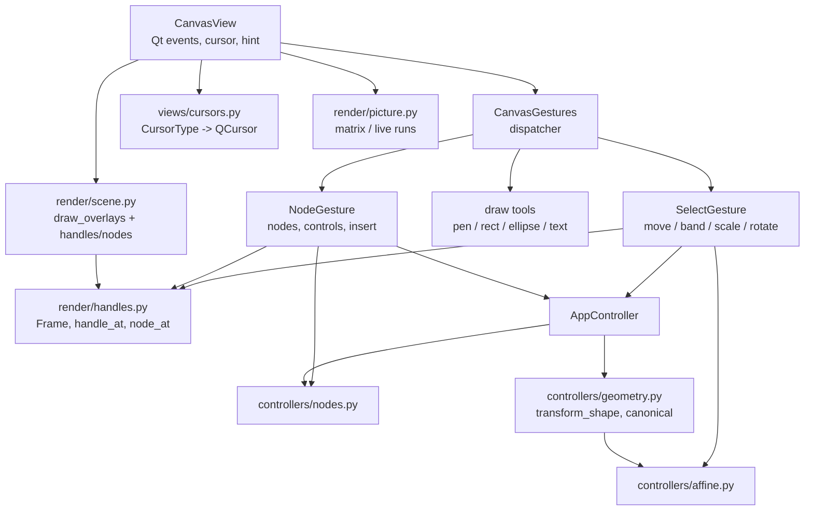

# Design Document

## Overview

Four pieces, built bottom-up:

1. **Affine transforms in the model.** Every shape gets a `transform` field (6-tuple, identity by default). Pure matrix math lives in a new `controllers/affine.py`. Rect, ellipse and text keep a *canonical* form: unrotated geometry plus a rotation about the shape's own center (or anchor for text). Only when a transform can't be written that way (skew) does it stay a general matrix. Paths always have the transform baked into their segments, so a path's transform stays identity and its nodes are in document coordinates.
2. **Transform gestures on the Select tool.** These are scale handles and rotation zones on a *selection frame*. The frame geometry and the hit-testing of handles are Qt-free in `render/handles.py`. The gesture maths produces one doc-space affine `M`, previewed live and committed through `controller.transform_selection(M)`.
3. **Node tool.** A new `Tool.NODE`. The node operations are pure functions in `controllers/nodes.py`, used both for the live preview and for the commit. The node selection lives in `AppState`, because the Delete action (a QAction) has to see it.
4. **Cursor feedback.** Every gesture module answers `hover(point) -> CursorType` (a Qt-free enum). `views/cursors.py` maps that type to a `QCursor`, including a custom rotate cursor rendered from a Tabler SVG.

`canvas_gestures.py` becomes a thin dispatcher over per-tool gesture classes. That way it doesn't grow into one class handling every tool.

## Steering Document Alignment

### Technical Standards (tech.md)
- MVC: gestures hold the transient state (the drag matrix and the live preview shapes). Controllers are the only writers: one controller call per committed gesture, `_checkpoint()` before the change and `_notify()` after.
- There are no Qt imports in `models/`, `controllers/` or `render/`. Cursor types and handle geometry are Qt-free, so pytest can cover them.
- SVG interop: rotated rect, ellipse and text are written as the same element with `transform="rotate(a cx cy)"`, and as `matrix(...)` when skewed. On import, shapes under a transform are canonicalized instead of being flattened to paths. This resolves the tech.md debt entries "no per-shape transforms" and "non-translation transforms are flattened". tech.md gets updated in the final task.
- Paint defaults stay unchanged. Stroke is drawn under the shape's transform, as SVG does. Our own scaling puts the scale into the geometry, so strokes don't scale (Req 2.8).

### Project Structure (structure.md)
- New modules, one concern each: `controllers/affine.py`, `controllers/nodes.py`, `render/handles.py`, `views/select_gesture.py`, `views/node_gesture.py` and `views/cursors.py`.
- Dependency direction stays as it is. `render/` already imports `controllers.geometry` (pure helpers) and now also imports `controllers.affine`. Neither of those imports render or views, so there is no cycle.

## Code Reuse Analysis

### Existing Components to Leverage
- **`geometry.transform_segments`**: bakes an affine into path segments (paths, Object to Path, SVG import).
- **`geometry.translate`**: kept for moves, now also translating the transform of rect, ellipse and text when that transform isn't identity.
- **`geometry.outline` / `boolean`**: `outline` now applies the shape's transform, so booleans, rubber band and hit-testing respect rotation without any other changes.
- **`svg_io._compose / _apply / _parse_transform`**: these move to `controllers/affine.py` (`compose`, `apply`), and svg_io imports them from there.
- **`PathCache`**: builds the path in world space (local path → `transform`). `get`, `stroke_path` and `bounds` keep their meaning. A new `geometry_bounds` gives tight bounds without stroke, for the selection frame.
- **`DocumentPicture` runs**: the moving runs are already replayed under a translation. That generalizes to an arbitrary matrix and to live shapes drawn in place of a run.
- **`hit_test.shape_at`**: the hover fallback for the move cursor.
- **`_hairline`, `parse_color`, `theme.SELECTION`**: used for drawing handles and nodes.
- **`icon_engine` / `generate_icons.py`**: new Tabler icons for the Node tool (`vector-spline`) and the rotate cursor (`rotate-clockwise-2`).

### Integration Points
- **`AppController`**: new `transform_selection`, `set_rotation`, `object_to_path`, `set_node_selection`, `move_nodes`, `move_control`, `insert_node` and `delete_nodes`. `delete_selection` deletes nodes when the Node tool has selected nodes. `set_shape_field` keeps the rotation when X/Y/W/H change.
- **`CanvasView`**: passes Alt along with the other modifiers, sets the cursor from `gestures.hover`, refreshes the cursor after state, zoom or scroll changes under a stationary pointer, and forwards the gesture hint text to the status bar.
- **`SelectionOptions`**: a "Rotation" spinbox for rect, ellipse and text. It is disabled with "skewed" shown when the transform isn't a pure rotation. The hint text mentions the handles.
- **`AppActions` / `menu_bar_view` / `toolbar`**: a `Tool.NODE` entry (`N`) and an `object_to_path` action (Ctrl+Shift+C). The action goes in the existing **Path** menu next to Union and Difference, not in a new "Object" menu. Inkscape puts it there too, and an Object menu with a single item would be odd. *(This deviates from the wording of Req 6.1. Say so if you want an Object menu.)*
- **`StatusBar`**: `show_hint(text | None)` shows a transient gesture message (rotation angle, Node-tool hint) over `state.status_message` without writing app state.

## Architecture



Gesture flow (scale): press on a handle → `SelectGesture` stores the frame, handle, start point and modifiers → each move computes `M = scale_about(frame, handle, pointer, shift, alt)` and sets `Overlay(moving, matrix=M, live=…)` → release calls `controller.transform_selection(M)`, which is one undo step.

### Modular Design Principles
- `render/handles.py` does geometry and picking for overlays only. It has no state and draws nothing. Drawing lives in `scene.draw_overlays`.
- `controllers/affine.py` holds tuple-based 2D affine maths with no other dependencies.
- `controllers/nodes.py` holds pure functions from segments to segments. It knows nothing about the controller or gestures.
- Each gesture class owns one tool's transient state and exposes the same small interface.

## Components and Interfaces

### `controllers/affine.py`
- **Purpose:** 2D affine maths on `Affine = tuple[float, float, float, float, float, float]` (SVG `matrix(a b c d e f)` order).
- **Interfaces:** `IDENTITY`; `compose(outer, inner)`; `apply(m, x, y)`; `invert(m)` (raises on a singular matrix); `translation(dx, dy)`; `rotation(rad, cx, cy)`; `scaling(sx, sy, cx, cy)`; `is_identity(m, eps)`; `decompose(m) -> (angle, sx, sy, skew) | None` for diagnostics; `as_rotation(m) -> (deg, cx, cy) | None` when `m` is a pure rotation about a point (used by the SVG writer and the panel).
- **Reuses:** the `_compose` / `_apply` code from svg_io (moved here).

### `models/shapes.py` (changed)
- Each of `RectShape`, `EllipseShape`, `PathShape` and `TextShape` gets `transform: tuple[float, ...] = (1, 0, 0, 1, 0, 0)` as its last field, after `style`. Existing positional constructors keep working. Shapes stay frozen.

### `controllers/geometry.py` (extended)
- `outline(shape)` applies `shape.transform`.
- `translate(shape, dx, dy)` for a rect, ellipse or text shape with a non-identity transform moves the geometry *and* recenters the rotation by the same delta. This keeps the canonical form: the transform stays a rotation about the new center.
- `transform_shape(shape, m: Affine, min_extent: float) -> Shape` returns the shape with its total transform `m ∘ shape.transform`, canonicalized:
  - **Path:** segments mapped through the total, transform = identity.
  - **Rect / ellipse:** let `L` be the linear part of the total. If its columns are orthogonal (within 1e-9 relative), scale factors `|u|` and `|v|` go into the width/height or radii, clamped to `min_extent`. The geometry is re-centred on the mapped centre, and the transform becomes `rotation(angle, centre)`. A flip (det < 0) is a 180° rotation plus an axis swap of the sign, which leaves the shape looking the same because rects and ellipses are symmetric. If the columns aren't orthogonal (skew), the geometry is kept and transform = total (Req 3.8).
  - **Text:** the anchor is mapped through the total, `font_size *= max(|u|, |v|)` (minimum 1), and the rotation angle is taken from `u` when det > 0. On a flip the previous rotation is kept, so text never turns upside down. Skew is dropped, matching Req 2.9's uniform scaling.
  - A rotation angle within 1e-9 of 0 becomes the identity transform, so unrotated shapes stay transform-free (existing documents and tests are unaffected).
- `rotation_of(shape) -> float | None` returns degrees, 0 for identity, or None when skewed. `with_rotation(shape, deg)` builds `rotation(deg, centre)` from the current geometry.

### `controllers/nodes.py`
- **Purpose:** node-level path editing on `tuple[Segment, ...]`, with no knowledge of the controller.
- **Model of nodes:** a node is addressed by the index of the segment that ends at it (`MoveTo`, `LineTo` or `CubicTo`). In a closed subpath whose last endpoint equals its `MoveTo` point, that last endpoint is an *alias* of the `MoveTo` node: it isn't listed separately and moves with it. A control point is addressed as `(segment_index, 1 | 2)`: `c1` belongs to the node before the segment, `c2` to the node the segment ends at.
- **Interfaces:**
  - `nodes(segments) -> list[NodeInfo(index, point, controls: list[ControlRef], smooth: bool)]`
  - `move_nodes(segments, indices, dx, dy) -> segments`: anchors, their alias and their attached control points move together.
  - `move_control(segments, ref, point, keep_smooth: bool) -> segments`: when `keep_smooth` is set and the node was smooth (the opposite control is collinear within 1° and on the other side of the anchor), the opposite control is rotated to stay collinear with its length unchanged.
  - `nearest_on_path(segments, point) -> (segment_index, t, distance)`: samples each segment (16 steps), then refines t by ternary search.
  - `insert_node(segments, segment_index, t) -> (segments, new_index)`: lines are split by interpolation, cubics by de Casteljau, so the shape doesn't change.
  - `delete_nodes(segments, indices) -> segments | None`: each removed anchor's two neighbouring segments become one. If either was a cubic, the result is a cubic using the outer controls; otherwise a line. Subpaths with fewer than 2 nodes are dropped. Returns None when nothing remains.

### `render/handles.py`
- **Purpose:** the selection frame and picking for handles and nodes, at screen-constant size.
- **Interfaces:**
  - `@dataclass(frozen=True) Frame(rect: Rect, transform: Affine)`: `rect` is in frame space and `transform` maps frame space to the document.
  - `selection_frame(shapes, cache) -> Frame | None`: a single shape uses `local_bounds(shape)` plus `shape.transform`. Several shapes use the union of `cache.geometry_bounds` (axis-aligned) with the identity transform.
  - `Handle` enum: `N, NE, E, SE, S, SW, W, NW` plus `ROTATE_NE, ROTATE_SE, ROTATE_SW, ROTATE_NW`, with `handle_points(frame, zoom) -> dict[Handle, Point]` and `handle_at(frame, point, zoom) -> Handle | None`. Scale handles are hit within `HANDLE_PX / 2 + 2` screen px. Rotation zones are corner-relative, between 6 and 22 px outside the frame on the outward diagonal side, and only where no scale handle and no frame interior is hit. Edge handles are omitted on an axis whose on-screen length is under `3 * HANDLE_PX` (Req 1.4).
  - `handle_direction(frame, handle) -> float`: the on-screen angle of the handle's outward normal, which `views/cursors.py` uses to pick the resize cursor.
  - `node_at(segments, point, zoom, controls_visible: set[int]) -> NodeRef | ControlRef | None`: within 6 screen px, controls first, then anchors.
  - `local_bounds(shape) -> Rect`: the untransformed geometric bounds (rect and ellipse analytically, text via `render.text.text_path` with the transform ignored). It lives here rather than in geometry so that controllers don't need text rendering.
- **Dependencies:** `controllers.affine`, `controllers.nodes`, `render.paths`, `render.text`.

### `render/overlay.py` (changed)
```
Overlay(
  selection: frozenset[int],
  rubber_band: Rect | None,
  preview: (segments, style) | None,
  moving: frozenset[int],
  matrix: Affine = IDENTITY,           # replaces `offset`; translation for move, rotation for rotate
  live: tuple[Shape, ...] = (),        # exact replacement shapes for `moving` (scale, node drag)
  frame: Frame | None,                 # handles to draw, already live-transformed
  nodes: NodeOverlay | None,           # Node tool: path segments, selected nodes, visible controls
)
NodeOverlay(segments, selected: frozenset[int], controls: frozenset[ControlRef])
```

### `render/picture.py` and `render/scene.py` (changed)
- `DocumentPicture.draw(canvas, doc, moving, matrix, live)`: runs also record their shape ids. When `live` is given, a moving run draws its live shapes directly. Otherwise it is replayed under `canvas.concat(matrix)`. Static runs are reused, so a gesture never re-records the document (performance NFR).
- `draw_shape` concatenates `shape.transform` around the drawRect / drawOval / drawTextBlob fast paths. Paths are untransformed, so they cost nothing extra.
- `draw_overlays` draws per-shape dashed bounds (mapped through `matrix` for moving shapes; for live shapes, computed from the live shape), then the frame (its outline as a hairline), then the handles: white squares of `HANDLE_PX` = 8 screen px with a selection-colour border, drawn in screen-aligned rects at the mapped points. Node overlays draw anchors as squares (filled in the selection colour when selected), controls as small circles and control arms as hairlines. Rotation zones aren't drawn; the cursor communicates them.

### `views/canvas_gestures.py` (refactored)
- `Mods(shift, ctrl, alt)` dataclass. `press(point, mods)`, `move(point, mods)`, `release(point, mods)`, `hover(point) -> CursorType`, `overlay`, `hint: str | None`, `escape()`, `double_click(point)`, `cancel()`.
- Dispatches to `SelectGesture`, `NodeGesture` or the existing draw-tool logic (pen, rect, ellipse and text stay in this module; they are short).
- `CursorType` enum: `ARROW, MOVE, RESIZE_H, RESIZE_V, RESIZE_FDIAG, RESIZE_BDIAG, ROTATE, CROSS, IBEAM, NODE, NODE_INSERT`. While a drag is active, `hover` returns the cursor type captured at press (Req 7.5).

### `views/select_gesture.py`
- **States:** idle; band; move; scale(handle); rotate.
- **Press:** `handle_at(frame)` first, then `shape_at`, then the band. The frame is computed from the selection once per state change and cached by the selected shapes' identity.
- **Scale maths:** in frame space, with anchor = opposite handle (Alt: frame centre). Factors are `sx = (p - anchor) / (start - anchor)` per axis, edge handles keep the other factor at 1, Shift makes corners uniform (`max |f|` with signs kept) and edges apply the same factor to both axes. Factors are clamped so the extent stays ≥ 1 screen px, keeping the sign so dragging past the opposite side flips. The result is `M = F ∘ scaling(sx, sy, anchor) ∘ F⁻¹`.
- **Rotate maths:** `θ = atan2(p - c) - atan2(start - c)` with `c` the frame centre in the document. Shift snaps the *resulting* angle (the shape's rotation + θ for a single shape, θ for several) to 15°. The result is `M = rotation(θ, c)`. The hint shows `"Rotate 37.5°"`.
- **Preview:** move and rotate use `matrix` only, which is exact. Scale uses `live = tuple(transform_shape(s, M) …)` when the selection has ≤ 200 shapes, so text and stroke look exactly as they will after the commit. Above that it falls back to `matrix` (approximate stroke during the drag only) to stay fluid.
- **Release:** move → `move_selection(dx, dy)` (unchanged); scale or rotate → `transform_selection(M)`; Esc → cancel.

### `views/node_gesture.py`
- Edited paths are the selected `PathShape`s. Press checks, in order: `node_at` on edited paths (select the node or control; Shift toggles), a single click on a segment of an edited path (does nothing, since a double-click inserts), `shape_at` (selects that shape and clears the node selection), and finally a node rubber band over empty space.
- Dragging an anchor previews with `live = (path with move_nodes applied)` and commits through `controller.move_nodes(shape_id, indices, dx, dy)`. Dragging a control previews `move_control` (Alt disables `keep_smooth`) and commits with `controller.move_control`. Double-click on a segment within tolerance calls `controller.insert_node`.
- Hint for a selected non-path shape: "Node tool edits paths. Use Path → Object to Path (Ctrl+Shift+C) first." (Req 5.9).
- Hover: control or anchor → `NODE`; segment of an edited path → `NODE_INSERT`; otherwise `ARROW` (or `MOVE` over a shape that a click would select).

### `views/cursors.py`
- `qt_cursor(cursor_type, direction_deg | None, dpr) -> QCursor`. For resize types, the view passes the handle's on-screen angle and the nearest of the 4 Qt resize shapes is chosen. That choice is a pure function `resize_cursor_type(angle) -> CursorType`, tested from `canvas_gestures`. `ROTATE` and `NODE_INSERT` are custom cursors: the Tabler SVG rendered via `QSvgRenderer` into a `QPixmap` at 24 px × dpr, a white halo stroke under a dark stroke so the cursor is visible on any background, hotspot in the centre. They are cached per dpr.

### `AppController` additions
- `transform_selection(m: Affine)`: does nothing for identity or an empty selection. Otherwise `_checkpoint()`, then `_map_selected(lambda s: geometry.transform_shape(s, m, MIN_EXTENT))`, sets a status message and calls `_notify()`.
- `set_rotation(shape_id, degrees)`: uses `merge_key=f"{id}:rotation"` so spinbox steps merge into one undo step, and does nothing for skewed shapes.
- `set_shape_field`: after the field change, a rotated (non-skew) shape is rebuilt with `with_rotation(updated, rotation_of(old))`, so editing X, Y, W or H keeps it rotated about its new centre.
- `object_to_path()`: rect and ellipse go through `outline` (transform applied); text through `render.paths.from_skia_path(text_path)` mapped through the transform. Ids are kept so the selection stays. One undo step.
- `set_node_selection(refs)`, `move_nodes`, `move_control`, `insert_node`, `delete_nodes`: each edit is one checkpoint. `delete_nodes` returning None deletes the shape.
- `AppState.node_selection: frozenset[tuple[int, int]]` holds (shape id, node index) pairs. It is cleared on `set_selection`, tool change, undo/redo and any structural path change other than the gesture's own result. `delete_selection` deletes the selected nodes instead of the shapes when the Node tool is active and nodes are selected.

### `render/paths.py` additions
- `_build` applies `shape.transform` (via `skia.Matrix`) after building the local path; a stroke outline is built from the world path. That matches stroke-under-transform for rotation, which is our canonical case. A skewed shape's hit-test stroke is approximated in world space, which is acceptable for picking.
- `geometry_bounds(shape)` gives tight bounds of the world path without stroke.
- `from_skia_path(path) -> tuple[Segment, ...]` converts quads with `quad_to_cubic` and conics via `ConvertConicToQuads`.

### `svg_io.py` changes
- Writer: identity writes no attribute. `affine.as_rotation` writes `rotate(a cx cy)`; anything else writes `matrix(a b c d e f)`.
- Reader: rect, ellipse/circle and text under a non-translation matrix are built in their local form and passed through `geometry.transform_shape(shape, m, 0)`. That produces the same canonical form as the gestures (axis scales go into the geometry, rotation into the transform, skew is kept). Paths are unchanged (baked). Stroke width keeps the existing `sqrt(|det|)` scaling.

## Data Models

```python
Affine = tuple[float, float, float, float, float, float]   # controllers/affine.py; models use the plain tuple type

@dataclass(frozen=True)
class RectShape:          # likewise EllipseShape, PathShape, TextShape
    id: int
    x: float
    y: float
    width: float
    height: float
    style: Style
    transform: tuple[float, float, float, float, float, float] = (1.0, 0.0, 0.0, 1.0, 0.0, 0.0)

NodeRef = tuple[int, int]            # (shape_id, segment_index)
ControlRef = tuple[int, int]         # (segment_index, 1 | 2), within one path

@dataclass
class AppState:
    ...
    node_selection: frozenset[NodeRef] = frozenset()
```

The undo snapshot copies layer lists only. Transforms are inside the frozen shapes, so undo restores them for free.

## Error Handling

### Error Scenarios
1. **Singular or degenerate scale (pointer on the anchor, zero-width path).**
   - **Handling:** factors are clamped to the minimum extent, and an axis with zero extent keeps factor 1. `invert` is only called on the frame transform, which is a rotation and always invertible.
   - **User Impact:** the shape stops shrinking at 1 screen px or flips cleanly, with no NaN and no vanishing.
2. **Malformed SVG transform.**
   - **Handling:** `_parse_transform` already falls back to identity. A singular imported matrix (det 0) makes `transform_shape` keep the shape's geometry with `min_extent` 0. Rect and ellipse with a singular total are skipped like zero-size elements.
   - **User Impact:** the file opens and the bad element is dropped or left untransformed.
3. **Node selection invalidated by undo or another edit.**
   - **Handling:** cleared in `_restore` and on structural edits, and node indices are validated against the current segments before every operation.
   - **User Impact:** the selected nodes deselect. There is no crash.
4. **Deleting every node.**
   - **Handling:** `delete_nodes` returns None and the controller deletes the shape in the same undo step.
   - **User Impact:** the path disappears and undo brings it back.
5. **Custom cursor SVG missing.**
   - **Handling:** this is an asset bug, not a runtime boundary. The icons are generated and committed, and a test asserts the files exist.

## Testing Strategy

### Unit Testing (pytest, Qt-free)
- `test_affine.py`: compose, invert, `as_rotation` round trip, `is_identity`.
- `test_geometry.py`: `transform_shape` canonicalization (rect scale → width/height; rotation → `rotate` about the centre; flip; skew kept; text uniform and flip keeps its rotation; path baked); `translate` of rotated shapes; `outline` with a transform; `with_rotation` / `rotation_of`.
- `test_nodes.py`: node listing with closed-path aliases, `move_nodes`, smooth `move_control`, `insert_node` keeps the shape (sampled points equal), `delete_nodes` joins and removes, `nearest_on_path`.
- `test_handles.py`: frame for single/rotated/multi selections, `handle_at` per handle at different zooms, rotation zone vs. interior, small-selection edge-handle hiding, `handle_direction` under rotation, `node_at`.
- `test_canvas_gestures.py` (extended): scale from each handle with Shift/Alt/flip commits the expected shapes; rotate with Shift snapping; Esc cancels with no undo entry; hover returns the right `CursorType` (including under rotation and during a drag); `resize_cursor_type`; node drag, control drag, insert and delete through gestures.
- `test_app_controller.py`: `transform_selection` is one undo step, `set_rotation` merges, `set_shape_field` keeps the rotation, `object_to_path` keeps ids, z-order and appearance, node commands, Delete with selected nodes.
- `test_svg_io.py`: write/read round trip of a rotated rect, ellipse and text; Inkscape-style `rotate()`/`matrix()` input; old files unchanged.
- `test_render_scene.py` / `test_picture.py`: a rotated rect renders rotated pixels (CPU surface); moving runs under a matrix; live-shape replacement; overlays not in export.

### Integration Testing
- A scratch QTest script (not committed to the suite, per CLAUDE.md) drives the real window: select, drag the SE handle, Shift-rotate, switch to the Node tool, drag a node, double-click to insert, Delete. It also checks `viewport().cursor().shape()` over each handle. Run once offscreen (raster) and once on the desktop (GL).

### End-to-End / Visual
- `scripts/screenshot_app.py` with a selected rotated demo shape, to check the handles and frame visually (crop and zoom with Pillow).
- `scripts/bench_canvas.py` gets scale-drag and rotate-drag frame-time cases on the 10k document, plus hover-query timing.
