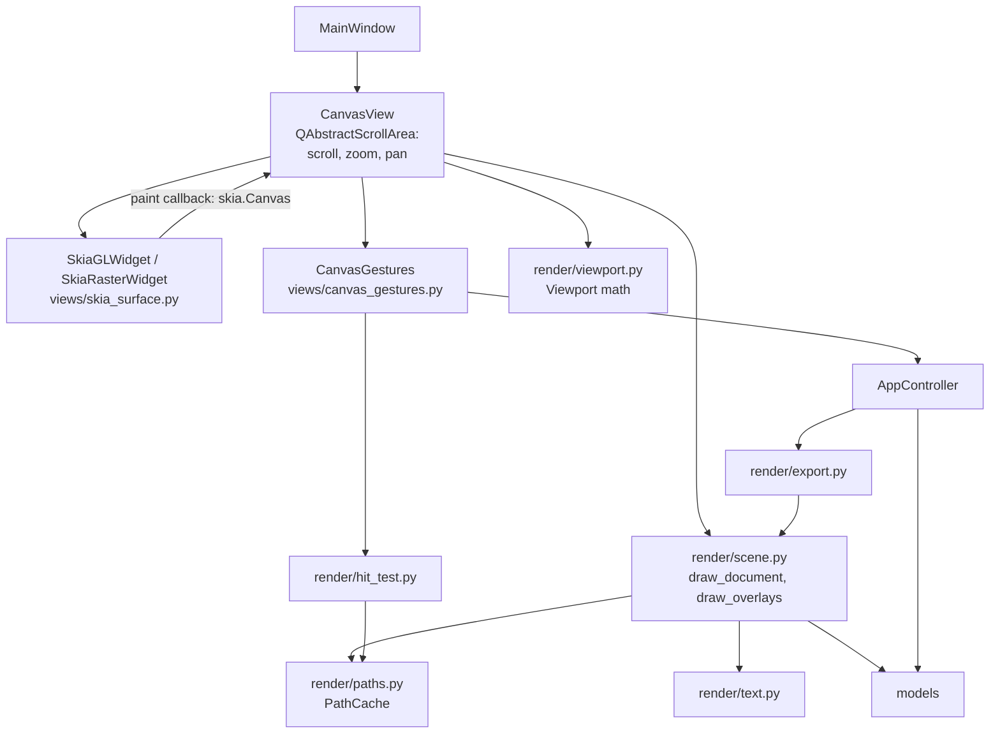

# Design Document

## Overview

The canvas stops being a `QGraphicsView`/`QGraphicsScene` and becomes a `QAbstractScrollArea` whose viewport is a Skia surface widget — `SkiaGLWidget` (a `QOpenGLWidget` hosting a Skia `GrDirectContext`) or, as fallback, `SkiaRasterWidget` (a plain `QWidget` blitting a CPU Skia surface). Every frame, the canvas asks a Qt-free renderer in `veccy/render/` to draw the document plus overlays onto a `skia.Canvas`. Hit-testing, rubber-band selection and viewport math — previously provided by QGraphicsScene — move into Qt-free, tested modules. PNG export renders the same document drawing onto a CPU surface.

Spike results (2026-10-18, this machine): skia-python `144.0.post2` has cp313 wheels for Linux x86_64/aarch64, Windows x64/arm64, macOS x86_64/arm64; `GrDirectContext.MakeGL()` inside `QOpenGLWidget.initializeGL` + `Surface.MakeFromBackendRenderTarget` on `defaultFramebufferObject()` renders correctly with PySide6 6.12 (verified via `grabFramebuffer`). skia-python offers GL and Vulkan, not Metal, so macOS uses OpenGL 4.1 core.

## Steering Document Alignment

### Technical Standards (tech.md)
- Implements decision 4: Qt for UI/input, Skia for rendering (GPU via OpenGL, CPU fallback), behind a renderer boundary.
- MVC rules hold: the model stays the single source of truth; rendering is a pure function of `AppState` + transient view state; controllers are the only writers (`export_png` is a controller method).
- No Qt in `models/`, `controllers/`, `render/`. skia-python pinned `==` via `uv add`.
- Pen defaults stay SVG defaults (nonzero fill, flat cap, miter join).

### Project Structure (structure.md)
- New package `veccy/render/` as planned in structure.md; one module per concern.
- `canvas_view.py` is split: scroll/zoom shell, surface widgets, gesture handling in separate modules (keeps each under ~400 lines).
- Dependency direction: `views → controllers → render → models` and `views → render`. `render` never imports controllers or views. (Controllers importing `render` for export is the small extension accepted in requirements.)

## Code Reuse Analysis

### Existing Components to Leverage
- **`controllers/geometry.py`**: `outline()` (rect/ellipse/path → segments) feeds `render/paths.py`; `box_from_drag`, `smooth_segments` keep powering previews; `translate()` produces live-drag shapes.
- **`AppController`**: `set_selection`, `move_selection`, `add_*`, `set_zoom` unchanged; new `export_png`.
- **`CanvasView` gesture logic**: pen dedupe, Shift constraints, Esc/Enter/double-click handling, wheel/pan rules, manual zoom anchoring with scroll residual, resize compensation — ported, not rewritten.
- **`views/theme.py`**: pasteboard/artboard/preview colors; new `SELECTION` color constant.
- **`AppActions` / `menu_bar_view`**: new `export_png` action in the File menu.

### Integration Points
- **`MainWindow`**: hosts the new `CanvasView` (same public API: `refresh`, `center_artboard`, `fit_artboard`, `shutdown`); new `export_png()` window command (dialogs live in views).
- **`App.run`**: sets the default `QSurfaceFormat` before `QApplication` is created.
- **`scripts/screenshot_app.py`**: unchanged usage; offscreen forces the raster widget, so `window.grab()` captures the canvas.

## Architecture



Frame flow: model change → `CanvasView.refresh(state)` stores state, updates scroll range if artboard changed, calls `viewport().update()` → surface widget's paint → `CanvasView._paint(canvas, size, dpr)` → `scene.draw_pasteboard/draw_document/draw_overlays` with `viewport.matrix(dpr)`.

Input flow: Qt mouse/key events on `CanvasView` → `CanvasGestures` (tool state machine, transient state) → controller calls on commit; while a gesture is live it updates an `Overlay` and requests a repaint.

### Modular Design Principles
- **render/** knows models + skia only; **views/** knows Qt + render + controllers.
- Transient gesture state stays in `CanvasGestures`; `Overlay` is the only data it hands to the renderer.

## Components and Interfaces

### `render/viewport.py` — Viewport
- **Purpose:** Qt-free document↔screen mapping, replacing QGraphicsView's transform/scrollbar math.
- **Interfaces:**
  - `@dataclass(frozen=True) Viewport(zoom: float, scroll_x: float, scroll_y: float, width: int, height: int, scene: Rect)` — `scene` = artboard ± `SCENE_MARGIN` (4000) in doc units; scroll in screen px like a scrollbar value.
  - `to_screen(p) / to_doc(p)`; `matrix(dpr) -> skia.Matrix`.
  - `scroll_range() -> (min_x, max_x, min_y, max_y)`; when the scaled scene is smaller than the viewport it is centered (QGraphicsView behavior).
  - `zoom_at(new_zoom, anchor_px, residual) -> (Viewport, residual)` — keeps the doc point under the anchor fixed, carrying sub-pixel residual (ported from `_apply_zoom`).
- **Dependencies:** skia (Matrix only). **Reuses:** current `_apply_zoom` algorithm.

### `render/paths.py` — PathCache
- **Purpose:** model shape → cached `skia.Path` (+ stroke outline for hit-testing), rebuilt only when the frozen shape changes.
- **Interfaces:** `PathCache.get(shape) -> skia.Path` (fill type `kWinding`); `stroke_path(shape, min_width) -> skia.Path`; `bounds(shape) -> skia.Rect`; `prune(live_ids)`.
- **Dependencies:** `geometry.outline`, `render/text.py`. Keyed by shape id, entry valid while `entry.shape == shape`.

### `render/text.py` — text outlines
- **Purpose:** single text implementation for canvas, export, hit-test and bounds.
- **Interfaces:** `typeface() -> skia.Typeface` (matched once via `FontMgr` for `"sans-serif"`, matching the `font-family="sans-serif"` written to SVG); `text_path(shape: TextShape) -> skia.Path` (glyph outlines at `font_size`, baseline at `(x, y)`).
- **Note:** booleans keep excluding text (parity with today; `geometry.outline` stays `None` for text). Text-to-outline belongs to the typography pillar.

### `render/scene.py` — drawing
- **Purpose:** draw pasteboard/artboard, document and overlays onto any `skia.Canvas`.
- **Interfaces:**
  - `draw_background(canvas, doc, vp)` — pasteboard fill, artboard fill + 1-px border (canvas only).
  - `draw_document(canvas, doc, cache, overrides: Mapping[int, Shape] = {})` — visible layers bottom→top, shapes in order; `overrides` substitutes live-dragged shapes. Paint: `AntiAlias=True`, fill then stroke, `kButt_Cap`, `kMiter_Join`, miter limit 4 (SVG default).
  - `draw_overlays(canvas, overlay, cache, vp)` — selection boxes (dashed, constant 1 screen px via inverse scale), rubber band (translucent fill + outline), preview path with tool style or hairline `PREVIEW_STROKE`.
  - `parse_color(str) -> skia.Color` — hex as stored in models.
- **Dependencies:** paths, text, models. **Reuses:** style semantics from `canvas_view._apply_style`.

### `render/overlay.py` — Overlay data
```python
@dataclass(frozen=True)
class Overlay:
    selection: frozenset[int] = frozenset()
    rubber_band: tuple[float, float, float, float] | None = None   # doc coords x, y, w, h
    preview: tuple[tuple[Segment, ...], Style] | None = None
    overrides: Mapping[int, Shape] = field(default_factory=dict)    # live drag positions
```

### `render/hit_test.py`
- **Purpose:** replace QGraphicsScene item picking.
- **Interfaces:**
  - `shape_at(doc, cache, point, tolerance) -> int | None` — top-most visible shape; hit if `fill` set and fill path contains point, or `stroke` set and stroked outline (width `max(stroke_width, 2*tolerance)`) contains it. Text is hit on its glyph area.
  - `shapes_in_rect(doc, cache, rect) -> set[int]` — shapes whose geometry intersects the rect (bounds pre-check, then `skia.Region` / path intersection).
- `tolerance` = 3 screen px converted to doc units by the caller.
- Bounds pre-check keeps clicks fast on 10k shapes.

### `render/export.py`
- **Purpose:** PNG bytes from the document.
- **Interfaces:** `render_png(doc, scale) -> bytes` — raster surface `ceil(w*scale)×ceil(h*scale)`, cleared transparent, scaled, `draw_document`, encode PNG. `export_size(doc, scale) -> (int, int)`.

### `views/skia_surface.py` — surface widgets
- **`SkiaGLWidget(QOpenGLWidget)`**: `initializeGL` → `GrDirectContext.MakeGL()`; on `None` emits `gl_failed`. `paintGL` wraps `defaultFramebufferObject()` in a `GrBackendRenderTarget` (cached per size/FBO), calls the paint callback, `flushAndSubmit()`, `resetContext()`. `release()` makes current, drops surfaces, `abandonContext()`; also connected to `context().aboutToBeDestroyed`.
- **`SkiaRasterWidget(QWidget)`**: N32-premul raster surface sized to `size × dpr`, paint callback, wrapped in a `QImage` (no copy) with `setDevicePixelRatio`, blitted with `QPainter.drawImage` (blit only).
- **`create_surface(paint_cb, parent)`**: raster if `QT_QPA_PLATFORM`/platform is `offscreen` or `VECCY_RENDERER=cpu`, else GL. On `gl_failed`, `CanvasView` swaps in a raster widget via `QTimer.singleShot(0, …)` and logs one warning.

### `views/canvas_view.py` — CanvasView (rewritten shell)
- **Purpose:** scroll area + zoom/pan + painting; same public API as today.
- **Interfaces:** `refresh(state)`, `center_artboard()`, `fit_artboard()`, `shutdown()`; holds the current `Viewport`, `PathCache`, `CanvasGestures`.
- Scrollbars map 1:1 to `Viewport.scroll_x/y`; wheel/pan/resize rules ported unchanged (middle-button wheel suppression, touchpad pixel-delta pans, Ctrl+scroll zooms, resize compensation).

### `views/canvas_gestures.py` — CanvasGestures
- **Purpose:** per-tool gesture state machine; produces `Overlay`, commits to the controller.
- **Select:** press on shape → select it (Ctrl toggles) unless already selected, start move; press on empty → start rubber band (Ctrl adds). Move → `overrides = {id: geometry.translate(s, dx, dy)}` / rubber band rect. Release → `controller.move_selection(dx, dy)` once if moved; rubber band → `controller.set_selection(...)`. Click without drag on empty → clear selection.
- **Rect/Ellipse/Pen/Text:** ported from today's `mousePress/Move/Release`, `_pen_tuples`, `_finish_pen`, `_cancel_gesture`, producing `Overlay.preview` instead of a `QGraphicsPathItem`.
- Mouse move without button does nothing for Select (no hover state needed for parity).

### Export UI
- **`views/export_dialog.py`**: `ExportPngDialog(QDialog)` — scale spinbox (0.1–16, step 0.5, 2 decimals) + live label "W × H px"; returns scale or `None`.
- **`MainWindow.export_png()`**: dialog → `QFileDialog.getSaveFileName(filter "PNG image (*.png)")` → append `.png` → `controller.export_png(path, scale)`.
- **`AppActions.export_png`**: "&Export PNG…", `Ctrl+Shift+E`, in File menu after Save As.

### `AppController.export_png(path, scale) -> bool`
- Stores `state.export.scale = scale`; calls `render.export.render_png`; writes bytes; status `"Exported {name} (W × H px)"` or `"Export failed: {error}"`; `_notify()`. No `_checkpoint`, does not touch `dirty`.

## Data Models

```python
# models/app_state.py
@dataclass
class ExportSettings:
    scale: float = 1.0          # last PNG export scale, session only

@dataclass
class AppState:
    ...
    export: ExportSettings = field(default_factory=ExportSettings)
```

`Viewport` and `Overlay` are transient view-side data defined in `render/` (frozen dataclasses), not part of `AppState` — they are gesture/viewport state per the transient-state rule. `zoom_percent` stays in `AppState` as today.

## Error Handling

### Error Scenarios
1. **GPU context creation fails** (no GL driver, `MakeGL()` returns `None`)
   - **Handling:** swap viewport to `SkiaRasterWidget`, log one warning.
   - **User Impact:** canvas works, possibly slower; no dialog.
2. **GL context destroyed before widget** (app exit, reparenting)
   - **Handling:** `aboutToBeDestroyed` → `release()` abandons the Skia context; `CanvasView.shutdown()` calls it explicitly too.
   - **User Impact:** none (no crash on exit).
3. **Zero-size viewport**
   - **Handling:** paint callback returns early; no surface created.
4. **PNG write fails** (permissions, disk full) or encode fails
   - **Handling:** `export_png` catches `OSError`/encode `None`, sets status, returns `False`.
   - **User Impact:** status bar "Export failed: …".
5. **Huge export size** (scale × artboard beyond Skia surface limits)
   - **Handling:** dialog caps scale so max side ≤ 16384 px; renderer returns `None` if surface creation still fails → handled as 4.

## Testing Strategy

### Unit Testing (pytest, headless, CPU surfaces)
- `test_viewport.py`: to_screen/to_doc round-trip, zoom_at keeps anchor fixed and carries residual, centered small scene, scroll range.
- `test_render_scene.py`: sample pixels on CPU surface — filled rect colors its interior; `fill=None` leaves interior transparent; stroke colors edge; hidden layer not drawn; z-order (top shape wins); overrides draw at moved position; overlays not drawn by `draw_document`.
- `test_hit_test.py`: top-most wins, no-fill shape hit only near stroke, hidden layers ignored, tolerance, text hit, `shapes_in_rect` intersection vs. outside; 10k-shape click under 10 ms.
- `test_paths.py`: cache returns same object for unchanged shape, rebuilds on change, prune.
- `test_export.py` / `test_app_controller.py`: export size for scales, transparent background, PNG decodes (`skia.Image.MakeFromEncoded`), `export_png` writes file, sets status, leaves undo/dirty unchanged, failure path on unwritable directory.
- CLAUDE.md rule refined: pixel assertions are allowed on `render/` CPU output; still none on whole-window screenshots.

### Integration Testing
- QTest scratch scripts driving the real window (offscreen/raster): click-select, Ctrl-click toggle, rubber band, drag-move (one undo step), rect/ellipse with Shift, pen double-click, Esc, wheel zoom anchor stays fixed, middle-drag pan.
- Same scripts once with GL on the desktop session (`VECCY_RENDERER=gl`).

### End-to-End Testing
- `scripts/screenshot_app.py` before/after comparison of the demo document (visual parity).
- `scripts/bench_canvas.py`: generates 10,000 shapes, measures average frame time for pan/zoom/drag repaints with GL and CPU; target ≤ 16 ms GL.
- Manual check on Windows and macOS before merge (GL path, HiDPI, exit without crash); CI runs pytest headless on all three OSes once CI exists.

## Follow-up Documentation
- `CLAUDE.md`: architecture tree (`render/`), Skia/GL lifetime notes, removal of the `AnchorUnderMouse` note (no QGraphicsView anymore), refined pixel-assertion rule, `VECCY_RENDERER` switch.
- `README.md`: Export PNG feature.
- `tech.md`/`structure.md`: mark Skia renderer as implemented; dependency direction `controllers → render`.
