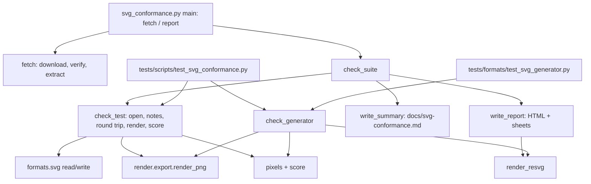

# Design Document

## Overview

Level 0 adds developer tooling only; nothing in the `presstoshape` package changes. One script, `scripts/svg_conformance.py`, holds all logic: fetching the W3C SVG 1.1 suite into a cache, checking tests (open, round trip, render, score), rendering with resvg, writing the report and the summary. Two pytest modules load that script the way `tests/scripts/test_build_package.py` loads `build_package.py`, so the scoring and rendering code exists once:

- `tests/scripts/test_svg_conformance.py`: the curated pass list (Requirement 3) and the generator check over pass-list tests (Requirement 4.3), skipped when the suite isn't fetched; plus offline unit tests of the script's pure parts (pass-list parsing, scope rules, scoring, safe extraction).
- `tests/formats/test_svg_generator.py`: the generator check over documents built in the test (Requirement 4.2), always runs, no suite needed.

A quick feasibility run before this design: resvg rendering of PressToShape-saved files of the 269 currently matching tests vs. our own rendering, same scoring as below: all under 3 % (worst 2.96 %, a text test), 12.7 s for all 269.

## Steering Document Alignment

### Technical Standards (tech.md)
- **uv**: `resvg_py` (pinned `==0.5.0`) and `numpy` added with `uv add --dev`. `numpy` is already installed as a skia-python dependency; declaring it makes the direct use explicit.
- **Pinned downloads**: suite URL + SHA-256 as a constant, like `build_package.py`'s pinned tools.
- **Offline app**: only the script touches the network; the app never imports the script, `resvg_py` or `numpy` directly.
- **Testing**: pixel comparisons run on CPU raster output from `render/export.py`, which CLAUDE.md allows ("Pixel assertions are fine on `render/` CPU-surface output"). No whole-window pixels.
- **Security**: untrusted files: checksum first, `tarfile` extraction with the `data` filter.

### Project Structure (structure.md)
- Scripts live in `scripts/`, insert the repo root into `sys.path` like `screenshot_app.py`, and are tested in `tests/scripts/` via `importlib`.
- Generated output goes to gitignored `build/`: suite cache `build/svg-suites/w3c-svg11/`, report `build/svg-conformance/`.
- Committed outputs: the pass list `tests/scripts/svg_conformance_pass.txt` and the summary `docs/svg-conformance.md`.

## Code Reuse Analysis

### Existing Components to Leverage
- **`formats/svg.py`**: `read_svg_with_notes` (open + notes), `write_svg` (save), `read_svg` (reopen).
- **`render/export.py`**: `render_png(doc, scale)` renders exactly what the canvas draws, on CPU.
- **skia-python**: decode PNGs (`skia.Image.MakeFromEncoded`), composite on white, blur (`skia.ImageFilters.Blur`), pixel arrays (`Image.toarray`), side-by-side sheets. No Pillow needed.
- **`build_package.py` `_download` pattern**: read, hash, compare, write. Reimplemented in the script (scripts don't import each other), same shape.
- **`tests/helpers.py`**: shape builders for the generator documents where they exist.

### Integration Points
- **pytest**: new tests in the existing `testpaths`; skip via `pytest.skip` with the fetch command when the cache is missing.
- **`.gitignore`**: `build/` is already ignored; nothing to add.

## Architecture



### Modular Design Principles
- One script module, sections in this order: suite and cache, pass list and scope, rendering and scoring, checks, report and summary, CLI. Pure functions with plain values; the CLI is the only part that prints.
- Expected size ~350 lines, comparable to `build_package.py`. If it grows past ~500 lines, split rendering/scoring into a sibling module before adding more.

## Components and Interfaces

### Suite and cache
- **Purpose:** Requirement 1.
- **Interfaces:**
  - `SUITE = (url, sha256)`: `https://www.w3.org/Graphics/SVG/Test/20110816/archives/W3C_SVG_11_TestSuite.tar.gz`, `b5f46cca1ad79b670f9179770b2366c57efd5c671d084144090feab4b7ff1030`.
  - `CACHE = ROOT / "build" / "svg-suites" / "w3c-svg11"`.
  - `fetch(cache: Path = CACHE) -> bool`: True when it downloaded, False when the cache was already complete. Downloads into memory, checks the hash (mismatch → `SystemExit` with expected and actual hash, nothing written), extracts into a sibling temp folder with `tarfile.extractall(filter="data")` (rejects absolute paths, `..`, links outside), writes a `.complete` marker holding the hash, then renames the temp folder into place.
  - `suite_folder(cache: Path = CACHE) -> Path | None`: the folder when its `.complete` marker holds the pinned hash, else None.
- **Dependencies:** `urllib.request`, `hashlib`, `tarfile`, `shutil`.

### Pass list and scope
- **Purpose:** Requirement 2.4, 3.1–3.3, 3.6.
- **Interfaces:**
  - `PASS_LIST = ROOT / "tests" / "scripts" / "svg_conformance_pass.txt"`.
  - File format, one test per line: `name [threshold] [# comment]`; blank lines and `#` lines ignored. Example: `styling-pres-03-f  # reference image older than the test; ours is right`.
  - `PassEntry(name: str, threshold: float, comment: str)`; `read_pass_list(path) -> dict[str, PassEntry]` (raises `ValueError` with line number on malformed lines or duplicates).
  - `in_scope(name: str) -> bool`: False for chapters `animate`, `script`, `interact`, `svgdom`, `fonts`, `extend`, sub-chapters `color-prof`, `text-altglyph`, and any `<chapter>-dom-*` test; True otherwise. The list is a constant with the reason (non-goals in the feature gap list).
  - `chapter(name) -> str`, `subchapter(name) -> str`: first one / two dash-separated parts.

### Rendering and scoring
- **Purpose:** Requirement 2.2, 4.
- **Interfaces:**
  - `THRESHOLD = 0.03`, `BLUR_SIGMA = 3`, `CHANNEL_TOLERANCE = 60`.
  - `pixels(png: bytes) -> np.ndarray`: decode, draw onto white through a Gaussian blur, RGB `int16` array (H, W, 3).
  - `score(a, b) -> float`: share of pixels whose largest channel difference exceeds `CHANNEL_TOLERANCE`. Arrays of different shape score 1.0 (a size mismatch is a real difference).
  - `render_ours(doc, width, height) -> bytes`: `render_png(doc, width / doc.width)`; the reference images are 480×360 and the test documents keep their aspect ratio.
  - `render_resvg(svg_text, width, height, resources_dir: Path | None) -> bytes`: `resvg_py.svg_to_bytes(svg_string=…, width, height, resources_dir, sans_serif_family=SANS, languages=["en"])`. `SANS` is the family Skia resolves for `sans-serif` (`skia.FontMgr().matchFamilyStyle("sans-serif", …).getFamilyName()`), so both renderers use the same font for what PressToShape writes as `font-family="sans-serif"`.
- **Why this score:** the blur makes anti-aliasing and small glyph-shape differences vanish; the tolerance ignores faint colour shifts; a whole shape missing or in the wrong colour still counts. With this setting the baseline showed 269 matches, and those looked right by eye in spot checks.

### Checks
- **Purpose:** Requirement 2.1, 3.4, 4.2, 4.3, 4.5.
- **Interfaces:**
  - `TestResult(name, in_scope, status: Literal["match", "differs", "error"], score: float | None, notes: list[str], error: str | None)`.
  - `check_test(suite: Path, name: str, threshold: float = THRESHOLD) -> tuple[TestResult, Document | None]`: read the file (`read_svg_with_notes`), errors caught and recorded as `error`; `write_svg` → `read_svg` (round trip; an error here also gives `error`, message prefixed "round trip:"); render ours at reference size, score against the reference PNG. Returns the document for follow-up checks.
  - `check_suite(suite, pattern: str | None) -> list[TestResult]`: all `svg/*.svg` in name order, filtered by `fnmatch` pattern.
  - `check_generator(doc: Document) -> float`: `write_svg(doc)`; assert well-formed with root `{http://www.w3.org/2000/svg}svg` (`ElementTree.fromstring`); render with resvg (`resources_dir=None`) and with `render_png`, at the document's export size; return the score. resvg errors propagate (Requirement 4.5).
- **Catching errors:** only in `check_test`, around reading and the round trip, because test files are foreign input and the report must go on. Rendering and resvg errors are not caught.

### Report and summary
- **Purpose:** Requirement 2.3, 2.5–2.8, 5.
- **Interfaces:**
  - `write_report(results, suite, pass_list, folder=ROOT / "build" / "svg-conformance") -> Path`: `index.html` with
    - the per-chapter and per-sub-chapter table (tests, match, differs, error), in-scope totals, out-of-scope chapters listed separately;
    - candidates: in-scope matches not on the pass list; pass-list entries no longer matching;
    - one row per test: name, status, score, notes, error, link to its sheet.
    Sheets `sheets/<name>.png`: ours | W3C reference | resvg of the original file (`resources_dir = suite / "svg"`, so the suite's relative `../resources` and `../images` references resolve), only for in-scope tests that don't match. The folder is cleared before writing so stale sheets don't linger.
  - `write_summary(results, pass_list, date: str, path=ROOT / "docs" / "svg-conformance.md")`: suite name and hash, date, threshold, a short how-to (fetch, report, adding to the pass list), and the in-scope table per chapter: tests / matches / on the pass list. Sorted, no other variable data.
- **HTML**: one static page, inline CSS, no scripts, light and dark via `prefers-color-scheme`.

### CLI
- `uv run python scripts/svg_conformance.py fetch`
- `uv run python scripts/svg_conformance.py report [--filter 'struct-*'] [--write-summary] [--date YYYY-MM-DD]`: requires the cache (else exits with the fetch hint); prints the in-scope totals, candidate counts and the report path.

### pytest modules
- **`tests/scripts/test_svg_conformance.py`**
  - Offline: pass-list parsing (thresholds, comments, malformed line, duplicate), `in_scope` examples, `score` (identical = 0, size mismatch = 1, one shape missing > threshold), safe extraction (a crafted tar with `../evil` and an absolute member is rejected), `fetch` with a wrong hash writes nothing (urlopen monkeypatched).
  - With suite (module-level skip otherwise, message: "run: uv run python scripts/svg_conformance.py fetch"): `test_pass_list_names_exist`; `test_listed_test_still_matches[name]` parametrised over the pass list (status match against the entry's threshold, failure message with score and notes); `test_listed_test_saves_for_other_viewers[name]` (generator check on the opened document, `THRESHOLD`).
  - Parametrising reads the pass list at collection time; the suite lookup happens inside the tests so collection never needs the cache.
- **`tests/formats/test_svg_generator.py`**
  - A handful of small documents, each one focused (shapes; fill rules with holes; text anchors; groups with opacity; Composite; transforms incl. skew; opacities; caps/joins/miter/dashes; hidden object and hidden layer), all saved and compared through `check_generator`. Text gets a per-test threshold only if a run shows it's needed, with the reason next to it (Requirement 4.4).
  - Despite the folder name it imports the script; it lives in `tests/formats/` because it tests the SVG writer.

## Data Models

```
PassEntry (frozen dataclass)
- name: str            # W3C test name without .svg
- threshold: float     # default THRESHOLD
- comment: str         # "" when none

TestResult (frozen dataclass)
- name: str
- in_scope: bool
- status: "match" | "differs" | "error"
- score: float | None  # None on error
- notes: tuple[str, ...]
- error: str | None
```

## Error Handling

### Error Scenarios
1. **Checksum mismatch on fetch**
   - **Handling:** nothing written, `SystemExit` naming both hashes.
   - **User Impact:** developer sees the mismatch; the pin is only changed deliberately.
2. **Network failure on fetch**
   - **Handling:** `urllib` error propagates with its message; no partial cache (extraction only after a verified download, into a temp folder renamed at the end).
3. **Suite missing when running report or suite tests**
   - **Handling:** report exits with the fetch command; suite tests skip with it; offline tests and the generator documents still run.
4. **A test file can't be read or doesn't survive the round trip**
   - **Handling:** `TestResult.status = "error"` with the message; the report continues. On the pass list this fails pytest with that message.
5. **Malformed pass list**
   - **Handling:** `ValueError` with the line number; fails pytest collection of that module, and the report refuses to run.
6. **resvg rejects a saved file**
   - **Handling:** not caught: the generator test fails with resvg's error (Requirement 4.5).

## Testing Strategy

### Unit Testing
- Pure script parts offline, as listed under pytest modules. Network is never touched in tests (`fetch` tested with a monkeypatched `urlopen`).

### Integration Testing
- Pass-list checks and generator checks over pass-list tests, with the cached suite.
- Generator documents through resvg on every run.

### End-to-End Testing
- Manual: `fetch`, `report`, open `build/svg-conformance/index.html`, look through candidates and sheets; build the initial pass list from the in-scope matches after checking them by eye; `report --write-summary` to create `docs/svg-conformance.md`.
- Timing check: the full pytest run grows by no more than about a minute.
