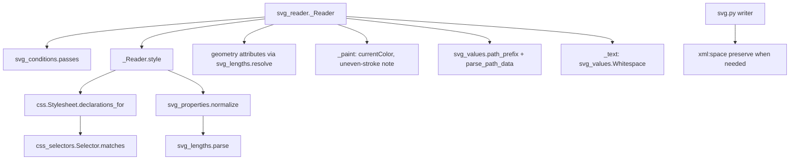

# Design Document

## Overview

Level 1 changes how the SVG reader interprets what it already reads; the model, renderer and native format stay as they are. The work splits along the requirements into small Qt-free units under `presstoshape/formats/`, each testable on its own, and a reader that wires them in:

| Unit | Module | Requirements |
|---|---|---|
| Path data and point lists up to the first error | `svg_values.py` | 1.1, 1.2 |
| Strict lengths with units, resolved against a context | `svg_lengths.py` (new) | 1.3, 2 |
| Property validation and normalisation (paint, colour, lengths, enums) | `svg_properties.py` (new) | 1.3, 3, 4.5 |
| Selector grammar and matching | `css_selectors.py` (new) + `css.py` | 4 |
| Conditional processing | `svg_conditions.py` (new) | 5 |
| Text whitespace | `svg_values.py` | 6 |
| Notes | `svg_notes.py` | 1.5, 5.6, 7 |
| Reader wiring | `svg_reader.py` | all |
| Writer: `xml:space` | `svg.py` | 6.4 |
| Pass-list entries checked against resvg | `scripts/svg_conformance.py` | 8 |

## Steering Document Alignment

### Technical Standards (tech.md)
- **Formats use only models, geometry and i18n**, no Qt. The user's languages reach the reader as a parameter; `editing/` passes `(i18n.active_language(), "en")`.
- **svgelements only for micro-syntax**: it keeps parsing path data (on a prefix we validated), transforms and colours. Lengths move to our own parser because svgelements accepts invalid input (`10PX`, garbage read as 0) and has no viewport context for `%`.
- **Files are untrusted input**: the new parsers are linear scanners or anchored regular expressions without nested quantifiers; selector parsing is bounded by the sheet length.

### Project Structure (structure.md)
- One module per concern in `formats/`, as `svg_values.py`, `svg_page.py`, `svg_notes.py` already are. `svg_reader.py` (622 lines) loses its length/colour helpers to the new modules, so it doesn't grow much.
- Tests mirror modules: `tests/formats/test_svg_lengths.py`, `test_svg_properties.py`, `test_css_selectors.py`, `test_svg_conditions.py`, plus reader cases in `test_svg_import.py` and writer cases in `test_svg.py`.

## Code Reuse Analysis

### Existing Components to Leverage
- **`css.parse` / `Stylesheet` / `parse_declarations`**: block and declaration parsing stay; selectors and the index change.
- **`_Reader.style`**: stays the single cascade point; validation hooks in where declarations are assigned.
- **`NoteCollector` / `Note`**: new note kinds, same pattern and translations.
- **`parse_transform`, svgelements colours**: unchanged.
- **`read_page`**: provides the viewBox size for `%` lengths.
- **Conformance script** (`check_test`, `render_resvg`, `PassEntry`): extended for `~` entries.

### Integration Points
- **`editing/operations/documents.py` and `clipboard.py`**: pass `languages=(i18n.active_language(), "en")` to `read_svg_with_notes` / `read_shapes_svg`.
- **`svg.py` writer**: text elements get `xml:space`.

## Architecture



## Components and Interfaces

### 1. Path data and points up to the first error (`svg_values.py`)
- `valid_path_prefix(d: str) -> tuple[str, bool]`: scans the SVG path grammar (commands `MmZzLlHhVvCcSsQqTtAa`, numbers with optional sign, fraction and exponent, comma/whitespace separators, arc flags as a single `0`/`1` that may be packed without separators, implicit command repetition, first command must be a moveto) and returns the text up to the end of the last complete segment plus whether anything was cut. No regex backtracking: one pass with a small state machine (current command, argument index).
- `parse_path_data(d) -> tuple[tuple[Segment, ...], bool]`: parses the valid prefix with svgelements as today; the bool says the path was cut. If svgelements still rejects the prefix (a bug in it), the result is `()` with `True`, never an exception.
- `parse_points(text) -> tuple[tuple[tuple[float, float], ...], bool]`: number list up to the first invalid token; an odd count drops the last number and counts as cut.

### 2. Lengths (`svg_lengths.py`, new)
```python
Axis = Literal["x", "y", "other"]

@dataclass(frozen=True)
class Viewport:
    width: float
    height: float
    def percent_base(self, axis: Axis) -> float  # width, height, or hypot(width, height) / sqrt(2)

def parse(text: str, css: bool = False) -> tuple[float, str] | None
    # number + unit from {"", px, pt, pc, mm, cm, in, em, ex, %}; units case-sensitive unless css; None if invalid
def resolve(length: tuple[float, str], axis: Axis, viewport: Viewport, font_size: float) -> float
    # absolute units in user units (in = 96, cm = 96/2.54, mm, pt = 4/3, pc = 16); em = font_size; ex = font_size/2
def length(text: str | None, axis: Axis, viewport: Viewport, font_size: float, default: float = 0.0) -> float | None
    # convenience for geometry attributes: None when present but invalid (caller counts it and uses default)
```
- `Viewport` comes from the root: viewBox width/height when present, else the root's width/height in user units, else 100 × 100 (what browsers use for a missing size is Level 2's business). Nested viewports are Level 2.

### 3. Property values (`svg_properties.py`, new)
- `normalize(name: str, value: str, css: bool) -> str | None`: the value in a canonical string form, or None when invalid (the declaration is then ignored and counted). Rules per property:
  - `fill`, `stroke`: `none`, `currentColor`, a colour, `url(…)` with optional fallback; system colours (`ActiveBorder`, …) invalid.
  - `color`: a colour or `currentColor` (resolved to the parent's colour by the cascade, see 6).
  - `stroke-width`, `stroke-dashoffset`, `font-size`: a length (non-negative for width and size); kept as text with the unit, resolved later because `%` and `em` need context.
  - `stroke-dasharray`: `none` or a list of non-negative lengths.
  - `opacity`, `fill-opacity`, `stroke-opacity`: number or percentage.
  - `stroke-miterlimit`: number ≥ 1.
  - Enums: `fill-rule`, `stroke-linecap`, `stroke-linejoin`, `text-anchor`, `visibility`, `display`.
  - `clip-path`, `mask`, `filter`, markers: passed through as today (they only produce notes).
  - `inherit` is accepted for every property and handled by the cascade as today.
- With `css=True` units and keywords are matched case-insensitively and returned in canonical case; attribute values are case-sensitive.

### 4. Selectors (`css_selectors.py`, new; `css.py`)
```python
@dataclass(frozen=True)
class Compound:
    tag: str | None
    ids: frozenset[str]
    classes: frozenset[str]
    attributes: tuple[AttributeTest, ...]   # (name, operator | None, value)
    pseudo: tuple[PseudoClass, ...]         # first-child, last-child, only-child, nth-child(a, b), not(Compound), root, lang(tag), link, never
    def matches(self, node: Node) -> bool
    specificity: tuple[int, int, int]       # ids, classes + attributes + pseudo-classes (:not counts its argument), types

@dataclass(frozen=True)
class Selector:
    compounds: tuple[Compound, ...]          # left to right
    combinators: tuple[str, ...]             # " ", ">", "+", "~" between them
    def matches(self, node: Node) -> bool    # right to left, backtracking only over ancestors/siblings
    specificity: tuple[int, int, int]        # sum over compounds

def parse_selector(text: str) -> Selector | None   # None for pseudo-elements or anything unsupported

class Node(Protocol):
    tag: str | None; id: str | None; classes: frozenset[str]
    def attribute(self, name: str) -> str | None
    parent: "Node | None"; previous_sibling: "Node | None"; index: int; sibling_count: int; language: str | None
```
- The reader builds the nodes once per document (`_Nodes(root)`: parent, sibling position and inherited `xml:lang`/`lang` per element, lazily on first use) so matching is plain attribute access.
- `Stylesheet` indexes rules by the **rightmost** compound's key (id, class, tag, `*`) as today; `declarations_for(node)` checks only those candidates, then cascades by specificity and order. Rules with combinators cost a walk up the tree only when their rightmost compound matched.
- `css.parse(text)` additionally descends into `@media` blocks whose query is empty, `all` or `screen` (comma lists allowed); other at-rules stay skipped and counted.
- The reader collects `<style>` elements only when `type` is absent, empty or `text/css` and `media` is absent, empty, `all` or `screen` (comma lists allowed). Others are counted as skipped rules.

### 5. Conditional processing (`svg_conditions.py`, new)
- `passes(element: ET.Element, languages: tuple[str, ...]) -> bool`: `requiredExtensions` present → False; `systemLanguage` present → any listed tag (comma-separated, trimmed, case-insensitive) equals a user language or starts with it followed by `-`; `requiredFeatures` ignored.
- `switch_choice(switch: ET.Element, languages) -> ET.Element | None`: first direct child in the SVG namespace that is drawable (`g`, `use`, shapes, `text`, `svg`, `image`, `switch`, `a`, `foreignObject`) and passes.
- Reader: `visit` checks `passes` before anything else (also for `<use>` targets and symbol contents) and counts a `CONDITIONAL` note when it fails; `<switch>` visits only `switch_choice` and counts the other drawable children.

### 6. Cascade changes (`_Reader.style`)
- Each declaration goes through `svg_properties.normalize(name, value, css=source != "attribute")`; None → skipped and `INVALID_VALUE` counted.
- `color` joins the inherited keys. After the cascade: `color: currentColor` or `inherit` takes the parent's computed colour.
- `font-size` is resolved to user units after the cascade (`em`/`%` against the parent's resolved size, others via `svg_lengths.resolve`) and stored as a plain number string, so children inherit an absolute size.
- `fill`/`stroke` keep `currentColor` as a keyword; `_paint` resolves it with the element's own `color` (default black). This gives SVG 2 inheritance without extra state.
- `_Reader.__init__` gains `viewport: Viewport` and `languages: tuple[str, ...]`; `read_svg_with_notes(text, languages=("en",))` and `read_shapes_svg(text, languages=("en",))` pass them in.

### 7. Geometry attributes
- `x`, `y`, `width`, `height`, `rx`, `ry`, `cx`, `cy`, `r`, `x1`…`y2`, `<use>` `x`/`y`, text `x`/`y`/`dy` go through `svg_lengths.length` with their axis and the element's font size. Invalid values count as `INVALID_VALUE` and take the attribute's default (0, or "auto" for `rx`/`ry` as today).
- `stroke-width`, dash lengths and `stroke-dashoffset` are resolved in `_paint` with axis `"other"`.

### 8. Text whitespace (`svg_values.py`, reader `_text`)
```python
class Whitespace:
    """Builds one text object's string from chunks, each with its element's xml:space mode."""
    def add(self, text: str, preserve: bool) -> None
    def result(self) -> str
```
- Default chunks: newlines removed, tabs → spaces, runs of spaces collapsed, a leading space dropped when the string so far is empty or already ends in a collapsible space. Preserve chunks: newlines and tabs → spaces, everything kept. `result()` trims trailing spaces that came from default chunks only.
- `_collect_runs` passes each text node with the `xml:space` in effect for its element (inherited from the `{http://www.w3.org/XML/1998/namespace}space` attribute up the text element's children); each run owns one `Whitespace`.

### 9. Writer (`svg.py`)
- `_untransformed_element` for `TextShape`: when the text has a leading or trailing space or two spaces in a row, set `{http://www.w3.org/XML/1998/namespace}space="preserve"` (ElementTree writes it as `xml:space`). Otherwise unchanged output.

### 10. Approximation notes
- `_paint`: when the shape has a stroke and the matrix isn't a similarity (|a·c + b·d| or |(a² + b²) − (c² + d²)| above a small relative tolerance), count `UNEVEN_STROKE`. Mirroring stays a similarity, so flips don't count.
- `_text`: when the matrix isn't a similarity, count `TEXT_SKEW` (today's code already drops the skew).

### 11. Notes (`svg_notes.py`)
New kinds, in this order after the existing ones: `PATH_ERROR` ("{count} path had errors and was cut short"), `INVALID_VALUE` ("{count} invalid value was ignored"), `CONDITIONAL` ("{count} element meant for another language or viewer was left out"), `UNEVEN_STROKE` ("{count} stroke under uneven scaling was approximated"), `TEXT_SKEW` ("{count} skewed text lost its skew"); plural forms as the others, German translations in `de.po`.

### 12. Conformance script (Requirement 8)
- `PassEntry` gets `reference: Literal["w3c", "resvg"] = "w3c"`; `read_pass_list` accepts `~name [threshold] # reason` (reason required).
- `check_test(suite, name, threshold, reference="w3c")`: for `"resvg"` it scores against `render_resvg(original, w, h, suite / "svg")` at the reference image's size.
- `check_suite` takes the per-test reference from the pass list; the report shows the reason next to such tests; pytest passes the entry's reference.

## Data Models

No model changes. Reader-internal:

```
Viewport (frozen): width: float, height: float
AttributeTest: (name: str, operator: Literal["=", "~=", "|=", "^=", "$=", "*="] | None, value: str)
PseudoClass: (kind: str, argument: tuple | Compound | str | None)
PassEntry: + reference: "w3c" | "resvg"
```

## Error Handling

### Error Scenarios
1. **Malformed path data or point list**
   - **Handling:** valid prefix kept, `PATH_ERROR` counted; nothing left → element dropped.
   - **User Impact:** file opens; report says "N paths had errors and were cut short".
2. **Invalid property value (attribute, sheet or inline)**
   - **Handling:** declaration ignored, cascade continues with lower layers / inheritance; `INVALID_VALUE` counted.
3. **Invalid geometry attribute**
   - **Handling:** default value, `INVALID_VALUE` counted; existing rules for zero/negative sizes still drop the element.
4. **Unsupported selector or at-rule**
   - **Handling:** that rule skipped, `CSS_SKIPPED` counted, other rules apply (as today).
5. **svgelements rejects a validated path prefix**
   - **Handling:** treated as a fully broken path (dropped, counted); covered by a test with a mocked failure.

## Testing Strategy

### Unit Testing
- `valid_path_prefix`: complete paths unchanged; cut at bad flag (`paths-data-20-f` string), missing argument, unknown command, number glued to command; packed arc flags accepted; implicit repetition; leading non-moveto → empty.
- `svg_lengths`: every unit, case rules attribute vs CSS, `%` per axis, `em`/`ex`, invalid strings (`10PX` in attribute, `1e`, `--1`, empty).
- `svg_properties`: valid and invalid values per property, system colours invalid, `inherit`, canonical case for CSS.
- `css_selectors`: parsing and matching for each combinator, attribute operator and pseudo-class on small ElementTree documents; specificity values; pseudo-elements rejected; adversarial long selectors parse in linear time.
- `svg_conditions`: language matching table (exact, prefix, case, lists), extensions, features ignored, switch choice skipping non-drawable children.
- `Whitespace`: default/preserve chunks, boundaries between tspans, leading/trailing handling.
- Writer: `xml:space` only when needed; round trip keeps spaces.

### Integration Testing
- Reader cases in `test_svg_import.py`: file with one broken path opens with the others intact and the note; `currentColor` on nested groups with SVG 2 inheritance; CSS combinators from a realistic icon-set sheet; `<switch>` with German and English text picks by the passed language; uneven stroke and skewed text notes; font-size in `em` chains.
- Performance: a generated 10,000-shape SVG with a 200-rule sheet (classes plus some combinators) opens within 10 % of the current reader's time; measured before and after and reported in the task log.

### End-to-End Testing
- Conformance report before and after; every newly matching in-scope test checked by eye and added to the pass list; reviewed exceptions updated (`color-prop-05-t`, `color-prop-04-t`, `paths-data-18-f`, tests needing Level 2 or fonts); `~` entries for `styling-pres-03-f` and `text-ws-01-t`; `docs/svg-conformance.md` regenerated.
- Manual: open an icon-set SVG with `currentColor` and a multilingual `<switch>` file in the app with English and German UI.
