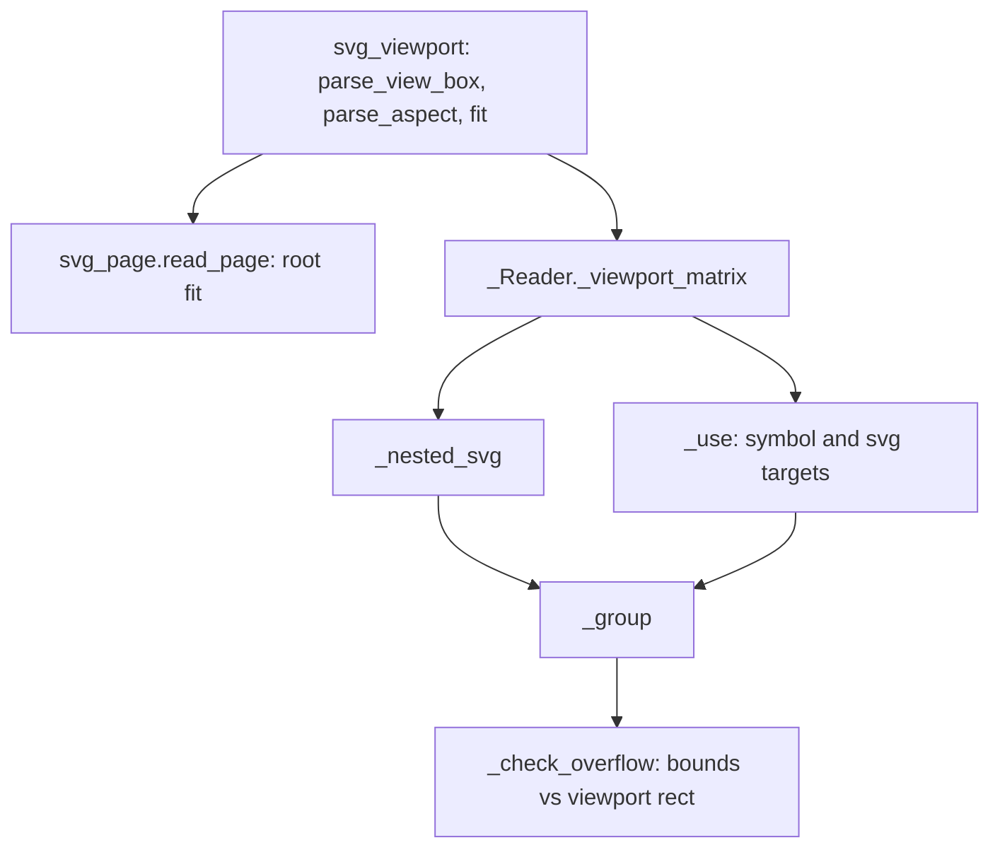

# Design Document

## Overview

Viewports become one concept in the reader. A new pure module `formats/svg_viewport.py` parses `viewBox` and `preserveAspectRatio` and computes the viewBox-to-viewport matrix. The reader uses it for three callers: the root (page), nested `<svg>` (new) and `<symbol>` via `<use>` (replacing `_symbol_matrix`). A nested `<svg>` is flattened into a `GroupShape` whose children carry the composed matrix, the same way a `<symbol>` is today. The reader keeps a stack of "current viewport" (`self.viewport`) so `%` lengths resolve against the nearest viewport. Because no clip object exists yet, a viewport's overflow is checked against shape bounds and reported (`Note.VIEWPORT_OVERFLOW`); nothing is clipped or dropped.

No change to `models/`, `editing/`, `render/`, `.p2s` or the SVG writer: the result is plain groups and transformed shapes.

## Steering Document Alignment

### Technical Standards (tech.md)
- Reader code stays in `formats/`, Qt-free, using only `models` and `geometry`. New text goes through `presstoshape.i18n` and `de.po`.
- svgelements stays limited to path data, colours and transform strings; the viewBox and aspect parsing are hand-written (strict grammar, as `svg_lengths`).

### Project Structure (structure.md)
- One new module per concern (`svg_viewport.py`), like `svg_lengths.py` and `svg_conditions.py` in Level 1. Tests mirror it: `tests/formats/test_svg_viewport.py`.

## Code Reuse Analysis

### Existing Components to Leverage
- **`svg_lengths.Viewport` / `length` / `resolve`**: carrier for the percentage base; the reader swaps `self.viewport` while reading a nested viewport's children.
- **`_Reader._group`**: builds the `GroupShape` with opacity and depth cut-off; the nested `<svg>` and `<symbol>` use it.
- **`_Reader._use`**: already the place for symbol width/height/aspect precedence; extended to `<svg>` targets.
- **`svg_page.read_page`**: gets the root fit as a new `Page.view` matrix.
- **`geometry.affine`** (`compose`, `translation`, `scaling`) and **`geometry.transforms.outline`** for bounds.
- **`NoteCollector` / `Note`**: new note, plus `INVALID_VALUE` for bad `preserveAspectRatio`/`viewBox`.

### Integration Points
- **`_Reader._visit_shown`**: the `tag == "svg"` branch changes from a note to `_nested_svg`.
- **`read_svg_with_notes`**: base matrix uses `page.view` when the page was fitted.
- **Conformance pass list and docs**: updated in the last task.

## Architecture



### Modular Design Principles
- `svg_viewport` has no knowledge of the reader or elements: strings and numbers in, tuples and matrices out.
- The reader owns element rules (defaults, which attributes apply, `<use>` overrides).
- The overflow check is a pure function in `svg_viewport` (`escapes(shapes, rect)`), called by the reader.

## Components and Interfaces

### 1. `formats/svg_viewport.py` (new)
- **Purpose:** viewBox and `preserveAspectRatio` maths.
- **Interfaces:**
  - `ViewBox = tuple[float, float, float, float]`
  - `parse_view_box(text: str | None) -> ViewBox | None | Invalid`: `None` when absent; a sentinel `INVALID` when present but malformed or with non-finite numbers; a tuple otherwise (width/height may be ≤ 0, the caller disables rendering for those, Requirement 1.2).
  - `@dataclass(frozen=True) class Aspect: align: str ("none" or "xMidYMid" …), slice: bool`; `DEFAULT = Aspect("xMidYMid", False)`.
  - `parse_aspect(text: str | None) -> Aspect | None | Invalid`: strict grammar `[defer] <align> [meet|slice]`, whitespace separated; case-sensitive; single-pass tokeniser.
  - `fit(view_box: ViewBox, width: float, height: float, aspect: Aspect) -> Affine`: scale per `meet`/`slice`/`none`, alignment offset per axis (`min` 0, `Mid` 0.5, `max` 1), then `- min_x * scale`. Pure, always finite for valid inputs.
  - `escapes(shapes: Sequence[Shape], x: float, y: float, width: float, height: float) -> bool`: True when the bounds of any shape reach more than a tolerance (1e-6 of the size) outside the rectangle. Bounds come from `transforms.outline` segment points (control points included, a safe over-approximation for the note); groups recurse; shapes with no outline (text) are ignored.
- **Dependencies:** `geometry.affine`, `geometry.transforms`, `models.shapes`.
- **Reuses:** the strict-parse style of `svg_lengths`.

### 2. Reader: viewport matrix and nested `<svg>`
- **Purpose:** flatten viewports.
- **Interfaces:**
  - `_Reader._viewport(element, use, style) -> _View | None` where `_View` holds `matrix` (viewBox → parent space), `rect` (x, y, width, height in parent space), `inner` (the `Viewport` for percentages inside). `None` disables rendering (invalid size/viewBox ≤ 0).
    - `x`, `y`: from the element for a nested `<svg>`; for `<symbol>`/`<svg>` reached by `<use>` the use's `x`/`y` are already composed in `_use`, so the target's own `x`/`y` are ignored for `<symbol>` and kept for `<svg>` (SVG 1.1: `<use>` x/y plus the `<svg>`'s own).
    - `width`/`height`: `use` attribute, else element attribute, else `100%` of the parent viewport (`self.viewport`); lengths through `self._length` with axis `x`/`y`.
    - `viewBox` absent: matrix is `translation(x, y)`, `inner` = (width, height). Present and valid: `translation(x, y) ∘ fit(...)`, `inner` = viewBox size. Invalid: counted (`INVALID_VALUE`), treated as absent. Width or height ≤ 0 or viewBox size ≤ 0: `None`.
    - `preserveAspectRatio`: `use` first, then element; invalid counted and the default used.
  - `_nested_svg(element, style, matrix, out, opacity, uses, use=None)`: `matrix = compose(matrix, parse_transform(element.get("transform")))`, `view = self._viewport(...)`; swaps `self.viewport` to `view.inner` around `_group`; restores in `finally`; then `_check_overflow`.
  - `_use`: for `symbol` and `svg` targets both go through `_viewport` with the use element; `<symbol>` keeps its `display`/conditions checks, `<svg>` goes through `visit` (so its own conditions, `display` and cascade apply), with `use` handed over for the size override.
  - `_check_overflow(children, view, style)`: skipped unless `overflow` is hidden/scroll/absent (`visible`/`auto` suppress, per Requirement 4.2); adds `Note.VIEWPORT_OVERFLOW` when `svg_viewport.escapes(children, *view.rect)`. Children are in the viewBox space transformed into parent space, i.e. the same space as `rect`.
- **Dependencies:** `svg_viewport`, `svg_lengths`, `_group`.
- **Reuses:** `_symbol_matrix` is deleted; its tests move to `test_svg_viewport.py` and the reader tests.
- **`overflow` property:** added to the style keys (not inherited), validated in `svg_properties.normalize` (`visible|hidden|scroll|auto|inherit`).

### 3. Root fit in `svg_page`
- **Purpose:** page size from absolute `width`/`height` when proportions differ.
- **Interfaces:** `Page` gets `view: Affine | None = None`. `read_page`: after the existing parse, if the root has a valid viewBox, both `width` and `height` are valid, absolute (not `%`) and positive, no PressToShape unit/DPI attributes (own files are never fitted), and the aspect ratios differ by more than 0.1 %, then `Page(width_px, height_px, origin=(0, 0), scale=1.0, unit, dpi=96, view=fit(view_box, width_px, height_px, aspect))`. `unit` is the physical unit of `width` when it is physical, as now. `read_svg_with_notes`' base matrix is `page.view` if set, else today's scale/translate. Invalid root `preserveAspectRatio` counted by the reader.
- **Dependencies:** `svg_viewport`.
- **Reuses:** `_css_px`, `_inches`.
- **`read_shapes_svg` (paste):** unchanged, no root fit (it keeps the SVG's own user space).

### 4. Note
- `Note.VIEWPORT_OVERFLOW` with `ngettext("{count} viewport would clip its content; it is shown unclipped", "{count} viewports would clip their content; it is shown unclipped", count)`; `Note.NESTED_SVG` is removed. `update_translations.py` run and `de.po` extended.

## Data Models

No model changes. Internal only:

```python
@dataclass(frozen=True)
class Aspect:
    align: str       # "none" or one of xMinYMin … xMaxYMax
    slice: bool

@dataclass(frozen=True)
class _View:
    matrix: Affine
    rect: tuple[float, float, float, float]
    inner: Viewport
```

## Error Handling

### Error Scenarios
1. **Malformed or non-finite `viewBox`, `preserveAspectRatio`**
   - **Handling:** ignored as invalid, counted via `INVALID_VALUE`, defaults apply.
   - **User Impact:** report line "N values were ignored".
2. **Zero or negative viewport size / viewBox size**
   - **Handling:** the element is not rendered (spec). No note beyond the existing silence for `display:none`-like cases.
   - **User Impact:** none; matches browsers.
3. **Huge or non-finite `x`, `width`, …**
   - **Handling:** `svg_lengths.parse` already rejects non-finite; matrices with a non-finite entry are rejected in `_viewport` (element skipped, `INVALID_VALUE`).
4. **Deep nesting / `<use>` loops through `<svg>`**
   - **Handling:** existing `_MAX_DEPTH` in `_group` and the `uses` chain.
   - **User Impact:** existing "left out" notes.

## Testing Strategy

### Unit Testing
- `tests/formats/test_svg_viewport.py`: `parse_view_box` (separators, comma, invalid, zero size), `parse_aspect` (all nine aligns × meet/slice/none, `defer`, case, junk), `fit` (hand-computed matrices for meet/slice/none at min/mid/max, wide and tall viewports), `escapes` (inside, outside, group, rotation, tolerance, text ignored).
- `tests/formats/test_svg_page.py` additions: fitted page for unequal proportions, unchanged for equal and for PressToShape's own files, `%` root unchanged.

### Integration Testing
- `tests/formats/test_svg_import.py`: nested `<svg>` placement (x/y/viewBox/par), nesting two deep, `%` lengths inside a nested viewport, `<use>` of `<svg>` with width/height override, `<symbol>` regression (existing cases), invalid sizes skip, opacity/conditions through nested `<svg>`, overflow note cases, no `NESTED_SVG` note left.
- SVG round trip of a nested-`<svg>` file and the existing generator check in `tests/formats/test_svg_generator.py`.

### End-to-End Testing
- Conformance report: new candidates checked by eye; pass list, docs updated; pytest with the suite fetched stays green (no entry from Levels 0/1 leaves).
- Benchmark: a 10,000-shape file without nested viewports opens within noise of today.
