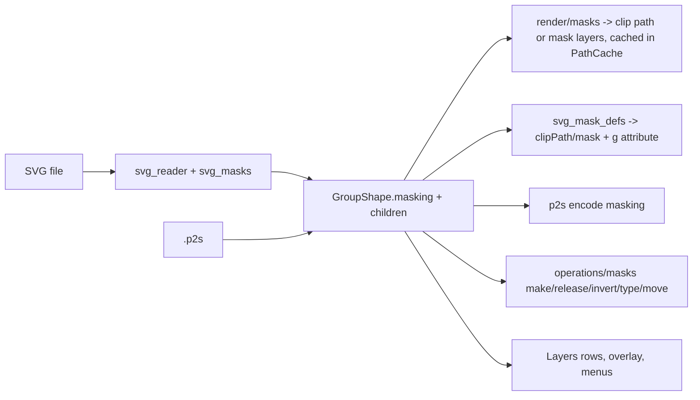

# Design Document

## Overview

Clipping and opacity masks become part of the existing group container. A `GroupShape` gets an optional `masking: Masking | None`. A masked group is a group whose children are split into **mask objects** (ids listed in `Masking.mask_ids`) and **content** (all other children). Everything that already treats groups as containers (entering, selecting, moving, transforming, Layers tree, copy/paste, ungroup, snapping) keeps working unchanged; only drawing, hit-testing, bounds, the reader, the writers, `.p2s` and a handful of operations learn about the mask.

```
models/shapes.py          Masking (frozen), GroupShape.masking, mask_children()/content_children() helpers
formats/svg_masks.py      reader side: <clipPath>/<mask> resolution, units, nesting, error rules -> Masking + mask shapes
formats/svg_reader.py     wraps elements carrying clip-path / mask in a masked GroupShape
formats/svg_mask_defs.py  writer side: MaskDefs collector (ids, <defs>, clip-path="url(#id)" / mask="url(#id)")
formats/svg.py            _untransformed_element handles masked groups via MaskDefs
formats/p2s.py            "masking" object on a group; version 9 (+ migration, sample, docs row)
render/masks.py           clip path of the mask objects (cached), luminance layer drawing
render/paths.py           PathCache: group bounds/clip for masked groups; mask_clip(group) cached by group id
render/scene.py           _draw_group: clip / mask layers; entered masked group shows mask objects + overlay
render/hit_test.py        masked group hit area = content regions inside the clip
editing/operations/masks.py   make/release clip, make/release opacity mask, invert, set type, move to mask/content
editing/containers.py     with_children keeps mask_ids pruned; children_of unchanged
editing/object_tree.py    mask objects labelled / grouped in the Layers tree data
views/                    keymap + menu entries, Layers rows, entered-mask overlay colour, status-bar/edit-bar names
```

### Deviation from the approved requirements

Requirement 1.1/1.2 describe a new frozen `MaskGroup` with `mask` and `content` tuples. This design implements the same behaviour as an optional field on `GroupShape` plus id lists, because:

- Groups already are the container the editor enters, moves, copies and shows in the tree; a second container type would repeat roughly 20 `isinstance(shape, GroupShape)` sites (found by grep in `render/`, `geometry/`, `formats/`, `editing/`, `tools/`, `views/`).
- A group can then carry an opacity **and** a mask, which SVG allows on one `<g>` (`opacity`, `clip-path`, `mask`).
- Parity with Composites: parts keep their mode by id on rebuild (`with_children`); mask membership works the same way by id, so `change_container` needs no new mechanism.

Observable behaviour of Requirements 1-6 is unchanged. Where they say `MaskGroup` read "a `GroupShape` with `masking`"; `mask` / `content` exist as read-only helpers. Requirement 1.2's `is_mask_part(container, child_id)` is `Masking.is_mask(child_id)`.

## Steering Document Alignment

### Technical Standards (tech.md) and CLAUDE.md
- Import direction `models <- geometry <- render <- editing <- tools <- views`; `formats` on models + geometry only; no Qt below `views/`.
- Shapes frozen, changed with `dataclasses.replace`; operations plain functions in `editing/operations/` registered with `@operation`; one undo step each via `session.edit(label)`; shortcuts only in `views/keymap.py`.
- p2s: explicit encoders, version bump + migration + `tests/formats/samples/v9.p2s` + `docs/file-format.md` row.
- Translations through `_`/`N_`/`ngettext`/`pgettext`; `update_translations.py` and `de.po` complete.
- No comments unless a non-obvious why.

### Project Structure (structure.md)
New modules sit beside their siblings (`svg_masks.py` next to `svg_gradients.py`, `render/masks.py` next to `render/gradients.py`, `operations/masks.py` next to `operations/groups.py`).

## Code Reuse Analysis

### Existing Components to Leverage
- **`GroupShape` + `children_of` + `containers.change_container`**: entering, selection, undo and rebuilding of the container chain are reused as is.
- **`_Reader.ids`, `<use>` resolution, `_Reader.style` cascade, `Viewport` stack** (Level 1/2/3): reference lookup, `display`, `clip-rule`, `%` lengths.
- **`geometry.transforms.area_outline` and `outline`**: fill geometry of mask objects with fill-rule awareness (even-odd made nonzero-safe).
- **`geometry.booleans.combine_parts`** (skia-pathops): union of several mask objects into one clip path, and the inverted clip via subtract from a large rect.
- **`PathCache`** (id-keyed, valid while the stored frozen shape equals the current one): extended to hold the clip path of a masked group.
- **`render/gradients.py`** and the recorded-picture replay: mask objects that use gradients render through the normal `draw_shape`.
- **`svg_paint.PaintDefs`** (Level 3 writer collector): the same pattern for `MaskDefs`, sharing one `<defs>` element and id counter.
- **`render.hit_test`**, **`snapper`**, **`handles`** already recurse through `GroupShape.children`; they only need the "ignore mask objects" filter through one helper.
- **Resvg generator test** (`tests/formats/test_svg_generator.py`): extended to clips and masks.

### Integration Points
- `formats/svg_reader.py` element wrapper (where `_EFFECT_NOTES` is checked today) calls `svg_masks`.
- `editing/operations/groups.py`: ungroup on a masked group releases the mask first (see Operations).
- `views/layers_panel` data comes from `editing/object_tree.py`; the mask objects appear as marked children.
- `Note.CLIP` and `Note.MASK` stay in `formats/svg_notes.py`, reworded; `FILTER` unchanged.

## Architecture

### Modular Design Principles
- **One module per job**: resolving a reference (reader), writing (writer), building the clip/mask (render), the value type (models), the commands (operations).
- **Values, not references**: no ids shared between the model and the file; the reader copies the mask objects for every user (new shape ids), the writer writes each masked group's own `<clipPath>`/`<mask>`.
- **Mask objects are ordinary shapes**: no special shape class, no flag on shapes; membership lives on the container and is pruned when children disappear.



## Components and Interfaces

### Component 1: Model (`models/shapes.py`)
- **Purpose:** the value type and its invariants.
- **Interfaces:**
  ```python
  MaskType = Literal["clip", "luminance", "alpha"]

  @dataclass(frozen=True)
  class Masking:
      type: MaskType
      mask_ids: tuple[int, ...]         # ids of the children that form the mask
      inverted: bool = False
      region: Rect | None = None        # luminance/alpha only: SVG x y width height in the group's space
      def is_mask(self, shape_id: int) -> bool: ...

  GroupShape(..., masking: Masking | None = None)
  mask_children(group) -> tuple[Shape, ...]      # children in mask_ids, in order
  content_children(group) -> tuple[Shape, ...]   # all others
  ```
  `region` uses a plain 4-tuple `(x, y, width, height)` so `models` need not import `geometry`. It is the explicit mask rectangle of SVG; `None` means "no cut".
- **`sanitized`**: unknown `type` → `"clip"`; `mask_ids` not among the children dropped, duplicates removed; non-finite or negative-size `region` → `None`; a masked group whose content is empty keeps its mask (renders nothing, is valid); a group with `masking` whose `mask_ids` ends up empty keeps `masking` (clip: content invisible; luminance: content invisible), matching the SVG rule for empty clip/mask.
- **Empty group rule:** `GroupShape` children may be empty only transiently; the existing "entered container left empty is removed" applies when **all** children (mask and content) are gone. When only the content is gone the group stays (so the mask can be dragged content again) unless the user deletes it.
- **Nesting:** a mask object or content child may itself be a masked group; no extra rule.

### Component 2: Reader (`formats/svg_masks.py` + `svg_reader.py`)
- **Purpose:** from `clip-path`/`mask` references to a `GroupShape` with `masking` around the element.
- **Interfaces:**
  - `resolve_clip(ref_id, ids, context) -> ClipResult | None` and `resolve_mask(...)`. `context` (callables passed in so the module doesn't import the reader): `read_children(element, space) -> list[Shape]`, `style(element)`, `length(...)`, `new_id()`, `bbox_of(shapes) -> Rect | None`.
  - Result holds the mask shapes (fresh ids), `type`, the region, and flags for notes (`basic_shape`, `linear_rgb`, `missing`).
  - The reader wraps the element **after** reading it normally: `shapes = read_element(...)`; if `clip-path` / `mask` apply, `masked = GroupShape(new_id, (*mask_shapes, *shapes), masking=Masking(type, mask_ids))`. Both on one element: mask inside, clip outside (two nested groups).
- **Clip rules (Req 2.2):**
  - Children are read through the normal shape readers but with a **clip style**: fill painted black, stroke none, opacity 1, `fill-rule` set from the child's `clip-rule`, `visibility` ignored, `display: none` children skipped. Text becomes `TextShape` with the same clip style.
  - `clipPathUnits=objectBoundingBox` and `maskUnits`/`maskContentUnits=objectBoundingBox`: the matrix `[w 0 0 h x y]` from the content's bounding box is applied to the mask shapes (`transform_shape`). The bounding box of the wrapped shapes comes from `geometry.transforms.outline` + `segments_bounds` for geometry; for text the reader's existing line-width estimate is used (the same one text anchoring uses). Empty box → the whole group is dropped (SVG: not rendered).
  - `transform` on `<clipPath>`: applied to its shapes. A `clip-path` on a child: that child becomes a clip-type group nested in the mask list (read as intersect). A `clip-path` on the `<clipPath>` itself: the result is wrapped again, outer = the referenced clip (SVG: intersection).
  - Per spec the clipPath's children do **not** inherit `clip-path` from the clipPath's ancestors (`masking-path-14-f`): the cascade for children starts at the `<clipPath>` element, not at the place of use; `clip-path` is not an inherited property so the existing cascade already behaves; a test pins it.
- **Mask rules (Req 2.3):** children read like artwork with the cascade starting at the `<mask>` element; `maskContentUnits=objectBoundingBox` applies the bbox matrix; the region (`x y width height`, default `-10% -10% 120% 120%` of the bbox, resolved to user space for `maskUnits=objectBoundingBox`) is stored in `Masking.region` only when it is not larger than the mask objects' and content's union (so no needless rectangles); `mask-type: alpha` → `type="alpha"`; `color-interpolation: linearRGB` → note; mask with no children → `Masking("luminance", ())` over the content.
- **Errors (Req 2.5):** missing/wrong-type reference → no wrapper, element drawn plain, `Note.CLIP`/`Note.MASK` counted ("reference to a missing clip path or mask was ignored"). Cycles detected by a visiting set and a depth cap of 16 nested clip/mask references; cap hit → treated as missing. Clip child count cap 4096 (note when exceeded). Basic-shape `clip-path: circle()` etc. → ignored, own note.
- **Memoisation:** the resolved *definition* (reading children once) is memoised per `(id, bbox-independent)`; for user-space units the memoised shapes are copied with fresh ids per use through `copy_with_new_ids` (existing helper used by paste, if not importable from `formats`, a small copy in `models`); bbox-unit definitions are re-instantiated per use since the matrix differs.
- **Dependencies:** `models.shapes`, `geometry.affine`, `geometry.transforms`, `formats.svg_values`.

### Component 3: Renderer (`render/masks.py`, `paths.py`, `scene.py`)
- **Purpose:** draw masked groups; keep per-frame cost flat.
- **Clip type:**
  - `mask_clip_path(group, cache) -> skia.Path`: union of `area_outline` fill paths of the mask objects (each with its fill-rule set from its style, nested masked groups contribute their own clipped region), via `combine_parts` in "add" mode when more than one. Inverted: subtract from the document-size rect enlarged by a margin. Cached in `PathCache._clips[group.id] = (group, path)`, same validity rule as other entries.
  - `_draw_group`: if `masking` is `clip`: `canvas.save(); canvas.clipPath(path, doAntiAlias=True); draw content children; canvas.restore()`. A group opacity below 1 keeps its `saveLayerAlpha` outside the clip.
- **Mask types:**
  - `canvas.saveLayer(bounds)` → draw content → `canvas.saveLayer(paint with kDstIn blend)` → draw mask objects normally (with `region` as `clipRect`) → `restore()` twice. Luminance applies a `ColorFilter.MakeMatrix` that maps RGB to luminance into alpha (SVG coefficients 0.2125/0.7154/0.0721 on sRGB; alpha multiplies) at the mask layer paint; `alpha` type uses no colour filter; `inverted` flips the filter matrix's alpha row. Layer bounds = content bounds ∩ region.
  - No mask → no layer; masked groups outside the visible area are skipped by the existing viewport culling (their bounds come from the cache).
- **Bounds:** `PathCache._entry` for a masked group: clip type → intersection of the content-children union and the clip path bounds; mask types → content union (∩ region). `geometry_bounds` likewise. Mask objects are excluded from bounds, framing, selection frame, snapping targets, align, unless the group is entered (then the entered shapes are the children and everything is in play).
- **Entered state:** while a masked group is entered, the scene draws all children plainly (no clip/mask applied), and draws the mask objects with a dashed outline in `CanvasColors.mask_outline`; content stays editable. On leaving, the clip/mask applies again. A faint preview of the effect is not required.
- **Recorded pictures:** gesture `Overlay.matrix` moving a masked group moves its recorded picture; moving one child while the group is entered goes through the existing `live` replacement path.
- **Hit-test (`render/hit_test.py`):** `_regions(shape)` for a masked group = content regions intersected with the clip path (clip type: `skia.Path.Op` intersect, cached with the clip in `PathCache`; inside mask types: the content regions, documented approximation); mask objects are never hit while the group is not entered.

### Component 4: SVG writer (`formats/svg_mask_defs.py`, `svg.py`)
- **Purpose:** emit `<clipPath>` / `<mask>` and the reference attribute.
- **Interfaces:** `MaskDefs.add(masking_group, write_shape) -> dict[str, str]` returns the attribute (`{"clip-path": "url(#clipN)"}` or `{"mask": "url(#maskN)"}`) after appending the definition to the shared `<defs>`; ids from the same counter as paints (`PaintDefs`), stable for equal documents (order of first use).
- **Clip:** each mask object written as its geometry element with `clip-rule` from its fill rule and no paint attributes; non-path shapes written as is (rect, ellipse, path, text); nested masked groups as `<g clip-path>` elements are **not** valid inside `<clipPath>`, so a nested masked group in a clip is flattened: its content clipped by its own mask is baked by the pathops intersection into a path. `inverted` (clip): one `<path>` with the big rectangle + the mask geometry, `clip-rule="evenodd"` — the bounds rectangle is the document's page rect enlarged by a margin.
- **Mask:** `<mask maskUnits="userSpaceOnUse" x y width height>` with the mask objects written as ordinary artwork (paint, gradients, strokes); region from `Masking.region` or the union bounds of mask and content grown by 10%; `mask-type="alpha"` for the alpha type; `inverted`: a white rect + the artwork in a group with `style="mix-blend-mode:difference"` is *not* portable; instead the writer wraps the mask objects in `<g filter>`-free form: for `luminance` inverted the colours of the mask are not modified; **inverted mask is written as a clip-like rect trick only for flat white/black masks; otherwise written non-inverted with a note** (design decision: exact inversion for arbitrary artwork needs a filter, which is the next level). The note says so on save through the existing save report. Inverted clip is exact.
- **Group:** `<g clip-path|mask [opacity]>` with the content children. A masked group with a single content shape could carry the attribute directly; **not done** (keeps the round trip exact with equal models — answer to Requirement 4.2: always a `<g>`).
- **Reader round trip:** the reader sees `<g clip-path>` and recreates the same structure.

### Component 5: `.p2s` (`formats/p2s.py`, `p2s_migrations.py`)
- **Purpose:** lossless storage.
- **Format:** group object gains optional `"masking": {"type": "clip"|"luminance"|"alpha", "mask": [child ids], "inverted": true, "region": [x, y, w, h]}`; children list as before (mask objects included, in z-order). Decoder validates ids against children, raises the existing `_damaged` errors on malformed values, defaults when keys are missing. `CURRENT_VERSION` 8 → 9; the migration is a no-op re-label (new key optional) but exists and is tested; `tests/formats/samples/v9.p2s` has all three types; `docs/file-format.md` row added.
- **Clipboard:** `formats/clipboard.py` payload uses `encode_shape`, so it carries masking automatically (not migrated: falls back to SVG).

### Component 6: Operations (`editing/operations/masks.py`)
All plain functions `operation(session)`, registered with `@operation(id, label, can_run=...)`, one `with session.edit(label)` each, working through `containers.change_container` and `queries.selected_shapes`.
- `object.clip.make` ("Make Clipping Mask"): `can_run`: ≥ 2 selected shapes in the same container. Top-most selected = mask, the rest = content; result is a `GroupShape(children=(*content, mask), masking=Masking("clip", (mask.id,)))` at the top-most's position; selected. Mask object with no fill and no stroke is untouched (it may be invisible: that is the point), but a visible default is applied on release only.
- `object.clip.release`: for each selected masked clip group: replace the group by its children (content first, mask objects on top), mask objects without fill/stroke get a thin stroke (`#18181b`, 1 px) and no fill so they do not vanish; selection = the released children.
- `object.mask.make` / `object.mask.release`: the same for luminance; release hides the former mask objects (`hidden=True`) rather than adding strokes; selection = content.
- `object.mask.invert` (checked callback = `masking.inverted`): toggles `inverted` on selected masked groups.
- `object.mask.type` (submenu "Mask Type": Luminance / Alpha) acts on selected opacity masks; `Clip ↔ opacity mask` conversion is **not** offered (different semantics).
- `object.mask.to_mask` / `object.mask.to_content` (entered state): moves selected children between the sides by editing `mask_ids`; context-menu items, no menu shortcut. This is how a user adds a shape to an existing mask.
- **Ungroup:** `ungroup` on a masked group calls the matching release (so Ungroup never silently loses the mask).
- **Group / cut / copy / duplicate / align / flip / arrange / booleans** work on the group as one object (they already treat groups so); booleans take `shape` outlines of the group's **visible** result? The existing group handling in booleans is by children; for a masked group booleans use the content shapes clipped by the mask via the pathops intersection (`render.masks.clip_path`-style helper in `geometry`), not the raw children. Design: booleans on masked groups are refused with a status message in this level ("Release the mask first") — simpler, and Illustrator behaves similarly. Requirement 5.7 allows "treat as one object"; refusal is the documented exception for booleans, divide and Composite.
- **Style:** `restyle_shape` on a masked group recurses into content children only (mask objects keep their look); the style editor shows opacity only for any group, unchanged.
- **Entered state and deletes:** `change_container` is unchanged; `with_children` prunes `mask_ids` to children that still exist. An entered group whose children are all gone is removed (existing rule).
- **Keymap/menus (`views/keymap.py`, `actions.py`):** Object → Clipping Mask → Make / Release; Object → Opacity Mask → Make / Release / Invert / Type. **No shortcuts in this spec**: Make Clipping Mask is the only frequent one; Illustrator users expect Ctrl+7, but the project rule says ask. Open question recorded for the user at the end of the task list; the default is none.
- **Edit bar / status:** `edit_bar_view` names the entered masked group "Clipping Mask" / "Opacity Mask"; status messages via `ngettext`.

### Component 7: Layers panel and views
- `editing/object_tree.py` row data: masked groups get `type = "clip" | "mask"`; children carry `role = "mask" | "content"`; the Layers panel shows the mask objects first with a mask icon (Tabler `mask` / `scissors`, added to `scripts/generate_icons.py` and `presstoshape/icons.py`) and the group row with a small clip/mask badge.
- Selection view (position/size fields): a masked group uses its visible bounds; type name "Clipping Mask" / "Opacity Mask".
- `views/theme.py`: `mask_outline` colour passed to the canvas through `CanvasColors`.

## Data Models

### `Masking`
```
type:      "clip" | "luminance" | "alpha"
mask_ids:  tuple[int, ...]        ids among GroupShape.children
inverted:  bool = False
region:    tuple[float, float, float, float] | None = None   # x, y, w, h, group space
```

### `GroupShape` (extended)
```
id, children, opacity=1.0, transform=identity, hidden=False, locked=False,
masking: Masking | None = None
```

### Notes (`formats/svg_notes.py`)
```
CLIP  -> "{count} clip path reference was ignored (missing or not supported)" / plural
MASK  -> "{count} mask reference was ignored (missing or not supported)" / plural
MASK_COLOR_SPACE (new) -> "colours in a mask are interpolated in sRGB"
CLIP_SHAPE (new)       -> "{count} basic-shape clip path was ignored"
MASK_INVERT_SAVE (save-side report) -> "{count} inverted mask was saved without inversion"
```

## Error Handling

### Error Scenarios
1. **Reference to a missing/wrong element, cycle, depth > 16:** element read without a mask; counted note. User sees the content unclipped plus the note in the import report.
2. **Empty `<clipPath>` / empty `<mask>`:** group with empty `mask_ids`: content not drawn; valid in the model and in `.p2s`.
3. **objectBoundingBox on an empty bbox:** wrapped element dropped as the SVG rule says; counted in the existing "not shown" notes.
4. **Non-finite or huge numbers in mask geometry/region:** sanitised before Skia; region reset to `None`.
5. **Malformed `masking` in a `.p2s`:** the existing damaged-file error with a path (`shapes[3].masking.mask`) and the file is refused, like other fields; unknown `type` → damaged.
6. **Clip path build failure in pathops (degenerate geometry):** fall back to the unioned raw fill path of the first object; never raises into the paint loop.
7. **Make with a selection in different containers, a single object, or only locked/hidden ones:** `can_run` false (menu entry disabled) and, via shortcuts/command palette, a status message says why.
8. **Release when nothing selected is masked:** `can_run` false.
9. **Inverted mask saved to SVG:** saved non-inverted, report note (see writer).

## Testing Strategy

### Unit Testing
- `tests/models/test_masking.py`: `Masking` sanitising, `is_mask`, helpers, `with_children` pruning.
- `tests/formats/test_svg_masks.py`: every rule of Requirement 2 (units, clip-rule, nested, transform on clipPath, stroke ignored in clip, `display:none`, missing/cyclic/depth, shared clipPath fresh ids, text in clip, `<use>` in clip, mask region, alpha type, linearRGB note, hostile inputs).
- `tests/render/test_masks.py` (CPU surface pixel asserts): nonzero/evenodd, two-child union, nested, transformed, inverted clip, luminance white/black/gradient/50 % alpha, stroke in mask, region cut, alpha type, empty clip/mask, masked group with opacity, masked group inside masked group; bounds and hit-test assertions.
- `tests/formats/test_p2s_masking.py` and the migration sample test; clipboard round trip.
- `tests/formats/test_svg_generator.py`: resvg comparison for each render case; read-back equivalence (`read(write(x)) == x` in structure).
- `tests/editing/test_masks.py`: make/release (clip + opacity), invert, type, to_mask/to_content, ungroup release, refusals, undo labels, selection results, `edit_path` interaction, boolean refusal.
- `tests/test_architecture.py` unchanged (new modules respect the layers).
- Translations: `update_translations.py` clean, `de.po` complete, mnemonics unique.

### Integration Testing
- The W3C suite: `scripts/svg_conformance.py report --filter 'masking-*'`; pass list updated after eye check; struct/painting tests that used clip/mask re-run.
- Round trip: open a suite file → save SVG → reopen → compare render; open → save `.p2s` → reopen → save SVG.
- A real Inkscape-style file (clip on layer group, mask with gradient) in `tests/formats/samples/`, written by hand from the format facts.

### End-to-End Testing
- Scratch `QTest` script on the offscreen (raster) and desktop (GL) renderers: draw two shapes, Make Clipping Mask, enter, move the mask, leave, release, undo ×3; same for an opacity mask with a gradient. Screenshot via `scripts/screenshot_app.py` for the Layers rows and the entered-mask overlay.
- `scripts/bench_canvas.py` with 1000 masked groups (clip and luminance), recorded in the task log; target: no frame regression for unmasked content, masked content within 2× of unmasked per object.

## Open Points (for the user in the task review)

1. Keyboard shortcut for Make/Release Clipping Mask (Ctrl+7 as in Illustrator, or menu only).
2. Booleans on masked groups: refused for now (Component 6). Alternative: boolean on the visible result. Costs one more pathops step per operation.
3. Inverted opacity masks are saved without inversion until filters exist.
