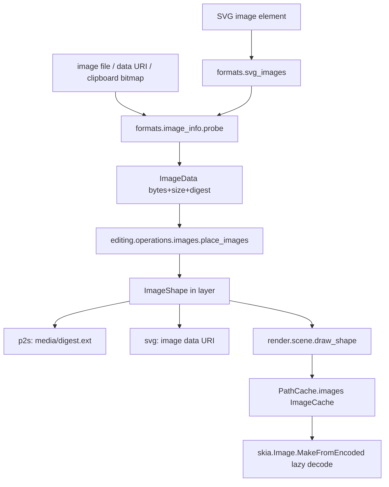

# Design Document

## Overview

Images become one new frozen shape type, `ImageShape`, with a shared immutable blob `ImageData`. Everything that is generic over shapes keeps working; the places that `match` on shape types learn the new case. The bytes are the original encoded file, embedded; decoding is lazy and cached in the render layer.

```
models/shapes.py            ImageData, ImageShape, PreserveAspect value reused from geometry, Shape union, sanitized
geometry/aspect.py          Aspect + fit(): align/meet/slice math, moved out of formats/svg_viewport.py (which re-imports it)
formats/image_info.py       pure-Python sniff of PNG/JPEG/WebP/GIF header: type, pixel size, EXIF orientation, limits. No Skia.
formats/svg_images.py       <image> reading: href (data: / relative path), limits, notes -> ImageShape
formats/svg_reader.py       calls svg_images for tag == "image" (replaces Note.IMAGE); base folder passed in
formats/svg.py              writer: ImageShape -> <image> with data URI; references skipped and counted
formats/p2s.py             "image" shape object + media/<digest>.<ext> entries; version 10 (+ migration, sample, docs row)
formats/clipboard.py        carries ImageShape with its bytes (digest-keyed blob table in the payload)
render/images.py            ImageCache (decode, LRU budget, mip level for huge images), draw_image(), placeholder
render/paths.py             PathCache owns an ImageCache (`cache.images`); _build gives the fitted rect path
render/scene.py             draw_shape: ImageShape case; reference dimming; draw_document(references=...)
render/hit_test.py / handles.py   fitted rect for hits; viewport rect for the transform frame
render/export.py            references=False
editing/operations/images.py   place_images, reset/fit/replace, make/release reference, show/hide references
editing/containers.py       unchanged (images are leaves)
geometry/transforms.py      ImageShape handled like RectShape (box scale, translate, rotate, flip)
views/                      Place/Replace dialogs, drag and drop, bitmap paste, Layers thumbnail, Object → Image menu,
                            selection panel pixel size / PPI, show-references toggle
```

### Deviations and clarifications against the approved requirements

- **Decode and sniff are split.** Requirement 2.1 puts loading in `render/images.py`. The reader lives in `formats`, which may not import `render` (`tests/test_architecture.py`), and it needs the type, size and limits at import time. So the header sniff (`formats/image_info.py`, pure Python, ~150 lines, no new dependency) produces `ImageData` everywhere; Skia only decodes to pixels, lazily, at draw time. Operations in `editing` additionally do a trial decode (`render.images`) before placing so a file with a valid header but corrupt body is refused with a message instead of becoming a placeholder.
- **Frame vs hit area.** For an image read from SVG with `meet` and a different aspect, the drawn area is smaller than the viewport box. Hit-testing and bounds (align, snapping, export bounds, selection outline) use the drawn area (Requirement 5.9). The transform handle frame uses the viewport box `x y width height`, because scaling changes exactly those four numbers and the fitted rectangle follows. For every image placed in the editor the two coincide (viewport = pixel aspect). Documented in the module docstring of `render/images.py`.
- **Cache ownership.** Requirement 2.5 asks for an owned, passed-in cache. Drawing already passes a `PathCache` everywhere (`draw_shape(canvas, shape, cache)`), so `ImageCache` lives as `PathCache.images`. No signature changes; export and clipboard bounds that create a `PathCache()` get their own.
- **`MaskGroup` in the requirements** reads `GroupShape` with `masking` (Level 4 design). The table test of Requirement 1.2 covers `ImageShape` and groups.

## Steering Document Alignment

### Technical Standards (tech.md) and CLAUDE.md
- Layer imports as in `tests/test_architecture.py`; the new modules respect them: `geometry/aspect.py` imports nothing above models; `formats/image_info.py` and `svg_images.py` use models + geometry; `render/images.py` uses models + geometry + skia; operations use render and formats; Qt only in `views/`.
- Frozen shapes, `dataclasses.replace`; registered operations `@operation("image.reset", N_("&Reset Image Size"), can_run=...)`; labels through `_`/`N_`/`ngettext`; shortcuts only in `views/keymap.py`, none for the image commands.
- p2s explicit encoders; version 10 + migration + `v10.p2s` sample + `docs/file-format.md` row.
- No comments unless a non-obvious why; no defensive try/except around Qt; try/except only at the file, decode and ZIP boundaries.
- Skia specifics: paint defaults and "opacity layers only where required" are kept: image opacity is a paint alpha, never a layer.

### Project Structure (structure.md)
New modules sit next to siblings (`svg_images.py` beside `svg_gradients.py`/`svg_masks.py`, `render/images.py` beside `render/gradients.py`, `operations/images.py` beside `operations/groups.py`).

## Code Reuse Analysis

### Existing Components to Leverage
- **`svg_viewport.Aspect` / `fit`**: already do align/meet/slice for the root, nested `<svg>` and `<symbol>`; moved to `geometry/aspect.py` and reused for `<image>` and for drawing.
- **`PathCache`**: keyed by shape id, rebuilt when the frozen shape changes; holds the image's fitted-rect path so bounds, hit-testing and snapping need no image-specific code beyond `_build`.
- **`RectShape` branches** in `geometry/transforms.py` (`translate`, `transform_shape`, `with_rotation`, flips, `_center`) and `render/handles.py` `local_bounds`: `ImageShape` joins those `case RectShape() | ...` arms.
- **`_Reader._visit_shown`**: the `tag == "image"` branch, the `matrix` / `opacity` / `uses` plumbing, `display`/`visibility`, and the Level 4 clip/mask wrapper that already wraps any element in a masked group.
- **`PaintDefs`/`MaskDefs` writer pattern**: no defs needed, but `write_shapes_svg` counts skipped references the same way it counts other things for the save status.
- **`editing.operations._document` helpers** (`add_on_top`, `insert_copies`, `with_fresh_ids`), `containers.change_container`, `ngettext` status messages, `Session.edit`.
- **`views.clipboard` / `main_window.paste`**: extended with a bitmap branch; **`QFileDialog`** pattern used by Open/Export dialogs; **`SvgIconEngine`/`icons.py`** for the new menu icons (Tabler `photo`, `photo-plus`, `replace`).
- **`import_report_dialog` + `svg_notes.Note`**: new counted notes.
- **`MaskGroup` render path**: images inside a clip or mask render through `draw_shape` with no extra work.

### Integration Points
- **SVG reader/writer, `.p2s`, clipboard, export, scene, hit-test, handles, transforms, object tree, selection panel, Layers panel, keymap/actions, main window (drop, paste), recovery (just `.p2s`)**: each listed in the components below.
- **Document storage**: `Document.layers` unchanged; the "Reference" layer is an ordinary `Layer(name="Reference", locked=True)`.

## Architecture



### Modular Design Principles
- `image_info` knows file formats, nothing about shapes or Skia. `svg_images` knows hrefs and limits, nothing about drawing. `render/images` knows pixels, nothing about files on disk. Operations take plain `ImageData`; dialogs, drops and the Qt bitmap conversion stay in views.
- One blob object per digest: `ImageData` is created once per distinct content in a load or paste (a small interning dict inside the call, not a global) and shared by every shape using it, so undo snapshots copy no bytes.

## Components and Interfaces

### `models/shapes.py`
- `ImageData(data: bytes, width: int, height: int, mime: str, digest: str)`, frozen; `__eq__`/`__hash__` by `digest` (`field(compare=False)` on `data`). `digest` is lowercase hex SHA-256 of `data`, computed by the creator (`image_info.probe`), validated for shape (64 hex) in `sanitized`.
- `ImageShape(id, x, y, width, height, data, aspect=Aspect("xMidYMid"), opacity=1.0, transform=IDENTITY, reference=False, hidden=False, locked=False)`. `Aspect` is a tiny frozen dataclass in `models` (`align: str`, `slice: bool`); `geometry/aspect.py` builds its math on it (models cannot import geometry, so the value type lives in models and `parse_aspect`/`fit` in geometry).
- `Shape = Rect | Ellipse | Path | Text | Composite | Group | Image`; `children_of(ImageShape)` is empty (leaf). `sanitized` clamps size ≥ 0 / finite, opacity 0..1, align in enum.
- Helper `visible_box(shape) -> (x, y, w, h)` in `geometry/aspect.py`: the fitted rectangle (meet), the viewport (slice, clipped), or the viewport (none).

### `geometry/aspect.py`
- `parse_aspect(text)`, `Aspect`, `fit(view_box, width, height, aspect)` moved from `formats/svg_viewport.py` (unchanged behaviour; that module imports them back so Level 1/2 code and tests keep passing). New `fitted_rect(source_w, source_h, x, y, w, h, aspect)` returns the image's destination rectangle plus whether it must be clipped to the viewport.

### `formats/image_info.py`
- `probe(data: bytes) -> ImageData`: signature sniff (PNG `\x89PNG`, JPEG `FFD8FF`, GIF `GIF87a/89a`, WebP `RIFF....WEBP`); reads IHDR / SOF0-15 / GIF logical screen / VP8, VP8L, VP8X dimensions; JPEG APP1 EXIF orientation 5-8 swaps width and height (render applies the rotation). Enforces 64 MiB bytes and 100 MP pixels *before* any decode. Raises `ImageError(reason)`, `reason` one of `empty | unsupported | corrupt | too_large | too_many_pixels` with a translated message built by the caller.
- No Skia, no Qt, no Pillow. Fuzz-style unit tests (truncated headers, zero dimensions, huge dimensions).

### `formats/svg_images.py`
- `read_image(element, style, matrix, opacity, base_folder, budget, notes) -> ImageShape | None`. Resolves `href`/`xlink:href`:
  - `data:` URI: base64 or percent-encoded; payload length checked before decoding; `image/svg+xml` → `Note.IMAGE_SVG`.
  - no scheme / `file:`: path relative to `base_folder`; `Path.resolve(strict=True)`; must be a regular file (`stat.S_ISREG` after `os.open` with `O_NOFOLLOW`-equivalent check via `resolve` then `is_file`), size checked via `stat` before reading, read in a bounded way.
  - any other scheme (`http`, `https`, `ftp`, …): not fetched, `Note.IMAGE_REMOTE`.
- `budget` is a small mutable object per import: total embedded bytes (cap 256 MiB) and a path→`ImageData` map so one file referenced 10 000 times is read and embedded once.
- `width`/`height` missing → pixel size; `0`/negative → `None` (nothing drawn). `preserveAspectRatio` via `geometry.aspect.parse_aspect`; invalid values fall back to the default (SVG error handling, as Level 2).
- Notes: `IMAGE_MISSING`, `IMAGE_UNSUPPORTED`, `IMAGE_REMOTE`, `IMAGE_TOO_LARGE`, `IMAGE_SVG` replace `Note.IMAGE` (all counted, `ngettext`).
- `read_svg` / `read_shapes_svg` / `read_document` take an optional `base_folder: Path | None`; `editing.operations.documents` passes the opened file's folder; clipboard SVG passes `None` (relative paths then give `IMAGE_MISSING`).

### `formats/svg.py` (writer)
- `ImageShape` → `<image x y width height preserveAspectRatio? opacity? transform? xlink:href="data:MIME;base64,…"/>`. Only `xlink:href` is written: every renderer that matters reads it (resvg, browsers, Inkscape old and new), and writing `href` as well would double the data. The resvg generator test confirms before the task closes; the reader accepts both.
- `hidden` follows the existing `display="none"` handling; `reference` images are skipped; the writer returns the skipped count through the existing result object so the save status can say "{count} reference image was not saved to SVG".

### `formats/p2s.py` and migrations
- Shape object `{"type": "image", "id", "x", "y", "width", "height", "aspect": "xMidYMid" | "xMidYMid slice", "opacity", "reference", "transform", "hidden", "locked", "media": "<digest>"}`; no bytes in JSON.
- ZIP entries `media/<digest>.<ext>` (`ext` from mime: png, jpg, webp, gif), stored uncompressed (`ZIP_STORED`: the formats are already compressed), after `document.json`. Names are generated from the digest only; on read, entry names are never used as paths. Read limits: each entry ≤ 64 MiB (existing `_read_entry` chunked), at most 10 000 entries, total media ≤ 1 GiB; `probe` re-validates each blob and the digest is recomputed and compared (mismatch = damaged media).
- `write_p2s` collects distinct `ImageData` reachable from the document (walks `children_of`), writes each once; unreferenced media are never written.
- Missing or corrupt media for a referenced digest: decode yields an `ImageShape` with a placeholder `ImageData` (`mime="application/x-missing"`, zero bytes, the stored `width`/`height` kept in the shape) and a load note; `render` draws the placeholder (Requirement 5.6). `read_p2s` returns the notes through the existing `SavedState`-adjacent channel used for migration messages (design: add `notes: list[str]` to the read result; open dialog shows them like import notes).
- `CURRENT_VERSION = 10`, `MIGRATIONS[9] = _unchanged` (version 10 only adds the optional `image` shape type and `media/` entries); sample `tests/formats/samples/v10.p2s` containing one image; `docs/file-format.md` row plus a "Media" paragraph.
- `read_preview` and the thumbnail path are untouched.

### `formats/clipboard.py`
- Payload gains a `media` object `{digest: base64}` for the images in the copied shapes (cap 128 MiB total, else the image part is dropped and the paste says so); decode interns blobs by digest, so pasting the same image twice shares one `ImageData`.

### `render/images.py`
- `ImageCache(budget_bytes=256 MiB)`: `get(data) -> skia.Image | None`. LRU by decoded size (`width*height*4`). Decodes with `skia.Image.MakeFromEncoded(skia.Data.MakeWithCopy(bytes))`, applies EXIF origin via `skia.Codec` (or `MakeFromEncoded` honours it; verified in task 2), returns `None` on failure (remembered so a corrupt blob is tried once).
- `draw_image(canvas, shape, image, opacity, scale, cache)`: destination from `geometry.aspect.fitted_rect`, `clipRect` for slice, `SamplingOptions`: `FilterMode.kNearest` when `device_scale >= 2`, else linear + `MipmapMode.kLinear`. Device scale is `zoom × matrix scale`; the scene needs the zoom, which `draw_shape` does not have today (`draw_shape(canvas, shape, cache)`): it is read from `canvas.getTotalMatrix()` scale factors, no signature change.
- Huge images: when `image.width*image.height > 16 MP` and effective scale < 0.5, a prescaled `skia.Image` (power-of-two level) is cached next to the original, keyed `(digest, level)`; evicted with it.
- `draw_placeholder(canvas, box)`: 1 px hairline rectangle with a cross in the existing "missing" colour (constant in `render`, not `views/theme.py`, per the layering rule; passed through `CanvasColors` only for the canvas).
- `trial_decode(data) -> bool` for operations.

### `render/scene.py`, `paths.py`, `hit_test.py`, `handles.py`, `export.py`
- `draw_shape`: new early branch before the `style = shape.style` line (groups-first rule): `ImageShape` → opacity, transform, `draw_image`. Opacity is `shape.opacity`, times the reference dimming constant (`REFERENCE_OPACITY = 0.4`) when `shape.reference`. `transform` handled like other non-path shapes (`save`/`concat`/`restore`).
- `draw_document(canvas, doc, cache, ..., references=True)`: when `False`, shapes with `reference` are skipped (export and the view toggle share this). A reference nested in an unlocked group is still a reference.
- `PathCache._build(ImageShape)`: rect path of `visible_box` transformed; so `bounds`, `geometry_bounds`, snapping targets, align and `hit_test` (path contains) work unchanged. `hit_test` skips `reference` images (locked) and treats them as non-pickable.
- `handles.local_bounds(ImageShape)`: viewport box; `selection_frame` single-shape branch includes `ImageShape` (rotated frame).
- `export.render_png`: `draw_document(..., references=False)`.
- Recorded picture: `picture.py` records via `draw_shape`; images are drawn by reference to the cached `skia.Image` inside the picture, so replay holds the image alive; gestures use `Overlay.matrix` as for other shapes.

### `editing/operations/images.py`
- `place_images(session, items: Sequence[ImageData], center: Point, reference=False)`: sizes per Requirement 3.3 (`min(1, 0.8*page / size)`), offsets each item by 16 px × index, adds into the active container via `add_on_top`, selects them, one `session.edit(ngettext(...))`. With `reference=True`: finds or creates the layer named by `pgettext("layer name", "Reference")` (locked, inserted at the bottom) inside the same edit, and makes the images `reference=True, locked=True`.
- `@operation("image.reset_size")`, `"image.fit_page"`, `"image.make_reference"`, `"image.make_artwork"` with `can_run=selected images`.
- `replace_image(session, shape_id, data)`: keeps `x y width height transform`, new data, refit rule: viewport box keeps its width and gets the new aspect (`height = width * h/w`) about its centre; one undo step.
- `set_show_references(session, bool)`: view state on `AppState` (`show_references`), saved in `.p2s` working state next to grid visibility (`SavedState`); the p2s working-state field is optional (no version bump needed beyond 10).
- `selection refusals`: booleans, composites, node tools, "make clipping mask with image as mask object in clip type" check `ImageShape` and set the status message (`_("Images cannot be combined")` etc.) instead of raising.
- `place` and `replace` call `render.images.trial_decode`; refusals go back to the caller as a typed result `PlaceResult(placed, refused: list[(name, reason)])` so the view shows one message listing files.

### `editing/queries.py`, `object_tree.py`, style
- `object_type` gains `"image"` and `"reference"`; `object_label` → `_("Image")`; `queries` helpers that list rect-like types for numeric fields include images; `style` operations skip `ImageShape` except opacity (`restyle_shape` handles groups first, then images get `opacity` only).

### `views/`
- `main_window`: `place_image()`, `place_reference()` (dialogs, `QFileDialog.getOpenFileNames` with a filter built from `N_("Images (*.png *.jpg *.jpeg *.webp *.gif)")`), `replace_image()`; reading bytes happens in the view (file I/O boundary), then `image_info.probe` through the operation.
- `canvas_view` / `main_window`: `dragEnterEvent`/`dropEvent` accept `text/uri-list` with image suffixes; non-image drops are ignored with the status message; drop position converted with `Viewport.to_doc`.
- `views/clipboard.py`: `QMimeData.hasImage()` → `QImage` → PNG bytes (`QBuffer`) → `place_images`; shapes win when the mime data has our type or SVG.
- `keymap.py`: menu layout adds File → Place Image…, Place as Reference…; Object → Image submenu (Reset Size, Fit to Page, Replace…, Make Reference, Make Artwork); View → Show References (checkable via `checked` callback). No shortcuts.
- `selection_view.py`: `ImageShape` entry in the field table (X, Y, W, H as for rect), read-only line "{w} × {h} px, {ppi} PPI", style fields limited to opacity.
- `layers_view` / `object_tree_model`: thumbnail icon for image rows (rendered by `render.images.thumbnail(data, size)` into a `QImage` in the view, cached by `(digest, size)` in the model); reference marker as an extra text suffix `(reference)`.
- `icons.py` + `scripts/generate_icons.py`: add `photo`, `photo-plus`, `replace`, `photo-off` (reference/show toggle) from Tabler.

## Data Models

### ImageData
```
- data: bytes                      original encoded file (not compared)
- width, height: int               displayed pixel size (EXIF applied)
- mime: str                        image/png | image/jpeg | image/webp | image/gif
- digest: str                      sha-256 hex of data; identity and equality
```

### ImageShape
```
- id: int
- x, y, width, height: float       viewport in user space (as SVG <image>)
- data: ImageData
- aspect: Aspect(align: str, slice: bool)   default xMidYMid meet
- opacity: float 0..1
- transform: Transform             canonical, like RectShape
- reference: bool                  dimmed, locked on creation, never exported/printed
- hidden, locked: bool
```

### `.p2s` additions
```
shape:  {"type":"image", ..., "media":"<digest>"}
zip:    media/<digest>.<ext>  (stored)
state:  show_references (optional bool)
```

## Error Handling

### Error Scenarios
1. **Unreadable / unsupported / corrupt / too large file at Place or Replace**
   - **Handling:** `probe` or `trial_decode` raises `ImageError`; the operation returns `PlaceResult` with refusals; other files in the batch are placed.
   - **User Impact:** one status/dialog message naming each file and the reason; nothing changes for refused files; no undo step if nothing was placed.
2. **`<image>` in SVG: missing file, remote URL, SVG image, oversize, over the 256 MiB import budget**
   - **Handling:** element skipped, counted in the matching `Note`; reader continues.
   - **User Impact:** import report lists "{count} image was left out: file not found" etc.
3. **Valid header, undecodable body (found at draw time)**
   - **Handling:** `ImageCache.get` returns `None` once and remembers it; scene draws the placeholder; export likewise.
   - **User Impact:** visible crossed box instead of a missing image; no exception.
4. **`.p2s` with missing, oversized or digest-mismatching media**
   - **Handling:** placeholder `ImageData`, load note; the file still opens.
   - **User Impact:** note in the open report; other content intact.
5. **Hostile input**: huge `data:` URI, decompression bomb header, device path, symlink to special file, 10 000 `<image>` elements with one URI, ZIP entry names with `..`
   - **Handling:** limits checked before reading/decoding (Requirement 2.2, 6.9), path checks, interning by path/digest, ZIP media names never used as paths.
   - **User Impact:** counted note; no hang, no crash.
6. **Clipboard bitmap too large or not decodable**
   - **Handling:** same as scenario 1 with the name "Clipboard".
   - **User Impact:** status message.
7. **Image selected for geometry-only commands (booleans, node edit, Composite)**
   - **Handling:** `can_run`/early refusal with status message.
   - **User Impact:** disabled menu entry or "Images cannot be combined".

## Testing Strategy

### Unit Testing
- `tests/models/test_image_shape.py`: construction, sanitising, digest equality, shared blob; table test over `match shape` sites.
- `tests/geometry/test_aspect.py`: moved Level 2 cases plus `fitted_rect` for every align × meet/slice × wide/tall; existing viewport tests keep passing through the re-import.
- `tests/formats/test_image_info.py`: each type, EXIF, truncated/zero/huge, limits, garbage.
- `tests/formats/test_svg_images.py`: data URI forms, relative path, absolute, remote refused, symlink/device refused, budget, interning, 0/negative/auto size, notes, symbol/use/switch/nested svg.
- `tests/formats/test_p2s_images.py`: round trip, shared blob, unreferenced drop, corrupt/missing media, name safety, migration from `v9.p2s`, `v10.p2s` loads; clipboard round trip.
- `tests/render/test_images.py`: CPU-surface pixels for aspect cases, rotation, opacity, reference dimming, nearest at 4× zoom, placeholder, image in clip and luminance mask, cache eviction order, huge-image mip, export skips references.
- `tests/editing/test_images.py`: place one/many/size rules/containers/undo labels/selection, reference layer create+reuse, reset/fit/replace/make-reference, refusals, show/hide references, `can_run`.
- `tests/formats/test_svg_generator.py`: images rendered by resvg match the canvas (all aspect values, opacity, rotation, in group and mask).
- Architecture test stays green; i18n tests (template fresh, `de.po` complete, mnemonics) for new texts.

### Integration Testing
- Open → edit → save `.p2s` → reopen → save SVG → reopen: equal image (bytes, box, aspect, opacity).
- Conformance: `struct-image-*`, `struct-symbol-01-b`, `coords-viewattr-02-b/-04-f`, `masking-path-04-b/-06-b/-07-b/-11-b`; pass list updated after checking by eye; `docs/svg-conformance.md` regenerated.
- `scripts/bench_canvas.py` extended with 200 mid-size images (CPU and GL paths); cost recorded in the task log.
- `main.py --self-test` decodes tiny PNG, JPEG and WebP.

### End-to-End Testing
- Headless `QTest` script (scratch, not in pytest): Place Image through the dialog slot with a temp file, drag an image file onto the window, paste a bitmap, drag-scale with Shift, rotate, Replace, Make Reference, toggle Show References, undo each; once offscreen (raster), once on the desktop (GL).
- Screenshot check (`scripts/screenshot_app.py`) with a demo image: Layers thumbnail, selection panel PPI line, reference dimming.
