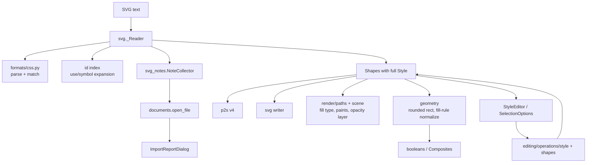

# Design Document

## Overview

The work splits into three layers that can land one after another:

1. **Model + rendering**: `Style` gains fill rule, opacities and stroke options; `RectShape` gains corner radii; `TextShape` gains an anchor. All defaults equal today's behaviour. Rendering, hit-testing, bounds, booleans, `.p2s` (v4) and SVG writing learn the new fields.
2. **UI**: the style editor and selection panel show the new fields, through generic style operations.
3. **SVG reader**: a CSS module, a reworked cascade, `<use>`/`<symbol>` expansion, tspan runs, and counted import notes shown in a dialog after opening.

No new runtime dependency: the CSS subset is small enough to parse by hand (a full CSS library such as `tinycss2` + `cssselect2` would bring a cascade for selectors we deliberately don't support).

## Steering Document Alignment

### Technical Standards (tech.md)
- Frozen dataclasses, changed with `dataclasses.replace`; Qt-free layers below `views/`.
- Skia paint setup in one place (`render/paths.py`), matching SVG defaults.
- `.p2s` changes follow the migration rule: `CURRENT_VERSION` 3 → 4, migration, sample, `docs/file-format.md` row.
- `svgelements` stays limited to parsing path data, colours, lengths and transforms.

### Project Structure (structure.md)
- `models/shapes.py`: new fields.
- `geometry/segments.py`, `geometry/transforms.py`, `geometry/booleans.py`: rounded rect outline, radii under transforms, fill-rule normalization for booleans.
- `render/paths.py`, `render/scene.py`, `render/text.py`, `render/hit_test.py`: paint, opacity, anchor.
- `formats/css.py` (new), `formats/svg.py`, `formats/svg_notes.py` (new), `formats/p2s.py`, `formats/p2s_migrations.py`.
- `editing/operations/style.py`, `editing/operations/shapes.py` (radius, anchor).
- `views/style_editor.py`, `views/selection_view.py`, `views/tool_options_view.py`, `views/import_report_dialog.py` (new), `views/main_window.py`.

## Code Reuse Analysis

### Existing Components to Leverage
- **`render/paths.stroke_paint`**: becomes `stroke_paint(style, width=None)`, building cap/join/miter/dash from the style. Used by drawing and `PathCache.stroke_path`, so hit-testing follows dashes and caps automatically.
- **`PathCache`**: cached skia paths get their fill type from the shape's style; cache keys are the frozen shapes, so style changes rebuild entries as today.
- **`geometry/segments.rect_segments` / `ellipse_segments`**: rounded corners reuse the ellipse kappa constant for the quarter arcs.
- **`booleans.combine_parts` / `divide`**: take outlines; evenodd outlines are normalized first (see below), so their internals don't change.
- **`svg._Reader`, `_merge_style`, `_parse_transform`, `_length`, `_color`**: extended rather than replaced.
- **`editing/operations/style._restyle`**: already generic over `Style` fields; new public operations are thin wrappers.
- **`views/unit_fields.LengthSpinBox`**: radius, dash and offset fields in the document unit.
- **Import notes**: `read_svg_with_notes` / `read_shapes_svg` already return notes; open and paste already pass them on.

### Integration Points
- **Open**: `documents.open_file` stores the notes in `AppState.import_notes`; `MainWindow.open_path` shows the report dialog when that list is non-empty and clears it through an operation.
- **Paste**: unchanged path, notes in the status message.
- **Recovery / `.p2s`**: shapes go through `encode_style`/`decode_style` and the per-type shape codecs, so recovery snapshots carry the new fields for free.

## Architecture



## Components and Interfaces

### 1. Model (`models/shapes.py`)

```python
FillRule = Literal["nonzero", "evenodd"]
LineCap = Literal["butt", "round", "square"]
LineJoin = Literal["miter", "round", "bevel"]
TextAnchor = Literal["start", "middle", "end"]

@dataclass(frozen=True)
class Style:
    fill: str | None = "#3b82f6"
    stroke: str | None = "#18181b"
    stroke_width: float = 2.0
    opacity: float = 1.0          # whole object, 0..1
    fill_opacity: float = 1.0
    stroke_opacity: float = 1.0
    fill_rule: FillRule = "nonzero"
    cap: LineCap = "butt"
    join: LineJoin = "miter"
    miter_limit: float = 4.0
    dashes: tuple[float, ...] = ()   # even length, all >= 0, sum > 0; () = solid
    dash_offset: float = 0.0

RectShape:  + rx: float = 0.0, ry: float = 0.0   (appended after `transform`, so existing
                                                 positional construction stays valid)
TextShape:  + anchor: TextAnchor = "start"        (appended after `transform`)
```

Colours stay `#rrggbb`; alpha always lives in the opacity fields. Opacities are stored 0..1 and shown as percent. `dashes` is normalized to even length on every entry point (import, decoder, operation), so renderers never see an odd list.

### 2. Geometry

- **`segments.rect_segments(x, y, w, h, rx=0.0, ry=0.0)`**: clamps radii to w/2, h/2 (SVG rule: if only one is non-zero, `rx = ry`, done by the reader), emits lines + four quarter-arc cubics with `_KAPPA`; zero radii give today's segments exactly.
- **`transforms.outline`**: rects pass their radii.
- **`transforms.transform_shape(shape, m, min_extent=0.0, scale_radii=False)`**: rects keep `rx`/`ry` by default (handles, numeric fields: Requirement 4.5). The SVG reader passes `scale_radii=True` so a `<rect rx>` under `scale()` keeps its look; in the skew branch the matrix is kept whole, so radii are untouched either way.
- **`transforms.area_outline(shape)`**: `outline(shape)` made nonzero-safe: for `fill_rule == "evenodd"` it runs `booleans.simplify(segments, evenodd=True)` (pathops `simplify` with `FillType.EVEN_ODD`, result winding-safe). Used by booleans, divide, Composite part outlines and Composite creation, never by drawing (stroking must follow the original contours).
- **`booleans.simplify(segments, evenodd)`**: new small helper next to `combine_parts`.

### 3. Rendering (`render/`)

- **`paths.to_skia_path(segments, fill_rule="nonzero")`**: sets `kEvenOdd` or `kWinding`. `_build` passes `shape.style.fill_rule`; text keeps winding.
- **`paths.stroke_paint(style, width=None)`**: cap, join, miter limit, and `DashPathEffect` when `style.dashes` (skipped when all lengths are 0). `width` overrides for hit-test widening. Old call sites `stroke_paint(width)` (overlays) become `hairline`/explicit paints; they never used style.
- **Bounds**: stroke outset becomes `half * factor` where factor is `max(1, √2 if cap == "square", miter_limit if join == "miter" and the path has corners)`. To stay cheap and identical to today for default styles, the miter term is kept as today (not applied); square caps add √2. Bounds remain a cull/selection approximation as now.
- **`scene._paints(style)`**: multiplies `fill_opacity`/`stroke_opacity` (and `opacity`, when only one paint is drawn) into the paint alpha.
- **`scene.draw_shape`**: when `opacity < 1` **and** both fill and stroke are painted, wraps the shape in `canvas.saveLayerAlpha(bounds, alpha)` / `restore()`; otherwise no layer (Requirement 2.2, performance requirement). Opacity 0 skips drawing entirely but hit-testing ignores opacity (Requirement 2.9).
- **Rounded rects**: `_draw_local` uses `canvas.drawRRect(skia.RRect.MakeRectXY(rect, rx, ry), paint)` when radii are non-zero (GPU fast path), `drawRect` otherwise.
- **`text.anchor_offset(shape) -> float`**: `-advance * {start: 0, middle: 0.5, end: 1}` using the same `_font` measurement. `text_blob` drawing and `text_path` both shift x by it, so canvas, export, hit-testing and bounds agree. Rotation stays about `(x, y)`, the anchor point.
- **`hit_test._area`**: unchanged logic; fill regions now carry the fill type, so `contains` respects evenodd holes; stroke regions come from the dashed/capped `stroke_path`.

### 4. CSS (`formats/css.py`, new, Qt-free)

```python
@dataclass(frozen=True)
class Compound:          # one simple selector sequence, e.g. path.st0#a
    tag: str | None      # None = any
    id: str | None
    classes: frozenset[str]
    def matches(self, tag: str, element_id: str | None, classes: frozenset[str]) -> bool
    specificity -> tuple[int, int, int]

@dataclass(frozen=True)
class Rule:
    selector: Compound
    declarations: tuple[tuple[str, str, bool], ...]   # property, value, important
    order: int

@dataclass
class Stylesheet:
    rules: list[Rule]
    skipped: int                                      # rules dropped for unsupported syntax
    def declarations_for(self, tag, element_id, classes) -> tuple[dict[str, str], dict[str, str]]
        """(normal, important) declarations, cascaded by specificity then order."""

def parse(text: str, order_start: int = 0) -> Stylesheet
```

- Tokenizing: strip `/* */` comments; skip at-rules (balanced braces for block at-rules like `@media {...}`, up to `;` for `@import`); split `selectors { declarations }`. Comma lists become one `Rule` per selector. A selector containing whitespace combinators, `>`, `+`, `~`, `[`, `:` is unsupported: the rule is dropped and `skipped` counts it (once per rule, not per selector).
- Declarations split on `;` outside parentheses and quotes; `!important` stripped and flagged; property names lower-cased.
- Indexed by tag/id/class for speed: `declarations_for` looks up candidate rules through dicts (`by_id`, `by_class`, `by_tag`, `universal`), so a few hundred rules don't cost per-element scans (performance requirement).

### 5. SVG reader (`formats/svg.py`)

**Cascade.** `_merge_style(inherited, element, sheet)` becomes:

1. start from inherited **inheritable** properties;
2. presentation attributes;
3. stylesheet normal declarations;
4. inline `style` normal declarations;
5. stylesheet `!important` declarations;
6. inline `!important` declarations.

`_STYLE_KEYS` grows to: fill, stroke, stroke-width, display, visibility, font-size, fill-opacity, stroke-opacity, fill-rule, stroke-linecap, stroke-linejoin, stroke-miterlimit, stroke-dasharray, stroke-dashoffset, text-anchor. `opacity` is **not** inherited in SVG: it's read per element and passed down as a separate `group_opacity` multiplier in `visit(...)`; a `<g>` with opacity < 1 that holds more than one shape adds the "group opacity approximated" note. `display:none` is not inherited either but hides the subtree (as today); `visibility: hidden` is inherited and skips shapes (with `visible` re-enabling).

**Paint.** `_paint(style_text) -> (hex | None, alpha)`: `svgelements.Color` already parses `rgba()`, `hsla()`, `#rgba`, `#rrggbbaa`; alpha multiplies into `fill_opacity`/`stroke_opacity`. `url(...)` keeps the grey fallback and counts a "gradient or pattern" note.

**Stroke options.** Parsed with fallbacks to defaults; `stroke-dasharray` accepts commas/spaces and lengths, odd lists repeated, negative values or all-zero → solid; dash lengths and offset scaled by the same √|det| factor as `stroke_width`.

**Stylesheets.** Before visiting, the reader collects every `<style>` element in document order (`root.iter(_q("style"))`, text including CDATA, which ElementTree already returns as text) into one `Stylesheet`; `skipped > 0` adds one note.

**Id index and `<use>`.** One pass builds `ids: dict[str, Element]`. `visit` gets two new parameters: `use_stack: tuple[str, ...]` (ids being expanded) and depth. For `<use>`:
- resolve `href` / `{xlink}href` (`#id`); missing → note, skip;
- id already in `use_stack` or depth > 32 → "cyclic reference" note, skip;
- matrix = current · `use.transform` · `translate(x, y)`;
- target `<symbol>`: apply its `viewBox` → `width`/`height` mapping (`xMidYMid meet` default; `width`/`height` default 100 % → viewBox size), then visit its children;
- other targets: visit the target element with the `<use>`'s cascaded style as inherited.

Containers `defs`, `symbol`, `clipPath`, `mask`, `pattern`, `marker`, `linearGradient`, `radialGradient`, `filter`, `style`, `title`, `desc`, `metadata`, `sodipodi:namedview` are skipped during normal visiting (no shapes, no "unknown element" note). Elements carrying `clip-path`, `mask`, `filter`, `marker-*` add the matching note once per element; `<image>`, nested `<svg>` and `<foreignObject>` add theirs; any other unknown SVG-namespace element adds "other elements skipped". Foreign-namespace elements (Inkscape, Illustrator `i:pgf`) are ignored silently.

**Text runs.** `_text(element, style, matrix)` walks `<text>` and its `<tspan>` children (one level deep plus nested tspans flattened):
- the text element starts a run at its `x`/`y` (first numbers);
- a tspan with its own `x` or `y` or `dy` starts a new run: `x` = tspan `x` or the run start x of the text element; `y` = tspan `y`, or previous run y + `dy`. `dy`/`dx` in `em` are resolved against the run's font size (`_length(value, font_size=...)`);
- a run takes font size, paint and anchor from its cascaded style; text of a tspan without position is appended to the current run, and if that tspan's cascaded paint or size differs from the run's, the "mixed text styles" note is added;
- empty runs are dropped; each run becomes a `TextShape` with `anchor` via `_transformed`.

**Notes (`formats/svg_notes.py`, new).**

```python
class Note(Enum): GRADIENT, CLIP, MASK, IMAGE, FILTER, MARKER, GROUP_OPACITY, CSS_SKIPPED,
                  MISSING_REFERENCE, CYCLIC_REFERENCE, MIXED_TEXT, NESTED_SVG, UNKNOWN_ELEMENT,
                  COMPOSITE_UNREADABLE, COMPOSITE_EDITED

class NoteCollector:
    def add(self, note: Note) -> None          # counts
    def messages(self) -> list[str]            # ngettext per note, in Enum order
```

Messages are `ngettext` strings ("{count} gradient or pattern shown as grey", …). The existing two Composite notes move into it. Public `read_svg_with_notes` / `read_shapes_svg` keep returning `list[str]`.

**Writer.** `_untransformed_element` writes non-default fields only: `opacity`, `fill-opacity`, `stroke-opacity`, `fill-rule`, `stroke-linecap`, `stroke-linejoin`, `stroke-miterlimit`, `stroke-dasharray` (comma list), `stroke-dashoffset`, rect `rx`/`ry`, text `text-anchor`. Presentation attributes, as today.

### 6. Native format (`formats/p2s.py`, `p2s_migrations.py`)

- `encode_style` writes all fields; `decode_style` reads new ones as optional with defaults and validates (opacities clamped to 0..1, enums checked against their `Literal` values, dashes non-negative, normalized to even length). Rect `rx`/`ry` and text `anchor` likewise optional.
- `CURRENT_VERSION = 4`, `MIGRATIONS[3] = _unchanged` (fields optional, defaults equal v3 behaviour). Sample `tests/formats/samples/v3.p2s`, `docs/file-format.md` row "4: style opacity/fill rule/stroke options, rect radii, text anchor".

### 7. Operations

- **`style.py`**: `set_style(session, **changes)` public, with a label table (`{"opacity": N_("Change opacity"), "fill_rule": N_("Change fill rule"), "cap": N_("Change line cap"), …}`) and merge keys for continuous fields (opacities, miter limit, dash offset). Values are sanitized (clamp, enum check, dash normalization) in one `_sanitize(changes)` shared with `view.set_tool_style`.
- **`shapes.py`**: `set_corner_radius(session, radius)` (rects in selection, sets `rx = ry`), `set_text_anchor(session, anchor)` (keeps `(x, y)` — the anchor point — so the text moves around it, Requirement 7.5).
- **`documents.open_file`**: stores notes in `state.import_notes` (new `AppState` field, list of strings, not part of the document or undo) and keeps a short status message ("Opened name, with 3 notes"); `view.clear_import_notes(session)` resets it.
- **Object to Path** (`paths.py`): unchanged except it keeps `style` (already) — fill rule travels with it; rounded rect outline comes from `outline`.

### 8. Views

- **`StyleEditor`** takes field groups (`FILL`, `STROKE`, `WIDTH`, `OPACITY`, `FILL_RULE`, `STROKE_OPTIONS`) and one callback `on_change(changes: dict[str, Any])` replacing the three per-field callbacks. Rows:
  - Fill: checkbox + swatch + opacity spin (%) on one row; Stroke likewise.
  - Opacity: slider + spin (%), object opacity.
  - Fill rule: two-item combo ("Nonzero", "Even-odd"), shown when fill is on.
  - Stroke options (shown when stroke is on): cap and join as small icon button groups (Tabler icons via `icons.py`, generated through `scripts/generate_icons.py`), miter limit spin (only for miter join), dash line edit (lengths in document unit, space/comma separated, empty = solid) + offset `LengthSpinBox`.
  - Mixed values across a multi-selection show as blank/indeterminate, like the existing fields.
- **`SelectionOptions`**: adds "Corner radius" (`LengthSpinBox`, rects only, shows mixed when `rx != ry`) and "Anchor" (three-button group, text only) rows to the geometry form.
- **`ToolOptions`**: drawing tools get `FILL, STROKE, WIDTH, OPACITY, FILL_RULE, STROKE_OPTIONS` (Text: no stroke options beyond what it has today, anchor stays per object).
- **`ImportReportDialog`** (`views/import_report_dialog.py`): `QMessageBox`-style dialog with the list of notes and the hint "Saving as SVG writes the file without these parts. Save as .p2s or under a new name to keep the original." One OK button. Shown by `MainWindow.open_path` after a successful open when `state.import_notes` is non-empty, then `view.clear_import_notes`.

## Data Models

See Component 1. `.p2s` JSON (v4) for a style:

```json
{"fill": "#e30613", "stroke": null, "stroke_width": 1, "opacity": 0.5, "fill_opacity": 1,
 "stroke_opacity": 1, "fill_rule": "evenodd", "cap": "round", "join": "round", "miter_limit": 4,
 "dashes": [4, 2], "dash_offset": 0}
```

Rect: `"rx": 8, "ry": 8`; text: `"anchor": "middle"`.

## Error Handling

### Error Scenarios
1. **Malformed CSS** (unbalanced braces, garbage):
   - **Handling:** parser recovers at the next `}` or end of text; unparseable rules counted as skipped.
   - **User Impact:** remaining rules apply; report says some CSS rules weren't applied.
2. **Bad property values** (`stroke-dasharray: foo`, `opacity: 2`, unknown cap):
   - **Handling:** fall back to the inherited/default value; numeric values clamped.
   - **User Impact:** none beyond the default look.
3. **Missing or cyclic `<use>` references, deep nesting:**
   - **Handling:** skipped with a counted note; depth limit 32.
   - **User Impact:** report lists them; import completes.
4. **pathops failure while normalizing an evenodd outline:**
   - **Handling:** same as today's boolean failure paths (`PathOpsError` → "… failed" status; Composite outline → empty).
   - **User Impact:** status message, no crash.
5. **Damaged `.p2s` with invalid new fields:**
   - **Handling:** `P2sError` with the field path, as for existing fields.
   - **User Impact:** existing "Could not open" message.

## Testing Strategy

### Unit Testing
- `tests/formats/test_css.py`: tokenizer (comments, at-rules, CDATA text, `!important`), selector support and rejection, specificity/order cascade, indexing.
- `tests/formats/test_svg_import.py` (extend existing SVG tests): each property via attribute / inline / CSS / inheritance; colour alpha; group opacity multiplier + note; `<use>` with x/y/transform, forward references, symbol viewBox, missing + cyclic references; tspan runs with x/y/dy/em; text-anchor; rect rx/ry under scale; notes and counts; elements that must not produce notes.
- `tests/geometry/`: rounded `rect_segments` (clamping, zero radii identical to today), `transform_shape` radii behaviour, `area_outline` on an evenodd ring gives a ring.
- `tests/render/`: CPU-surface pixel checks for evenodd hole, opacity layer (overlap not darker), fill/stroke opacity, dashes, round caps beyond end points, rounded rect corner pixel, text anchor offset; hit-test inside evenodd hole misses.
- `tests/formats/test_p2s.py`: round trip of every new field, v3 sample opens with defaults, damaged values rejected.
- `tests/editing/`: `set_style` labels/merge keys/sanitizing, corner radius, anchor keeps anchor point, undo restores; open stores `import_notes`.

### Integration Testing
- Fixture SVGs in `tests/formats/samples/svg/` (hand-written): `illustrator_classes.svg`, `inkscape_layers_text.svg`, `figma_frame.svg`, `icon_sprite.svg`. Tests assert shape counts, types, key styles, positions and the exact notes.
- SVG write → read round trip for every new field; clipboard round trip.

### End-to-End Testing
- Scratch QTest script (not in the suite): open each fixture in the real window offscreen and with GL, check the report dialog appears only for files with losses, edit opacity/dashes/radius/anchor through the panel, screenshot with `scripts/screenshot_app.py` and compare by eye.
- Manual: PressToShape-written SVG with all new properties opened in Inkscape.
