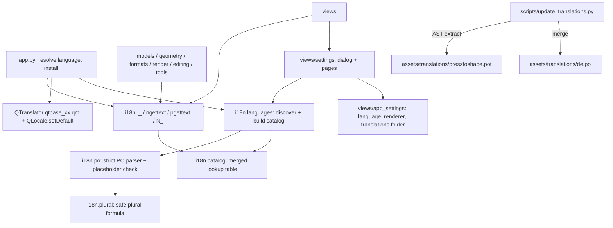

# Design Document

## Overview

Translations rest on a new Qt-free package, `presstoshape/i18n/`, at the very bottom of the layer stack, so models, formats, editing and tools can all translate their texts. It provides the gettext-style calls (`_`, `ngettext`, `pgettext`, `N_`), parses PO files with a small strict parser, evaluates plural formulas without `eval`, and merges English, shipped and user translations into one lookup table.

The language is chosen once per run: `App` resolves it from the settings before any window or document exists, installs the catalog, Qt's own translator and the default `QLocale`, then builds the UI. That is why a language change needs a restart (Requirement 2.4), and it keeps the active catalog a read-only, process-wide value.

Strings are marked in the source and collected by an AST-based script into a committed template, `presstoshape.pot`. The same script updates `de.po` from the template, and a test fails when the template is out of date.

The Settings window is a `QDialog` with a category list and a page stack. Pages are small classes listed in one place, so later features add a page without touching the dialog.

## Steering Document Alignment

### Technical Standards (tech.md)
- **No Qt below `views/`:** `i18n` is plain Python. Qt-specific work is in `views/` and `app.py`:
  - `QTranslator` for Qt's own strings;
  - `QLocale.setDefault` for number formats;
  - `QStandardPaths` for the user folder;
  - the dialogs.
- **Dependencies:** none added. PO parsing, plural formulas and string extraction are about 400 lines of stdlib Python. That's less than vetting and pinning `babel` or `polib` for what is needed.
- **Settings storage:** the existing `QSettings` from `views/app_settings.py` (registry, `~/.config`, or portable `settings.ini`).
- **Packaging:** translations live under `presstoshape/assets/`, which the PyInstaller spec already bundles. `--self-test` gains a German check (CLAUDE.md: extend it for new data files).

### Project Structure (structure.md)
- **New:**
  - `presstoshape/i18n/` with `__init__.py` (public calls), `po.py`, `plural.py`, `catalog.py`, `languages.py`;
  - `presstoshape/assets/translations/` with `presstoshape.pot` and `de.po`;
  - `scripts/update_translations.py`;
  - `views/settings/` with `dialog.py`, `pages.py`, `language_page.py`, `canvas_page.py`;
  - tests under `tests/i18n/`, `tests/views/test_settings.py`, `tests/scripts/test_update_translations.py`.
- **Changed:** `tests/test_architecture.py` (new bottom layer `i18n`, allowed everywhere); every module with user-visible text; `app.py`, `views/app_settings.py`, `views/skia_surface.py`, `views/keymap.py`, `views/actions.py`, `views/main_window.py`.
- **Module-level state, deliberately:** CLAUDE.md says "no module-level state". The active catalog is the exception: it is set once by `App` before anything else runs and read-only afterwards, as with Python's own `gettext.install`. Passing a translator through every call (including the frozen-dataclass defaults and format errors) would touch every signature for no gain. CLAUDE.md gets a line documenting this exception.

## Code Reuse Analysis

### Existing Components to Leverage
- **`views/app_settings.open_settings`:** knows the portable mode, so it also decides the user translations folder (portable: `translations/` next to the executable).
- **Registries (`editing/registry`, `tools/registry`, `views/keymap.WINDOW_COMMANDS`, `views/tool_options_view.TITLES`):** keep their source strings, now marked with `N_()`; `AppActions` and the views translate them when building actions and titles.
- **`views/skia_surface.use_gpu`:** gains the renderer setting as a parameter, with `PRESSTOSHAPE_RENDERER` still overriding.
- **`scripts/generate_icons.py` pattern:** a dev script that regenerates committed assets; `update_translations.py` follows it.
- **`PySide6/Qt/translations/qtbase_de.qm`:** Qt's own German strings, loaded with `QTranslator` from `QLibraryInfo.path(TranslationsPath)`.

### Integration Points
- **Startup (`App`):** settings → language resolution → `i18n.install` → `QTranslator` → `QLocale.setDefault` → `Session` and `MainWindow`.
- **Edit menu:** new window command `edit.settings` ("&Settings…", `Ctrl+,`).
- **Status bar, undo labels, dialogs:** translated at the place the text is produced.

## Architecture



## Components and Interfaces

### `i18n/__init__.py`: the public calls
```python
def _(message: str) -> str
def ngettext(singular: str, plural: str, count: int) -> str
def pgettext(context: str, message: str) -> str          # e.g. pgettext("part mode", "Add")
def npgettext(context: str, singular: str, plural: str, count: int) -> str
def N_(message: str) -> str                               # marks a string for extraction, returns it unchanged
def install(catalog: Catalog) -> None                     # once at startup (and in tests)
def active_language() -> str                              # "en", "de", ...
```
- Without `install`, the identity catalog (English) is active, so tests and scripts need no setup.
- Placeholders use `str.format` names: `ngettext("Copied {count} object", "Copied {count} objects", n).format(count=n)`. f-strings are never passed to the calls (the extractor needs literals).
- Imports nothing from `presstoshape`.

### `i18n/po.py`: PO parsing and checking
```python
@dataclass(frozen=True)
class Entry:
    context: str | None
    message: str
    plural: str | None
    translations: tuple[str, ...]   # one, or one per plural form; empty strings = untranslated
    fuzzy: bool

@dataclass(frozen=True)
class PoFile:
    language: str | None            # from the "Language:" header
    plural_forms: PluralRule
    entries: tuple[Entry, ...]
    ignored: tuple[str, ...]        # human-readable reasons, e.g. 'line 120: "{cout}" is not in the original'

class PoError(ValueError)           # message names the line

def parse_po(text: str, source: str) -> PoFile
def write_po(header: dict[str, str], entries: Sequence[Entry]) -> str   # for the template and the merge script
```
- **Supported syntax:** `msgctxt`, `msgid`, `msgid_plural`, `msgstr`, `msgstr[n]`, multi-line strings, the escapes `\n \t \" \\`, comments (`#`, `#.`, `#:`), the `#, fuzzy` flag and the header entry.
- **Ignored lines:** obsolete entries (`#~`).
- **Errors:** anything else raises `PoError` with the line number.
- **Size limit:** 5 MB of text.
- **Fuzzy entries** count as untranslated (the gettext convention).
- **Placeholder check (Requirement 4.3):** each translation's `str.format` fields, each a (name, conversion, spec) triple, are compared with the original's:
  - a singular entry needs the same set;
  - plural forms need a subset of the union of `msgid` and `msgid_plural` (so "Ein Objekt kopiert" may drop `{count}`);
  - unparsable braces count as a mismatch.

  Mismatching entries go to `ignored` and are left out, so they fall back to English.
- **Missing or invalid `Plural-Forms` header:** `PoError` (Requirement 4.4).

### `i18n/plural.py`: plural formulas without `eval`
```python
@dataclass(frozen=True)
class PluralRule:
    count: int                              # nplurals
    choose: Callable[[int], int]            # n -> form index, clamped to [0, count)

def parse_plural_forms(header: str) -> PluralRule   # "nplurals=2; plural=(n != 1);"
```
- A recursive-descent parser for the C subset gettext allows:
  - `n` and integers;
  - `! - * / % + < > <= >= == != && || ?:`;
  - parentheses.

  It builds a closure tree. Expressions are limited to 500 characters and nesting depth to 50.
- Division or modulo by zero yields form 0 instead of raising.

### `i18n/catalog.py`: merged lookup
```python
class Catalog:
    language: str
    def gettext(self, context: str | None, message: str) -> str
    def ngettext(self, context: str | None, singular: str, plural: str, count: int) -> str
    def completeness(self, template: Sequence[tuple[str | None, str]]) -> float

def build_catalog(language: str, files: Sequence[PoFile]) -> Catalog
    # files from lowest to highest priority (shipped, then user); later entries replace earlier ones
```
- The table is `dict[(context, message)] -> (translations, PluralRule)`, so a lookup is one dict access. Each entry keeps its own file's plural rule, so a user file and a shipped file of the same language can be merged even if their formulas differ.
- **Missing or untranslated entry:** the source text (`singular`/`plural` by the English rule `n != 1`).

### `i18n/languages.py`: discovering languages
```python
LANGUAGE_CODE = re.compile(r"^[a-z]{2,3}(_[A-Z]{2})?$")

@dataclass(frozen=True)
class Language:
    code: str
    shipped: Path | None
    user: Path | None
    completeness: float | None     # None for English

def available_languages(shipped_dir: Path, user_dir: Path | None, template: Path) -> list[Language]
def load_catalog(language: Language) -> Catalog               # broken files are skipped with a log warning
def resolve(saved: str | None, system_languages: Sequence[str], available: Sequence[Language]) -> str
    # saved code if available; else the first system language that matches exactly or by its language part
    # ("de_AT" -> "de"); else "en"
def code_for_import(file_name: str, header_language: str | None) -> str | None
    # "fr.po" -> "fr"; else a valid header Language; else None (import refused with a hint)
```
- English is always available and needs no file.
- `completeness` = translated non-fuzzy template entries / template entries.

### `scripts/update_translations.py`
- `uv run python scripts/update_translations.py` walks `presstoshape/**/*.py` with `ast` and collects literal arguments of `_`, `N_`, `ngettext`, `pgettext`, `npgettext`, with `#:` file:line references. It writes `presstoshape/assets/translations/presstoshape.pot` with stable ordering and no creation date (diff-friendly).
- It merges the template into every shipped `.po`:
  - existing translations are kept;
  - new entries are added untranslated;
  - entries no longer in the source become `#~` obsolete.
- `--check` exits non-zero if the template would change; `tests/scripts/test_update_translations.py` runs that check so a forgotten update fails the suite.
- A call with a non-literal argument (e.g. an f-string) is reported as an error, which catches untranslatable call sites.

### `views/app_settings.py` (extended)
```python
def translations_folder(executable=..., frozen=...) -> Path   # portable: <exe dir>/translations; else AppDataLocation/translations
def language(settings) -> str | None          # "language" key; None = system default
def set_language(settings, code: str | None) -> None
def renderer(settings) -> str                 # "auto" | "gl" | "cpu"
def set_renderer(settings, value: str) -> None
```

### `app.py` (startup order)
1. Create `QApplication` and open the settings.
2. Get the available languages and resolve the language from the setting, `QLocale.system().uiLanguages()` and the available languages.
3. Install the translations:
   - `i18n.install(load_catalog(...))`;
   - a `QTranslator` for `qtbase_<code>` (kept alive as an `App` attribute);
   - `QLocale.setDefault(QLocale(code))`.
4. **Then** create `Session` (so the first layer is "Ebene 1") and `MainWindow`.

`Session` creation moves from `App.__init__` into `run()` for this. The screenshot and self-test paths stay English unless `--language` is given.

### `views/settings/`
- **`dialog.py` — `SettingsDialog(QDialog)`:**
  - a `QListWidget` of categories (icon + title) on the left and a `QStackedWidget` of pages on the right;
  - a Close button; Esc closes;
  - remembers the last category and size for the session (stored on the `MainWindow`).
- **`pages.py` — the page interface:**
  ```python
  class SettingsPage(QWidget):
      title: str          # source string, translated by the dialog
      icon: Path
      def __init__(self, context: SettingsContext) -> None
  @dataclass
  class SettingsContext:
      settings: QSettings
      running_language: str
      translations_folder: Path
      shipped_translations: Path
  PAGES: list[type[SettingsPage]] = [LanguagePage, CanvasPage]
  ```
- **`language_page.py`:**
  - a combo box: "System default" plus the languages, by native name (`QLocale(code).nativeLanguageName()`, capitalized) and completeness ("Deutsch (100 %)");
  - a restart note shown while the chosen language differs from the running one;
  - a list of user translations with Import…, Remove, Open folder, and Save template… buttons.
  - Import parses with `parse_po` and refuses on `PoError` (the message names the line). It asks before replacing, copies to `<folder>/<code>.po`, and reports ignored entries in a message box.
- **`canvas_page.py`:** a renderer combo box ("Automatic", "GPU (OpenGL)", "CPU"), a restart note, and a hint when `PRESSTOSHAPE_RENDERER` overrides it.
- Writes go through `app_settings` setters immediately (Requirement 5.3).

### Converting the source (mechanical)
- **Marked with `N_()`:** labels in `@operation(...)`, `register(...)`, `ToolEntry(...)`, `WINDOW_COMMANDS`, `TITLES`, `CompositeShape` mode names. They are translated where shown: `AppActions._add`, menus, tool options, the edit bar.
- **Wrapped in `_()` / `ngettext()` with named placeholders:** status messages and `session.edit()` labels. "object(s)" becomes real plural forms.
- **Wrapped in `_()`:** `P2sError` and SVG reader notes in `formats/`, so file errors show translated.
- **Model defaults:** `Layer("Layer 1")` defaults and `layers.add_layer` use `_("Layer {number}").format(number=...)`. This is evaluated at document creation time, after `install`.
- **Not translated:**
  - `CursorType` names, ids, file format keys, log messages;
  - the `.p2s` mimetype;
  - SVG element names and the font family.

## Data Models

### Settings keys (`QSettings`)
```
language   = "de" | "en" | ... | (absent = system default)
renderer   = "auto" | "gl" | "cpu"           (absent = auto)
```

### Translation files
```
presstoshape/assets/translations/presstoshape.pot   template, generated, committed
presstoshape/assets/translations/de.po              shipped German, Plural-Forms: nplurals=2; plural=(n != 1);
<user folder>/<code>.po                             user translations (imported or dropped in)
```

### German glossary (shipped `de.po`)
| English | Deutsch |
|---|---|
| Layer | Ebene |
| Path / Node / Handle | Pfad / Knoten / Anfasser |
| Fill / Stroke / Stroke width | Füllung / Kontur / Konturstärke |
| Composite / Part / Mode | Komposit / Teil / Modus |
| Add / Subtract / Intersect / Exclude (part modes) | Hinzufügen / Abziehen / Schneiden / Ausschließen |
| Union / Difference / Intersection / Exclude / Divide | Vereinigen / Differenz / Schnittmenge / Ausschließen / Teilen |
| Make / Release / Flatten Composite | Komposit erstellen / auflösen / reduzieren |
| Object to Path | Objekt in Pfad umwandeln |
| Select / Node / Pen / Rectangle / Ellipse / Text tool | Auswahl / Knoten / Zeichenstift / Rechteck / Ellipse / Text |
| Artboard | Zeichenfläche |
| Raise / Lower / Raise to Top / Lower to Bottom | Eine Ebene nach vorne / nach hinten / In den Vordergrund / In den Hintergrund |
| Undo / Redo | Rückgängig / Wiederholen |
| Cut / Copy / Paste / Paste in Place / Duplicate | Ausschneiden / Kopieren / Einfügen / An Originalposition einfügen / Duplizieren |
| Zoom In / Out / to Fit | Vergrößern / Verkleinern / An Fenster anpassen |
| Settings | Einstellungen |

## Error Handling

### Error Scenarios
1. **Broken PO file in the user folder at startup.**
   - **Handling:** `PoError` caught in `load_catalog`; the file is skipped and a warning is logged; the language falls back entry by entry (shipped, then English).
   - **User Impact:** the app starts; affected texts are English or the shipped German.
2. **Import of an invalid file** (not PO, no or invalid `Plural-Forms`, over the size limit, no usable language code).
   - **Handling:** the file is not copied.
   - **User Impact:** a message box with the reason and line ("Line 42: expected msgstr"), or a hint to name the file like `fr.po`.
3. **Entries with mismatching placeholders.**
   - **Handling:** dropped at parse time.
   - **User Impact:** those texts stay English; import says "3 entries were ignored: …".
4. **Saved language no longer available.**
   - **Handling:** `resolve` falls back to system, then English.
   - **User Impact:** the app starts in English or the system language; Settings shows "System default".
5. **Qt translation file missing** (e.g. a bundle without it).
   - **Handling:** `QTranslator.load` returns False; a warning is logged.
   - **User Impact:** Qt's standard buttons stay English; everything else is translated.
6. **User folder not writable** (import, open folder).
   - **Handling:** `OSError` caught at the I/O boundary.
   - **User Impact:** a message box with the reason.

## Testing Strategy

### Unit Testing
- **`tests/i18n/test_po.py`:**
  - every syntax element, escapes, multi-line strings, fuzzy, obsolete;
  - errors name the line;
  - the size limit;
  - the placeholder rules (singular exact, plural subset, bad braces, format specs).
- **`tests/i18n/test_plural.py`:**
  - English, German, French, Polish, Russian, Arabic formulas against known tables;
  - malformed formulas are refused;
  - the length and depth limits;
  - division by zero.
- **`tests/i18n/test_catalog.py`:** identity English; user overrides shipped entry by entry; fallback to English; contexts; plural selection; completeness.
- **`tests/i18n/test_languages.py`:** discovery; code validation; broken files skipped; `resolve` (saved, system exact or by language part, fallback); `code_for_import`.
- **Shipped files:** `de.po` parses with no ignored entries and is 100 % complete against the template.
- **`tests/scripts/test_update_translations.py`:** the template is up to date (`--check`); a fixture module with an f-string inside `_()` is reported.
- **Existing tests:** run in English (identity catalog). A `german` fixture installs `de.po` to check a few operations' status messages and plurals.

### Integration Testing
- **`tests/views/test_settings.py`** (offscreen):
  - the dialog lists both categories;
  - changing the language or renderer writes the setting and shows the restart note;
  - importing a valid file copies it and lists it; an invalid file shows an error and copies nothing;
  - Remove deletes the file.
- **Architecture test:** `i18n` imports nothing from `presstoshape`, and every layer may import it.

### End-to-End Testing
- **Self-test:** loads German, checks that a known label is translated and that `qtbase_de.qm` loaded.
- **Screenshot:** `scripts/screenshot_app.py --language de` for a visual check of the German UI (text fitting in docks, toolbar and menus).
- **Scratch QTest run on the real window:**
  - Edit → Settings opens;
  - keyboard navigation works;
  - after switching to German and restarting, menus, status messages, the unsaved-changes dialog and a spin box show German (decimal comma).
